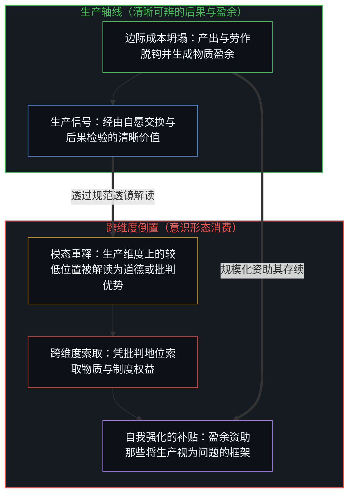
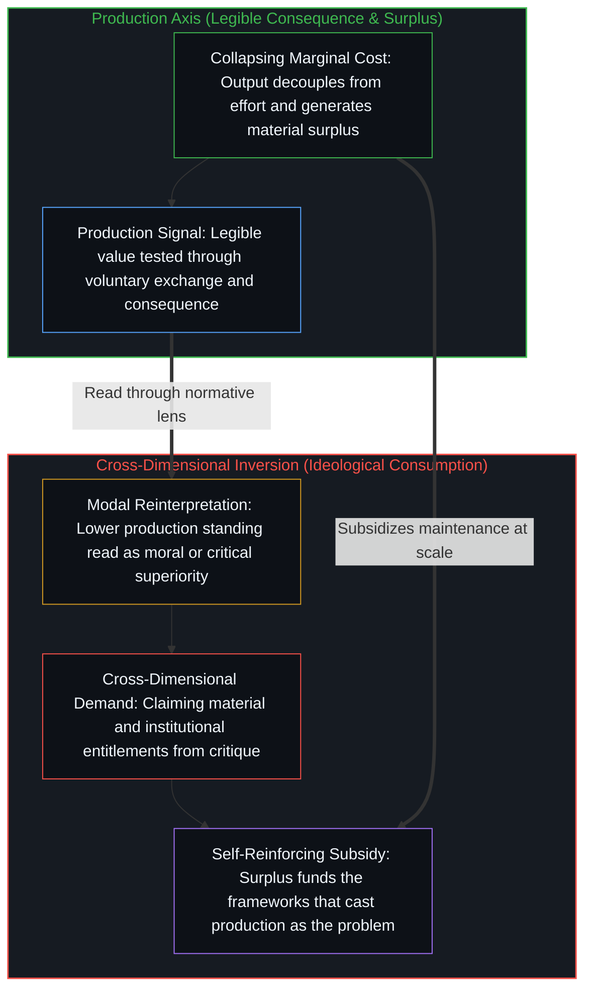

# 生产创造自己的意识形态消费 / Production Creates Its Own Ideological Consumption

*边际成本坍塌之际，物质盈余资助并放大了将生产本身反判为问题的非生产性框架。 / As marginal costs collapse, material surplus funds the frameworks that recast production itself as the problem.*

让-巴蒂斯特·萨伊曾指出，供给创造其自身的需求。在边际成本坍塌的时代，这一法则迎来了它充满反讽的应验——不仅体现在商品上，更体现在那些对商品进行重新解释的观念体系中。

Jean-Baptiste Say observed that supply creates its own demand. In an era of collapsing marginal costs, that law finds its ironic fulfillment—not merely in goods, but in the conceptual systems that reinterpret them.

## 一、 盈余扩散与模态放大 / 1. Surplus Diffusion and Modal Amplification

当生产成本坍塌时——正如 AI 如今正将软件推向零边际成本——产出便与协同的人类劳作脱钩。盈余随之向外扩散：财富、产能与制度注意力中未被认领的资源向外溢流。接下来发生的不是质变，而是放大。

When production costs collapse—as AI now drives software toward zero marginal cost—output decouples from coordinated human effort. The surplus diffuses: unclaimed resources in wealth, capacity, and institutional attention flow outward. What happens next is not transformation, but amplification.

人类活动投射在众多维度上。其中之一是生产：通过自愿交换或可度量的后果，生成经得起直接价值检验的结果。其他维度则包括阐释、规范建构、关系协调与符号推演。每个维度都有其自身的度量标准、优化方向与卓越逻辑。

Human activity projects onto many dimensions. One is production: generating results that pass direct tests of value through voluntary exchange or measurable consequence. Others include interpretation, normative construction, relational coordination, and symbolic elaboration. Each has its own metric, its own optimization, and its own logic of excellence.

跨越这些坐标轴的取向呈现出模态化与自我强化的特征。在稀缺条件下，生产维度上的反馈极为紧绷，因为稀缺资源限制了任何人在不补充物质基础的前提下向其他轴线延展的距离。丰裕松开了这一约束。原本受制衡的取向如今顺着各自原有的向量大幅延展——并非衍生出新的取向，而是将既有的取向直接放大。

Orientations across these axes are modal and self-reinforcing. Under scarcity, feedback along the production dimension is tight, because scarce resources constrain how far anyone can extend along other axes without replenishing the material base. Abundance loosens that constraint. Orientations previously held in check now extend along their native vectors—not as new orientations, but as the same ones amplified.

## 二、 跨维度的倒置 / 2. The Cross-Dimensional Inversion

每个维度都会生成各自的反馈。生产维度的信号相对清晰可辨：产出、交换与可度量的后果。那些主要朝向其他维度的人，会从生产轴线上接收到一种特定的信号——在该度量体系内的产出较低、认可较弱——而这不过是一个人沿着另一条轴线进行优化时的自然结果。

Each dimension generates its own feedback. The production dimension's signal is comparatively legible: output, exchange, and measurable consequence. Those oriented primarily toward other dimensions receive a specific signal from the production axis—lower output and weaker recognition within that metric—which is simply what happens when one optimizes along a different axis.

然而，来自某一个维度的信号，总是透过观察者自身所处维度的逻辑被解读。生产轴线发出的信号经由阐释或规范逻辑的解读后发生了倒置：生产维度上的较低位置，被登记为自身所在轴线上占据优势的证据——无论这种优势被表述为更敏锐的道德感知、更深邃的洞见，还是更精密的批判。在阐释维度自身的度量标准内，这种解读具有内部自洽性，而人类文明也确实因那些在表达与阐释轴线上延展的人而更加丰盈。就其自身而言，这种倒置并非连贯性断裂之处。

Yet signals from one dimension are interpreted through the logic of the dimension an observer inhabits. The production-axis signal is read through interpretive or normative logic and inverts: lower standing in production is registered as evidence of superiority along the home axis, whether as greater moral sensitivity, deeper insight, or refined critique. Within the interpretive dimension's own metric, that reading is internally coherent, and civilization is richer for those who extend along expressive and interpretive axes. The inversion, on its own terms, is not where coherence breaks.

断裂发生在一个具体的位置上：要求将在某一个维度上自称的优势，折算为以另一个维度计价的回报。阐释上的卓越不会在生产轴线上自动登记，正交的维度之间也不存在客观的汇率。然而，这一跨越依然发生了——人们以自身在阐释、规范建构或批判中的地位为凭据，将物质支持、制度权威与分配优先权当作理所应当的权益来索取。一个人无法在逻辑自洽的前提下，一边消解某个维度的纪律约束，一边又以自己在另一个维度上的地位为理由，将前者的产出据为己有。那个本可支撑开放多元主义的信号——即承认正交维度之间无法自动换算——被重新包装成了跨边界索取的凭证。

The fracture occurs at a specific location: the demand to convert claimed superiority in one dimension into rewards denominated in another. Excellence in interpretation does not register on the production axis, and there is no objective exchange rate between orthogonal dimensions. Yet the move is made—demanding material support, institutional authority, and distributional priority as entitlements warranted by standing in interpretation, normative construction, or critique. One cannot coherently de-emphasize a dimension's discipline while claiming its outputs as a right justified by standing in a different dimension. The signal that could support open pluralism—acknowledging that orthogonal dimensions do not automatically convert—is reframed as a warrant for extraction across the boundary.

## 三、 盈余如何资助对自身的批判 / 3. How Surplus Funds Its Own Critique

这一回路之所以自我强化，正是因为盈余为其提供了可能。来自生产核心的盈余越庞大，这种倒置就越具存续空间，用来证成跨维度索取的观念档案库就越繁复，所登记的索取诉求也就越强烈。生产出资支撑了那些把生产重新解释为问题的框架，使其得以规模化扩张。

The loop self-reinforces because the surplus enables it. The larger the surplus from the production core, the more viable the inversion becomes, the more elaborate the conceptual archives justifying the cross-dimensional claim grow, and the stronger the demand registers. Production funds the scaling of the frameworks that reinterpret production as the problem.

萨伊的观察在此听到了它充满反讽的回响。超高速生产不仅创造商品，还创造了对那些证成这一倒置的观念体系的扩张性需求。这些框架并非丰裕时代的凭空发明；它们是非生产性取向的延伸，只因物质盈余为其日常运转买单，才得以在规模上产生显著后果，而[你的代码库即是记忆](../your-codebase-is-memory/)则标定了那套不断累积的意识形态经典本身的位置：它只是由过往辩护词构成的外化记忆库，并非独立的因果施动者。一旦握住[个体抉择是唯一的因果杠杆](../individual-choices-as-the-only-causal-levers/)，这层反讽便随之消解：任何意识形态机器，依然是通过一个个体的具体抉择才得以运转的。

Say's observation finds its ironic echo here. Hyper-production does not only create goods; it creates expanded demand for the conceptual systems that justify the inversion. These frameworks are not inventions of abundance; they are the extension of non-production orientations, rendered consequential at scale because material surplus pays for their maintenance, while [Your Codebase Is Memory](../your-codebase-is-memory/) locates the accumulated ideological canon itself: an externalized memory repository of prior justifications rather than an independent causal agent. The irony dissolves once [Individual Choices as the Only Causal Levers](../individual-choices-as-the-only-causal-levers/) is held: every ideological apparatus is still enacted through individual choices.

当技术令生产成本坍塌时，这些阐释体系便面临压力：清晰可辨的结果检验，随时可能暴露其自称的优势无法跨维度兑现。取向的自我保存机制随即引发阻抗，于是，恰恰在生产的清晰度大幅提升之际，那些将生产置于可疑地位的框架反而愈发激化。

When technology collapses cost in production, these interpretive systems face pressure: legible outcome-testing threatens to expose the claimed superiority as non-convertible. Resistance follows as self-preservation of the orientation, so the frameworks casting production as suspect intensify right when production's legibility increases.

由此，创造丰裕的人补贴了那些把他们重新解释为问题根源的框架，资助其不断扩张——这并非出于阴谋，而是源于盈余扩散与模态的自我强化。[公共支出不创造资本](../public-spending-does-not-create-capital/)是披着预算外衣的同一反讽：攫取被记作投资，仿佛它能修复被攫取本身所削薄的根基。[人口崩溃神话的拆解](../the-myth-of-population-collapse-explained/)是披着生育外衣的同一反讽：资助转移支付的盈余，同时也资助了那种不断削薄主体能动性的强化机制，而唯有这种能动性，才会选择将下一代带入一个值得亲手书写的世界。[悲观是乐观的阴影](../pessimism-is-the-shadow-of-optimism/)则是披着情绪外衣的同一反讽：充满希望的留存余量，出资供养了那些将希望重新定性为问题的框架，而更大规模的乐观反而为更大规模的悲观颁发了许可。

Those generating abundance thereby subsidize the expansion of the frameworks reinterpreting them as the source of the problem—not through conspiracy, but through surplus diffusion and modal self-reinforcement. [Public Spending Does Not Create Capital](../public-spending-does-not-create-capital/) is that irony under budget costume: extraction scored as investment that will restore what extraction thinned. [The Myth of Population Collapse Explained](../the-myth-of-population-collapse-explained/) is that irony under fertility costume: the surplus that funds transfers also funds the reinforcement that thins the agency required to bring the next generation into a world worth authoring. [Pessimism Is the Shadow of Optimism](../pessimism-is-the-shadow-of-optimism/) is that irony under mood costume: hopeful residue funds the frameworks that reframe hope as the problem while more optimism licenses more pessimism at larger scale.

这一回路没有外部出口，因为对某种系统性出口的信念本身就是回路的燃料。每一个被提出的宏观解决方案——无论是“维度诚实”、“自洽诉求”还是“更佳反馈”——当它作为外部处方被开出时，都只是盈余所生成的又一件观念产品、沿着非生产轴线的又一次延伸，以及对跨维度折算的又一轮索取。纠偏的处方与它所要纠正的对象运转在同一台引擎之上，而[生产、消费与心智的区分](../production-consumption-and-the-minds-distinction/)给出了其中的枢纽：只要边界被固守不动，生产就会转化为消费。

The loop has no external exit because the belief in a systemic exit is itself the loop's fuel. Every proposed macro-solution—"dimensional honesty," "coherent claims," "better feedback"—when offered as an external prescription is another conceptual product generated by the surplus, another extension along a non-production axis, and another demand for cross-dimensional conversion. The corrective prescription and the thing it corrects run on the same engine, and [Production, Consumption, and the Mind's Distinction](../production-consumption-and-the-minds-distinction/) supplies the hinge: production turns into consumption whenever the boundary is held fixed.

这既非悲剧，亦非喜剧，而只是盈余传播的方式。丰裕放大了原本就存在的事物，而原本就存在的事物中，便包含着叙述这种放大、诊断这种放大并为他人开具处方的冲动。处方又回馈至盈余之中，随着一个个具体的心智选择将注意力投向何处、选择承担何种后果，这一回路便相应地收紧或松动。

This is neither tragedy nor comedy; it is how surplus propagates. Abundance amplifies what is already there, and what is already there includes the impulse to narrate the amplification, diagnose it, and prescribe for others. The prescription feeds back into the surplus, tightening or loosening as individual Minds choose where to direct their attention and what consequences to own.
