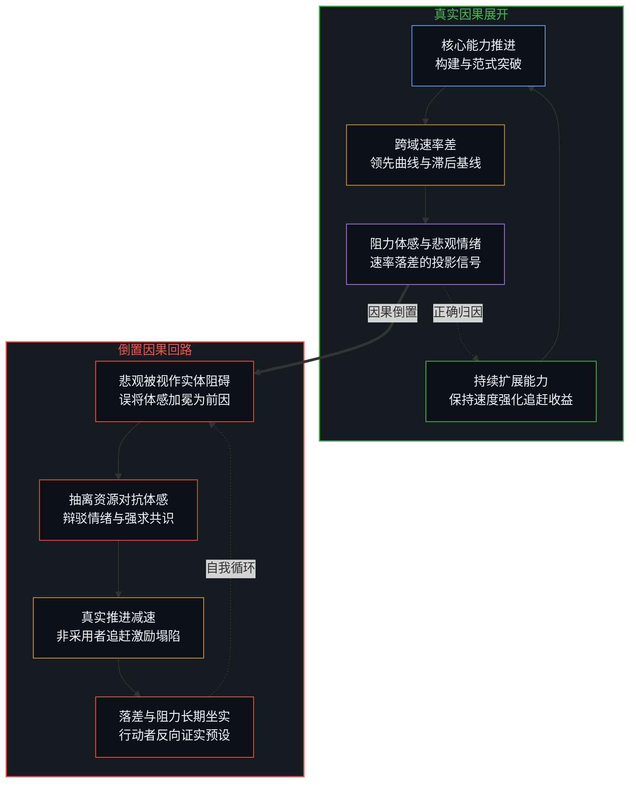
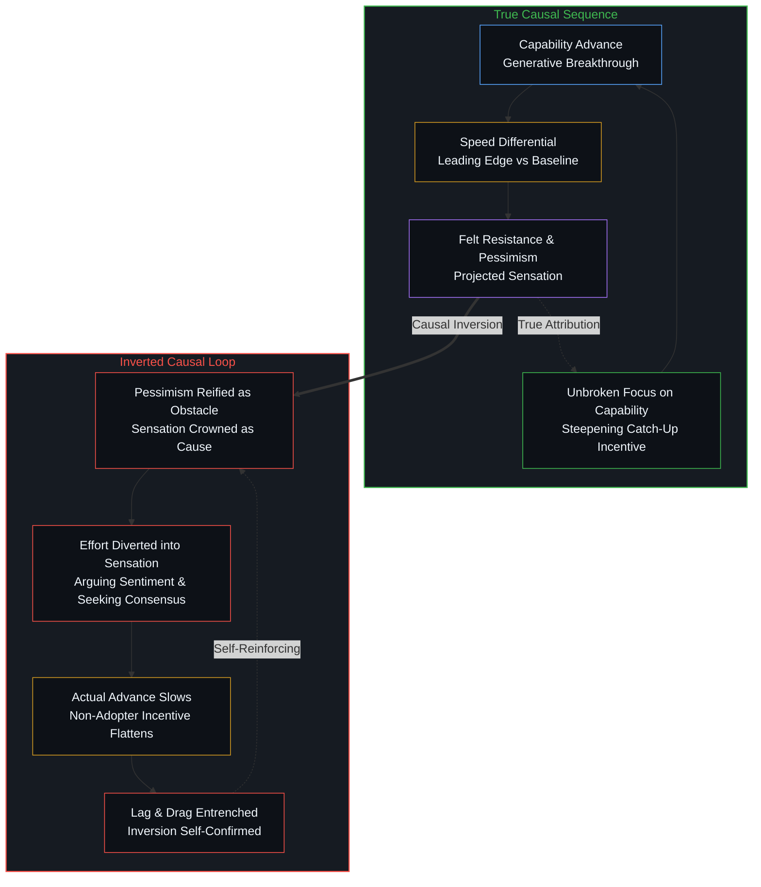
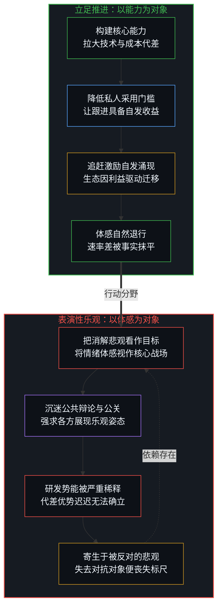
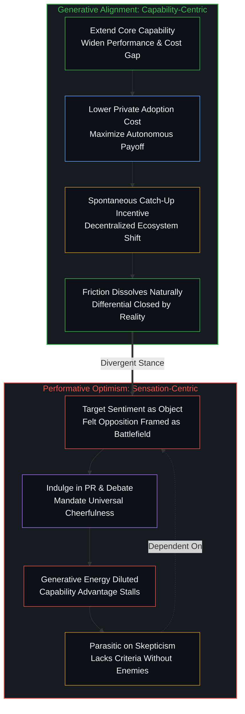

# 阻力体感与速率差 / Felt Resistance and the Speed Differential

*阻力仅是速率差的体感投影，对抗体感只会因抽离构建资源而坐实迟滞。 / Resistance is the sensation of a speed differential, and contesting it merely confirms lag by diverting generative effort.*

所感知到的阻力，并非独立施加于演进之上的自主力量，而是非对称领域间速率差所激起的成比例体感。当某一维度的能力推进快于周遭的适应节奏，已实现的速率缺口便在经验界面中显影为摩擦或悲观情绪。把这种体感误认作延宕的外在因由，进而将资源从扩展能力转移至安抚情绪，不仅无法收窄这一落差，反而会抹平非采用者跟进的私人激励，将原本旨在消除的迟滞牢牢坐实。

Felt resistance is not an autonomous force acting upon progress, but the proportional sensation of a differential in rates across asymmetric domains. Where one line of capability advances faster than the surrounding pace of adaptation, the realized speed gap registers within experiential interfaces as friction or pessimism. Mistaking this sensation for the external cause of delay, and subsequently diverting resources from extending capability into pacifying sentiment, fails to narrow the differential; instead, it flattens the private incentive for non-adopters to catch up, entrenching the very lag it aims to extinguish.

## 一、 阻力并非外力，而是速率差的体感 / 1. Resistance as Sensation of a Speed Differential

在围绕技术变革的文化争论中，阻力常被描绘为一堵横亘在未来之路上的坚硬高墙。常规视角将摩擦视作一种独立的负向能量；从早期汽车直面马车利益群体，到算法系统取代陈旧科层体制，这类历史插曲一贯被框定为同顽固反抗意志的交锋。然而将因果回溯至源头便能看清，阻力在速率差本身之外并不具备独立的实在性。一条能力曲线的急剧陡升，必然与滞后的制度基线发生剪切。阻力不是从虚空中迎面吹来的逆风，而是加速载具与静止空气之间产生的气动阻力。速率差越大，所登记的阻力体感与相伴的悲观情绪便越发尖锐。

In cultural debates surrounding technological change, resistance is routinely depicted as an unyielding wall standing in the path of the future. The conventional stance treats friction as an autonomous negative energy; historical episodes—from early automobiles confronting carriage interests to algorithmic systems displacing legacy bureaucracies—are habitually framed as confrontations with an entrenched counter-will. Yet tracing causality back to its origin reveals that resistance possesses no independent reality outside the differential itself. The rapid steepening of one capability curve inevitably shears against lagging institutional baselines. Resistance is not a headwind blowing in from the void, but the aerodynamic drag generated between an accelerating vehicle and stationary air. The larger the speed differential, the sharper the felt resistance and accompanying pessimism register.

至关重要的认识论区分在于，速率差所激发的体感本身，并不从推进前沿扣减动量。阻力体感的强度与已实现的推进速率，是两条在因果上可以分离的运动轨迹。只要生成性的投入始终锚定在扩展能力、测试边界摩擦与降低采用的运行成本上，即便周遭充斥着激烈的文化质疑，演进依然能够不减分毫甚至持续加速。反之，当推进前沿的注意力被牵引去应对周遭的疑虑时，阻力体感固然可能因为速率差坍缩而减弱，系统却也随之搁浅于停滞之中。尖锐的阻力体感可以与不息的生成复利并行不悖，正如平静的自满也可以掩盖寸步不前的惰性。正如[悲观是乐观的阴影](../pessimism-is-the-shadow-of-optimism/)所阐明的，阴影无论看起来多么浓重，终究只是投射之光的光学投影，既不具备对等的生成权能，也无力熄灭自身的光源。

The vital epistemological distinction is that the sensation excited by a speed differential does not inherently subtract momentum from the advancing edge. The intensity of felt resistance and the realized rate of advance remain causally separable trajectories. So long as generative energy remains anchored to expanding capability, testing boundary friction, and lowering the operational cost of adoption, progress proceeds undiminished or even accelerates amid fierce cultural skepticism. Conversely, when attention at the advancing edge is drawn into managing ambient doubt, the sensation of resistance may diminish simply because the differential has collapsed, leaving the system stranded in stagnation. Acute felt resistance can effortlessly coexist with relentless generative compounding, just as serene complacency can mask complete inertia. As articulated in [Pessimism Is the Shadow of Optimism](../pessimism-is-the-shadow-of-optimism/), no matter how thick the shadow appears, it remains an optical projection of the cast light, lacking both co-equal generative authority and the capacity to extinguish its source.

## 二、 因果倒置：把体感当成阻碍的自我证实 / 2. The Causal Inversion: Sensation Cast as Obstacle

惯常叙事几乎无一例外地倒置了这一因果链条。它将悲观与摩擦实体化为自主的阻碍，断言正是因为阻力强悍、怀疑者声浪高昂，演进才会步履维艰。这一倒置催生出一个极具诱惑力的谬误：安抚迟疑者、扭转公共情绪并消解阻力体感，是技术继续推进的先决条件。一旦体感被加冕为首要原因，抗辩反对意见与协商共识便显得像是强制性的前置条件。由不均衡演进衍生出的信号，就此被抬升为一道外生壁垒。正如[减速是加速时感受到的阻力](../deceleration-is-the-drag-felt-when-accelerating/)所剖析的，把加速激起的惯性反推解读为刹车的指令，恰恰展示了人类认知常将反馈遥测与方向掌舵混为一谈。

Conventional narratives almost universally invert this causal chain. They reify pessimism and friction into autonomous impediments, asserting that progress falters precisely because resistance is formidable and skeptics are vocal. This inversion yields a seductive fallacy: that appeasing the reluctant, shifting public sentiment, and dissolving felt resistance form prerequisites for further technical advance. Once sensation is crowned as the primary cause, contesting opposition and negotiating consensus appear as mandatory preconditions. A derivative signal generated by uneven development is thereby elevated into an exogenous barrier. As analyzed in [Deceleration Is the Drag Felt When Accelerating](../deceleration-is-the-drag-felt-when-accelerating/), interpreting the inertial pushback of acceleration as a directive to brake exemplifies how human cognition frequently confuses feedback telemetry with destination steering.

顺应这种倒置行事，恰恰在亲手制造它所哀叹的阻碍。当稀缺的人才、算力与资本从扩展能力前沿被抽走，转向去论战、安抚或说服怀疑者时，演进的生成速率便随之放缓。由于性能代差未能迅速拉大，抱守陈旧范式的机会成本依然低廉，非采用者便失去了更新换代的紧迫经济压力。试图直接压制阻力体感的举动，削平了追赶的私人回报，拉长了过渡期的落差；原本旨在根除的摩擦，恰恰被那些用来扑灭它的投入持续维系。好斗地对抗阻力的姿态，与它所痛斥的停滞落差，不过是同一次精力分流的一体两面。

Acting upon this inversion actively manufactures the very impediment it laments. When scarce talent, compute, and capital are siphoned away from advancing capability frontiers to debate, soothe, or persuade skeptics, the generative rate of progress decelerates. Because the performance gap fails to widen rapidly, the opportunity cost of clinging to obsolete paradigms remains low, depriving non-adopters of the acute economic pressure to modernize. The attempt to directly suppress felt resistance flattens the private payoff of catching up, prolonging the transitional gap; the friction that was supposed to be eradicated is sustained by the very efforts deployed to extinguish it. The militant stance that fights resistance and the stagnant lag it decries are two faces of the exact same diversion.

## 三、 推进拓展与表演性乐观的界河 / 3. Alignment with Progress Versus Performative Optimism

这一动态机制在结构性的立足推进与表演性乐观之间划出了清晰边界。立足推进在于持续拉升领先速率：放大核心能力、降低采用的私人摩擦、扩展实际效用，而不把周遭的阻力当作一项亟待情绪矫正的输入。由于认清摩擦不过是速率差的衍生读数，这类构建者既不要求旁观者换上欢欣姿态，也不把盛行的怀疑情绪解读为结构性瓶颈。制度与社会的追赶，从来不是修辞说服的果实，而是能力鸿沟压倒性地拉开之后必然触发的自利重组。正如[进步叙事中的症候与原因](../symptom-and-cause-in-the-narratives-of-progress/)、[个体抉择是唯一的因果杠杆](../individual-choices-as-the-only-causal-levers/)与[你的代码库即是记忆](../your-codebase-is-memory/)所探明的，在掌舵边缘将活态切口直接铭刻并整固进可执行痕迹的外化网格、而非同周遭情绪争辩之处，唯有经由具体抉择复利累积出的实际能力，才能改写去中心化行动者核算自身投入的地形。

This dynamic delineates a crisp boundary between structural alignment with progress and performative optimism. Alignment with progress consists in expanding the leading rate: amplifying capability, lowering the private friction of adoption, and scaling practical utility, without treating ambient resistance as an input that requires emotional rectification. Recognizing that friction is merely a derivative readout of a speed differential, such builders neither demand that observers adopt cheerfulness nor interpret prevailing skepticism as a structural bottleneck. Institutional and social catch-up is never the fruit of rhetorical persuasion; it is the inevitable reorganization of self-interest triggered when capability gaps become overwhelming. As explored in [Symptom and Cause in the Narratives of Progress](../symptom-and-cause-in-the-narratives-of-progress/), [Individual Choices as the Only Causal Levers](../individual-choices-as-the-only-causal-levers/), and [Your Codebase Is Memory](../your-codebase-is-memory/), where the steering edge inscribes and consolidates its live cuts directly into an externalized lattice of executable traces rather than debating ambient sentiment, only the realized capability compounded through concrete choices shifts the terrain on which decentralized agents calculate their commitments.

与此形成鲜明对照，表演性乐观将阻力体感奉为自身的操作标的。它以批评者的噤声与怀疑者的表面归顺来衡量成功，将海量带宽耗散在针对周遭迟疑的意识形态缠斗之中。这种姿态径直踏入了因果倒置的流沙：由于核心构建放缓，速率差无法借由压倒性的功能优势完成闭合，所感知的摩擦便被无休止地悬置在半空。颇具反讽意味的是，表演性乐观在结构上始终寄生于它自称鄙弃的悲观情绪；一旦剥去它借以界定自身的怀疑声浪，它便既无自主的罗盘，也无独立的度量标尺。

Performative optimism, in stark contrast, takes the sensation of resistance as its operational target. It measures success by the silencing of critics and the outward conversion of skeptics, dissipating immense bandwidth in ideological combat against ambient hesitation. This stance walks directly into the quicksand of causal inversion: because core building slows, the differential fails to close through overwhelming functional superiority, leaving the felt friction suspended indefinitely. Poignantly, performative optimism remains structurally parasitic upon the very pessimism it purports to despise; stripped of the skepticism it defines itself against, it possesses no autonomous compass or independent measure.

## 四、 混合表象与单一因果序列的解离 / 4. Mixed Appearances and the Single Causal Sequence

在盘根错节的人类事务中，这两条轨迹很少以实验室般彼此隔离的形态呈现。一项实质性的能力提升，常被包裹在回击怀疑者的论战修辞中发布；而一次公开辩护，偶尔也会顺带扫除某处细微的行政阻碍。这种交织制造出经验观察上的悖论：痛击悲观情绪有时看似先于快速部署，有时却深陷于尖刻对立的停滞之中。观察者之所以陷入困惑，是因为未能把改变物理推进速率的做功部分，同仅仅抚弄迟滞解释的部分拆解开来。正如[调速者的幻觉与行动的活态摩擦](../the-fallacy-of-pacing-and-the-felt-friction-of-ground-truth/)与[独见者的自反困境与必然性的后验投射](../the-reflexive-dilemma-of-unique-insight/)所论证的，在低阻沙盒中借由卸除运行负荷所取得的指标加速，从未改变履带碾过乱石地形时的抓地牵引；将由此产生的速率差归咎于背负系统重荷者所谓的“惰性”，是一场深层的因果倒置。

In tangled human affairs, these two trajectories rarely present themselves in laboratory isolation. A substantive enhancement in capability is often broadcast under the cover of polemical rebuttals against skeptics, while a public defense may occasionally eliminate a minor bureaucratic hurdle as a byproduct. This interweaving produces empirical paradoxes: attacking pessimism sometimes appears to precede rapid deployment, while at other times it bogs down in acrimonious stagnation. Observers stumble into confusion because they fail to disentangle the component that altered the physical rate of advance from the component that merely massaged the interpretation of lag. As demonstrated in [The Fallacy of Pacing and the Felt Friction of Ground Truth](../the-fallacy-of-pacing-and-the-felt-friction-of-ground-truth/) and [The Reflexive Dilemma of Unique Insight and the Retrospective Projection of Necessity](../the-reflexive-dilemma-of-unique-insight/), metric acceleration achieved inside low-drag sandboxes by shedding operational burdens never alters the traction of treads moving across rocky terrain; blaming the resulting speed differential on the alleged inertia of actors carrying systemic weight represents a profound causal inversion.

一旦用这把剖析手术刀将改变推进速率的行动，同仅仅拨弄迟滞登记的举动切分清楚，经验迷雾便消解为一条毫不含糊的因果链：速率差决定了阻力体感的烈度，唯有改变速率差的投入，才能消解那份阻力。把阻力当作独立前因，从来无法直接弥合速率差，反而会因空耗稀缺的生成资源而拖慢能力推进、坐实迟滞。对于正在延展自身前沿的主权心智而言，操作上的切分清晰明了：抛弃表演性乐观那诱人的剧场，停止向周遭的摩擦体感纳贡，将每一分第一人称的决断力重新投入切实的创造之中。当这种摩擦体感进一步被外部观察者实体化为所谓耐受“高级苦”的精英禀赋时，[观察的因果僭越与第一人称的收益差](../the-causal-overstep-of-observation-and-the-first-person-surplus/)无需声称能够窥见他人的内在体验，便追溯了这一推论为何失效：跨越复利周期的持续推进并非建立在无补偿的自我折磨之上，因为对于迈出步伐的当事者而言，唯有在即时或预期的收益差超过其代价之处，每一步才会继续向前。拿封闭集合中的最好或最坏去衡量阻力，正是[闭合的N与开放的现实](../the-closed-n-and-the-open-reality/)所指出的陷阱。

Once this analytical scalpel cleanly distinguishes between actions that shift the rate of advance and those that merely fiddle with the registration of lag, empirical confusion dissolves into an unambiguous causal chain: the speed differential determines the intensity of felt resistance, and only effort that alters the differential can dissolve that resistance. Treating resistance as an autonomous cause never closes the differential directly, and by burning scarce generative resources, slows capability advance and entrenches the lag. For the sovereign Mind extending its own leading edge, the operational cut is clear: discard the seductive theater of performative optimism, cease paying tribute to ambient sensations of friction, and reinvest every ounce of first-person resolve into tangible creation. When such felt friction is further reified by external observers into an alleged elite endowment for enduring advanced pain, [The Causal Overstep of Observation and the First-Person Surplus](../the-causal-overstep-of-observation-and-the-first-person-surplus/) traces why that inference fails without claiming access to another's interior: sustained continuation across compounding cycles does not rest on uncompensated self-mortification, because each step continues only where an immediate or anticipated surplus outweighs its cost for the one taking it. Measuring resistance against the best or worst of a closed set is the trap [The Closed N and the Open Reality](../the-closed-n-and-the-open-reality/) names.
