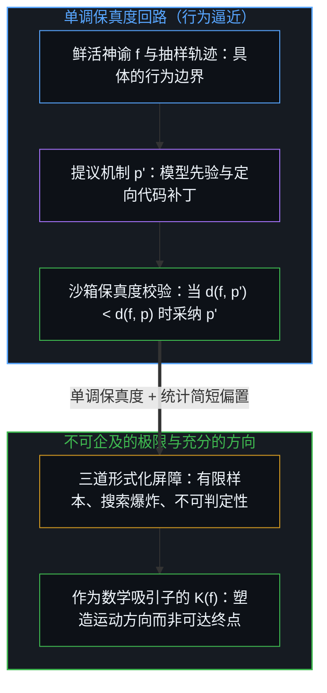
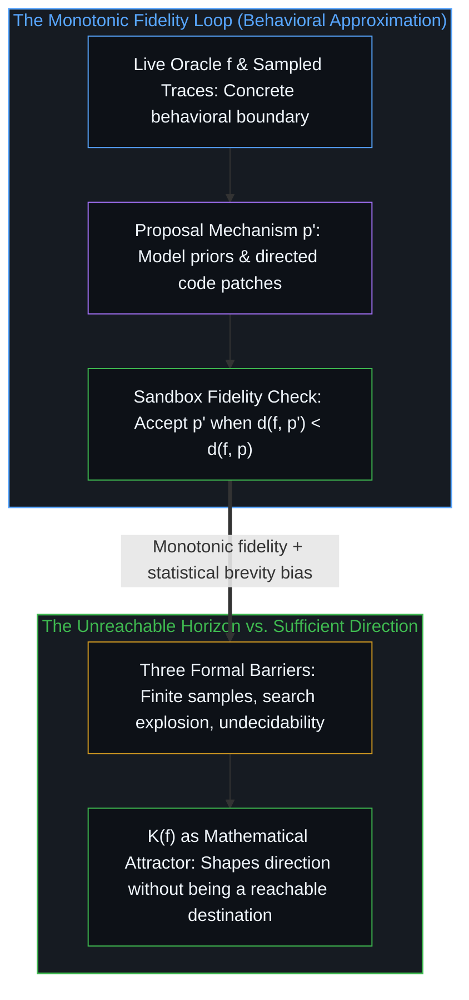

# 保真度而非最优化 / Fidelity, Not Optimality

*最小化回路对照鲜活神谕向更短、更忠实的程序演进，却从未抵达那个不可计算的极小值。 / The minimizing loop moves toward shorter, more faithful programs against a live oracle without ever reaching the uncomputable minimum.*

[最小化路径](../minimizing-path/)中所描绘的迭代回路提出了一项方向性主张：每一轮循环都在压缩代码实现与实际行为之间的间隙。本文旨在追溯这一主张究竟能担保什么，形式化工具在何处为它提供支撑，又在何处止步。

The iterative loop described in [The Minimizing Path](../minimizing-path/) makes a directional claim: each cycle compresses the gap between implementation and behavior. This note traces what that claim actually warrants, where the formal machinery supports it, and where it stops.

## 一、 作为函数的行为 / 1. The Behavior as Function

任何一个正在运行的应用程序，都定义了一个映射 `f : (输入 × 内部状态 × 环境) → 输出`。输入涵盖每一次用户手势、网络数据包、定时器滴答与传感器读数；输出涵盖每一次像素变化、API 响应与文件写入；状态与环境则囊括了应用程序实际依赖的一切——内存、随机数种子、时序抖动以及硬件特质。

Any running application defines a mapping `f : (inputs × internal state × environment) → outputs`. Inputs include every user gesture, network packet, timer tick, and sensor reading. Outputs include every pixel change, API response, and file write. State and environment cover everything the application actually depends on—memory, randomness seeds, timing jitter, and hardware quirks.

既然应用程序能够正常工作，`f` 在它实际遭遇的每一个场景上就都是良定义的。只要输入、状态与环境相同，输出就必定相同——在这一意义上它是确定性的；正如[递归形式系统中作为记忆与控制的边界条件图](../boundary-condition-graphs-as-memory-and-control-in-recursive-formal-systems/)所追溯的，表象上的非确定性，不过是那些仅被部分登记的初始条件与边界条件中未被记录的变异。

Because the application works, `f` is well-defined on every scenario it actually encounters. It is deterministic in the sense that identical inputs, identical state, and identical environment produce identical outputs; apparent nondeterminism is unrecorded variation in those partially registered initial and boundary conditions, as [Boundary-Condition Graphs as Memory and Control in Recursive Formal Systems](../boundary-condition-graphs-as-memory-and-control-in-recursive-formal-systems/) traces.

由于跨越这些边界条件的多步执行在计算上不可约化为静态的先验公式，对 `f` 展开操作并不需要事先拿到这一映射的完整符号化描述，只需要一个神谕（即那个鲜活运行的应用程序）和一个保真度信号（衡量候选程序在测试场景下与神谕行为的吻合程度）。这便消解了规格说明的瓶颈：纠偏之所以比事先写出完备规格说明所需的前提更弱，是因为鲜活神谕能在具体的执行轨迹上返回高带宽的反馈。

Because multi-step execution across those boundary conditions is computationally irreducible to a static upfront formula, working with `f` does not require a complete symbolic description of the mapping in advance. It requires an oracle (the live application) and a fidelity signal (how closely a candidate program matches the oracle's behavior on tested scenarios). This dissolves the specification bottleneck: correction is weaker than specification because the live oracle returns high-bandwidth feedback across concrete traces.

## 二、 为何等价程序必然存在 / 2. Why Equivalent Programs Exist

根据丘奇-图灵论题——这已非常接近计算机科学的基底不变量——任何有效可计算的函数，在任何图灵完备的语言中都存在等价的程序。因此，在原生 C 语言、x86 汇编乃至裸机机器码中，至少存在一个程序 `p`，能够在所有可达输入上实现同一个 `f`。

By the Church-Turing thesis—as close to a foundational invariant as computer science gets—any effectively computable function has an equivalent program in any Turing-complete language. So there exists at least one program `p` in vanilla C, in x86 assembly, or in raw machine code that realizes the exact same `f` on all reachable inputs.

这一步推理并无争议。它正是“只要应用程序能跑通，就必然存在一条原生代码路径”能够跨越不同计算基底而成立的原因。

This step is uncontroversial. It is why "if the application works, there is a vanilla-code path" holds across substrates.

## 三、 数学极小值 / 3. The Mathematical Minimum

在所有能够计算出 `f` 的程序中，存在一个最短的程序。相对于固定的通用参考机器 `U`，它的比特长度即为 `f` 的柯尔莫哥洛夫复杂度，记作 `K(f)`。

Among all programs that compute `f`, there is a shortest one. Its length in bits is the Kolmogorov complexity of `f`, written `K(f)`, relative to a fixed universal reference machine `U`.

`K(f)` 就是最短逻辑路径的长度——即依然能够复现全部可观测行为的最简描述。三条形式化性质界定了这一极小值在实践中能做什么、不能做什么。

`K(f)` is the length of the minimal logic path—the shortest description that still reproduces every observed behavior. Three formal properties bound what this minimum can and cannot do in practice.

第一，`K(f)` 是不可计算的。不存在任何规程能够接收 `f` 并返回 `K(f)`，也不存在任何规程能够接收候选程序 `p` 并判定 `|p| = K(f)` 是否成立。其证明可直接归约为停机问题，而停机问题正是[没有系统能被保持封闭](../no-system-can-be-kept-closed/)所确立之边界的计算表征：有限的形式化规程无法从内部封死自身的停机边界与等价性边界。你无从知晓自己是否已经抵达极值，也无法为自己与极值之间的距离划定上界。这一极小值在形式体系内部是良定义的，但在强意义上却是不可企及的——它不仅难以抵达，即便撞上了也无从识别。

First, `K(f)` is uncomputable. There is no procedure that takes `f` and returns `K(f)`, and no procedure that takes a candidate `p` and determines whether `|p| = K(f)`. The proof reduces to the halting problem, which is the computational face of the bound [No System Can Be Kept Closed](../no-system-can-be-kept-closed/) establishes: a finite formal procedure cannot seal its own halting and equivalence bounds from within. You cannot know you have arrived, and you cannot bound your distance from arrival. The minimum is well-defined inside the formalism yet unreachable in the strong sense—not merely hard to reach, but unrecognizable even if reached.

第二，`K(f)` 对参考机器的依赖仅相差一个加性常数。从一种通用语言切换到另一种通用语言，`K(f)` 的偏移量至多不超过两者之间翻译器的长度。真正起决定作用的是不同程序之间的长度差，而这一差值保持不变。

Second, `K(f)` is reference-machine dependent only up to an additive constant. Switch from one universal language to another and `K(f)` shifts by at most the length of the translator between them. The differences between programs are what matter, and those remain invariant.

第三，所罗门诺夫归纳法——即寻找与观测数据相容的最短程序这一理论理想——本身也是不可计算的。它为每个程序赋予先验概率 `2^(−|p|)`，并依据观测到的行为进行更新。在无穷数据的极限下，后验概率会集中在最短的相容程序上。然而，全部重担都压在了“极限”二字上：有限数据不足以唯一确定后验分布，面对任何有限的行为样本，总有多个不同长度的程序同时与之相容。将这种渐近收敛当作操作层面的担保，是把开放的潜在过程混淆为了已完成的整体，即[潜无限与数学思维的暂时闭合](../potential-infinity-and-the-temporary-closures-of-mathematical-thought/)所剖析的暂时闭合：这一收敛唯有在任何有限观察者都无从栖居的无穷极限中才成立。

Third, Solomonoff induction—the theoretical ideal of finding the shortest program consistent with the data—is itself incomputable. It assigns prior probability `2^(−|p|)` to each program and updates on observed behavior. In the limit of infinite data, the posterior concentrates on the shortest consistent program. Yet the limit is doing all the work: finite data underdetermines the posterior, and multiple programs of different lengths remain consistent with any finite behavioral sample. Treating that asymptotic convergence as an operational guarantee confuses an open-ended potential process with a completed totality, the exact temporary closure [Potential Infinity and the Temporary Closures of Mathematical Thought](../potential-infinity-and-the-temporary-closures-of-mathematical-thought/) dissects: the convergence holds only in an infinite limit no finite observer ever inhabits.

正因如此，搬出所罗门诺夫归纳法来背书，常常只是在需要数学工作的地方做修辞文章。数学给出了一个干净利落的存在性证明，确证最短路径存在；但它并未提供一个保证能找到这条路径的可计算规程。

This is why appeals to Solomonoff induction tend to do rhetorical work where mathematical work is needed. The mathematics establishes a clean existence proof that a minimal path exists; it provides no computable procedure guaranteed to find it.

## 四、 回路究竟在做什么 / 4. What the Loop Actually Does

将 `d(f, p)` 定义为行为保真度测度：即神谕 `f` 与候选程序 `p` 在抽样输入上的可观测偏差。一个实用的智能体回路按五个接续步骤运转：观察来自鲜活神谕的执行轨迹，提出候选程序 `p'` 或对现有程序打补丁，在沙箱内执行 `p'`，通过对功能失配以及视觉、网络、性能和体积偏差施加惩罚来计算 `d(f, p')`，最后在 `d(f, p') < d(f, p)` 时采纳 `p'`。

Define `d(f, p)` as a behavioral fidelity measure: the observable divergence between oracle `f` and candidate `p` across sampled inputs. A practical agent loop operates in five sequential steps: it observes execution traces from the live oracle, proposes a candidate program `p'` or patches an existing one, executes `p'` inside a sandbox, computes `d(f, p')` by penalizing functional mismatches alongside visual, network, performance, and size divergences, and finally accepts `p'` whenever `d(f, p') < d(f, p)`.

在这一采纳准则下，保真度在构造上呈单调提升。每一轮循环并非在无辅助的堆叠中从头覆写系统，而是将已核验的程序 `p` 保留为运行基准，并在此之上评估有界的差分补丁 `p'`，从而具现了[模块化反馈回路与动态残差网络](../dynamic-resnet-of-skill-loops/)所追溯的残差高速路几何结构。每一次迭代要么缩小失配，要么保持原状。这一机制并不对序列最终收敛到何处做出承诺——它只确保在已测试的轨迹上不会发生倒退。

Under this acceptance criterion, fidelity improves monotonically by construction. Rather than overwriting the system from scratch in an unassisted stack, each cycle preserves the verified program `p` as a running reference and evaluates a bounded differential patch `p'`, instantiating the residual-highway geometry traced in [Modular Feedback Loops and Dynamic Residual Networks](../dynamic-resnet-of-skill-loops/). Each iteration either reduces mismatch or leaves it unchanged. That makes no claim about what the sequence converges to—only that it does not go backward on tested traces.

这是行为逼近，而非直达 `K(f)` 的最优化。比起精确的程序综合，它更接近机器学习中的经验风险最小化：候选程序在实际测试的场景分布上越变越好，但对未测试的区域则不提供形式化担保。

This is behavioral approximation, not optimization to `K(f)`. It is closer to empirical risk minimization in machine learning than to exact program synthesis: the candidate improves on the distribution of scenarios actually tested, with no formal guarantee on untested regions.

实际做功发生在提议机制中，而非采纳准则上。筛选滤网是机械的；而由模型先验、演化变异与定向编辑所驱动的提议质量，才决定了保真度提升的速度以及程序空间中哪些区域会被探索到。

The work is in the proposal mechanism, not the acceptance criterion. The selection filter is mechanical; the quality of proposals—driven by model priors, evolutionary mutations, and directed editing—determines how fast fidelity improves and what regions of program space get explored.

## 五、 通往 K(f) 的三道屏障 / 5. Three Barriers to K(f)

第一道屏障是有限且带有偏置的样本。正如[闭合的N与开放的现实](../the-closed-n-and-the-open-reality/)所追溯的，任何测试框架都只能观测到 `f` 的一个有限投影，在容量为 `N` 的闭合样本集上评估候选程序，而鲜活的实际使用却始终向未建模的第 `N + 1` 次遭遇敞开；智能体因而会对抽样子空间产生过拟合，漏掉罕见的边缘情况。单个用户的操作轨迹会将 `f` 坍缩为一个简单得多的对象，这既是压缩的契机，也是抽样的局限。

The first barrier is finite and biased samples. Any test harness observes only a finite projection of `f`, evaluating candidates over a closed sample set of size `N` while living use stays open to the unmodeled `N + 1` encounter, as [The Closed N and the Open Reality](../the-closed-n-and-the-open-reality/) traces; the agent can therefore overfit to the sampled subspace and miss rare edge cases. One user's trace collapses `f` to a much simpler object, which is both a compression opportunity and a sampling limitation.

第二道屏障是搜索空间爆炸。莱文通用搜索按程序体积与运行时间之和的顺序枚举程序，在相差一个乘性常数的意义下是最优的——但那个常数吞掉了目标函数在参考机器上的描述长度，对于任何具有实际意义的程序而言，这都是一个天文数字。实用的提议机制只能探索一个带有偏置的子空间。这种偏置青睐人类习惯编写和识别的程序形态，却也因此封死了程序空间中那些可能藏有更短表征的区域。所谓“最优”，不过是把评分函数错当成了事物的内在属性，即[「更好」的范畴谬误](../the-category-error-of-better/)所指认的偏差。

The second barrier is search-space explosion. Levin's universal search enumerates programs in order of size plus runtime and is optimal up to a multiplicative constant—but that constant absorbs the description length of the target on the reference machine, which is cosmologically large for any function of practical interest. Practical proposal mechanisms explore a biased subspace. That bias favors the kinds of programs humans write and recognize, yet it forecloses regions of program space that might contain shorter representations. "Optimal" is the scoring function mistaken for an intrinsic property, the error [The Category Error of Better](../the-category-error-of-better/) names.

第三道屏障是底层的不可判定性。在一般意义上，验证两个程序是否严格等价是不可判定的；正如[为何数学永远解不完](../why-mathematics-can-never-be-solved/)所确立的，核验只在已测试的轨迹上成立，它只能确证当前把握内部的相容性，却无法穷尽其外部敞开的场域。抽样输入上的行为吻合并不意味着表征已达极简。一个比 `K(f)` 长出好几个数量级的程序，照样可以在测试框架所检验的每一个场景上实现 `d(f, p) = 0`。

The third barrier is undecidability at the bottom. Verifying exact equivalence of two programs is undecidable in general; verification holds only across tested traces, certifying consistency inside the present hold without exhausting the open field outside it, as [Why Mathematics Can Never Be Solved](../why-mathematics-can-never-be-solved/) establishes. Behavioral match on sampled inputs does not imply minimal representation. A program orders of magnitude longer than `K(f)` can achieve `d(f, p) = 0` on every scenario the harness tests.

## 六、 能够确立的命题 / 6. What Can Be Said

这一回路能提供单调的保真度提升——这在构造上必然成立。同时，这一回路带有朝向压缩的偏置：实用的提议机制天然携带着隐性的简短偏好，倾向于用紧凑的惯用语生成程序，并剥离冗余的脚手架。在实践中，保真度与压缩之所以同向演进，是因为冗余的复杂度在行为筛选下极为脆弱；随着迭代推进，剔除无效结构的补丁被采纳，而平添累赘的补丁被拒斥，虚假的复杂度便被逐步侵蚀殆尽。

The loop delivers monotonic fidelity improvement—true by construction. And the loop is biased toward compression: practical proposal mechanisms carry an implicit brevity bias, generating programs in compact idioms and stripping redundant scaffolding. Fidelity and compression correlate in practice because spurious complexity is fragile under behavioral selection, eroding over iterations as patches that remove non-functional structure get accepted and patches that add it get rejected.

这一序列并不保证逼近 `K(f)`。它可能会在某个局部极小值处停滞，或者落入某种远非最简、却在行为上足够合用的编程范式中。方向性的压缩在每一步上都实际生效；终极极小值则不然。

The sequence does not guarantee approach to `K(f)`. It may plateau at a local minimum or settle into an idiom far from minimal that remains behaviorally adequate. The directional compression is operative at every step; a terminal minimum is not.

## 七、 具体例证 / 7. A Concrete Illustration

不妨考虑一个带有精确时序规则的四状态交通信号灯控制器。完整的 `f` 是一张覆盖传感器与定时器约 `2¹⁰` 种输入组合的真值表。

Consider a four-state traffic-light controller with exact timing rules. The full `f` is a truth table over roughly `2¹⁰` input combinations of sensors and timers.

一份朴素的实现需要 180 行带注释和安全检查的可读 C 代码，折合约 2,400 比特。经过五轮智能体迭代——观察实时仿真、提出补丁、计算保真度差异、保留改进——候选程序缩减至 47 行，剥离了注释，改用整数运算与位操作，折合约 620 比特。而理论上的 `K(f)` 若编码为一个紧凑的微型状态机，大约在 180 比特左右。

A naive implementation takes 180 lines of readable C with comments and safety checks, roughly 2,400 bits. After five agent iterations—observe live simulation, propose patch, compute fidelity diff, keep improvements—the candidate is 47 lines, stripped of comments, using integer arithmetic and bit operations in roughly 620 bits. The theoretical `K(f)` might sit around 180 bits as a tiny state machine encoded compactly.

智能体从未证明自己抵达了 `K(f)`。它只是不断压低 `d`，直到人类操作员或自动化测试框架叫停为止。在已测试的场景上，它的表现与神谕无从区分。行为逼近随着每一轮迭代而改善；至于它是否逼近了数学极小值，则是另一个无法回答的独立问题。

The agent never proves it reached `K(f)`. It keeps reducing `d` until the human or automated harness stops it. On the tested scenarios it is indistinguishable from the oracle. Behavioral approximation improved with each iteration; whether it approached the mathematical minimum is a separate and unanswerable question.

## 八、 充分的主张 / 8. The Sufficient Claim

最小化路径并不需要以 `K(f)` 的可达性作为生效前提。它所需要的，只是保真度随迭代而提升、压缩随着死脚手架的剥落而与保真度同行，并且由人类操作员对“不贴合感”的敏锐感知来提供回路内部无法自行生成的边界信号。正如[你的代码库即是记忆](../your-codebase-is-memory/)所阐明的，代码库本身就是那些既有划界所留下的外化记忆痕迹：每一轮压缩循环都在修剪陈旧的残余，从而让身处领航边缘的鲜活心智能够读取、核验并重定向整个系统，而不至于溺死在堆积如山的脚手架中。`K(f)` 极值是一个数学吸引子，它塑造着运动的方向，却并非一个可以抵达的终点。

The minimizing path does not need `K(f)` reachability to work. What it needs is that fidelity improves with iteration, compression accompanies fidelity as dead scaffolding erodes, and the human operator's sensing of misfit provides the boundary signal the loop cannot generate internally. As [Your Codebase Is Memory](../your-codebase-is-memory/) demonstrates, the codebase itself is the externalized memory trace of those prior cuts: each compression cycle prunes stale residue so the living mind at the steering edge can read, verify, and redirect the system without drowning in accumulated scaffolding. The `K(f)` optimum is a mathematical attractor that shapes the direction of movement without being a reachable destination.

诚实的界定应当是：回路不断朝向更短、更忠实的程序演进，却并不收敛于那个最短的程序。更进一步看，本文所援引的形式化框架——柯尔莫哥洛夫复杂度、所罗门诺夫归纳法、莱文搜索——本身也是将收敛投射为离散枚举的认知模型。[底层表面](../the-surface-beneath/)追溯了当你察觉到这一层时的景象：鲜活的生成过程在比离散枚举模型更细腻的粒度上运作，而感知边缘在结构上始终先于任何形式化模型所能表征的对象。

The honest framing is that the loop moves toward shorter, more faithful programs without converging to the shortest. Moreover, the formal frameworks used here—Kolmogorov complexity, Solomonoff induction, Levin search—are themselves projections that cast convergence as discrete enumeration. [The Surface Beneath](../the-surface-beneath/) traces what happens when you notice this: the living process operates at finer grain than enumeration models, and the sensing edge remains structurally prior to what any formal model can represent.
