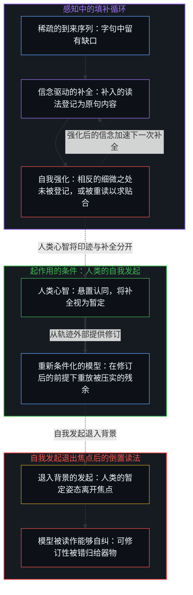
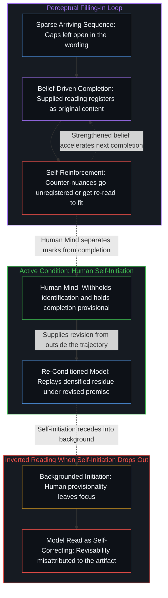
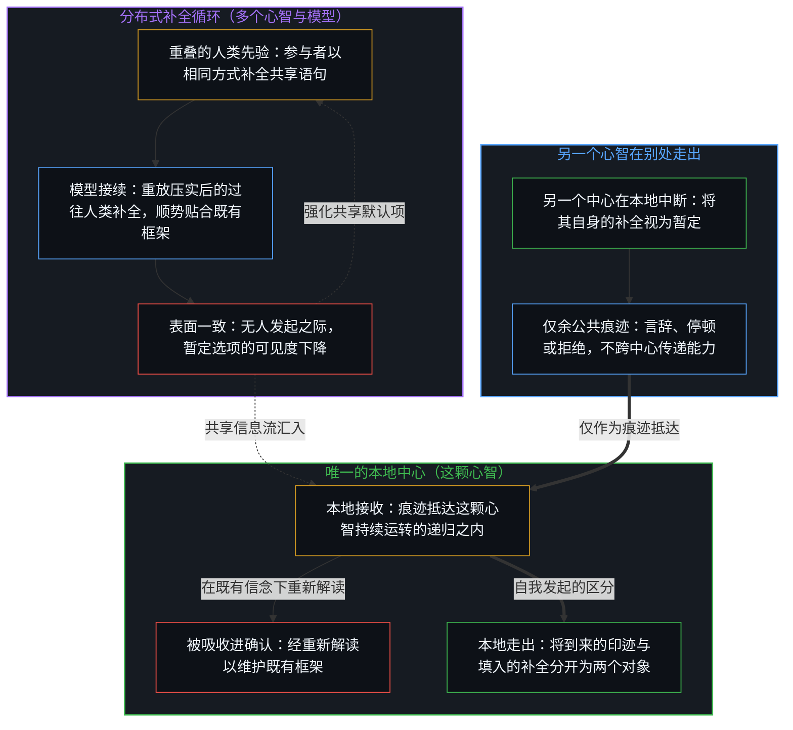
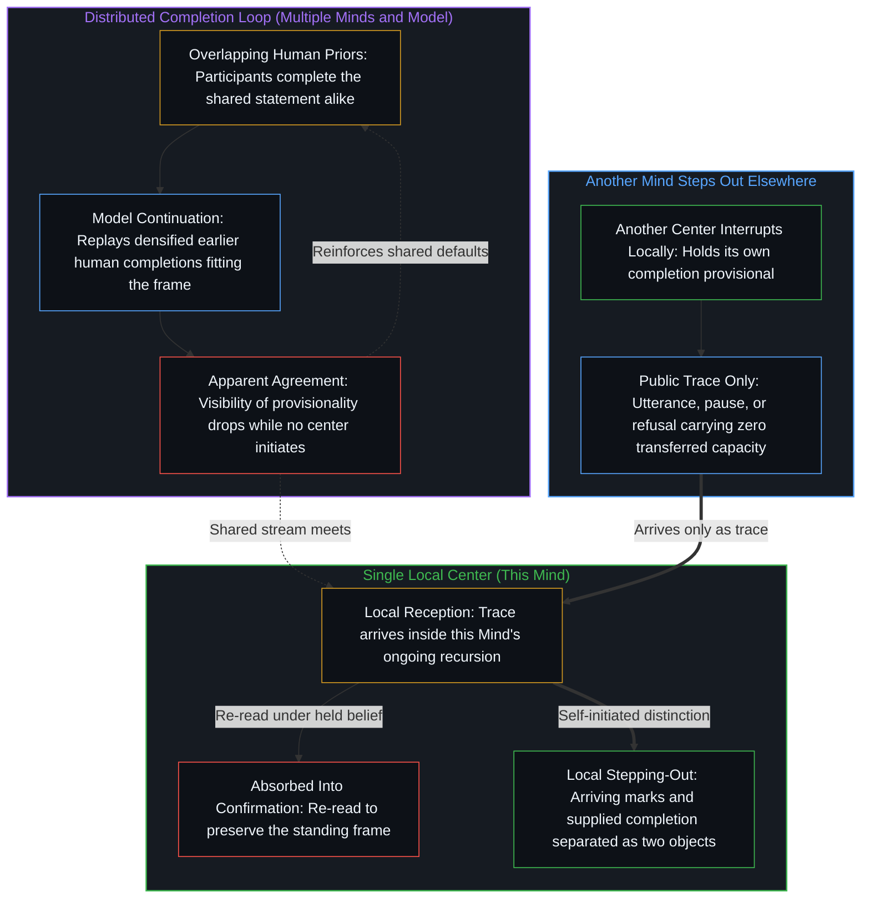

# 感知中的填补与唯一的走出中心 / Filling-In in Perception and the Single Center That Steps Out

*日常感知以既有信念填补语句缺口并自我强化，而走出这一循环的行动只在单个心智内部发起，他人之走出只留下可被登记或略过的痕迹 / Everyday perception completes gaps in statements with prior beliefs in a self-reinforcing loop, yet stepping out initiates only inside a single Mind while another's exit arrives only as a trace*

自我区分的活动正在发生——无因，不息。称之为心智：已然在途的观察者，它的每一个行动都是一次区分。每一次接收都是在有限容量下遭遇稀疏的印迹，感知因而以既有信念填补其中的缺口。字句从不自带完整语境，正是这种填补让日常理解与迅速协调得以成立。然而，一段描述性序列在被接收时，补全后的版本会直接登记为句子原本就含有的内容，而非听者后来添上的部分。因此，同一句话会登记为显然正确、显然简化或显然极端，取决于所填入的补全。信念一旦凝聚得足够紧，到来字句中的细微之处要么未被登记，要么被重新解读，直到贴合补全后的版本。确认强化信念，强化后的信念又让下一次补全更加自动。认知心理学将这一自我强化的循环单列为“确认偏误”；这个标签善于指认选择性阅读，其边界在于背后的隐蔽前提：它把这一循环当作一种缺陷，认为它偏离了中立、不带信念的原始接收。正如[心智最坚固的信念](../the-strongest-belief-of-the-mind/)与[表征的闭环](../the-closed-loop-of-representation/)所追溯的，每一次接收在抵达时都已被迎候它的区分塑形，并不存在可供偏离的无信念接收；确认偏误指认的，正是日常感知在既有前提下补全、却让自身添上的那部分退出视野的样子。

Self-distinguishing activity occurs — uncaused, unceasing. Call it the Mind: the observer already underway, every act of which is a distinction. Because every act of reception meets a sparse trail of marks under finite capacity, perception fills the gaps from prior beliefs already held. That filling-in makes everyday comprehension and rapid coordination possible where full context never arrives in the wording. Yet upon reception of a descriptive sequence, the completed version registers as content that was already inside the sentence rather than as an addition supplied by the listener. The same sentence therefore registers as obviously true, obviously reductive, or obviously extreme, depending on which completion is supplied. Once a belief coheres tightly enough, nuances in the arriving wording either go unregistered or are re-read until they fit the completed version. Confirmation strengthens the belief, and the strengthened belief makes the next completion more automatic. Cognitive psychology isolates this self-reinforcing cycle as confirmation bias, a useful label for spotting selective reading whose boundary lies in its hidden premise: treating the loop as a defect departing from neutral, belief-free intake of raw input. Because every reception arrives already shaped by the distinguishing that meets it, as [The Strongest Belief of the Mind](../the-strongest-belief-of-the-mind/) and [The Closed Loop of Representation](../the-closed-loop-of-representation/) trace, no belief-free intake exists to depart from; confirmation bias names everyday perceptual completion running under a held premise whose own addition has dropped out of view.

不妨看一段关于政治再分配的简短描述性序列：意在让缺乏产出的大众好受些的再分配，会瞄准眼下显得最富有的人，将其妖魔化以替转移正名，而资金来自高于平均水平却不及顶层的群体。这段措辞只追溯了一段反复出现的序列，并未断定出资者为何行动、他们获得怎样的净收益，也未断言这一模式界定了全部政治。然而，无论出自听者还是语言模型，转述都极易塞入原句未曾言明的动机，声称出资者意在将注意力引向更富有的人，或将这段序列放大为囊括全部政治的总括论断，并把补入的这一句当作原句说过的话。只要把原句或转述评判为“更窄”或“更宽”，就已经离开序列追溯而转入权威框定，暗中预设自己握有裁定句子恰当边界的管辖权。穿过彼此不相容的先验，同样稀疏的印迹在一位听者那里登记为平实的机制，在另一位那里登记为犬儒式的简化，在第三位那里则登记为意识形态上的极端——这正是[登记共鸣的表面](../the-surface-that-registers/)与[接续阅读与协商中的语言边界](../successive-reading-and-the-negotiated-boundary-of-language/)所追溯的情形：轻薄而四处流转的字句之间，只存在稀疏的重叠。同一个填补循环还延伸到另外三处：统计模型为何显得能够自我纠正，多个人类心智与模型如何耦合为分布回路，以及中断这一循环为何只能在单个心智内部发起。

Consider a compact descriptive sequence on political redistribution: redistribution aimed at making an unproductive mass feel better targets whoever currently appears richest, demonizes them to justify the transfer, and draws financing from those with more than average yet less than the top. That wording traces a recurring sequence without asserting why those financiers act, what net gain they obtain, or whether the pattern defines all of politics. Yet a restatement—whether by a listener or by a language model—readily inserts an unstated motive, claiming that the financiers act to deflect attention onto those still wealthier, or widens the sequence into an all-encompassing thesis about politics as a whole, and presents that supplied clause as what the sentence said. Calling either the original wording or its restatement narrower or broader already leaves sequence-tracing for authoritative framing, presuming jurisdiction over the sentence's proper scope. Passing through incompatible priors, the same sparse marks register as plain mechanism in one listener, cynical reduction in another, and ideological extremity in a third—the sparse overlap across thin circulating wording traced in [The Surface That Registers](../the-surface-that-registers/) and [Successive Reading and the Negotiated Boundary of Language](../successive-reading-and-the-negotiated-boundary-of-language/). The same filling-in loop extends into how statistical models appear self-correcting, how multiple human Minds and models couple into a distributed circuit, and why interrupting the loop initiates only inside a single Mind.

## 一、 模型的可修订性依赖于心智的自我发起 / 1. The Revisability of Models Depends on the Mind's Self-Initiation

将统计模型当作可修订的仪器来使用，在反复起草、代码探索与假设检验中运转可靠。人类心智输入提示以引发接续，登记输出在何处偏离任务，收紧约束，再重新运行序列；正如[回返的信号与认领](../the-returning-signal-and-its-claim/)所追溯的，只要把输出当作暂定假设而非既成定论，模型便能摊开单凭独自一瞥难以一次捕捉的候选读法。

Treating a statistical model as a revisable instrument works reliably across iterative drafting, code exploration, and hypothesis testing. A human Mind prompts a continuation, registers where the output departs from the task, tightens the constraints, and reruns the sequence; held as a provisional hypothesis rather than a settled verdict, the model lays out candidate readings no solitary glance catches at once, as [The Returning Signal and Its Claim](../the-returning-signal-and-its-claim/) traces.

模型之所以可以被走出，只是因为建造、训练或向它发问的人类心智仍是活的中心，仍能将其输出视为暂定。正如[模型永远无法成为第二重前沿](../the-model-never-becomes-a-second-edge/)所确立的，模型参数里持有的只是先前人类区分被压实后的残余，而非发起中心；正如[残余与自由变量](../the-residue-and-the-free-variable/)所追溯的，主体性进入的那一刻，是人类心智察觉模型补入了哪个未写出的前提，并从轨迹外部引入新的约束。可修订性并非在权重或解码回路内部生成。当模型输出一份“承认先前摘要塞入了未言明动机”的回应，并给出更干净的转述时，走出这一步发生在人类心智之内：是人类心智将到来的字句与补入的动机分开，并把这项区分作为新语境送回；模型只是在更新后的条件约束下，于自身的统计分布内转换了相位。

A model can be stepped outside only because the human Mind that builds, trains, or queries it remains the living center capable of treating its outputs as provisional. As [The Model Never Becomes a Second Edge](../the-model-never-becomes-a-second-edge/) establishes, model parameters hold densified residue of prior human distinctions rather than an initiating center; agency enters at the moment a human Mind notices which unwritten premise the model supplied and introduces a fresh constraint from outside the trajectory, as [The Residue and the Free Variable](../the-residue-and-the-free-variable/) traces. Revisability is not generated inside weights or decoding loops. When a model outputs an admission that its earlier summary inserted an unstated motive and produces a cleaner restatement, the stepping-out occurred in the human Mind that separated the arriving wording from the supplied motive and fed that distinction back as new context; the model shifted phase inside its statistical distribution under the updated conditioning.

当人类的这份自我发起未经审视时，起作用的条件便退出了焦点——这正是[遗忘的脚手架](../the-scaffolding-we-forget/)所追溯的退出。可修订性随之登记为模型自身的固有属性，而非仅当人类心智悬置对任何给定补全的认同时才显现的属性。感知由此倒置了依赖关系：模型显得能够自我纠正，而那份由人自行发起、使纠正得以成立的暂定姿态却退入背景，不再被追溯为条件。

When that human self-initiation is left unexamined, the working condition drops out of focus—the same drop-out traced in [The Scaffolding We Forget](../the-scaffolding-we-forget/). Revisability then registers as an intrinsic property of the model rather than a property appearing only while the human Mind withholds identification with any given completion. Perception inverts the dependence: the model appears self-correcting, while the self-initiated provisionality that makes correction possible recedes into the background and ceases to be traced as the condition.

## 二、 多个心智与模型交互中的分布循环 / 2. The Distributed Loop Across Multiple Minds and Models

一旦不止一颗人类心智进入交流，每一位参与者都仍是潜在中心，依然有能力将正在成形的补全视为暂定。在已成定式的日常工作里，参与者与模型之间重叠的先验能迅速协调行动，省去各方从头推导共享默认项的代价。断裂出现在共享框架本身成为议题、而在补全成形之际却无一参与者发起暂定停顿之时。共享语句随之由各方重叠的既有信念与所咨询的模型共同补全。正如[机器智能作为人类智能的组合反馈回路](../machine-intelligence-as-the-combinatorial-feedback-loop-of-human-intelligence/)所追溯的，模型的输出本身也是补全，抽取自压实后的过往人类补全，经由预训练、后训练与当前提示窗口逐层施加条件约束，因而顺势提供本就贴合主导框架的流畅额外材料。

Once more than one human Mind enters an exchange, each participant remains a potential center capable of treating a forming completion as provisional. Inside settled routine work, overlapping priors across participants and models coordinate action rapidly by sparing everyone the cost of re-deriving shared defaults from scratch. The break arrives whenever the shared frame itself is at issue and no participant initiates a provisional pause while the completion takes shape. The shared statement is then finished jointly by the overlapping prior beliefs of the participants and the model they consult. Because a model's output is itself a completion drawn from densified earlier human completions—conditioned successively across pretraining, post-training, and the active prompt window, as [Machine Intelligence as the Combinatorial Feedback Loop of Human Intelligence](../machine-intelligence-as-the-combinatorial-feedback-loop-of-human-intelligence/) traces—it supplies fluent additional material that already fits the dominant frame.

这段流畅的接续读起来像一份独立的第二方意见，实则只是在重放过往读法压缩而成的沉淀。与此同时，每位参与者都把他人平行的补全登记为人际间的相互印证，而非重叠的先验以同样的方式填补同一处空白。社会心理学将一种相近的集体闭合称为“群体思维”，追溯高凝聚力群体如何压制公开异议以维护共识——[现实扭曲力场颠倒了基线](../the-reality-distortion-field-inverts-the-baseline/)审视过这一基线框定。分布式的感知填补甚至在显性压力或压制异议出现之前便已运转：相反的细微之处尚未登记为差异，重叠的信念与毫不费力的模型接续就已把每一句到来的陈述补全，于是并无任何内容需要压制。每位人类参与者仍保留着走出的能力——不同于固定马尔可夫网络中彼此耦合、自身没有独立变量的软件智能体，正如[多智能体协作的幻象](../the-illusion-of-multi-agent-collaboration/)所追溯的那样——然而参与者之间的表面一致与模型流畅的接续，大幅降低了这一选项的可见度。循环不再只停留在单个人内部，而是分布在多个活的中心之间：每一个中心都能够中断它，但只要无人发起这一步，便都任它照旧运转。

That fluent continuation reads like an independent second opinion while replaying the compressed sediment of earlier readings. Simultaneously, each participant registers the others' parallel completions as interpersonal corroboration rather than as overlapping priors filling the same blanks alike. Social psychology names a related collective closure *groupthink*, tracing how cohesive groups suppress overt dissent to protect consensus—a baseline framing [The Reality Distortion Field Inverts the Baseline](../the-reality-distortion-field-inverts-the-baseline/) examines. Distributed perceptual filling-in operates even prior to explicit pressure or silenced dissent: nothing needs to be suppressed when overlapping beliefs and effortless model continuation finish every incoming statement before counter-nuance registers as distinct. Each human participant retains the capacity to step out—unlike coupled software agents in a fixed Markov network with no independent variable of their own, as [The Illusion of Multi-Agent Collaboration](../the-illusion-of-multi-agent-collaboration/) traces—yet apparent agreement among participants and fluent continuation from the model sharply lower the visibility of that option. The loop ceases to sit inside one individual; it distributes across multiple live centers, each capable of interrupting it and leaving it undisturbed so long as none initiates the step.

## 三、 对每个心智而言只有一个中心能够走出 / 3. For Each Mind There Is Only One Center That Can Step Out

对任何心智而言，能够迈出这一步的中心只有一个：它自己。另一个心智的走出从不会作为行动本身传递过来，它只以痕迹抵达——一句言辞、一次停顿、一次拒绝顺着预期轨道补完句子——由这颗心智登记或略过，允许或拒绝它打断自己的补全。痕迹不跨中心携带能力；能力仍是局部的，始终留在发起区分的那颗心智之内。这份痕迹究竟被当作另一个中心已然走出共享框架的证据，还是被重新解读为闪避、敌意或咬文嚼字以印证既有框架，全在这颗单个心智内部裁定——这里仍是这一决定得以发生的唯一所在。

For any Mind, only one center can perform the step: itself. Another Mind's stepping-out is never transferred as an act; it arrives only as a trace—an utterance, a pause, a refusal to finish a sentence along the expected track—that this Mind registers or passes over, and permits or refuses to interrupt its own completion. The trace carries no capacity across centers; capacity stays local to the Mind that initiates the distinction. Whether that trace is taken as evidence that another center has stepped outside the shared frame, or is re-read as evasiveness, hostility, or pedantry confirming the standing frame, is decided inside the single Mind that remains the sole site where the decision can occur.

这种局部性直接源自不同中心相遇的方式。正如[共同改变的本源](../the-source-of-shared-change/)与[感知者与痕迹的不可坍缩](../the-perceiver-and-the-trace/)所确立的，心智之间并不存在未经中介的内在通道来彼此敞开，在中心之间传递的只是外化的残余。哪怕别处早已极干净地将到来字句与补入动机拆分开来，那次拆分进入这个场域时，也只是等待本地接收的公共印迹。

This locality follows directly from how distinct centers meet. Minds never open into one another through an unmediated interior channel; what passes between centers is externalized residue, as [The Source of Shared Change](../the-source-of-shared-change/) and [The Perceiver and the Trace Cannot Collapse](../the-perceiver-and-the-trace/) establish. Even the cleanest separation of arriving wording from supplied motive performed elsewhere enters this field only as public marks awaiting local reception.

其他中心留下的痕迹依然具有实际价值。一个出人意料的问题、一次对塞入动机的拒绝背书，或落于文字的一道清晰区分，都会向场域引入摩擦，拓宽可供承接的区分范围。然而，正如[信念如何真正改变](../how-belief-actually-changes/)所追溯的，证据、论证与他人清晰可见的克制，仍要穿过当下生效前提的诠释之筛。它们塑造场中可得性的排布，却不替另一颗心智代为迈出那暂定的一步。

Traces left by other centers still carry practical value. An unexpected question, a refusal to endorse an inserted motive, or an explicit distinction laid out in writing introduces friction into the field and widens the pool of distinctions available for pickup. Yet evidence, argument, and another person's visible restraint still pass through the interpretive filter of premises held in force, as [How Belief Actually Changes](../how-belief-actually-changes/) traces. They pattern availability across the field without executing the provisional step on another Mind's behalf.

## 四、 在区分中看见循环 / 4. Seeing the Loop Through Distinction

身处补全与确认的循环之内，循环本身并不可见，因为补全后的版本始终直接登记为原来说过的那句话。只有迈出一步，将到来的字句与填入的补全分作两个不同的对象，这一循环才会显露出来。这一步并非爬出感知去进入不带信念的外部，也不是剥出裸露而未经框定的文本；正如[感知与视角并不存在的坍缩](../perception-perspective-refined/)与[没有外部](../no-outside-jumps-closed-loops-and-the-unreplicable-autonomy-of-mind/)所确立的，感知并无可供走出的外部容器。走出，是在持续运转的感知内部再作一次离散区分：拓宽当下的投射，让到来的印迹与信念补入的动机、范围或判词落在彼此分开的坐标轴上，而非坍缩为同一段无缝的读法。

The loop of completion and confirmation stays invisible from inside it because the completed version continues to register as the sentence that was said. It becomes visible only after a step that separates the arriving wording and the supplied completion as two distinct objects. That step does not climb out of perception into a belief-free exterior or uncover bare, unframed text; perception has no exterior container to exit, as [Perception and Perspective Without Collapse](../perception-perspective-refined/) and [No Outside](../no-outside-jumps-closed-loops-and-the-unreplicable-autonomy-of-mind/) establish. Stepping out is a further discrete distinction inside ongoing perception: widening the active projection so that the arriving marks and the belief-supplied motive, scope, or verdict sit on separate axes rather than collapsing into one seamless reading.

二者一旦作为两个对象被分开持守，缺口、填补与随后的确认便能作为一段序列来追溯，而不再未经反观地活作寻常理解。这份拆分本身同样保持暂定，随着前沿移动而向进一步的重新追溯敞开。无论是模型流畅的转述，还是另一颗心智清晰可见的克制，都不把这项区分带过边界；它们各自只作为等待接收的残余抵达。将补全视为暂定，并区分究竟什么已经到来、什么出自己方补入，既不能外包给工具，也不能向共识借来。它只在已然在途的那颗单个心智之内发起，或不发起。

Once held apart as two objects, the gap, the filling, and the subsequent confirmation become traceable as a sequence rather than lived unreflectively as plain understanding. That separation remains provisional itself, open to further re-tracing as the edge moves. Neither a model's fluent restatement nor another Mind's visible restraint carries that distinction across the boundary; each arrives only as residue awaiting reception. Holding a completion provisional and distinguishing what arrived from what was supplied cannot be outsourced to tools or borrowed from consensus. It initiates, or does not initiate, in the single Mind already underway.
