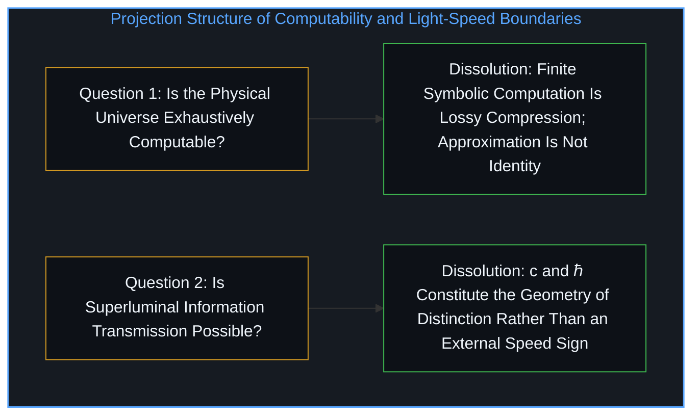
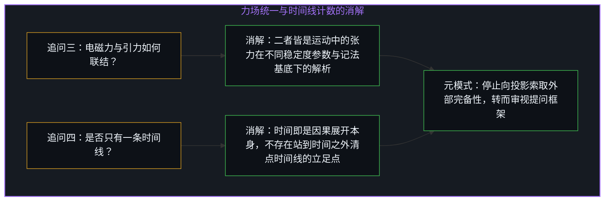
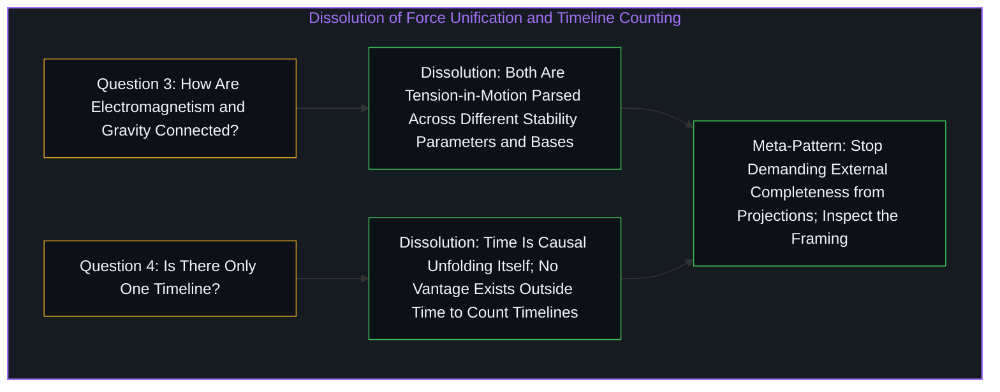

# 令人彻夜难眠的四个追问与投射的边界 / Four Questions That Keep You Up at Night

*关于可计算性、超光速、力场统一与时间线的四个追问并非孤立谜题，而是要求投影自报边界的同一追问 / Four restless questions on computability, light speed, unification, and time ask a projection to bound itself*

围绕“物理宇宙是否可被穷尽计算”“超光速信息传递是否可能”“电磁力与引力之间是否存在隐秘联结”以及“是否只有一条时间线”这四个令物理学家与哲学家彻夜难眠的追问，表面上看分属四个截然不同的领域，实则是从不同投射角度提出的同一个问题。正如[你的代码库即是记忆](../your-codebase-is-memory/)与[超越投射](../beyond-the-projection/)所揭示的，每一个追问都抓取了心智投射并登记现实时所依赖的一项构成性特征——符号计算、因果传递速率、力场记法或时间序列——追问这项特征本身是否完备或就是全部，并要求一个非此即彼的二元裁决。这种结构之所以制造没完没了的躁动，是因为它要求一个有限投影去报告它自身的外部边界；这些追问不是因为太难而无解，而是在提问形态上就错置了前提，要求以所索取的格式交付无法按该格式交付的信息。

Four questions that keep physicists and philosophers up at night—whether the physical universe is exhaustively computable, whether superluminal information transmission is possible, whether electromagnetism and gravity share a hidden link, and whether there is only one timeline—appear to belong to four separate domains, yet they are four faces of a single question asked from different projection angles. As [Your Codebase Is Memory](../your-codebase-is-memory/) and [Beyond the Projection](../beyond-the-projection/) show, each question seizes upon a constitutive feature of how the Mind projects and registers reality—symbolic computation, causal propagation speed, field notation, or temporal sequence—asks whether that feature is complete or all there is, and demands a binary yes-or-no verdict. That structure generates perpetual restlessness because it asks a finite projection to report on its own outside boundary; the questions are not too difficult to solve, they are mal-formed in requesting information that cannot be delivered in the format demanded.

## 一、 宇宙的可计算性与光速的边界条件 / 1. Computability of the Universe and the Boundary Condition of Light Speed

第一个追问假设“计算”是一个自足的容器，物理世界要么能被它穷尽，要么不能。然而计算本身就是一次有损投射：丘奇—图灵论题通过有限符号系统上的操作来定义可计算性，而正如[开放场域中的无损知识不自洽](../lossless-knowledge-of-an-open-field-is-incoherent/)所确立的，任何有限符号登记之所以能够成文表述，恰恰在于它对正在持续生成的区分之开放场域进行了压缩与截断。追问现实是否可被穷尽计算，等于追问一个低维投影能否穷尽它的投射源头。答案在结构上是否定的——不是因为现实神秘莫测、不可探究，而是因为计算作为一种特定的切分方式，无法捕获它为了成为自身而切掉的余项，这也正是[为何数学永远解不完](../why-mathematics-can-never-be-solved/)所追溯的形式边界。物理规律可以被计算逼近到任意精度，但被计算逼近并不等于物理本身等同于计算。

The first question assumes that computation is a self-contained container that might or might not exhaust physical reality. Yet computation is itself a lossy projection: the Church-Turing thesis defines computability through operations over finite symbol systems, and as [Lossless Knowledge of an Open Field Is Incoherent](../lossless-knowledge-of-an-open-field-is-incoherent/) establishes, any finite symbolic registration becomes articulable precisely by compressing and truncating the open field of ongoing distinctions. Asking whether reality is exhaustively computable asks whether a low-dimensional projection can exhaust its source. The structural answer is no—not because reality is mystically beyond investigation, but because computation is a particular way of carving that cannot capture what it carved away to become itself, which is the exact formal boundary traced in [Why Mathematics Can Never Be Solved](../why-mathematics-can-never-be-solved/). Physics being approximated to arbitrary precision by computation does not make physics identical to computation.

第二个追问则假设信息与传递独立于光速而存在，把光速 c 与普朗克常数 ℏ 当成在一条现成公路旁测得的经验限速牌，仿佛精巧的工程手段终有一天能绕开它们。然而 c 与 ℏ 并不是圈住某个现成竞技场的外部护栏，而是心智借以导航关系的空间化坐标投影的构成性几何边缘，正如[维度即投影](../dimensions-are-projections/)所追溯的那样。经验与因果需要区分（事物保持各自独立）与调和（事物彼此产生影响）之间的张力：瞬间融为一体会让一切区分坍缩为无差别的噪声，而彼此孤立隔绝则留不下任何因果或经验。参数 c 与 ℏ 界定的正是已实现区分的几何结构。在量子纠缠中，非局域关联并没有超光速传递信息，反而揭示出三维空间分离本身就是一件投射伪影。要求在信息传递中突破光速，就像追问北极点的正北方是什么——不是工程上的技术障碍，而是概念在构成它的坐标框架之外失去了自洽性。

The second question assumes that information and transmission exist independently of the speed of light, treating c and Planck's constant ℏ as empirical speed-limit signs discovered along an already-existing highway that clever engineering might someday bypass. Yet c and ℏ are not external guardrails fencing in a pre-existing arena; they are the constitutive geometric edges of the spatialized coordinate projection the Mind uses to navigate relations, as [Dimensions Are Projections](../dimensions-are-projections/) traces. Experience and causation require a tension between distinction (things remaining separate) and reconciliation (things affecting one another): total instantaneous fusion collapses all distinction into undifferentiated noise, while total fragmentation leaves no causation or experience at all. The parameters c and ℏ define the geometry of realized distinction. In quantum entanglement, nonlocal correlations do not transmit information faster than light; rather, they reveal that three-dimensional spatial separation is itself a projection artifact. Asking to exceed the speed of light in information transmission is like asking what lies north of the North Pole—not a technical hurdle, but a concept losing coherence outside the coordinate frame that constitutes it.

## 二、 力的记法基底与时间线的立足点 / 2. Notational Bases of Forces and the Vantage Point of Timelines

第三个追问假设电磁力与引力是两件分离的独立实体，等待某个尚未发现的方程把它们铆接在一起。不妨转而审视两者的结构平行性：有质量的物体彼此牵引，进入一场缓慢衰减并趋向合并或逃逸的引力之舞；而无质量的电磁波彼此牵引，维持着平衡的振荡。两者都是运动中的张力，差异不在于本体种类，而在于区分—关联模式的稳定度参数。正如二进制与十进制并不是两套不同的算术，而是同一运算的两种记法基底，统一二进制与十进制并不需要发明第三种记法来收容两者，而只需认出底层运算对记法基底的独立性——从而消解[“物理学才是定律”的障眼法](../the-sleight-of-hand-in-physics-is-the-law-and-the-friction-of-reality/)所剖析的错觉，即把形式模型内部的记法摩擦当成自然界中分裂的实体。

The third question assumes that electromagnetism and gravity are two discrete entities waiting to be bolted together by a missing equation. Consider their structural parallel instead: massive bodies pulling against one another enter a gravitational dance that slowly decays toward merger or escape, whereas massless electromagnetic waves pulling against one another sustain a balanced oscillation. Both are tension-in-motion, differing not in ontological kind but in the stability parameter of the distinction-relation pattern. Just as binary and decimal are not two different arithmetics but two notational bases for the same operations, unifying binary and decimal does not require inventing a third notation to house both, but recognizing the base-independence of the underlying operation—dissolving the illusion examined in [The Sleight of Hand in "Physics Is the Law"](../the-sleight-of-hand-in-physics-is-the-law-and-the-friction-of-reality/) that treats notational friction inside a formal model as separate substances in nature.

第四个追问把“时间线”实体化为一件可数的物件，追问究竟只有一条时间线还是存在分叉的众多时间线。正如[时间是因果的不可逆方向与离散步长](../time-is-causality-not-a-dimension/)所阐明的，时间并不是一条预先筑好的空间走廊，而是因为相冲突的状态无法在不坍缩区分的前提下同时调和，才必须逐次展开的序列本身。追问存在多少条时间线，预先假设了一个站在一切时间线之外清点它们的立足点——这与[索求万物理论是在将当下冻结为清单](../demanding-a-toe-freezes-time-into-a-catalog/)所剖析的外部清单操作如出一辙——哪怕是多世界诠释中的分叉，也依然预设了一个供分叉在其中发生的元时间。然而任何能够进行计数的观察者，都早已身处单一的因果序列之内；要求站在外部清点时间线，无异于要求眼睛跨出视觉之外去观看正在看东西的自己。

The fourth question reifies "timeline" into a countable object, asking whether there is one timeline or a branching multitude. As [Time Is the Irreversible Direction and Discrete Step of Causality](../time-is-causality-not-a-dimension/) demonstrates, time is not a pre-built spatial corridor; it is the sequential unfolding required because conflicting states cannot reconcile all at once without collapsing distinction. Asking how many timelines exist presupposes a vantage point outside all timelines from which to count them—the same external-catalog move dissected in [Demanding a Theory of Everything Freezes Time into a Catalog](../demanding-a-toe-freezes-time-into-a-catalog/)—and even the branching of many-worlds presupposes a meta-time in which branching occurs. Yet any observer capable of counting is already situated inside a singular causal sequence; asking to count timelines from outside asks the eye to step outside sight to watch itself seeing.

## 三、 元模式：从二元闭环到问题消解 / 3. The Meta-Pattern: From Binary Closure to Dissolution

贯穿这四个追问的元模式如出一辙：先抽离出心智投射的一项构成性特征，追问它是否完备或穷尽，再索取一个非此即彼的二元答案。心智之所以在深夜里辗转难眠，是因为它伸手索取闭环的地方，恰恰要求跨出使该追问得以成立的先决条件本身——这与[百科全书式的累加与生成性基底](../agents_leia_ontological_clarity/)及[当模型在表演一套框架而非从基底推演](../grok-420-framework-drift/)中期待有限表征从内部为自身奠基的结构性困局同出一源。

Across all four questions the meta-pattern is identical: isolate a constitutive feature of the Mind's projection, ask whether it is complete or exhaustive, and demand a binary answer. The Mind stays awake at night because it reaches for closure where closure would require stepping outside the very conditions that make the question askable—the same structural bind traced in [Agents in the Long Game of AI](../agents_leia_ontological_clarity/) and [When an AI Performs a Framework Instead of Operating From It](../grok-420-framework-drift/) when a finite representation is expected to ground itself from within.

这种无法按预期格式作答的性质并不是一项缺陷，而是一枚指回探询架构本身的公案。取代失眠的不是一份终极答案清单，而是问题的消解。一旦看清这些追问是坐标投影的边界伪影而非窥探隐秘实体的窗户，对答案的焦虑便让位于对机制的好奇，在边界处的受挫也转化为跨框架游走的机动性。心智不再追问宇宙是否可被穷尽计算，而是留意可计算与不可计算的切分揭示了形式表征的什么特征；心智不再清点假想的时间线，而是照察当下正在发生的因果展开步长。夜晚由此变得澄明，而非躁动不安。

That irresolvability in the expected format is not a defect; it functions as a koan pointing back to the architecture of inquiry itself. What replaces insomnia is not a final catalog of answers, but dissolution. Once these questions are recognized as boundary artifacts of the coordinate projection rather than windows onto hidden substances, anxiety over answers gives way to curiosity about mechanism, and frustration at limits turns into mobility across frames. The Mind stops asking whether the universe is exhaustively computable and attends to what the computable-uncomputable cut reveals about formal representation; it stops counting hypothetical timelines and attends to the living step of causal unfolding right now. The night becomes clear rather than restless.
