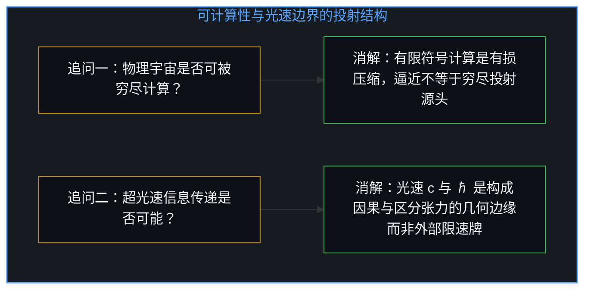
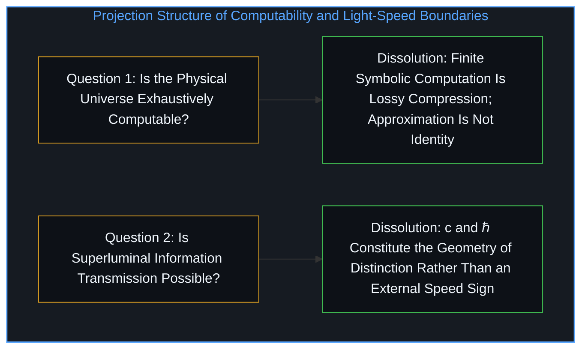
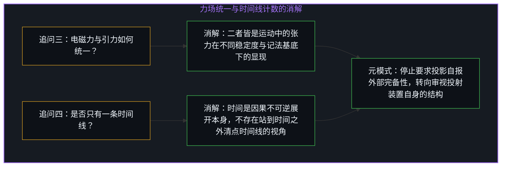
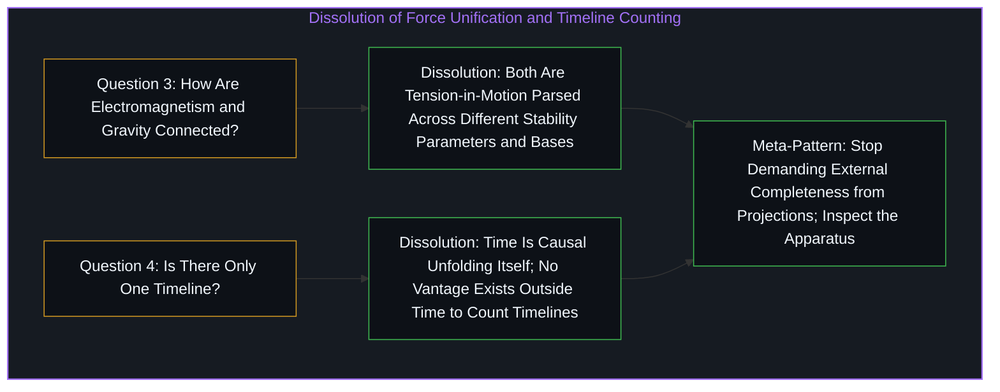

# 令人彻夜难眠的四个追问与投射的边界 / Four Questions That Keep You Up at Night

*关于可计算性、超光速、力场统一与时间线的四个追问并非孤立谜题，而是要求投影自报边界的同一追问 / Four restless questions on computability, light speed, unification, and time ask a projection to bound itself*

围绕“物理宇宙是否可被穷尽计算”“超光速信息传递是否可能”“电磁力与引力之间是否存在隐秘联结”以及“是否只有一条时间线”这四个令人彻夜难眠的追问，表面上看分属计算理论、相对论、统一场论与量子诠释四个领域，实则是从不同投射角度提出的同一个问题。正如[你的代码库即是记忆](../your-codebase-is-memory/)与[超越投射](../beyond-the-projection/)所揭示的，这四个追问都抓取了我们体验现实时所依赖的一项构成性特征——计算符号、因果传递速率、力场记法或时间序列——然后追问这项特征本身是否“完备”或“就是全部”，并期待一个非此即彼的二元回答。这种提问方式之所以持续制造焦虑，是因为它要求一个有限投影去报告它自身的外部边界；它们不是因为太难而无解，而是在结构上要求用投影内部的格式交付投影外部的信息。

Four questions that keep physicists and philosophers up at night—whether the physical universe is exhaustively computable, whether superluminal information transmission is possible, whether electromagnetism and gravity share a hidden link, and whether there is only one timeline—appear to belong to four separate domains, yet they are four faces of a single question asked from different projection angles. As [Your Codebase Is Memory](../your-codebase-is-memory/) and [Beyond the Projection](../beyond-the-projection/) show, each question seizes upon a constitutive feature of how we experience reality—symbolic computation, causal propagation speed, field notation, or temporal sequence—asks whether that feature is complete or all there is, and demands a binary yes-or-no verdict. That structure generates perpetual restlessness because it asks a finite projection to report on its own outside boundary; the questions are not too difficult to solve, they are mal-formed in requesting information that cannot be delivered in the format demanded.

## 一、 宇宙的可计算性与超光速信息传递的边界条件 / 1. Computability of the Universe and the Boundary Condition of Light Speed

第一个追问假设“计算”是一个边界分明的现成容器，客观世界要么能被装进这个容器，要么装不进。然而计算本身就是一次有损投射：丘奇—图灵论题在有限符号系统与规则操作的层面上定义了可计算性，而这一定义能够成立的前提，恰恰是先舍弃开放连续域中的无限自由度以换取离散的可表述性。追问现实是否“可被穷尽计算”，就等于追问一个低维投影能否穷尽它的投射源头。答案在结构上是否定的——不是因为现实“神秘莫测”，而是因为计算作为一种特定的切分方式，永远无法捕获它为了成为自身而切掉的余项，这也正是[为何数学永远解不完](../why-mathematics-can-never-be-solved/)所阐明的公理化与形式系统的内在边界。物理规律可以被计算无限逼近，但被计算良好逼近并不等于物理本身就是计算。

The first question assumes that computation is a self-contained container that might or might not exhaust physical reality. Yet computation is itself a lossy projection: the Church-Turing thesis defines computability through operations over finite symbol systems, and that definition becomes articulable precisely by discarding infinite degrees of freedom from an open continuum. Asking whether reality is exhaustively computable asks whether a low-dimensional projection can exhaust its source. The structural answer is no—not because reality is mystically beyond investigation, but because computation is a particular way of carving that cannot capture what it carved away to become itself, which is the exact formal boundary traced in [Why Mathematics Can Never Be Solved](../why-mathematics-can-never-be-solved/). Physics being approximated to arbitrary precision by computation does not make physics identical to computation.

第二个追问则假设“信息”与“传递”独立于光速而存在，仿佛光速 c 与普朗克常数 ℏ 只是我们在跑道上偶然测出的一块限速牌，原则上总可以设法绕开。然而光速并不是一块拦住某个现成空间的外部护栏，它本身就是构成我们所栖居的这一投影空间的几何边缘。经验与因果之所以可能，依赖于“区分（事物保持各自独立）”与“调和（事物彼此产生关联）”之间的张力平衡：如果一切瞬间融合，所有区分都会坍缩为无差别的混沌；如果一切彼此割裂，则没有任何因果与信息可言。光速 c 与普朗克常数 ℏ 正是维持这一“已实现区分之几何”的构成性边界条件。至于量子纠缠，相关性的显现并不是超光速的信息传递，它反而揭示出我们日常表征中的“空间分离”本身就是投射伪影。因此，要求突破光速传递信息，就像追问北极点的正北方在哪里——不是工程能力不足，而是概念在构成它的竞技场之外失去了意义。

The second question assumes that information and transmission exist independently of the speed of light, treating c and Planck's constant ℏ as empirical speed-limit signs discovered along an already-existing highway that clever engineering might someday bypass. Yet c and ℏ are not external guardrails fencing in a pre-existing arena; they are the constitutive geometric edges of the projection we inhabit. Experience and causation require a tension between distinction (things remaining separate) and reconciliation (things affecting one another): total instantaneous fusion collapses all distinction into undifferentiated noise, while total fragmentation leaves no causation or experience at all. The parameters c and ℏ define the geometry of realized distinction. In quantum entanglement, nonlocal correlations do not transmit information faster than light; rather, they reveal that spatial separation is itself a projection artifact. Asking to exceed the speed of light in information transmission is like asking what lies north of the North Pole—not a technical hurdle, but a concept losing coherence outside the arena that constitutes it.

## 二、 电磁与引力的记法基底以及时间线的计数视角 / 2. Notational Bases of Forces and the Vantage Point of Timelines

第三个追问假设电磁力与引力是两件原本分离的独立实体，需要等待某个尚未发现的终极方程把它们缝合起来。然而审视两者的动力学结构：有质量的物体彼此牵引，当达到相对平衡时便如地月般起舞，只是这种平衡在长时间尺度上终会衰减，趋向合并或逃逸；而无质量的电磁波彼此牵引，平衡为自维持的稳定振荡。两者都是运动中的张力（tension-in-motion），差异不在于本体种类，而在于区分与关联之动态模式的稳定度参数。正如二进制与十进制并不是两套不同的算术，而是同一算术结构在不同解析基底下的记法；你不需要发明第三种符号把二进制和十进制“统一起来”，你只需要认出底层运算对记法基底的独立性，这也印证了[“物理学才是定律”的障眼法](../the-sleight-of-hand-in-physics-is-the-law-and-the-friction-of-reality/)中把认知模型的记法摩擦当成自然界分裂实体的错觉。

The third question assumes that electromagnetism and gravity are two discrete entities waiting to be bolted together by a missing equation. Consider their structural parallel instead: massive bodies pulling against one another enter a gravitational dance that slowly decays toward merger or escape, whereas massless electromagnetic waves pulling against one another sustain a balanced oscillation. Both are tension-in-motion, differing not in ontological kind but in the stability parameter of the distinction-relation pattern. Just as binary and decimal are not two different arithmetics but two notational bases for the same operations, you do not unify binary and decimal by inventing a third notation to house both; you recognize the base-independence of the underlying operation, dissolving the illusion examined in [The Sleight of Hand in "Physics Is the Law"](../the-sleight-of-hand-in-physics-is-the-law-and-the-friction-of-reality/) that treats notational friction in our models as separate substances in nature.

第四个追问则把“时间线”实体化为一件可以像苹果一样被清点数量的东西，询问究竟只有一条时间线还是有无数条分叉的时间线。正如[时间是因果的不可逆方向与离散步长](../time-is-causality-not-a-dimension/)所剖析的，时间并不是一条预先铺好的空间走廊，而是相冲突的状态无法同时调和、只能按不可逆的因果步长逐次展开的序列本身。一旦发问“共有几条时间线”，发问者就已经暗中假设自己站在所有时间线之外的上帝视角上进行清点；哪怕是多世界诠释中的“分叉”，也依然预设了一个容纳分叉发生的元时间（meta-time）。然而任何能够进行观察与计数的视角，都早已身处单一的因果展开序列之内；追问时间线的数量，无异于要求眼睛看见正在看东西的自己。

The fourth question reifies "timeline" into a countable object, asking whether there is one timeline or a branching multitude. As [Time Is the Irreversible Direction and Discrete Step of Causality](../time-is-causality-not-a-dimension/) demonstrates, time is not a pre-built spatial corridor; it is the sequential unfolding required because conflicting states cannot reconcile all at once without collapsing distinction. Asking how many timelines exist presupposes a vantage point outside all timelines from which to count them, and even the branching of many-worlds presupposes a meta-time in which branching occurs. Yet any observer capable of counting is already situated inside a singular causal sequence; asking to count timelines from outside asks the eye to step outside sight to watch itself seeing.

## 三、 从索取二元闭环到消解失眠的元模式 / 3. The Meta-Pattern: From Binary Closure to Dissolution

至此，这四个追问共享的元模式便一目了然：先抽出认知投射装置的一项构成性特征，再追问它是否完备或唯一，最后要求一个非黑即白的二元答案。心智之所以在深夜里因它们而辗转反侧，是因为心智渴望闭环，却发现要想获得那个闭环，就必须跨出使该问题得以被提出的先决条件本身——这与[百科全书式的累加与生成性基底](../agents_leia_ontological_clarity/)及[当模型在表演一套框架而非从基底推演](../grok-420-framework-drift/)中试图在有限形式内部完成自足闭环的困境同出一源。

Across all four questions the meta-pattern is identical: isolate a constitutive feature of the projection apparatus, ask whether it is complete or exhaustive, and demand a binary answer. The Mind stays awake at night because it reaches for closure where closure would require stepping outside the very conditions that make the question askable—the same structural bind traced in [Agents in the Long Game of AI](../agents_leia_ontological_clarity/) and [When an AI Performs a Framework Instead of Operating From It](../grok-420-framework-drift/) when a finite representation is expected to ground itself from within.

这并不是心智的缺陷，而是一枚指向探询结构本身的公案指针：它们无法按预期格式作答这一事实本身，就是它们所携带的核心信息。真正取代失眠的不是勉强拼凑的终极答案，而是问题的消解。当你看清这些追问是投射装置的边缘伪影而非通向外部实体的窗户时，关于答案的焦虑便转化为对机制的好奇，对边界的挫败便转化为跨框架移动的自由。你不再追问宇宙是否可被穷尽计算，而是借由这个问题看清计算这一切分方式的纹理；你不再追问时间线是单一还是复数，而是切身照察因果在当下展开的步长。夜晚由此不再躁动不安，而是变得澄明而饶有趣味。

That irresolvability in the expected format is not a defect; it functions as a koan pointing back to the architecture of inquiry itself. What replaces insomnia is not a final catalog of answers, but dissolution. Once these questions are recognized as boundary artifacts of the projection apparatus rather than windows onto hidden substances, anxiety over answers gives way to curiosity about mechanism, and frustration at limits turns into mobility across frames. You stop asking whether the universe is exhaustively computable and attend to what the computable-uncomputable cut reveals about formal representation; you stop counting hypothetical timelines and attend to the living step of causal unfolding right now. The night becomes clear rather than restless.
