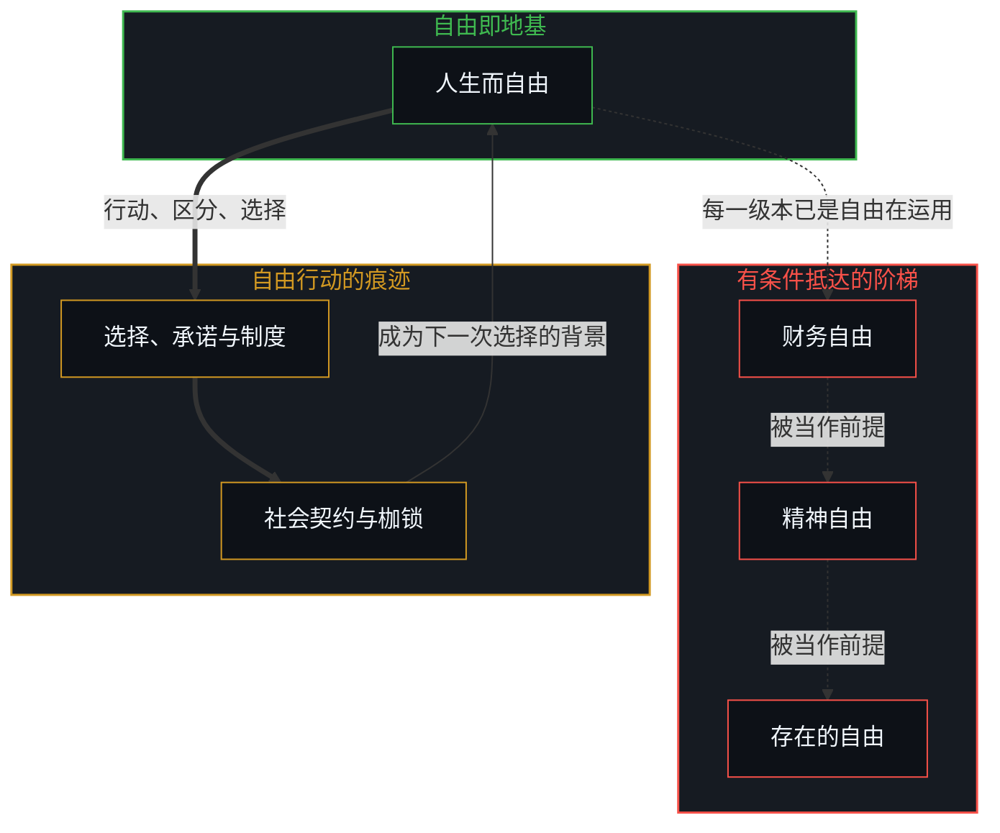
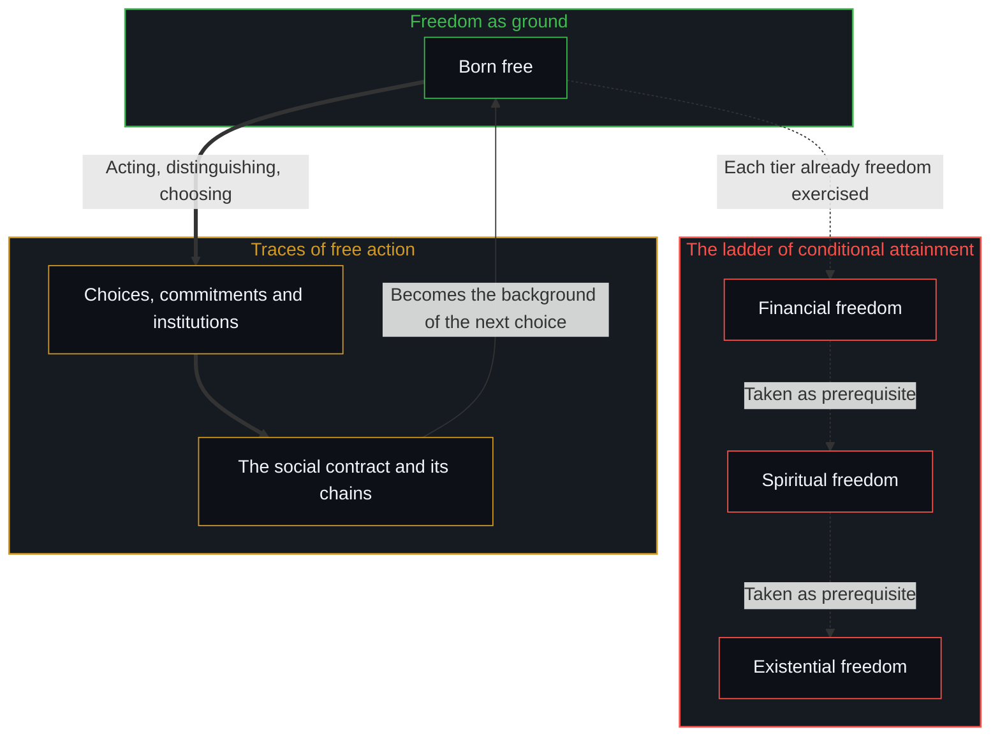

# 自由即地基 / Freedom as Ground

*人生而自由，却处处发明攀登的阶梯；束缚是自由行动时显现的轮廓 / Born free, people everywhere invent ladders of attainment; what binds is the contour through which freedom acts.*

让-雅克·卢梭在《社会契约论》的开头写下了那句著名的观察：“人是生而自由的，但却无往不在枷锁之中。”[常见的读法把它当作一场悲剧性的堕落](../zuo-jian-bu-shi-zi-fu/)：一份天然的自由被社会败坏、囚禁，需要一场艰难的、分好几层的攀登（财务独立、精神修炼、与死亡的哲学和解）才能找回。可顺着卢梭自己立足的前提追下去，机制就显现出来：社会契约这个概念所描述的，不是别的，正是个人自由做出的选择留下的集体痕迹。自由不是一座要分阶段才能抵达的远方山顶；它是存在原初的、持续的、无因的地基。人生而自由，此后出现的每一道约束，都只是因为自由本身行动了、区分了、选择了。

Jean-Jacques Rousseau opened *The Social Contract* with the famous observation: "Man is born free, and everywhere he is in chains." [The usual reading treats this as a tragic fall](../zuo-jian-bu-shi-zi-fu/): a natural liberty corrupted and imprisoned by society, to be recovered only by an arduous climb in several tiers (financial independence, spiritual discipline, philosophical reconciliation with mortality). Yet followed down from the premise Rousseau himself stands on, the mechanism shows itself: the very concept of the social contract describes nothing other than the collective trace of individual choices freely made. Freedom is not a distant summit reached in stages; it is the original, continuous and uncaused ground of existence. A human being is born free, and every constraint that appears afterward appears only because freedom itself has acted, distinguished and chosen.

## 一、 有条件抵达的虚幻阶梯 / 1. The Illusory Ladder of Conditional Attainment

日常的说法习惯于把自由拆成一级级的发展关卡。

Common talk habitually breaks freedom into a hierarchy of developmental hurdles.

在这套熟悉的分类里，一个人先要取得“财务自由”，才解锁选择的能力；再取得“精神自由”，才看清自己为什么选择；最后取得“存在的自由”，才能面对失去与死亡的必然。它作为一张自我超越的地图被递出来，却在不声不响中，于个人与其内在的主权之间制造出一段人为的距离。它装上了一本外部的前提账簿，暗示自由是一份未来的奖赏，只留给那些已经通过下面几层的人。

In this familiar taxonomy, one must first reach "financial freedom" to unlock the capacity to choose; then "spiritual freedom" to see why one chooses; and finally "existential freedom" to face the inevitability of loss and death. Offered as a map of self-transcendence, it quietly manufactures an artificial distance between the individual and their own sovereignty. It installs an outside ledger of prerequisites, implying that freedom is a future reward reserved for those who have cleared the lower tiers.

[超越的定相](../the-fixed-image-of-transcendence/)抓住的正是这个陷阱：把超越当作阶梯上一个遥远的里程碑，会把活着的行动者冻成一个永远的寻求者，把对抵达的表征错认作脚下的地基。[持续生长的脚手架](../the-scaffolding-that-keeps-growing/)从结构一侧追溯同一个错误：从一个被持守为完成的框架退后一步去寻找敞开，而敞开是让每个框架保持未完成的那份持续。

[The Fixed Image of Transcendence](../the-fixed-image-of-transcendence/) captures this trap: treating transcendence as a distant milestone on a ladder freezes the living agent into a perpetual seeker, taking the representation of arrival for the ground beneath one's feet. [The Scaffolding That Keeps Growing](../the-scaffolding-that-keeps-growing/) traces the same error from the side of structure: openness sought by stepping back from a frame held as finished, while openness is the continuing that keeps every frame unfinished.

把自由当作一个结果去寻求，就是否认了朝它迈出的每一步，已经在运用所寻求的那份自由。

To seek freedom as an outcome is to deny that every step taken toward it already exercises the very freedom being sought.

## 二、 枷锁是自由选择的可见痕迹 / 2. Chains as the Visible Traces of Free Choice

所以，束缚着人的枷锁，不是一个异己的现实强加给被动受害者的外来之物。它们是自由的行动留下的可见痕迹。

The chains that bind are therefore not foreign impositions forced on a passive victim by an alien reality. They are the visible traces left by free acts.

在集体的层面，政治哲学所说的“社会契约”正是这个：无数个人为了协调、承诺、建立共享的制度而自由做出的选择，累积、聚合起来的痕迹。反过来，这份集体的痕迹又成为后来的个人选择所依托的运作背景，而那些选择，同样是自由做出的。

At the collective level, what political philosophy names the "social contract" is exactly this: the cumulative, aggregated trace of countless individual choices freely made to coordinate, commit and build shared institutions. In turn, this collective trace becomes the operating background against which later individual choices are made, again freely.

一个人怎样对待这个背景，并不受约束：可以把它当作垫脚石往上建造，可以把它体验为一道边界或摩擦，可以认可并维护它，可以设法改革或拆除它，可以向它开战，也可以干脆无视它。每一种姿态，对每一个人都是自由可取的。可每一个选择都带着它自己不容商量的后果，那些结果未必合乎预期，并且要由做出决定的那个人承担，无论愿意与否。自由不是对现实或后果的豁免；它是选择、行动与随之而来的后果属于同一个不曾割裂的中心这一事实。

How any individual relates to this background is not constrained: one may treat it as a stepping stone to build on, experience it as a boundary or friction, affirm and uphold it, seek to reform or dismantle it, wage war against it, or simply ignore it. Every one of these stances is freely open to each individual. Yet every choice carries its own non-negotiable consequences, outcomes that may or may not match expectations and that must be borne by the one who made the decision, whether they wish to or not. Freedom is not an exemption from reality or from consequences; it is the fact that the choice, the act and the consequence that follows belong to the same unsevered centre.

当这些痕迹只被看作要铲除的压迫性限制，自由就被贬低成无形，一种拒绝做决定的贫瘠。当约束被认出是行动得以发生的必要轮廓，它们就不再是牢笼，而被理解为表达的媒介本身。[有条件的自由](../you-tiao-jian-de-zi-you/)剖析了自己锻造枷锁的机制：一个人把自由系于外部的认可、财富的里程碑或对他人冻结的印象时，就已经交出了自己的能动性，这说明枷锁总是从内部写成的。[个体抉择是唯一的因果杠杆](../individual-choices-as-the-only-causal-levers/)恢复了因果上的先后：处境提供运作的场，可任何条件的约束分量，都由个人选择怎样对待它来写成。[主权、信念与规制结构的生成](../sovereignty-belief-and-regulatory-structures/)追踪了同一种递归：制度并不持有独立的因果力量，它们是过去选择冻结下来的记录，为下一个不受胁迫的行动提供背景。[目的性的评判与认知的缺省状态](../cong-mu-di-xing-de-ping-pan-kan-ren-zhi-que-sheng/)说明了同一条原理：即便一个人诉诸外部归咎，那个反应也是一个主动的、不受胁迫的选择，选择交出写作的控制权。[约束基底与自由自否](../the-substrate-of-constraint-and-the-self-denial-of-freedom/)把这一点带进了苦：系于结果的自由，否认了它自己。

When these traces are regarded only as oppressive limits to be eradicated, freedom is reduced to formlessness, the barren refusal to decide. When constraints are recognized as the necessary contours through which action happens, they stop being prisons and are understood as the very medium of expression. [Conditional Freedom](../you-tiao-jian-de-zi-you/) dissects the mechanics of self-forged chains: when one conditions freedom on outside approval, wealth milestones or frozen images of others, one has already handed over one's agency, which shows that chains are always written from within. [Individual Choices as the Only Causal Levers](../individual-choices-as-the-only-causal-levers/) restores the causal order: circumstances supply the field of operation, but the binding weight of any condition is written by how the individual chooses to relate to it. [Sovereignty, Belief, and the Generation of Regulatory Structures](../sovereignty-belief-and-regulatory-structures/) tracks the same recursion: institutions hold no independent causal power; they are the frozen records of past choices, providing the background for the next uncoerced move. [Judging by Purpose and the Default State of Cognition](../cong-mu-di-xing-de-ping-pan-kan-ren-zhi-que-sheng/) shows the same principle: even when someone turns to outside blame, that reaction is an active, uncoerced choice to hand over authorial control. [The Substrate of Constraint and the Self-Denial of Freedom](../the-substrate-of-constraint-and-the-self-denial-of-freedom/) carries this into suffering: freedom conditioned on outcomes denies itself.

## 三、 道路是自由在移动，不是抵达的手段 / 3. The Path Is Freedom Moving, Not a Means of Arrival

由此可知，并不存在一条为了抵达自由而必须走完的强制道路。

It follows that there is no mandatory path that must be walked in order to arrive at freedom.

自由从未缺席，所以没有哪段旅程能弥合一段并不存在的距离。走上的任何一条路，已经是自由在一个特定的、有限的形式中实现自己。物质上的奋斗、技能的获得、哲学的探究、幻象的剥落，以及与死亡最终的照面，都是作为自由发生的，从不在它之外。

Freedom was never absent, so no journey can close a distance that does not exist. Any path taken is already freedom realizing itself in a particular, finite form. Material striving, the acquiring of skills, philosophical inquiry, the shedding of illusions and the final meeting with mortality all take place as freedom, never outside it.

自由不离开它的地基去踏上一条路，也不在路走完时回到自己。整个移动，是自由不间断的自我实现。[能动性的错配](../the-misallocation-of-agency/)追踪了忘记这份延续时会发生什么：个人开始把道路、制度或技巧当作自由的作者，把行动的源头与它下游的记录倒了过来。

Freedom does not leave its ground to set out on a path, nor does it return to itself when the path ends. The whole movement is freedom's uninterrupted self-realization. [The Misallocation of Agency](../the-misallocation-of-agency/) tracks what happens when this continuity is forgotten: the individual begins to treat the path, the institution or the technique as the author of freedom, inverting the source of action and its downstream record.

## 四、 圆满是当下的认出 / 4. Completeness as Immediate Recognition

因为圆满属于认出的质地，而不属于时间、地位或精神资历的累积，所以活在这份理解里的一生，无论长短、外在规模如何，都是完整的。

Because completeness belongs to the quality of recognition rather than to an accumulation of time, status or spiritual credentials, a life lived in this understanding is whole whatever its length or outward scale.

这正是几个古典传统里保存下来的洞见。在禅宗里，“放下屠刀，立地成佛”不是一份不太可能的道德赦免；它是一次直截的认出：佛性，那无因的自由之地，从未因先前的行为而缺席、减少或推迟。抵达这份地基不需要任何路程；误用的执持一放下，圆满就已经在当下立足之处。同样，孔子在《论语》里那句著名的“朝闻道，夕死可矣”，说的是圆满只关乎质，不关乎量。一个早晨清明的认出，就承载了存在的全部现实；几十年时间上的累积，并不给地基本身添上任何余量。

This is the insight preserved across classical traditions. In Chan Buddhism, the saying "Drop the butcher's knife and become a Buddha on the spot" (放下屠刀，立地成佛) is not an improbable moral pardon; it is a direct recognition that Buddha-nature, the uncaused ground of freedom, was never absent, diminished or delayed by earlier actions. Reaching the ground takes no travel time; the moment the misdirected hold is released, wholeness is already present where one stands. Likewise, Confucius's well-known line in the *Analects*, "Hear the Dao in the morning, and one may die content in the evening" (朝闻道，夕死可矣), says that completeness is qualitative, not quantitative. A single morning of lucid recognition holds the whole reality of existence; decades of chronological accumulation add no surplus to the ground itself.

长短既不增添、也不减少这样一个事实：自由已经在场，并且毫无剩余地表达了自己。一旦枷锁被看作自由自己选定的轮廓，道路被看作自由自己的移动，最短的一生与最长的一生就同样圆满。[现实的边界](../xian-shi-de-bian-jie/)指出，现实的地平线总是当下觉知的边界；没有一间未被照亮的、终极现实的后屋，等着去认证此刻。[没有普渡，只有自渡](../mei-you-pu-du-zhi-you-zi-du/)追踪的是同一种当下：没有哪个外部的载体或遥远的彼岸，能递送一件从未失去的东西。

Duration neither adds to nor subtracts from the fact that freedom has been present and has expressed itself without remainder. The shortest span and the longest are equally complete once the chains are seen as freedom's own chosen contours and the path as freedom's own movement. [The Boundary of Reality](../xian-shi-de-bian-jie/) points out that the horizon of reality is always the boundary of immediate awareness; there is no unlit back room of ultimate reality waiting to validate the present moment. [No Universal Salvation, Only Boundless Possibilities of Self-Salvation](../mei-you-pu-du-zhi-you-zi-du/) tracks the same immediacy: no outside carrier or distant shore can deliver what was never lost.

## 五、 没有前提的自由，从看见的现实到创造的现实 / 5. Freedom Without Preconditions, from Perceived Reality to Created Reality

关键在于，认出自由一直在场，并不意味着过一种丰富、开阔、饱满的生活没有价值；那是常见的寂静主义的误读，把当下塌缩成被动的虚无，或犬儒的弃世。

Crucially, recognizing that freedom has always been present does not mean that living a rich, expansive, full life has no value; that is the common quietist misreading, which collapses immediacy into passive nihilism or cynical renunciation.

认出地基，并不是说要放弃抱负、轻视物质的创造，或从世界退开。它剥掉的，是那份把这些努力当作自由之前提的、虚假而焦虑的负担。一个人可以放手去做自己选择去做的任何事，自由地、大胆地，不带一丝保留，也不留下任何“必须跨过一段距离才能挣得自由”的残余印象。

Recognizing the ground does not mean abandoning ambition, despising material creation or retreating from the world. What it strips away is the false, anxious burden that treats these endeavours as preconditions for freedom. One is free to go ahead and do whatever one chooses to do, freely, boldly, without the slightest reservation or lingering impression of a distance that must be crossed to earn freedom.

自由不是一条被动的终点线；它是现实本身主动的工具。它总是当下可用，供有心智的中心去使用：把自己选择看见的现实，重塑成自己选择创造的现实。建立一份事业、精通一门复杂的手艺、培育深的关系、拓展前沿，都不再是为了取得存在资格而疯狂偿还的债务。它们是自由不受胁迫的、生成性的游戏，主动地改变着世界。

Freedom is not a passive finish line; it is the active instrument of reality itself. It is always available now for the minded centre to use: to reshape whatever reality one chooses to see into the reality one chooses to create. Building an enterprise, mastering a complex craft, cultivating deep relationships and widening frontiers are no longer frantic debts paid to qualify for existence. They are the uncoerced, generative play of freedom actively transforming the world.

一个人不是为了抵达自由才去建造饱满的一生；正因为自由已经是不可动摇的地基，一个人才自主地用这份自由，去写下一段深度无限、创造不断的人生。

One does not build a full life in order to arrive at freedom; because freedom is already the unshakeable ground, one is sovereign to use that freedom to write a life of limitless depth and continuous creation.

所以，一致的看法很简单：自由一直就在这里。道路仍可以走，却从来不是抵达的机制；枷锁仍可以戴，却是自己选择写成的形式；从这份认出里展开的一生，已经是完整的。[个人选择、社会化与做自己](../ge-ren-xuan-ze-she-hui-hua-yu-zuo-zi-ji-de-zhen-zheng-zuo-biao/)把这份地基用到了社会的动态上：社会契约是自由选择的集体痕迹，是个人继续自由地穿行与创造的地形。[开放即一致](../openness-is-consistency/)是最后的锚：承认现实没有闭合、没有根底，不是一场追寻的开端，而是认出自由从未被放逐。从外面看，自由像是噪声；[自由的测不准](../zi-you-de-ce-bu-zhun/)说明，那噪声是在内部被活出来的选择的投影。

So the coherent view is simple: freedom is always already here. The path may still be walked, yet it is never a mechanism of arrival; the chains may still be worn, yet they are forms written by one's own choices; and the life that unfolds from this recognition is already whole. [Individual Choice, Socialization and Being Oneself](../ge-ren-xuan-ze-she-hui-hua-yu-zuo-zi-ji-de-zhen-zheng-zuo-biao/) applies this ground to social dynamics: the social contract is the collective trace of free choices, the terrain on which the individual goes on moving and creating freely. [Openness Is Consistency](../openness-is-consistency/) is the last anchor: acknowledging that reality is unclosed and groundless is not the start of a quest but the recognition that freedom was never in exile. Seen from outside, freedom looks like noise; [The Uncertainty of Freedom](../zi-you-de-ce-bu-zhun/) shows that the noise is the projection of choice lived inside.
