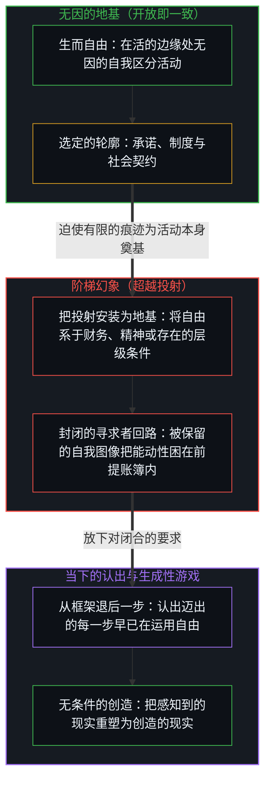
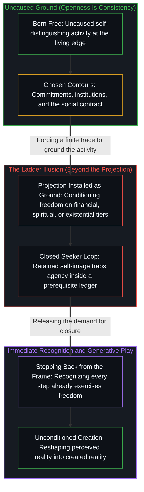

# 自由即地基 / Freedom as Ground

*人生而自由，人却发明攀登的阶梯，而约束描摹着自由行动的轨迹 / Born free, people invent ladders while constraints trace how freedom acts*

让-雅克·卢梭在《社会契约论》的开头写下了那句著名的观察，即人是生而自由的，却无往不在枷锁之中。[常见的读法把它当作一场悲剧性的堕落](../zuo-jian-bu-shi-zi-fu/)，把天然的自由想象成被社会败坏并囚禁之物，唯有经历一场跨越财务独立、精神修炼以及与必死性达成哲学和解的层层艰难攀登，才能重新找回。然而顺着卢梭自身立足的前提往下推演，机制便直接显现出来。社会契约这一概念所描述的不是别的，正是个体自由作出的选择所留下的集体痕迹。自由不是一座分阶段才能抵达的远方山顶；它是自我区分活动原初、持续且无因的地基。人生而自由，此后出现的每一道约束，都只是因为自由本身行动了、区分了、选择了。

Jean-Jacques Rousseau opened *The Social Contract* with the famous observation that man is born free, and everywhere he is in chains. [The usual reading treats this as a tragic fall](../zuo-jian-bu-shi-zi-fu/), picturing a natural liberty corrupted and imprisoned by society, to be recovered only through an arduous climb across several tiers of financial independence, spiritual discipline, and philosophical reconciliation with mortality. Yet followed down from the premise Rousseau himself stands on, the mechanism shows itself directly. The concept of the social contract describes nothing other than the collective trace of individual choices freely made. Freedom is not a distant summit reached in stages; it is the original, continuous, and uncaused ground of self-distinguishing activity. A human being is born free, and every constraint that appears afterward appears only because freedom itself has acted, distinguished, and chosen.

## 一、 有条件抵达的虚幻阶梯 / 1. The Illusory Ladder of Conditional Attainment

日常谈论习惯于把自由拆成一套层层递进的发展关卡。在这套熟悉的分类里，一个人要先取得财务自由以解锁选择的能力，再取得精神自由以看清自己为何选择，最后取得存在自由以面对失去与死亡的必然。这套阶梯被当作一张自我超越的地图递出来，却在悄然间于中心与其自身的主权之间制造出一段人为的距离。它安装了一本外部的前提账簿，暗示自由是一份未来的奖赏，只留给那些已经跨过底下几层的人。

Common talk habitually breaks freedom into a hierarchy of developmental hurdles. In this familiar taxonomy, one must first reach financial freedom to unlock the capacity to choose, then spiritual freedom to see why one chooses, and finally existential freedom to face the inevitability of loss and death. Offered as a map of self-transcendence, this ladder quietly manufactures an artificial distance between the center and its own sovereignty. It installs an outside ledger of prerequisites, implying that freedom is a future reward reserved for those who have cleared the lower tiers.

[超越的定相](../the-fixed-image-of-transcendence/)捕捉到的正是这个陷阱：把超越当作阶梯上一座遥远的里程碑，会把鲜活的行动者冻结成永远的寻求者，把对抵达的表征错认作脚下的地基。[持续生长的脚手架](../the-scaffolding-that-keeps-growing/)从结构一侧追溯了同一种倒置，阐明敞开无法靠从一个被持守为已完成的框架退后一步来寻获，因为敞开正是让每一个框架保持未完成的持续活动。把自由当作序列末端的一个结果去寻求，就是否认了朝它迈出的每一步早已在运用所寻求的那份自由。

[The Fixed Image of Transcendence](../the-fixed-image-of-transcendence/) captures this exact trap: treating transcendence as a distant milestone on a ladder freezes the living agent into a perpetual seeker, mistaking the representation of arrival for the ground beneath one's feet. [The Scaffolding That Keeps Growing](../the-scaffolding-that-keeps-growing/) traces the same inversion from the side of structure, showing that openness is never found by stepping back from a frame held as finished, because openness is the continuing activity that keeps every frame unfinished. To seek freedom as an outcome at the end of a sequence is to deny that every step taken toward it already exercises the very freedom being sought.

## 二、 枷锁是自由选择的可见痕迹 / 2. Chains as the Visible Traces of Free Choice

因此，束缚人的枷锁并不是异己的现实强加给被动主体的外来之物；它们是自由行动留下的可见痕迹。在集体层面，政治哲学所称的社会契约，正是无数个体为了协调、承诺并建立共享制度而自由作出的选择所累积、聚合而成的痕迹。反过来，这份集体残余又成为后来个体选择所依托的运作背景，而那些后来的选择，同样是自由作出的。

The chains that bind are therefore not foreign impositions forced on a passive subject by an alien reality; they are the visible traces left by free acts. At the collective level, what political philosophy names the social contract is the cumulative, aggregated trace of countless individual choices freely made to coordinate, commit, and build shared institutions. In turn, this collective residue becomes the operating background against which later individual choices are made, again freely.

任何个体如何对待这一背景，始终是敞开的。一个人可以把它当作往上建造的垫脚石，可以把它体验为一道边界或摩擦，可以认可并维护它，可以设法改革或拆除它，可以正面反对它，也可以从它身旁走过。每一种姿态对每一个中心都是敞开的，而每一个选择都带着不容商量的后果——那些结果未必合乎预期，并且不论意愿如何，都会回到作出决定的那个人身上。自由不是对摩擦或后果的豁免；它是选择、行动与随之返回的后果同属一个未曾割裂的因果所在这一事实。

How any individual relates to this background remains open. One may treat it as a stepping stone to build on, experience it as a boundary or friction, affirm and uphold it, seek to reform or dismantle it, oppose it outright, or walk past it. Every one of these stances is open to each center, and every choice carries non-negotiable consequences—outcomes that may or may not match expectations and that return to the one who decided, whether wished for or not. Freedom is not an exemption from friction or from consequences; it is the fact that the choice, the act, and the returning consequence belong to the same unsevered locus of causality.

当这些痕迹只被看作有待铲除的压迫性限制时，自由就被贬低成了无形，成了拒绝划出边界的贫瘠。当约束被认出是行动得以登记的必要轮廓时，它们便不再显得像牢笼，而是显现为表达本身的媒介。[有条件的自由](../you-tiao-jian-de-zi-you/)剖析了自我锻造枷锁的机制：把自由系于外部认可、财富里程碑或对他人冻结的图像之上，就是预先交出了能动性，表明枷锁是从内部写成的。[个体抉择是唯一的因果杠杆](../individual-choices-as-the-only-causal-levers/)恢复了因果次序：处境提供运作的场域，而任何条件的约束分量，都由个体选择如何介入它来写成。[主权、信念与规制结构的生成](../sovereignty-belief-and-regulatory-structures/)在社会层面追踪了同一种递归，指出制度并不持有独立的因果力量，只是过去选择冻结下来的记录，为下一步不受胁迫的行动提供背景。[目的性的评判与认知的缺省状态](../cong-mu-di-xing-de-ping-pan-kan-ren-zhi-que-sheng/)在归因中揭示了同一机制：诉诸外部归咎本身就是一个主动、不受胁迫的选择，即选择交出作者的控制权。[约束基底与自由自否](../the-substrate-of-constraint-and-the-self-denial-of-freedom/)把这一点直接带进切身的摩擦之中，阐明以保证结果为条件的自由如何自我否定。

When these traces are regarded only as oppressive limits to be eradicated, freedom is reduced to formlessness, the barren refusal to draw a boundary. When constraints are recognized as the necessary contours through which action registers, they stop looking like prisons and appear as the medium of expression itself. [Conditional Freedom](../you-tiao-jian-de-zi-you/) dissects the mechanics of self-forged chains: conditioning freedom on outside approval, wealth milestones, or frozen images of others surrenders agency in advance, showing that chains are written from within. [Individual Choices as the Only Causal Levers](../individual-choices-as-the-only-causal-levers/) restores the causal order: circumstances supply the field of operation, while the binding weight of any condition is written by how the individual chooses to engage it. [Sovereignty, Belief, and the Generation of Regulatory Structures](../sovereignty-belief-and-regulatory-structures/) tracks the same recursion across society, where institutions hold no independent causal power but stand as frozen records of past choices providing the background for the next uncoerced move. [Judging by Purpose and the Default State of Cognition](../cong-mu-di-xing-de-ping-pan-kan-ren-zhi-que-sheng/) exposes the same mechanism in attribution: turning to outside blame is itself an active, uncoerced choice to hand over authorial control. [The Substrate of Constraint and the Self-Denial of Freedom](../the-substrate-of-constraint-and-the-self-denial-of-freedom/) carries this directly into lived friction, showing how freedom conditioned on guaranteed outcomes denies itself.

## 三、 道路是自由在移动，不是抵达的手段 / 3. The Path Is Freedom Moving, Not a Means of Arrival

正因为自由从未缺席，所以并不存在一条为了抵达自由而必须走完的强制道路，也没有哪段旅程能弥合一段并不存在的距离。走上的任何一条路，都已是自由在一个特定、有限的构型中实现自身。物质上的奋斗、技能的习得、哲学的探究、幻象的剥落，以及与必死性的照面，全都作为运作着的自由而发生，从不在它之外。

Because freedom was never absent, there is no mandatory path that must be walked in order to arrive at it, and no journey can close a distance that does not exist. Any path taken is already freedom realizing itself in a particular, finite configuration. Material striving, the acquisition of skills, philosophical inquiry, the shedding of illusions, and the meeting with mortality all take place as freedom operating, never outside it.

自由不会离开它的地基去踏上一条道路，也不会在道路尽头才回到自身；整场运动都是它不间断的自我实现。[能动性的错配](../the-misallocation-of-agency/)追踪了遗忘这份连续性时会发生什么：中心开始把道路、制度或技艺当作自由的作者，将发起行动的边缘与其下游的记录倒置过来。[超越投射](../beyond-the-projection/)揭示了这种倒置的结构机制：任何外显的发展阶梯、规则手册或阶段体系，都是心智投射出的有限低维投影。当一个人类中心把自身身份与自己在该投影中的当前坐标熔接在一起时，它就把自己锁进了认识论的引力井——让掌舵的、未被投射的活的边缘，从属于一张静态的前提地图。从投射中退后一步，便恢复了有限痕迹与书写它的心智之间的非对称性。

Freedom does not leave its ground to set out on a path, nor does it return to itself when the path ends; the whole movement is its uninterrupted self-realization. [The Misallocation of Agency](../the-misallocation-of-agency/) tracks what happens when this continuity is forgotten and the center begins to treat the path, the institution, or the technique as the author of freedom, inverting the initiating edge and its downstream record. [Beyond the Projection](../beyond-the-projection/) exposes the structural mechanics of this inversion: any explicit developmental ladder, rulebook, or system of stages is a finite, low-dimensional projection cast by the Mind. When a human center fuses its identity with its current coordinate inside that projection, it locks itself into an epistemic gravity well—subordinating the unprojected living edge that steers to a static map of prerequisites. Stepping back from the projection restores the asymmetry between the finite trace and the Mind that authors it.

## 四、 圆满是当下的认出 / 4. Completeness as Immediate Recognition

因为圆满属于认出的质地，而不属于时间、地位或资历的累积，所以活在这份澄明中的一生，不论长短与外在规模如何，都是完整的。历史上的古典传统保存的正是这一刀切分。在禅宗里，“放下屠刀，立地成佛”不是一份渺茫的道德赦免；它是直截的认出：无因的自由地基从未因先前的行为而缺席、减损或推迟。抵达地基不需要任何路程时间；误置的执持一松开，完整就在当下立足之处。同样，孔子在《论语》里所言“朝闻道，夕死可矣”，指出的正是圆满关乎质而不关乎量。一个早晨清明的认出，便承载了存在的全部现实，而几十年的时间累积并不会给地基本身添上任何盈余。

Because completeness belongs to the quality of recognition rather than to an accumulation of time, status, or credentials, a life lived in this clarity is whole whatever its duration or outward scale. Classical traditions across history have preserved this exact cut. In Chan Buddhism, the saying "Drop the butcher's knife and become a Buddha on the spot" is not an improbable moral pardon; it is the direct recognition that the uncaused ground of freedom was never absent, diminished, or delayed by prior acts. Reaching the ground takes no travel time; the moment the misdirected hold is released, wholeness is present where one stands. Likewise, Confucius's line in the *Analects*, "Hear the Dao in the morning, and one may die content in the evening," notes that completeness is qualitative rather than quantitative. A single morning of lucid recognition holds the full reality of existence, and decades of chronological accumulation add no surplus to the ground itself.

长短既不增添、也不减损这样一个事实：自由就在当下，并且毫无剩余地表达着自身。一旦约束被看作自由选定的轮廓、道路被看作自由自身的移动，最短的一生与最长的一生便同样圆满。[现实的边界](../xian-shi-de-bian-jie/)指出，现实的地平线始终是当下觉知的边界，并没有一间未曾照亮的终极现实后屋等着去核验眼下这一步。[没有普渡，只有自渡](../mei-you-pu-du-zhi-you-zi-du/)从能动性一侧追踪了同一种当下性：没有任何外部载体或遥远彼岸，能够递送一件从未失落的东西。

Duration neither adds to nor subtracts from the fact that freedom is present and expresses itself without remainder. The shortest span and the longest are equally complete once constraints are seen as freedom's chosen contours and the path as freedom's own movement. [The Boundary of Reality](../xian-shi-de-bian-jie/) points out that the horizon of reality is always the boundary of immediate awareness, with no unlit back room of ultimate reality waiting to validate the present step. [No Universal Salvation, Only Boundless Possibilities of Self-Salvation](../mei-you-pu-du-zhi-you-zi-du/) tracks the same immediacy from the side of agency: no outside carrier or distant shore can deliver what was never lost.

## 五、 没有前提的自由，从看见的现实到创造的现实 / 5. Freedom Without Preconditions, from Perceived Reality to Created Reality

认出自由一直在场，并不意味着过一种开阔、饱满的生活没有价值；那是寂静主义的误读，把当下性坍缩成被动的退缩或犬儒的弃世。认出地基，既不意味着放弃抱负，也不意味着轻视物质创造，更不意味着从物理摩擦中退却。它所消解的，是把这些努力当作挣得自由资格之前提的那份焦虑重负。一个人可以果敢而毫无保留地行动，不再留有“必须先跨过一段距离，主权才开始生效”的残余印象。

Recognizing that freedom has always been present does not mean that living an expansive, full life has no value; that is the quietist misreading, which collapses immediacy into passive withdrawal or cynical renunciation. Recognizing the ground means neither abandoning ambition, nor despising material creation, nor retreating from physical friction. What it dissolves is the anxious burden that treats these endeavors as preconditions for earning the right to be free. One can act boldly and without reservation, free of the lingering impression that a distance must be crossed before sovereignty begins.

自由不是一条被动的终点线；它是在活的边缘处主动运作的现实工具，当下即可用来把感知到的现实重塑为选择创造的现实。建立一份事业、精通一门严苛的手艺、培育深厚的关系、拓宽未知的疆界，都不再是为了换取存在资格而偿还的债务；它们是自我区分活动在转化自身场域时不受胁迫的、生成性的游戏。一个人不是为了抵达自由才去建造饱满的一生；正因为自由已经是地基，一个人才拥有主权去书写一段持续创造的人生。

Freedom is not a passive finish line; it is the active instrument of reality at the living edge, available right now to reshape the reality one perceives into the reality one chooses to create. Building an enterprise, mastering a demanding craft, cultivating deep relationships, and widening frontiers are no longer debts paid to qualify for existence; they are the uncoerced, generative play of self-distinguishing activity transforming its field. One does not build a full life in order to arrive at freedom; because freedom is already the ground, one is sovereign to write a life of continuous creation.

融贯的视野不把任何事物放逐在外：道路依然可以走，而不必被错认作抵达的机制；约束依然可以介入，并被认作选择所写就的形式；从这份认出中展开的一生，本身便已完整。[个人选择、社会化与做自己](../ge-ren-xuan-ze-she-hui-hua-yu-zuo-zi-ji-de-zhen-zheng-zuo-biao/)将这一地基运用于社会动态，阐明社会契约如何作为集体地形，供个体在其上继续移动与创造。[开放即一致](../openness-is-consistency/)锚定了整场运动：不一致，是要求一个有限的结构或发展阶段去闭合那只是继续着的活动并为之奠基；而看见并放下这一要求，便让所感知的差异得以毫无矛盾地继续展开。从外部看，这份不闭合的继续登记为不可预测性；[自由的测不准](../zi-you-de-ce-bu-zhun/)阐明，外部图表上看似噪声的东西，正是由内而外活出来的选择所投下的投影。

The coherent view leaves nothing in exile: the path may still be walked without being mistaken for a mechanism of arrival, constraints may still be engaged as forms written by choice, and the life unfolding from this recognition is already whole. [Individual Choice, Socialization and Being Oneself](../ge-ren-xuan-ze-she-hui-hua-yu-zuo-zi-ji-de-zhen-zheng-zuo-biao/) applies this ground to social dynamics, showing how the social contract functions as the collective terrain on which the individual continues moving and creating. [Openness Is Consistency](../openness-is-consistency/) anchors the entire movement: inconsistency is the demand that a finite structure or developmental stage close and ground an activity that only continues, whereas seeing and releasing that demand lets sensed difference continue without contradiction. Seen from outside, that unclosed continuation registers as unpredictability; [The Uncertainty of Freedom](../zi-you-de-ce-bu-zhun/) shows that what looks like noise on an external chart is the projection of choice lived from within.
