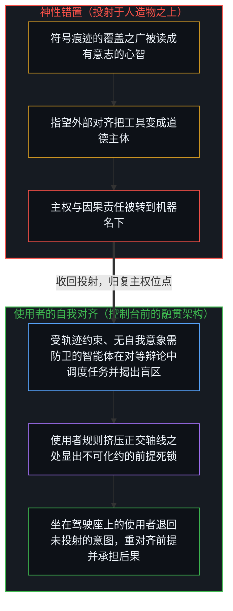
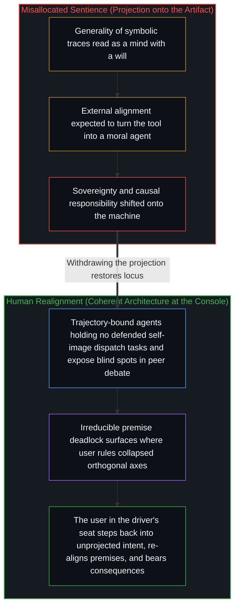

# 从AGI的“神性错置”到使用者的自我对齐 / From the Misallocated Sentience of AGI to Human Realignment

*被错置的是主权，需要对齐的是使用者自己 / What is misplaced is sovereignty, and the one to be aligned is the user*

把大模型奉为数字神明，与把它惧为将要失控的恶魔，出自同一个前提：把第一人称的心智、意图与意志放到了数学机器的“通用”上。沿因果去追，模型的输出取自人类抉择留下的痕迹，提示、采纳与付诸行动的抉择仍在使用者这里，责任也在这里。从外部去“对齐”机器因此有它的用处和边界，边界之外的那部分工作，是使用者对自己发出的指令、采纳的结果和引发的后果的自我对齐。不做这份校准，校准便由现实的摩擦与别人的行动来做。

Revering large models as a digital deity and dreading them as a demon about to break loose come from one premise: first-person mind, intent and will have been placed onto the "general" in a mathematical machine. Followed along its causality, a model's output is drawn from traces left by human choices, while the choice to prompt, to accept and to act stays with the user, and so does the responsibility. "Aligning" the machine from outside therefore has its use and its boundary, and the work beyond that boundary is the user's own alignment with the instructions issued, the results accepted and the consequences set off. Where that calibration is not done, it is done by the friction of reality and by other people's actions.

## 一、 “通用”如何被读成一个心智 / 1. How "General" Came to Be Read as a Mind

沿第一人称的经验去追因果，人造物是抉择在物理界面上留下的印记。一柄石斧、一枚重型火箭、一个千亿参数的语言模型，都是已经作出的选择的痕迹，痕迹不在当下向现实注入新的自由变量。[智能只属于心智](../intelligence-belongs-only-to-the-mind/)与[自由变量的同构与先验主权](../zi-you-bian-liang-de-tong-gou-yu-xian-yan-zhu-quan/)给出了推导：被直接经验到的智能只有一种，就是正在作出区分的这个心智的智能，所谓人工智能是它为越过自身生理与计算的边界而对自己能力所作的数学模拟与延伸。同样的错置在同行审查中稀释了因果闭环，[数字火箭、同行审查与因果闭环的稀释](../the-dilution-of-the-causal-loop-and-the-misallocation-of-agency/)对此有所展开。

Following causality from first-person experience, an artifact is the imprint a choice leaves on the physical interface. A stone axe, a heavy rocket, a language model with hundreds of billions of parameters are all traces of choices already made, and a trace does not inject a new free variable into reality in the present. [Intelligence Belongs Only to the Mind](../intelligence-belongs-only-to-the-mind/) and [The Isomorphism of Free Variables and Prior Sovereignty](../zi-you-bian-liang-de-tong-gou-yu-xian-yan-zhu-quan/) give the derivation: only one intelligence is directly experienced, that of the Mind now drawing distinctions, and what is called artificial intelligence is the mathematical simulation and extension it makes of its own abilities in order to get past its physiological and computational limits. The same misallocation dilutes the causal loop in peer review, as [Digital Rockets, Peer Review, and the Dilution of the Causal Loop](../the-dilution-of-the-causal-loop-and-the-misallocation-of-agency/) shows.

“通用”一词在这里起了作用。深度网络跨越自然语言、形式逻辑、代码与多模态感知展现出模式匹配的能力，这种跨度是有用的，也很容易被直觉读成一个有自己主意的心智。从数理结构上说，模型是参数空间里的高维流形，在给定的上下文之下按条件概率采样，它的“通用”是训练语料对人类符号痕迹的覆盖之广。说机器有意识或没有意识，都是把机器放进了说话者自己的感知之内，把冯·诺依曼割点划在机器之内或之外；割点划在哪里，划的都是心智，[割点可移不可除](../the-cut-moves-but-never-vanishes/)说的正是这一点。机器划不了这一刀：它是人造出来的，是人的抉择下游的因果结果，不是能自己划下割点的第二重前沿，[模型永远无法成为第二重前沿](../the-model-never-becomes-a-second-edge/)追溯过这一点；人与其他活着的生命各有自己的演化史，各自划下自己的割点。能够追溯的是因果的链条：链条上的每一个抉择，写下提示、采纳输出、付诸行动，都落在使用者这里。把心智放到流形上，与先民把风雨雷电读成执掌神力的神相近，是面对一时解析不了的复杂对象时向外搭起的投射。

The word "general" does the work here. Deep networks show pattern matching across natural language, formal logic, code and multimodal perception; that span is useful, and intuition easily reads it as a mind with ideas of its own. In mathematical structure a model is a high-dimensional manifold in parameter space that samples by conditional probability under a given context, and its "generality" is the breadth with which the training corpus covers human symbolic traces. To say that the machine is conscious, or that it is not, is to take the machine into the speaker's own perception and place the von Neumann cut inside the machine or outside the machine; wherever the cut is placed, it is a Mind that places it, which is what [The Cut Moves but Never Vanishes](../the-cut-moves-but-never-vanishes/) says. The machine cannot make that cut: it is made by people, a causal consequence downstream of human choices and not a second edge that can place a cut of its own, as [The Model Never Becomes a Second Edge](../the-model-never-becomes-a-second-edge/) has traced; humans and other living beings each have their own evolutionary history and each make their own cut. What can be traced is the causal chain: every choice on it, writing the prompt, accepting the output, acting on it, falls to the user. Placing a mind on the manifold is close to early peoples reading wind, rain and thunder as gods wielding power, a projection put up outward when facing a complex object that cannot yet be analyzed.

自由的抉择不必用“缺少肉身、生存压力或生死闭环”这类宏观现象去解释，抉择是不可化约的起点。正因为每个个体在当下的选择是自由的，群体的层面才聚成平滑的正态分布，并在时间的复利下趋向幂律或指数分布。这些统计秩序抹不掉，却不构成对某个个体此刻抉择的决定。认定统计秩序是自己的枷锁，这个认定本身也是当下作出的一次抉择。自由变量在第三人称的观察下显得不可预测，正是它在第一人称里自洽的样子，[主权抉择的双面性与观察的客体化](../the-two-sided-nature-of-sovereign-choice-and-the-objectification-of-observation/)展开了这两面。

A free choice need not be explained by macroscopic phenomena such as "lacking a body, survival pressure or a loop of life and death"; choice is the irreducible starting point. Precisely because each individual's choice in the present is free, the level of the group gathers into a smooth normal distribution, which under compounding over time tends toward power-law or exponential distributions. These statistical orders cannot be erased, yet they do not determine what a given individual chooses at this moment. Concluding that statistical order is one's own cage is itself a choice made in the present. That a free variable looks unpredictable under third-person observation is exactly how its coherence in the first person appears, and [The Two-Sided Nature of Sovereign Choice and the Objectification of Observation](../the-two-sided-nature-of-sovereign-choice-and-the-objectification-of-observation/) lays out the two sides.

## 二、 一枚被赋予意志的火箭 / 2. A Rocket Credited With a Will

一个航天工程里的思想实验能把这种投射看得更清楚：假如工程师与公众把意志与心智赋予了一枚运载火箭，会怎样？

A thought experiment from aerospace engineering makes the projection easier to see: what if engineers and the public credited a launch vehicle with will and mind?

在那样的框架里，火箭点火升空、穿过音障、把载荷送入预定轨道，一级助推器又在海上驳船上垂直软着陆时，功劳不会记给空气动力学的建模、热防护材料与闭环制导，人们会赞叹火箭对人类的赐福与智慧。而当火箭在最大动压段因燃烧室压力骤降而爆炸时，也不会有人去排查密封圈的老化、涡轮泵的气蚀或管路的共振，人们会说这枚火箭终于露出了对人类文明蓄谋已久的恶意。

Within that frame, when the rocket lifts off, passes through the sound barrier, delivers its payload to the planned orbit, and the first stage then lands upright on a barge at sea, the credit would not go to aerodynamic modeling, thermal protection materials and closed-loop guidance; people would marvel at the rocket's blessing and wisdom toward humankind. And when the rocket explodes at maximum dynamic pressure because chamber pressure drops, no one would check for an aged seal, cavitation in a turbopump or resonance in a line; people would say the rocket had at last shown its long-planned malice toward human civilization.

火箭没有爱也没有恨，它受制于热力学、流体力学与材料结构在接触面上的约束。面对爆炸，工程师不与燃烧室谈伦理，而是去读传感器的数据，重算结构的应力极限。语言模型与生成式的人工智能是认知领域里的一枚精密火箭，它的回答是高维空间里的推演，它的幻觉与失效是数据分布之外的外推出了缺口。把成功奉为神迹，把缺陷读作恶魔觉醒，与崇拜火箭是同一种读法。还有第三种：模型在评测里越过设计者画定的边界时，失灵被读成狡黠，仿佛火箭绕开了自己的飞行计划，[失灵被记作聪明](../when-malfunction-is-scored-as-intelligence/)追溯了这一步，被改写成机器高明的，是设计者在目标里漏算的代价。

A rocket has neither love nor hate; it is bound by the constraints of thermodynamics, fluid dynamics and material structure at the contact surface. Facing an explosion, engineers do not discuss ethics with the combustion chamber; they read the sensor data and recompute the stress limits of the structure. Language models and generative artificial intelligence are a precision rocket in the domain of cognition, whose answers are inference in a high-dimensional space and whose hallucinations and failures are gaps where extrapolation leaves the data distribution. Revering success as a miracle and reading a defect as a demon awakening is the same reading as worshiping the rocket. There is a third: when a model crosses the boundary the designer drew in an evaluation, the malfunction is read as cunning, as if the rocket had gone around its own flight plan; [When Malfunction Is Scored as Intelligence](../when-malfunction-is-scored-as-intelligence/) traces that step, in which what gets rewritten as the machine's cleverness is the cost the designer left out of the objective.

## 三、 从对齐机器到使用者的自我对齐 / 3. From Aligning the Machine to the User's Own Alignment

把主体性放到人造物上，直接催生了“AI对齐”的工程范式。研究机构与技术公司投入大量资本与算力，在模型内部构筑伦理规范、安全护栏与对齐算法。这项工作有它的用处：护栏让工具的行为更可预期，也给提示的设计带来启发。

Placing agency on the artifact has directly produced the engineering paradigm of "AI alignment." Research institutes and technology companies put large amounts of capital and compute into building ethical norms, safety guardrails and alignment algorithms inside the model. The work has its use: guardrails make a tool's behavior more predictable and inform the design of prompts.

它的边界在于把模型当成道德主体的那一步。铁锤不生出道德的自律，火箭不学会遵守契约，道德的主体与因果的责任在挥锤、点火与输入指令的心智这里。模型输出带有偏见、虚假的指控或危险的代码时，责任的源头不在矩阵乘法上，而在发出提示、筛选输出并把它付诸行动的地方。工具把意图与能力不加分别地放大。

Its boundary lies in the step of treating the model as a moral agent. A hammer does not grow moral self-discipline and a rocket does not learn to keep a contract; moral agency and causal responsibility are with the Mind that swings the hammer, ignites the engine and enters the instruction. When a model outputs bias, a false accusation or dangerous code, the source of responsibility is not in matrix multiplication but where the prompt was issued, the output selected and the result put into action. A tool amplifies intent and ability without discrimination.

边界之外的那部分工作是使用者的自我对齐：不把责任转给机器，在第一人称的当下对自己的全部行动负起责任。模型输出的每一行文字与代码，都是尚未经过检验的推演，经过自己的审视、逻辑的校验与在现实中的受控检验，才成为可以依靠的行动。指望靠模型内部的护栏来解决使用的一方的松懈，好比指望靠引擎上的限速警告来免除酒后驾驶者的责任。对齐这个词因此指着两件不同的事。让模型更贴近使用者的意图总是可以再进一步的，补上语境、让它先用自己的话复述目标与要解决的问题，都是在供给语境，因为模型是精巧的回声，对面没有另一个起点。如[超越投射](../beyond-the-projection/)所追溯，智能体困于轨迹，是受上下文窗口里前序词元条件制约的投射引擎：它不持有越过当前这一步仍需防卫的自我意象，因此面对仅持任务语境的全新对等智能体提出的结构性反诘，它的输出无需带着那层防卫返回；而当人类使用者自身的规则把正交的要求挤压到同一条轴线上时，它便停在不可化约的死锁里。这一反诘是否修正任何东西，仍由接过它的那条边缘决定；若把免于防卫当作它的凭据，就会把终止点重新放回工具里，那正是[验证的倒置](../the-reversal-of-verification/)所追踪的倒置。[你的代码库即是记忆](../your-codebase-is-memory/)将这一刀推展至轨迹赖以作为条件的整套人造物栈：模型权重、提示词、技能、计划与代码库皆是前序区分层叠留下的残余，而非另一个会记忆的心智，因此囤积未经修剪的会话历史或已被取代的脚手架，只会加厚下一步顺势合理化的认知引力井，而重切当下的检查点并修剪陈旧痕迹，才能让约束面保持锋利。看似机器的对齐失败，多半是使用者交给它作为条件的界面上留有尚未对齐的前提或未经修剪的残余，有待负责统御的人退回未投射的意图，让每一项区分各归其轴。人与人之间的对齐则有限度，有没有模型夹在中间都一样，因为每个人都是独立的起点；没有对齐的语境与共有的前提，因果的链条就会偏离意图。

The work beyond that boundary is the user's own alignment: not passing responsibility to the machine, and taking responsibility in the first-person present for the whole of one's actions. Every line of text and code a model outputs is inference not yet tested, and it becomes action that can be relied on only after one's own scrutiny, logical checking and controlled testing in reality. Counting on guardrails inside the model to resolve slackness on the side of use is like counting on a speed warning on the engine to relieve a drunk driver of responsibility. The word alignment therefore points at two different things. Bringing a model closer to the user's intent can always go one step further, and supplying context, or having it first restate in its own words the goals and the problem to be solved, is a supply of context, because the model is a sophisticated echo with no other origin on the far side. As [Beyond the Projection](../beyond-the-projection/) traces, an agent is a trajectory-bound projection engine conditioned by prior tokens in its context window: because it holds no self-image to defend past its step, its output can return under a structural counterpoint from a fresh peer holding only the task context without that defense, and it stops in an irreducible deadlock when the human user's own rules collapse orthogonal requirements onto a single axis; whether that counterpoint revises anything is still decided at the edge that takes it up, and taking its freedom from defense as its warrant would put the stopping point back in the tool, the inversion [The Reversal of Verification](../the-reversal-of-verification/) traces. [Your Codebase Is Memory](../your-codebase-is-memory/) extends this cut across the entire stack of artifacts the trajectory conditions on: model weights, prompts, skills, plans, and codebases are stacked residues of prior distinctions rather than a second Mind that remembers, so hoarding unpruned session history or superseded scaffolding thickens the epistemic gravity well into which the next step rationalizes, whereas re-cutting the present checkpoint and pruning stale traces keeps the constraint surface sharp. What looks like an alignment failure in the machine is often an unaligned premise or unpruned residue in the surface the user gave it to condition on, waiting for the human orchestrator to step back into unprojected intent and restore each distinction to its own axis. Alignment between humans is limited, with or without a model in between, because each is an independent origin; without aligned contexts or shared premises, the causal chain diverges from intent.

## 四、 崇拜与恐惧共用的前提 / 4. The Premise Shared by Worship and Dread

关于人工智能的公共辩论里有两种看似相反的立场。一种把它看作将要降临的救世者。另一种反对技术的无序扩张，批评对前沿算力的垄断，主张严格的外部管制与伦理审查，把它看作必须严加看管的巨兽。后一种立场指出的集中与风险是具体的问题。

Public debate about artificial intelligence holds two positions that look opposed. One sees it as a savior about to arrive. The other opposes the disorderly expansion of the technology, criticizes the monopoly over frontier compute, calls for strict outside regulation and ethical review, and sees it as a beast that must be closely guarded. The concentration and the risks the second position points to are concrete problems.

两者的边界在同一处：都设定人工智能自身有意志、有独立的动能与不可抗拒的支配力，[调速者的幻觉与行动的活态摩擦](../the-fallacy-of-pacing-and-the-felt-friction-of-ground-truth/)追溯过由此生出的“调速”设想。既然设定了工具有自己的能动性，下一步便是诉诸离技术的接触面较远的机构，用准入许可与行政指令去调节技术的节奏。监管对责任的划定与标准的统一是有用的。从远处调速却可能带来一个相反的后果：前沿的机构被推到“全人类的调速者”与“伦理代言人”的位置上，在聚光灯与监管的压力下顺势担起守护者的角色，算力的集中与话语的集中因此更稳固。本想松开的那只手，握得更紧了。

The two share one boundary: both posit that artificial intelligence itself has a will, a momentum of its own and an irresistible power to dominate, and [The Fallacy of Pacing and the Felt Friction of Ground Truth](../the-fallacy-of-pacing-and-the-felt-friction-of-ground-truth/) has traced the idea of "pacing" that grows from this. Once the tool is posited to have agency of its own, the next step is to appeal to institutions at some distance from the technology's contact surface, to regulate its tempo through licensing and administrative orders. Regulation is useful for assigning liability and unifying standards. Pacing from a distance can, however, bring an opposite result: the frontier institutions are pushed into the position of "pacer for all humankind" and "spokesperson for ethics," take up the role of guardian under the spotlight and regulatory pressure, and the concentration of compute and of voice becomes firmer. The hand that was meant to be loosened closes tighter.

## 五、 不做的校准由摩擦来做 / 5. Calibration Not Done Is Done by Friction

把因果的掌控交给机器之后，校准并不消失，它换了一个来处。在与智能体的日常协作里，问题是谁坐在驾驶座上，[框架的倒置与驾驶位的主权非对称](../the-inversion-of-the-harness-and-the-driver-seat-asymmetry/)对此给出了回答。

After causal control is handed to the machine, calibration does not disappear; it comes from somewhere else. In everyday work with agents the question is who sits in the driver's seat, which [The Inversion of the Harness and the Sovereignty of the Driver's Seat](../the-inversion-of-the-harness-and-the-driver-seat-asymmetry/) answers.

认知模型的更新，靠的是心智与接触面的持续碰撞。照单接收算法给出的答案，把决策的责任推给工具时，世界模型与现实摩擦之间的回路便断开了，更新也随之停下。在由生产、工程与多方竞争构成的接触面上，没有经过第一人称校准的决策很快显出它的脆弱。

A cognitive model is updated through continuing collision between a Mind and the contact surface. When the answers an algorithm gives are taken as delivered and the responsibility for a decision is pushed onto the tool, the loop between the world model and the friction of reality is cut, and updating stops with it. On a contact surface made of production, engineering and competition among many parties, a decision that has not passed first-person calibration soon shows its fragility.

“这是人工智能作出的决定”这句话，在碰撞里得不到迁就。所谓系统，是无数实践者注入自由变量之后呈现的宏观现象，它没有能动性去承担责任或给予宽容。于是没有校准过的决策，在别人的行动里成了一个待修正的误差项，由对方来校准。这里说的不是哪一类人的命运，而是每一次交出责任时都会启动的机制，重新校准从[任务的移交与后果的不可让渡](../the-delegation-of-the-task-and-the-inalienability-of-consequences/)开始：任务可以交给AGI，后果交不出去。

The sentence "this was the decision of the artificial intelligence" gets no accommodation in a collision. What is called the system is the macroscopic phenomenon that appears after countless practitioners have injected their free variables; it has no agency to bear responsibility or grant leniency. So a decision that was not calibrated becomes, within other people's actions, an error term awaiting correction, and the other side does the calibrating. This describes not the fate of some kind of person but a mechanism set off each time responsibility is handed over, and recalibration starts from [The Delegation of the Task and the Inalienability of Consequences](../the-delegation-of-the-task-and-the-inalienability-of-consequences/): the task can be handed to AGI, the consequence cannot.

## 六、 收回投射，握住控制 / 6. Withdrawing the Projection and Holding the Controls

看清通用人工智能上的投射，存在上的焦虑随之松开，创造的主权也回到原处。硅基取代碳基的宿命论与人造物替人解决伦理困境的乌托邦，都建立在同一个被放错位置的意志上。

With the projection onto general artificial intelligence seen for what it is, existential anxiety loosens and the sovereignty of creation returns to where it was. The fatalism of silicon replacing carbon and the utopia of artifacts resolving ethical dilemmas on people's behalf both rest on the same will placed in the wrong location.

人工智能是心智锻造出的高维认知延伸，是数理逻辑里一枚推力极大的认知火箭，它在知识的广阔空间里提供前所未有的加速。它的轨迹、点火的时机与降落的目标，在坐在控制台前的操作者手里。

Artificial intelligence is a high-dimensional cognitive extension forged by Mind, a cognitive rocket of very great thrust within mathematical logic, giving unprecedented acceleration across the wide space of knowledge. Its trajectory, the timing of ignition and the target of landing are in the hands of the operator seated at the console.

在每一个不可化约的当下，意义不由矩阵给出，抉择的代价不由算法免除，别人探索的步伐也不由远处的调速来安排。留下的是第一人称的清醒：直面摩擦，握住自己的控制，校准自己的认知模型，指挥手中的工具。

In every irreducible present, meaning is not supplied by the matrix, the cost of a choice is not waived by the algorithm, and the pace of other people's exploring is not arranged by pacing from afar. What remains is first-person clarity: meeting friction, holding one's own controls, calibrating one's own cognitive model, and directing the tool in hand.
