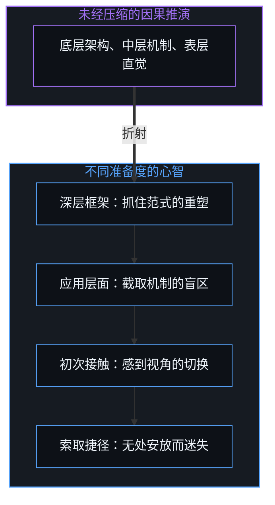
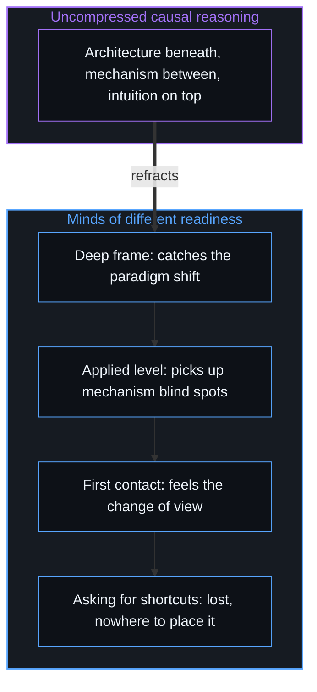

# 高维信息的离散折射与认知分层 / The Discrete Refraction of High-Dimensional Information

*大众传播把多维现实压成单一捷径，在第一人称当下展开的沟通，让每位听者各取所需 / Mass communication flattens reality into one shortcut; first-person communication lets each listener take what fits.*

在公共表达与大众媒介的场域里，内容传播面对一种结构性的张力：追求受众覆盖面最大化的传播者，把多维复杂的现实经验压成低门槛的口号、非黑即白的结论或可以直接套用的操作捷径。当一个人选择不做这种单向的降维压缩，而是在播客或公共对话里以第一人称展开高密度、多维度的第一性原理推演时，随之出现的是两极的分布：一边是击节赞赏的深度共鸣，一边是激烈抵触的全盘否定。

In public expression and mass media, the spreading of content faces a structural tension: communicators seeking to maximise audience reach compress many-dimensional, complex lived reality into low-threshold slogans, black-and-white conclusions, or shortcuts ready to apply. When someone chooses not to perform this one-way compression and instead unfolds dense, many-dimensional first-principles reasoning in the first person on a podcast or in public conversation, a polarised distribution follows: deep resonance and applause on one side, fierce resistance and wholesale rejection on the other.

这不是沟通策略的失灵，而是高维信息在不同认知坐标系里的离散折射。它揭示了信息匹配与视角错配的规律，也提供了一面观察心智怎样运行因果闭环的透镜。

This is not a failure of communication strategy, but the discrete refraction of high-dimensional information through different cognitive coordinate systems. It reveals how information matching and mismatched views work, and offers a lens for watching how a Mind runs its causal loop.

## 一、 最便宜的单一功能手机与苹果的产品矩阵 / 1. The Cheapest Single-Function Phone and Apple's Product Matrix

理解大众媒介里信息压缩的机制，可以借工业制造里的产品策略做一个机制上的类比。如果一家手机厂商唯一的目标是覆盖数量最多的用户，最优的策略就是造一台功能最单一、成本最低、没有任何使用门槛的普及型设备。在内容传播里，这台“单一低门槛设备”对应简化的情绪触点、抽离语境的格言、确定的结论或线性的叙事。正如[登记共鸣的表面](../the-surface-that-registers/)所追溯的，这类表述之所以分发效率极高，恰在于它们只约束少数几个坐标轴，而把源初的前提、适用边界与修正节点留在信道之外：不同的心智把既有的先验投射到那层薄表面上，将稀疏的交集登记为相互认出，可一旦抽离了多维约束与动态推演的张力，陈述就承载不了真实的因果复杂度。

The mechanism of information compression in mass media can be understood through an analogy with product strategy in manufacturing. If a phone maker's only goal is to reach the largest number of users, the optimal strategy is a mass-market device with the fewest functions, the lowest cost, and no threshold of use at all. In the spreading of content, this "single low-threshold device" corresponds to simplified emotional hooks, detached maxims, settled conclusions, or linear narratives. As [The Surface That Registers](../the-surface-that-registers/) traces, such formulations distribute with high efficiency precisely because they constrain only a few axes while leaving the originating premises, scope conditions, and revision points outside the channel: diverse minds project their existing priors onto that thin surface and register sparse overlap as mutual recognition, yet with the tension of many-dimensional constraint and dynamic reasoning stripped out, the statement carries no real causal complexity.

与之对照的，是高维表达呈现的“多层级产品矩阵”。一位思考者在对话里完整地呈现未经删减的因果推演，信息就在多个正交轴上展开纵深：底层是本体论的因果架构，中层交织着实际系统与博弈的运行机制，表层映照着敏锐的直觉经验。这样的输入进入公共视界，就像光穿过棱镜，在不同准备度的心智里自适应地分层：带着深层因果框架去听，会直接抓住底层的范式重塑；在应用层面去听，会截取中层的机制盲区与非共识的策略；初次接触时去听，也能从思路与推演的节奏里感到视角切换的冲击；习惯直接索取孤立答案与操作捷径时去听，则会因为无法把这些信息安放进既有框架而感到迷失。同一个人在不同的话题上，会站在这些位置里的不同一处。

Set against it is the "multi-tier product matrix" of high-dimensional expression. When a thinker presents uncut causal reasoning in full in a conversation, the information gains depth across multiple orthogonal axes: at the bottom an ontological causal architecture, in the middle the working mechanisms of real systems and games, on the surface the reflections of sharp intuitive experience. Entering the public field, such input is like light through a prism, layering itself adaptively in minds of different readiness: listening with a deep causal frame, one catches the paradigm shift at the bottom; listening at the applied level, one picks up the mechanism blind spots and non-consensus strategies in the middle; listening on first contact, one still feels the jolt of a changed view in the line and rhythm of the reasoning; listening in the habit of asking for isolated answers and shortcuts, one feels lost, unable to place the information in an existing frame. The same person stands at different ones of these positions on different topics.

这种分层不是人为设立的高低等级，而是信息的维度与心智接收带宽之间的结构性匹配。高维信息保留着完整的坐标空间，让每位听者在各自够得着的高度上各取所需；那些在既有框架无法解码时生出的困惑与反对，正是信息没被均质化压缩的直接表征。

This layering is not an artificial hierarchy, but a structural match between the dimensions of the information and the bandwidth of the receiving Mind. High-dimensional information, preserving its full coordinate space, lets each listener take what fits at the height within reach; the confusion and opposition that arise when a frame cannot decode it are the direct sign of information not compressed into uniformity.

## 二、 雕像的正反面 / 2. The Front and Back of a Statue

真实的播客对话里会出现一种诉求：“既然说对某项技术感兴趣，为什么不直接讲几个具体的技术原因，非要讲那么多抽象的逻辑与道理？”这种诉求背后，藏着对信息供给与认知建构机制的误解。可以用一座雕像的正反面来理解视角的几何关系：两个人站在同一座雕像的两侧，一个站正面，一个站背面；如果一个人留在背面，不肯挪动自己的观察位置，却要求对方把正面的细节描述到自己在背面也能看懂的程度，这在信息上是做不到的。

In real podcast conversations a request comes up: "if you are interested in some technology, why not just give a few concrete technical reasons instead of all this abstract logic and argument?" Behind it lies a misunderstanding of how information is supplied and how understanding is built. The geometry of views can be understood through the front and back of a statue: two people stand on either side of one statue, one at the front, one at the back; if one stays at the back, unwilling to move their own point of observation, yet asks the other to describe the front in enough detail to be understood from behind, that cannot be done informationally.

更要紧的是，具体信息的输入并不自动带来理解，效果取决于双方初始视角的相对几何关系。两人的观察坐标系很接近时，输入具体的公开数据与技术参数，能提高对方画面的分辨率，起到细化与校准的作用；两人的坐标系截然相反或正交时，输入越多具体的技术细节，越不能促成视角的转变，反而会被对方既有的心智框架吸收，做反向的合理化，进一步固化原来的看法。在复杂的动态系统与投资决策里，并没有脱离个人第一人称动态体系的静态判据；挑出一两个静态的技术参数当作“标准答案”，表面上迎合了对确定结论的渴望，实际上是用一张静态的局部切片替代了连续的动态校准。

More important, the input of concrete information does not automatically bring understanding; the effect depends on the relative geometry of the two starting views. When the two coordinate systems are close, concrete public data and technical parameters raise the resolution of the other's picture, refining and calibrating it; when the two are opposite or orthogonal, the more concrete technical detail is fed in, the less it shifts the view, and instead it is absorbed by the existing mental frame and reverse-rationalised, hardening the original opinion further. In complex dynamic systems and investment decisions there is no static criterion detached from a person's first-person dynamic system; picking one or two static technical parameters as "the standard answer" seems to meet the craving for settled conclusions while in fact replacing continuous dynamic calibration with a static local slice.

## 三、 从播客的退化到商业的停滞 / 3. From the Decline of Podcasts to Commercial Stagnation

传播里普遍有一种外部归因的倾向，默认“传播者有责任用最轻松的方式把我讲明白”；传播者一旦接受了这个外部设定的“责任”，整个系统就滑进一个互补的退化循环。这个机制在各个领域有着一致的轨迹。知识平台与知名播客起初以高密度的硬核洞察吸引一批核心听众；随着听众扩大，为了迎合更广人群的理解带宽，内容持续降维、稀释，向大众均值妥协；与此同时，规模的扩张带来沉重的变现压力，原本的机制探讨变成软性带货与迎合流量的表演。老听众的认知在继续迭代，节目的输出却向均值沉降，最后以听众的分化与流失收场。

Spreading content carries a widespread tendency toward outward attribution, the assumption that "the communicator is responsible for making me understand in the easiest way"; once the communicator accepts this outwardly set "responsibility", the whole system slides into a complementary loop of decline. The mechanism follows the same trajectory across fields. Knowledge platforms and well-known podcasts first attract a core audience with dense, hard-edged insight; as the audience grows, content is reduced, diluted, and compromised toward the public average to meet the bandwidth of a wider crowd; at the same time, scale brings heavy pressure to monetise, and what was an examination of mechanisms turns into soft selling and a performance for traffic. Long-time listeners keep iterating while the show's output sinks toward the mean, ending in the audience splitting and drifting away.

同样的因果机制也贯穿在商业公司与艺术创作里。一家创新企业起初能崛起，是因为它不妥协的产品形态抓住了未来的真实趋势，用户是奔着这份独特的价值汇聚过来的；可用户规模一到临界点，平台就反过来把“服务并迎合现有用户的拥挤需求”当作核心使命，把作为结果的用户增长当成了原因，把作为起点的核心创新降为从属，平台的架构随之变得臃肿、迟缓，失去自我更新的能力。艺术家在起步时处于第一人称的探索里，不求功利地直面所见；成名之后，一旦背上对受众道德化的“责任”，便转向迎合外界的期待与评价体系，这种迎合反过来扼杀了鲜活的原创灵感。这些现象的核心都是把因果颠倒了；缺乏清晰的第一人称锚点时，群体的互动就会滑向阻力最小的均值趋同。

The same causal mechanism runs through companies and artistic creation. An innovative company first rises because its uncompromising product catches a real future trend and users gather for that distinctive value; yet once the user base reaches a critical scale, the platform turns around and makes "serving and pleasing the crowded demands of existing users" its core mission, taking user growth, which is a result, for the cause and demoting the core innovation, which was the start, to a subordinate place, so that the platform's architecture grows bloated and slow and loses the capacity to renew itself. An artist at the start works in first-person exploration, facing what is seen without utilitarian aims; after fame, taking on a moralised "responsibility" toward the audience leads to catering to outside expectations and systems of evaluation, and that catering in turn chokes off living original inspiration. At the core of all these, cause and effect have been turned around; without a clear first-person anchor, group interaction slides toward the convergence on the mean that offers least resistance.

## 四、 阿甘的奔跑 / 4. Forrest Gump's Run

当交流的信息越过共识捷径、追溯因果机制时，它就在这条轴上处在超前的位置，人们的认知在时间轴上呈现滞后的正态或长尾分布。就像长跑：跑在前面时回头看，会看到一群在时间与空间上正在追赶的跟跑者，他们的出现是前面奔跑的自然副产品。陷阱在于，发现跟在身后的人越来越多，就停下来享受追捧，或放慢配速去迎合大部队，原本保持的超前身位就会随之瓦解。前与后在这里说的是在某一件事上的位置，不是人的等级。

When the information exchanged traces causal mechanisms past consensus shortcuts, it sits ahead on that axis, and people's understanding shows a lagging normal or long-tailed distribution along the time axis. It is like a long run: looking back from the front, one sees a group catching up in time and space, and their appearance is a natural by-product of running ahead. The trap is that, finding more and more people behind, one stops to enjoy the acclaim or slows the pace to suit the main pack, and the lead one held falls apart. Ahead and behind here name positions on one matter, not ranks of people.

这正是电影《阿甘正传》里阿甘横跨美国奔跑的意象：阿甘奔跑是因为自己选择去跑，前面有人还是后面有人，与他的步伐没有因果上的关联；成百上千的人跟在他身后、把他奉为精神导师时，他既不放慢脚步去迎合追随者，也不停下来向人群布道；决定停下时，他只是转身回家。这种状态，就是第一人称自主定向的样子：做事出于把事情推到逻辑闭环的内在愿望，与是否有人跟随、外界的赞赏或抵触脱钩。

This is the image of Forrest Gump's run across America in the film: he runs because he chooses to run, and whether anyone is ahead or behind has no causal bearing on his stride; when hundreds follow him and hail him as a spiritual guide, he neither slows to suit his followers nor stops to preach to the crowd; and when he decides to stop, he simply turns and goes home. This is what first-person self-direction looks like: acting out of an inner wish to carry the matter to a closed logical loop, detached from whether anyone follows and from outside praise or resistance.

## 五、 沟通的因果锚点 / 5. The Causal Anchor of Communication

要打破因果倒置的退化循环，关键在于重新校准沟通的第一自变量。[信息是什么](../what-information-is/)与[自由变量的同构与先验主权](../zi-you-bian-liang-de-tong-gou-yu-xian-yan-zhu-quan/)确立了行动的因果位阶：真实世界里的一切建构，只有以第一人称在当下的微观选择为锚，才能保持逻辑的自洽。在高质量的真实对话里，沟通的第一锚点，是在与对话者的实时碰撞里，探测并弥合自己认知架构中未知的盲点。把注意力放在捕捉推演中的逻辑断点、诚实地校准自己的前提假设、在现场完成思路的即时编译上，沟通就成了一个专注的、自我闭环的演化过程；听者的理解与共鸣，是这个过程自然溢出的副产品，而不是从一开始就设计好的迎合目标。

Breaking the declining loop of causal inversion turns on recalibrating the first independent variable of communication. [What Information Is](../what-information-is/) and [The Isomorphism of Free Variables and Prior Sovereignty](../zi-you-bian-liang-de-tong-gou-yu-xian-yan-zhu-quan/) establish the causal rank of action: every construction in the real world stays logically consistent only when anchored in a first-person micro choice in the present. In a real conversation of quality, the first anchor of communication is detecting and closing the unknown blind spots in one's own cognitive architecture through live collision with the other speaker. With attention on catching logical breaks in the reasoning, honestly calibrating one's own premises, and compiling the line of thought on the spot, communication becomes a focused, self-closing process of evolution; the listener's understanding and resonance are by-products that spill naturally from it, not a target of catering designed from the start.

不妥协的高维表达，还把外界的反馈变成诊断心智编译器的一面高分辨率透镜。[错置的因果与心智编译器](../cuo-zhi-de-yin-guo-yu-xin-zhi-bian-yi-qi/)与[投影的阶梯与因果的锚点](../tou-ying-de-jie-ti-yu-yin-guo-de-mao-dian/)指出，一切认同与争议，都是不同心智坐标系之间投影截面的差异。对话建立在公开的事实与数据之上，听懂或没听懂，取决于听者自己的心智模型如何解码这些痕迹；深度的共鸣标出了底层公理的交汇，激烈的反对则显露出编译器卡在哪一个局部坐标上。正如[你的代码库即是记忆](../your-codebase-is-memory/)所追溯的，把这份不妥协的推演从当下的掌舵边缘外化进持久的文库，便能跨越不同会话留存它完整的坐标空间，而不向人群均值稀释；像阿甘那样只管向前跑、不回头迎合追随者，则在[路口的转向与地平说的行动悖论](../lu-kou-de-zhuan-xiang-yu-di-ping-shuo-de-xing-dong-bei-lun/)里有更完整的展开。

Uncompromising high-dimensional expression also turns outside feedback into a high-resolution lens for diagnosing cognitive compilers. [Misplaced Causality and the Mind's Compiler](../cuo-zhi-de-yin-guo-yu-xin-zhi-bian-yi-qi/) and [The Ladder of Projections and the Anchor of Causality](../tou-ying-de-jie-ti-yu-yin-guo-de-mao-dian/) point out that all agreement and dispute are differences between projection cross-sections of different mental coordinate systems. The conversation rests on public facts and data, and whether it is understood depends on how the listener's own mental model decodes those traces; deep resonance marks where underlying axioms meet, and fierce opposition shows at which local coordinate a compiler is stuck. Externalizing that uncompromised reasoning from the live steering edge into a durable repository preserves its full coordinate space across sessions without diluting it toward a crowd mean, as [Your Codebase Is Memory](../your-codebase-is-memory/) traces, while running forward like Forrest Gump without turning back to please followers is unfolded further in [Turning at the Crossroad and the Flat-Earth Action Paradox](../lu-kou-de-zhuan-xiang-yu-di-ping-shuo-de-xing-dong-bei-lun/).

## 六、 棱镜的光谱与不疾不徐的步履 / 6. The Spectrum of the Prism and the Unhurried Stride

拒绝因果倒置，是对认知演化规律的尊重。为了迎合规模而稀释思路的维度，或为了他人的滞后而放慢脚步，都会折损当下的切分；每一次深度对话都是探测自己认知边界的试炼场，输出完整、自洽、不妥协的高维思考。就像穿过棱镜的光，它不要求所有介质都产生相同的折射，在它展开的光谱里，不同维度的听者各取所需。

Refusing causal inversion respects how understanding evolves. Diluting the dimensions of thought to suit scale or slowing down for others' lag trades away the living cut; each deep conversation serves as a proving ground for probing the edges of one's own understanding, putting out complete, consistent, uncompromising high-dimensional thinking. Like light passing through a prism, it does not demand the same refraction from every medium, and in the spectrum it spreads, listeners across different dimensions each take what fits.

听者各取所需，是他们自己的选择。[信任读者是最后的越界](../trusting-the-reader-is-the-last-overstep/)指出，连期待听者随时间跟上的信任本身，也是一种因果越界；信息超前于听者的分布，也是[成功的几何学](../the-geometry-of-success/)所描述的异步迁入尚未绘图的地带。

That listeners each take what fits is their own choice. [Trusting the Reader Is the Last Overstep](../trusting-the-reader-is-the-last-overstep/) points out that even trusting listeners to catch up over time is itself a causal overstep; information running ahead of its listeners' distribution is also the asynchronous migration into unmapped territory that [The Geometry of Success](../the-geometry-of-success/) describes.
