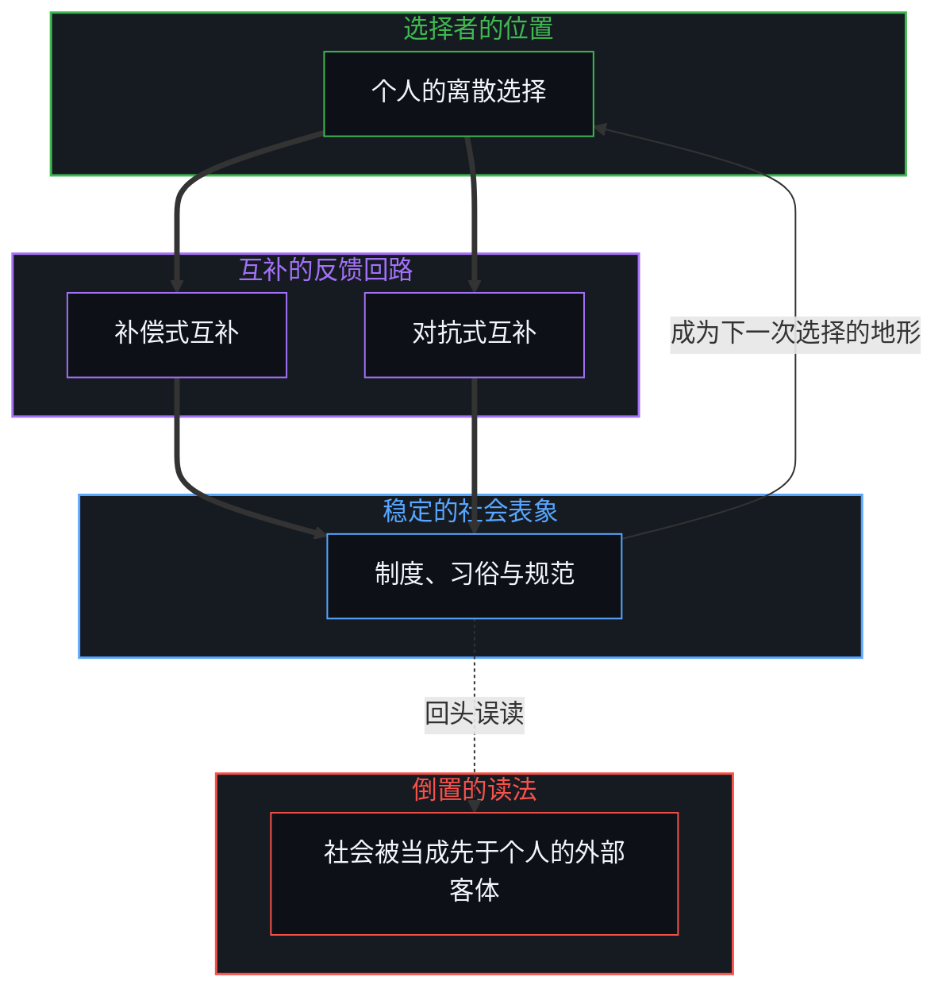
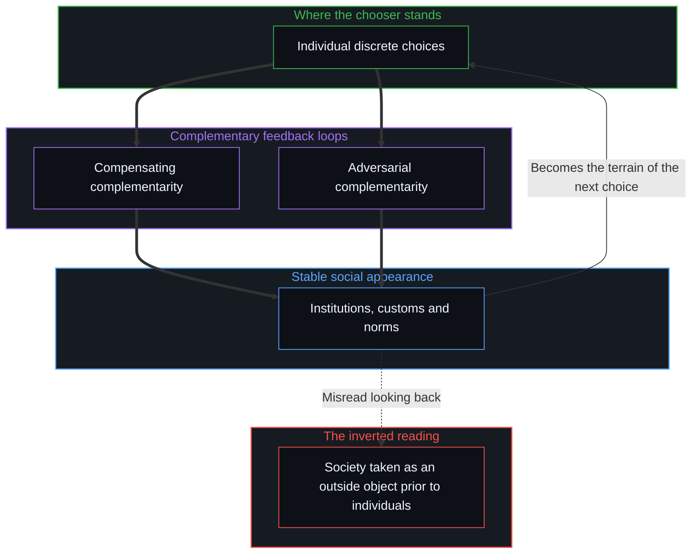

# 个人选择、社会化与做自己 / Individual Choice, Socialization and Being Oneself

*社会现象是个人选择的滞后沉淀，做自己是在痕迹场中持续认领并刷新行动边缘 / Social phenomena are the lagging sediment of choices; being oneself is renewing one's edge of action in the trace field.*

开学季或毕业季，关于“社会化”的讨论总会重新升温：社会化真的是必要的吗？它和“做自己”究竟冲不冲突？从学生到社会人，人到底经历了什么转变？

Every season of starting or finishing school, the talk about "socialization" warms up again: is socialization really necessary? Does it actually conflict with "being oneself"? What change does a person go through in passing from student to member of society?

常见的理解容易分成两极。一端把“做自己”推向孤立与对抗，试图脱离社会规则，甚至把规则看成对自由的剥夺；另一端把“社会化”奉为不可违抗的生存铁律，认为人必须全力适应、磨平棱角，才能融入既有的框架。这两种表面对立的看法共享同一个前提：都把“社会”当成先于个人存在、独立于个体行为之外的外部客体，因果的方向就此倒置。

The usual readings split easily into two poles. One pushes "being oneself" toward isolation and defiance, trying to step outside social rules and even taking the rules as a deprivation of freedom; the other holds "socialization" up as an iron law of survival that cannot be disobeyed, so that one must adapt with full effort and file down one's edges to fit the existing frame. The two views, opposed on the surface, share one premise: both take "society" as an outside object that exists before the individual and stands apart from individual acts, and the direction of causation is thereby inverted.

从选择者自身的位置追溯下去，社会化与做自己从来不是非此即彼的对立，而是因果相生的统一。

Traced from where the chooser stands, socialization and being oneself have never been an either-or opposition; they are one unity in which cause and effect give rise to each other.

## 一、 个人选择是因，互补回路是社会的表象 / 1. Choice Is the Cause, Complementary Loops the Social Appearance

一切社会现象，追溯下去都始于具体的个人选择。

Every social phenomenon, traced back far enough, begins in concrete individual choices.

一个常见的理解是：社会化是“足够多的个体在漫长时间中做出了相似的选择”。从选择的一侧看去，情形正相反：**社会的表象结构能够稳定维持，多半不是因为个体趋同，而是因为大量个体以互补的方式形成了自我强化的反馈循环。**

A common reading is that socialization is "enough individuals making similar choices over a long time". Seen from the side of the choosing, it runs the other way: **the apparent structure of society holds steady mostly not because individuals converge, but because great numbers of individuals form a self-reinforcing feedback loop in complementary ways.**

这种互补的反馈主要以两种形式运行：

This complementary feedback runs mainly in two forms:

1. **补偿式互补**：利己的选择与利他的选择相互补偿，激进的探索与保守的守序相互分工。一种选择模式留下的外部性或亏欠，被另一种互补的选择吸收、兜底，在统计层面呈现为代谢的稳态。
2. **对抗式互补**：刚性的制度与反抗它的社会行动之间相互拉锯。反抗本身也是既有系统反馈控制的一部分，双方在对抗中相互依存，共同维系了这一社会形态的表面框架。[革命之名把生活收成证据](../the-name-revolution-files-a-life-as-evidence/)展示了这种互补被书名提前装上的一面：一个人的下一步被称作私人革命之后，秩序就已经是句子的主语，随后的推荐把这个主语收成旧印象的新证据。

1. **Compensating complementarity**: self-interested choices and altruistic choices compensate each other, and radical exploring and conservative keeping of order divide the work between them. The externality or debt one pattern of choice leaves behind is absorbed and underwritten by a complementary choice, and at the statistical level this shows as a metabolic steady state.
2. **Adversarial complementarity**: a rigid institution and the social action that resists it pull against each other. The resistance is itself part of the existing system's feedback control; the two sides depend on each other in the contest and together keep up the surface frame of that social form. [The Name Revolution Files a Life as Evidence](../the-name-revolution-files-a-life-as-evidence/) shows the face of this complementarity that a book's title installs in advance: once a person's next step is called a private revolution, the order is already the subject of the sentence, and the recommendation that follows files that subject as new evidence for an old impression.

[自由即地基](../freedom-as-ground/)把社会契约追溯到同一处：社会契约是无数个体以各种互补方式自由交互留下的集体轨迹；它既是后来者做新选择时的参考地形，也是每一个行动都要承担其后果的背景。

[Freedom as Ground](../freedom-as-ground/) traces the social contract to the same place: the social contract is the collective track left by countless individuals interacting freely in all manner of complementary ways; it is both the reference terrain on which those who come later make new choices and the background against which every act bears its consequences.

看不清这种互补回路的因果，两极的应对都会陷入被动：

Without seeing the causation of these complementary loops, the responses at both poles fall into passivity:

- **孤立对抗的一极**（“我只管做自己，不管社会怎样”）：把反抗当作做自己，没有注意到激烈的对抗可能恰好补上了系统预留的对抗角色，仍旧被锁在旧回路的重力场里；遇到阻力时，容易把阻力读成社会对自由的扼杀。从选择者的位置看，摩擦只是当前的选择与既有痕迹场之间的失配，因果的源头与调整的杠杆一直在自己这一边。
- **全盘迎合的一极**（“融入规则，借规则为自己谋利”）：主动钻进既有回路充当螺丝钉，把适应规则变成在存量利益里的相互争夺。这样做把他人当成可以消耗的资源，压缩了他人的边界，也把自己的生命力锁在零和博弈的窄道里。

- **The pole of isolated defiance** ("I just do me, whatever society does"): taking resistance for being oneself, without noticing that fierce opposition may fill exactly the adversarial role the system has kept open, so that one stays locked in the gravity field of the old loop; meeting resistance, it is easy to read the resistance as society strangling freedom. From where the chooser stands, the friction is only a mismatch between the present choice and the existing field of traces, and the source of causation and the lever of adjustment have been on one's own side all along.
- **The pole of wholesale accommodation** ("blend into the rules and use them for one's own gain"): actively boring into the existing loop to serve as one of its screws, turning adaptation to the rules into a contest over a fixed stock of interests. This treats others as resources to be used up, narrows their boundaries, and locks one's own vitality into the narrow lane of the zero-sum game.

这两极不是两类人，而是同一个心智在不同的处境下都可能经过的位置；两者都把因果的源头放在自己之外，一个向外对抗，一个向外依附。

These two poles are not two kinds of people but positions one and the same Mind may pass through in different circumstances; both place the source of causation outside oneself, one by opposing it, the other by clinging to it.

看清个人选择是驱动之源，因果链条便回到原位：个人选择是因，被互补反馈稳定下来的社会现象是果。在短期尺度上，互补回路表现为相对坚固的秩序；把时间拉长，文化习俗、组织形态乃至制度变迁，都源自个体离散选择在代际之间的演化。

Once individual choice is seen as the source of the drive, the causal chain returns to its place: individual choice is the cause, and the social phenomena held steady by complementary feedback are the effect. On a short scale, complementary loops show up as a relatively solid order; stretch out the time, and cultural customs, organizational forms and even institutional change all come from the evolution of individuals' discrete choices across generations.

## 二、 真实理解环境，从零和争夺到正和生成 / 2. Understanding the Environment, from Zero-Sum Contest to Positive-Sum Generation

从个体的角度看，需要的不是“为了迎合社会而学习潜规则”，而是对自己所处的环境建立充分、真实、不带道德评判的清澈理解。

From the individual's angle, what is needed is not "learning the unwritten rules in order to please society", but a full, true and clear understanding of one's environment, free of moral judgment.

看清环境里的真实痕迹之后，行动才有了清晰的坐标：顺从、改写，还是绕道而行。关键不在于从存量里占到多少便宜，而在于摆脱零和思维对自身角色的窄化。零和思维把价值看成一块固定蛋糕的转移：“我多得一点，别人就少一点；我创造是为了换取；我分享是为了索取回报。”

Once the real traces of the environment are seen, action gains clear coordinates: to go along, to rewrite, or to go around. What matters is not how much advantage one takes from the existing stock, but getting free of the way zero-sum thinking narrows one's own role. Zero-sum thinking sees value as the transfer of a fixed cake: "if I get a little more, others get a little less; I create in order to trade; I share in order to claim a return."

有生命力的行动，是去创造原本不存在的正和价值。新的可能性不是从别人手里挪过来的，而是在与他人的互动协作中共同生成，并在同一过程中自然分享。[个体抉择是唯一的因果杠杆](../individual-choices-as-the-only-causal-levers/)确立了这个支点：最大化个人价值与尊重他人的边界，不是需要艰难平衡的两个矛盾目标，而是同一个生成性活动的两个侧面。把社会化当成一股外力，正是[涌现的伪因果](../yong-xian-de-wei-yin-guo-yu-ji-ti-gui-yin-dao-cuo/)所剖析的归因倒错。

Action with life in it creates positive-sum value that did not exist before. New possibilities are not moved over from someone else's hands; they are generated together in interaction and collaboration with others and shared in the same process. [Individual Choices as the Only Causal Levers](../individual-choices-as-the-only-causal-levers/) sets down this fulcrum: maximizing one's own value and respecting others' boundaries are not two conflicting goals to be balanced with difficulty but two faces of one generative activity. Taking socialization as an outside force is exactly the inverted attribution that [The Pseudo-Causality of Emergence](../yong-xian-de-wei-yin-guo-yu-ji-ti-gui-yin-dao-cuo/) dissects.

## 三、 观察的滞后，走在历史进程的前沿 / 3. The Lag of Observation, Walking at the Frontier of History

从时间的维度看，肉眼所能观察到的一切主流社会现象，都是历史的滞后现象。

Along the dimension of time, every mainstream social phenomenon the eye can observe is a lagging phenomenon of history.

总有人先在别人尚未察觉的边缘方向上做出离散的选择与探索；这些新的痕迹逐渐扩散、共振，直到大多数人终于适应并形成共识，才固化为大众眼中理所当然的“社会规范”。

Someone always first makes discrete choices and explorations in an edge direction others have not yet noticed; these new traces spread and resonate by degrees, and only when most people have at last adapted and formed a consensus do they harden into the "social norm" the public takes for granted.

把“适应既有的社会规范”当成人生的终极目标，等于主动把自己锚定在历史进程滞后的尾端，处在被动受力的位置。反过来，尽可能向前看，看到那些尚未被充分格式化的前沿方向，此时所做的一切首先是在拓展自己的认知与行动边界；同时，这些探索作为新的高共振痕迹注入场中，成为后来者落脚的基石。[持续生长的脚手架](../the-scaffolding-that-keeps-growing/)写出了这种生长的规律：边缘先动，痕迹后至；改善自己与推动社会，是同一个活动在不同时间尺度上的展开。社会规律只是个体抉择在时间中的沉淀，[自由的测不准](../zi-you-de-ce-bu-zhun/)从统计的一侧讲清了这一点。

Making "adapting to the existing social norms" the final goal of a life amounts to anchoring oneself at the lagging tail of history's course, in the position of being moved by forces rather than moving. Conversely, looking as far ahead as one can, to the frontier directions not yet fully formatted, everything done there first widens one's own boundaries of understanding and action; at the same time these explorations enter the field as new, highly resonant traces and become footholds for those who come later. [The Scaffolding That Keeps Growing](../the-scaffolding-that-keeps-growing/) sets out the pattern of this growth: the edge moves first, the traces arrive after; improving oneself and moving society forward are one activity unfolding on different scales of time. Social regularities are only the sediment of individual choices over time, as [The Uncertainty of Freedom](../zi-you-de-ce-bu-zhun/) makes clear from the statistical side.

## 四、 做自己的真正坐标，在痕迹场中持续更新 / 4. The True Coordinates of Being Oneself, Renewed in the Trace Field

社会化从来不是一道需要被盲从或被反抗的外部命令，它只是对当前痕迹场密度的描述。

Socialization has never been an outside command to be blindly obeyed or resisted; it is only a description of the present density of the field of traces.

“做自己”也不是刻舟求剑式地守住某一道旧的刻痕。并不存在一个可以被静态封装、不可更改的“不变自我”。自我是在持续做出离散选择、承受反馈、不断迭代之中更新的行动主体；对正从校园步入更广阔天地的学生与年轻人来说，尤其如此。

Nor is "being oneself" guarding some old notch cut in the side of a moving boat. There is no "unchanging self" that can be statically sealed and never altered. The self is an acting subject renewed in the ongoing making of discrete choices, bearing of feedback and iteration; for students and young people stepping from campus into a wider world, this holds all the more.

从学生到社会人的转变，不是身份被外部规则强行改写，而是同一个生命主体进入了变量更多、密度更高的痕迹场继续运作。[从“目的性”的评判，看认知系统的缺省状态与动态跃迁](../cong-mu-di-xing-de-ping-pan-kan-ren-zhi-que-sheng/)把向外评判的目光收回来，在每一个当下认领自己的选择权；[自我价值感与所有权](../ownership-and-self-worthiness/)守住了行动者的尊严：选择始终在场内发生，也始终在改写场本身。

The change from student to member of society is not an identity forcibly rewritten by outside rules, but the same living subject going on with its work in a field of traces with more variables and greater density. [Seeing the Default State and Dynamic Leaps of Cognition Through Judgments of Purpose](../cong-mu-di-xing-de-ping-pan-kan-ren-zhi-que-sheng/) draws the outward-judging gaze back and claims one's own power of choice in each present; [Ownership and Self-Worthiness](../ownership-and-self-worthiness/) keeps the dignity of the one who acts: choice always takes place within the field, and is always rewriting the field itself.
