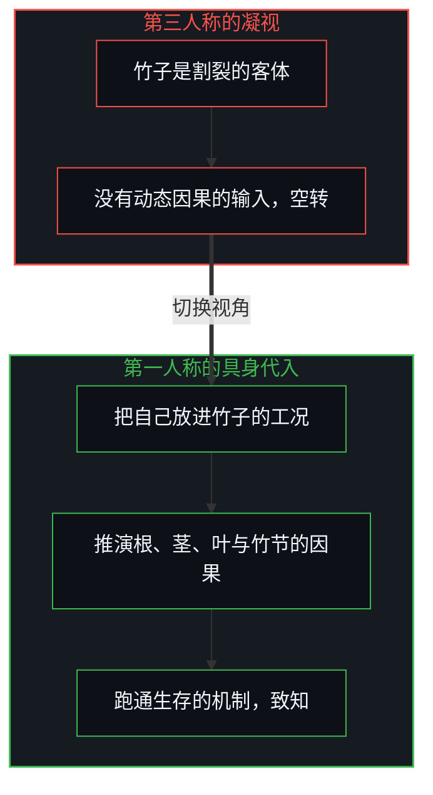
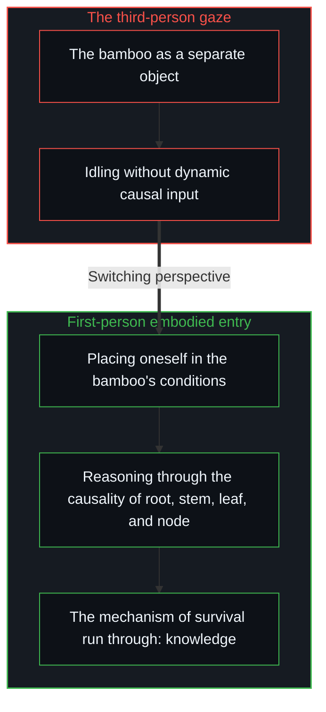

# 格物致知与信息复杂度 / Investigating Things and the Nature of Information Complexity

*格物不是第三人称的注视，而是在第一人称之内具身地代入工况，顺着因果与现实共振 / Investigating things is not a third-person gaze but embodied first-person entry into working conditions, resonating with reality along causality.*

中国哲学史上最有名的一场认知实验，是年轻的王阳明“格竹”。照朱熹“即物穷理”的教导，王阳明面对庭院里的竹子，竭尽心力地参究，据《传习录》里他自己的回忆，七天之后不但没有格出道理，反而病倒了。这次挫败促成了他与理学的分道，也埋下了后来龙场悟道、“知行合一”的伏笔。

The most famous cognitive experiment in the history of Chinese philosophy is the young Wang Yangming "investigating the bamboo". Following Zhu Xi's teaching of "exhausting the principle by going to things", Wang faced the bamboo in a courtyard and strained his whole Mind to investigate it; by his own recollection in the *Instructions for Practical Living*, after seven days he had found no principle and instead fell ill. The setback led to his parting from the school of principle and planted the seed of his later awakening at Longchang and of "the unity of knowing and acting".

后世多把这件事归结为王阳明否定“外求理法”、转向心学。从自我区分的活动追溯——其中第一人称视角与不可逆的因果如同一枚硬币的两面一体运作——格物本身没有错，格物通向致知；让王阳明陷进死结的，是视角的范畴错乱：他把一场必须在第一人称之内展开的微观因果推演，做成了一场脱离工况的第三人称凝视。

Later readers mostly sum this up as Wang rejecting "seeking principle outside" and turning to the learning of the Mind. Traced from self-distinguishing activity—where the first-person perspective and irreversible causality operate as two sides of one coin—investigating things was not wrong, and it leads to knowledge; what knotted Wang up was a category confusion of viewpoint: he turned a micro causal reasoning that must unfold within the first person into a third-person gaze detached from working conditions.

## 一、 旁观者的认知死锁 / 1. The Spectator's Cognitive Deadlock

王阳明坐在椅子上盯着竹子时，处在抽离的第三人称旁观姿态里：把竹子当作一个与自己割裂的孤立客体，等所谓的“天理”借着肉眼的注视从竹子表面自己浮现出来。离开了第一人称的因果建模与对其工况约束的具身代入，视界里的竹子始终只是一层静态表面——无论是登记为绿色的竹竿与竹节，还是归类为细胞壁、叶绿素与反射光；注视七天还是七年，心智都没有摄入任何动态因果变量来让可操作的模型闭环。

Sitting in his chair staring at the bamboo, Wang occupied a detached third-person spectator stance: treating the bamboo as an isolated object cut off from himself, he waited for so-called "heavenly principle" to rise from its surface on its own through the eye's gaze. Without first-person causal modelling and embodied entry into its working constraints, the bamboo in the field of view remains a static surface—whether registered as green stalks and joints or catalogued into cell walls, chlorophyll, and reflected light; whether one gazes for seven days or seven years, the Mind takes in no dynamic causal variable from which an operative model could close.

[止步于评判，是认知的歧途](../zhi-bu-yu-ping-pan-shi-ren-zhi-de-qi-tu/)暴露了这种旁观姿态的局限：观察停在抽离的第三人称看台上，未曾触动自身的内部参数，只是耗散注意力而闭合不了因果回路。这种凝视耗费了大量的体力与神经能量，却在心智里建不起一个自洽的微观因果闭环，终至心力交瘁、一病不起。[错置的因果与心智编译器](../cuo-zhi-de-yin-guo-yu-xin-zhi-bian-yi-qi/)追溯了这一底层的错置：把理解的源头转移到外部客体或器物之上，被动等待现成的结论——而不是从第一人称投射明确的前提、认领回返的偏差——会让心智自身的痕迹构型失去锻炼与校准。

[Stopping at Judgment Is a Wrong Turn of Cognition](../zhi-bu-yu-ping-pan-shi-ren-zhi-de-qi-tu/) exposes the limit of this spectator stance: observation that stays on a detached third-person perch leaves one's own internal parameters untouched and dissipates attention without closing a causal loop. Such a gaze spends great bodily and neural energy yet builds not a single consistent micro-causal loop in the Mind, ending in exhaustion and illness. [Misplaced Causality and the Mind's Compiler](../cuo-zhi-de-yin-guo-yu-xin-zhi-bian-yi-qi/) traces the underlying displacement: relocating the source of understanding into an outside object or instrument and waiting passively for a finished conclusion—rather than projecting explicit premises from the first person and claiming returning discrepancies—leaves the Mind's own trace-configuration unexercised and uncalibrated.

## 二、 具身代入与微观因果推演 / 2. Embodied Entry and Micro Causal Reasoning

心智把视角从第三人称的旁观切换为第一人称的具身代入时，格物便通向致知。面对那株竹子，不是坐在远处空想，而是在第一人称的心智里展开一场严密的微观因果推演：把自己的视角放进这株竹子的工况环境，承受风雨雷电、重力的撕扯与四季的温差；推演根系怎样在贫瘠的土壤里突破阻力、吸取水分与无机盐；推演中空的茎秆怎样以很高的材料效率达到抗弯的力学平衡；推演叶片怎样把落下的光照转化为可用能量；推演它怎样在竹节微观纤维的断裂与修复中持续向上生长。顺着生命与力学的微观因果链，在第一人称的心智里追溯并检验竹子的生存机制，便直接领会到什么是顺应节律，什么是刚柔并济的结构自洽。

Investigating things leads to knowledge when the Mind shifts from third-person spectating to first-person embodied entry. Facing the bamboo, one does not sit at a distance and speculate, but unfolds a rigorous micro-causal reasoning within the first-person Mind: placing one's own view into the bamboo's working environment, bearing wind, rain, and thunder, the pull of gravity, and the swings of the seasons; reasoning how the roots push through resistance in poor soil to take up water and minerals; how the hollow stem reaches a mechanical balance against bending with high material efficiency; how the leaves convert falling light into usable energy; and how it keeps growing upward through the breaking and repair of micro-fibres at its nodes. Tracing and testing the bamboo's mechanisms of survival within the first-person Mind along the micro-causal chains of life and mechanics, one grasps directly what following a rhythm means and what the structural consistency of firmness joined with flexibility is.

这就是“一花一世界，一草一乾坤”在认识上的意思：一朵花、一株草与整个宇宙的运行，共享同一套不可逆的因果语法。[表征的闭环](../the-closed-loop-of-representation/)阐明了这一闭环机制：致知从来不是去收集未经建模之外部客体的静态像素标本，而是在自身的第一人称回路之内进入约束工况，把微观因果模型放到场域的阻力里检验，直至彼此融贯。

This is what "a world in a flower, a universe in a blade of grass" means epistemically: a flower, a blade of grass, and the running of the whole cosmos share the same irreversible causal grammar. [The Closed Loop of Representation](../the-closed-loop-of-representation/) sets out this closed-loop mechanism: reaching knowledge is never collecting static pixel specimens of an unmodeled outside object, but entering the constraining working conditions within one's own first-person loop and testing micro-causal models against the resistance of the field until they cohere.

## 三、 信息与物质的复杂度鸿沟 / 3. The Gulf of Complexity Between Information and Matter

把这个认识推下去，就碰到一个更深的问题：人的抽象知识模型与所经验的世界之间的差别。一方面，无论人建起多么精妙宏伟的科学大厦、数学体系或哲学理论，哪怕把古往今来所有图书馆、数据库与超级计算机里的知识汇总起来，它们仍属于信息。正如[信息是什么](../what-information-is/)所确立的，信息是心智完成离散划界后留下的可记录痕迹；抽象的信息没有静止质量，是人的心智为了在有限带宽内穿行并应对世界，从现实中划出的简化低维投影与特征压缩。[你的代码库即是记忆](../your-codebase-is-memory/)在内在记忆与外化制品之间追溯了同一套机制：格物致知不是把每一条中间观察都囤进静态的仓库，而是主动压缩记忆的代码库并推进睡眠整合，剪去冗余的分支来降低描述复杂度，同时在依然吃重的维度轴上磨利因果的触角。

Carried further, this understanding meets a deeper question: the difference between human abstract models of knowledge and the experienced world. On one side, however refined and grand the scientific edifices, mathematical systems, or philosophical theories people build, even gathering all the knowledge of every library, database, and supercomputer ever built, it all still belongs to information. As [What Information Is](../what-information-is/) establishes, information is the recordable trace left once the Mind completes a discrete boundary; abstract information has no rest mass and is a simplified, low-dimensional projection and compression of features that the human Mind draws from reality to navigate the world within finite bandwidth. [Your Codebase Is Memory](../your-codebase-is-memory/) traces this same mechanism across internal and externalized artifacts: investigating things to extend knowledge is not hoarding every intermediate observation in a static warehouse, but actively compressing and sleep-consolidating the codebase of memory so that pruning redundant branches lowers descriptive complexity while sharpening causal reach on the axes that still matter.

另一方面，第一人称在物质摩擦中所遭遇之物——哪怕只是庭院里的一粒尘埃、一株竹子——每向深处探进一步，都会敞开潜在不可穷尽的自由度：无论是借量子尺度的跃迁、分子的热运动与化学键重组，还是借持续的生态扰动去建模，每一次更细的切分都会浮现出进一步的区分，非任何有限描述所能穷尽。被叫作客观现实的，正是这股不可穷尽的因果阻力，其模式在不同观察者的检验之间保持可重现。宏观模式始终是微观交互的统计结果，[涌现的伪因果](../yong-xian-de-wei-yin-guo-yu-ji-ti-gui-yin-dao-cuo/)说明了把它们当成驱动原因会怎样颠倒次序。

On the other side, what the first person meets in material friction—even a speck of dust or a bamboo in the courtyard—opens onto potentially inexhaustible degrees of freedom whenever probed further: whether modelled through quantum-scale transitions, molecular thermal motion and chemical-bond rearrangements, or ongoing ecological disturbances, every finer cut surfaces further distinctions that no finite description can exhaust. What is called objective reality is this inexhaustible causal resistance whose patterns remain reproducible across distinct observers' checks. Macroscopic patterns remain statistical outcomes of micro interactions, and [The Pseudo-Causality of Emergence](../yong-xian-de-wei-yin-guo-yu-ji-ti-gui-yin-dao-cuo/) shows how treating them as driving causes inverts the order.

[复杂性遮蔽了涌现之为心智的行动](../complexity-obscures-emergence-as-the-act-of-mind/)揭示了这里的脚手架错觉：复杂性属于由选定的语词与公式搭起的有限持守，而在任何这类压缩模型与开放的经验场域之间，都横着一道有限算力或固定维度无法封合的鸿沟；把低维的抽象模型当成现实本身，就是把地图当成了山川。[投影的阶梯与因果的锚点](../tou-ying-de-jie-ti-yu-yin-guo-de-mao-dian/)进一步拆开了这道投影的阶梯：从形式逻辑、数学公理到物理理论与世俗评判，都是有限心智在局部截取的低维切片，不是现实的边界。

[Complexity Obscures Emergence as the Act of Mind](../complexity-obscures-emergence-as-the-act-of-mind/) exposes the scaffolding illusion here: complexity belongs to the finite hold built from chosen words and formulas, and between any such compressed model and the open experienced field stands a gap no finite computation or fixed dimension can seal; taking a low-dimensional abstract model for reality itself mistakes the map for the mountains and rivers. [The Ladder of Projections and the Anchor of Causality](../tou-ying-de-jie-ti-yu-yin-guo-de-mao-dian/) takes this ladder of projections further apart: from formal logic and mathematical axioms to physical theory and worldly judgment, all are low-dimensional slices a finite Mind cuts locally, not the boundaries of reality.

## 四、 谦逊与逻辑的底线 / 4. Humility and the Floor of Logic

意识到这道越不过去的鸿沟，不会带来认知的虚无，反而给出最牢的立足点。一是放下全知模型的迷信：人的一切理论既然都是现实的低维压缩切片，就没有哪一个静态模型能永恒、完整地预测未来；想在封闭的沙盘里穷尽一切变量，是理论教条化与决策崩盘共同的源头。[印迹与行动](../the-mark-and-the-act/)表明，任何想在事前穷尽尚未发生之事的控制体系，都是一张停住的认知地图在强行捆绑未知的活动。

Recognising this uncrossable gap brings not cognitive nihilism but the firmest footing. First, it sets down the superstition of an all-knowing model: since all human theories are low-dimensional compressed slices of reality, no static model can predict the future forever and in full; trying to exhaust every variable in a closed sandbox is the common source of dogmatised theory and collapsed decisions. [The Mark and the Act](../the-mark-and-the-act/) shows that any control system that tries to exhaust in advance what has not yet happened is a stalled cognitive map forcibly binding unknown activity.

二是认出第一人称视角与逻辑因果交汇的在先底线：所经验的现实之展开与人心智之推演之所以彼此融贯，是因为先前的区分沿着同一支不可逆的箭头塑造着后来区分的场域。[因果贯穿始终](../causality-all-the-way/)确认了这块地基：因果链无始无终，并非独立于心智之外的外部闭合，而是在活的边缘处所重新追溯的不可逆单向塑造。[从形式迷思到逻辑闭环](../cong-xing-shi-mi-si-dao-luo-ji-bi-huan/)与[个体抉择是唯一的因果杠杆](../individual-choices-as-the-only-causal-levers/)把这不可分割的一体两面扣在一起：逻辑是心智之中诸区分得以融贯而不自我抵消的自指语法，而第一人称位点上的每一次离散抉择，则是因果权重在物质摩擦的痕迹场上得以登记的杠杆。认知的视界在每一刻都有边界，可这道边界不是固定的铁壁；拓宽它，是一个走出而不离场的过程，正如那句歌词所唱，“你随时可以退房结账，却永远无法离开”：人永远离不开第一人称的视界去触碰所谓的上帝视角，而每一次具身的因果推演，都在拓宽这一第一人称视界的半径。

Second, it recognises the prior floor where the first-person perspective and logical causality meet: the unfolding of experienced reality and the reasoning of the human Mind cohere because earlier distinctions shape the field of later ones along one irreversible arrow. [Causality All the Way](../causality-all-the-way/) confirms this foundation: the causal chain has no beginning and no end, operating not as an external closure standing apart from the Mind, but as the irreversible one-way shaping re-traced at the living edge. [From the Myth of Form to the Closed Loop of Logic](../cong-xing-shi-mi-si-dao-luo-ji-bi-huan/) and [Individual Choices as the Only Causal Levers](../individual-choices-as-the-only-causal-levers/) hold these two inseparable sides together: logic is the self-referential grammar through which distinctions cohere without self-cancellation in the Mind, while each discrete choice at a first-person locus is the lever where causal weight registers against the trace-field of material friction. The horizon of knowing has a boundary at every moment, yet the boundary is no fixed iron wall; widening it is a process of stepping out without leaving, as the line has it, *You can check out any time you like, but you can never leave*: the first-person horizon can never be left to touch a so-called God's-eye view, while each embodied causal reasoning widens the radius of that first-person horizon.

## 五、 在工况中对齐知与行 / 5. Aligning Knowing and Acting in Working Conditions

王阳明当年的困惑，是人在探索世界时普遍遇到的认知迷津：站在场外当旁观者、靠第三人称的凝视等真理降临，或是把有限而无质量的信息误作穷尽开放现实的标尺，都解不开这道迷津。格物致知，是承认视界有限而世界不可穷尽，把自己诚实地放进第一人称的工况，顺着不可逆的因果迈出每一步；知与行在当下的每一次微观选择里对齐时，心智便在自身当下切口的有限自由度上，与连绵的现实共振。

Wang Yangming's puzzlement then is a maze of knowing commonly met in exploring the world: neither standing outside the field as a spectator waiting for truth to arrive through a third-person gaze, nor mistaking finite, massless information for an exhaustive measure of open reality resolves it. Investigating things to reach knowledge means acknowledging a finite horizon and an inexhaustible world, placing oneself honestly in first-person working conditions, and taking each step along irreversible causality; when knowing and acting align in each micro choice of the present, the Mind, across the finite degrees of freedom of its present cut, resonates with continuous reality.
