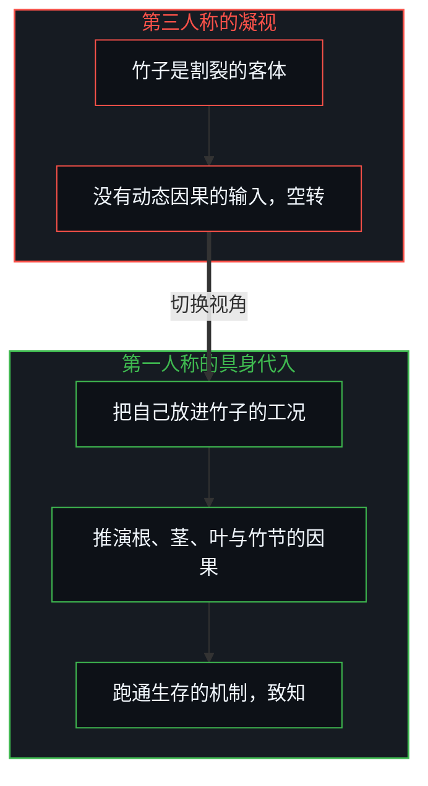
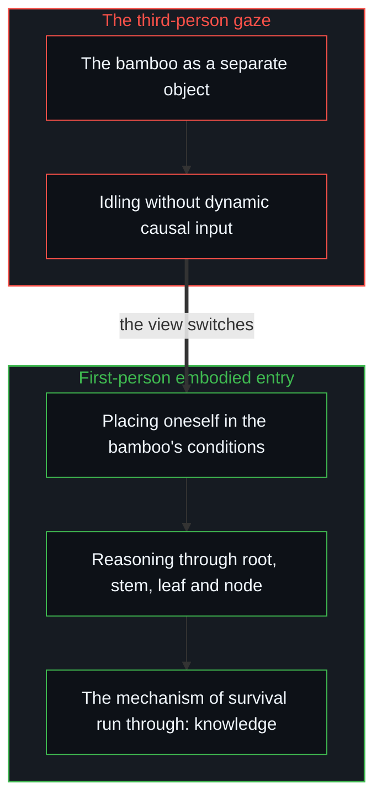

# 格物致知与信息复杂度 / Investigating Things and the Nature of Information Complexity

*格物不是第三人称的注视，而是在第一人称之内具身地代入工况，顺着因果与现实共振 / Investigating things is not a gaze but embodied first-person entry into the conditions, resonating along causality.*

中国哲学史上最有名的一场认知实验，是年轻的王阳明“格竹”。照朱熹“即物穷理”的教导，王阳明面对庭院里的竹子，竭尽心力地参究，据《传习录》里他自己的回忆，七天之后不但没有格出道理，反而病倒了。这次挫败促成了他与理学的分道，也埋下了后来龙场悟道、“知行合一”的伏笔。

The most famous cognitive experiment in the history of Chinese philosophy is the young Wang Yangming "investigating the bamboo". Following Zhu Xi's teaching of "exhausting the principle by going to things", Wang faced the bamboo in a courtyard and strained his whole Mind to investigate it; by his own recollection in the Instructions for Practical Living, after seven days he had found no principle and instead fell ill. The setback led to his parting from the school of principle and planted the seed of his later awakening at Longchang and of "the unity of knowing and acting".

后世多把这件事归结为王阳明否定“外求理法”、转向心学。从认识论、系统论与信息复杂度的角度看，格物本身没有错，格物能通向致知；让王阳明陷进死结的，是视角的范畴错乱：他把一场必须在第一人称之内展开的微观因果推演，做成了一场脱离工况的第三人称凝视。

Later readers mostly sum this up as Wang rejecting "seeking principle outside" and turning to the learning of the Mind. Seen through epistemology, systems thinking and information complexity, investigating things was not wrong, and it can lead to knowledge; what knotted Wang up was a category confusion of viewpoint: he turned a micro causal reasoning that has to unfold within the first person into a third-person gaze detached from the working conditions.

## 一、 旁观者的认知死锁 / 1. The Spectator's Cognitive Deadlock

王阳明坐在椅子上盯着竹子时，在认知与信息上处在一种很低效的第三人称旁观者状态：把竹子当作一个与自己割裂的孤立客体，想靠肉眼的注视，等所谓的“天理”从竹子表面自己浮现出来。离开了主观的逻辑建模与具身的代入，外面的竹子在视界里只是一堆由细胞壁、叶绿素与光子反射构成的静态表象；注视七天还是七年，心智系统都没有输入任何能产生有效计算的动态因果变量。

Sitting in his chair staring at the bamboo, Wang was in a very inefficient third-person spectator state, cognitively and informationally: treating the bamboo as an isolated object cut off from himself, he waited for so-called "heavenly principle" to rise from its surface by itself through the eye's gaze. Without subjective logical modelling and embodied entry, the bamboo outside is, in the field of view, only a static appearance of cell walls, chlorophyll and reflected photons; whether one gazes for seven days or seven years, the Mind receives no dynamic causal variable that could produce effective computation.

[止步于评判，是认知的歧途](../zhi-bu-yu-ping-pan-shi-ren-zhi-de-qi-tu/)揭示了这种旁观视角的贫乏：只站在第三人称观察者的位置，触不到任何系统内在的动力机制。这种凝视耗费了大量的体力与神经算力，却在心智里建不起一个自洽的微观闭环，心力交瘁而病倒，是这样运转的身体与心智的结果。[错置的因果与心智编译器](../cuo-zhi-de-yin-guo-yu-xin-zhi-bian-yi-qi/)指出，缺少动态因果输入的空转，不但编译不出现实，反而会在形式的迷宫里让认知萎缩。

[Stopping at Judgment Is a Wrong Turn of Cognition](../zhi-bu-yu-ping-pan-shi-ren-zhi-de-qi-tu/) reveals the poverty of this spectator's view: standing only in the third-person observer's place never reaches any system's inner dynamics. Such a gaze spends great bodily and neural computation yet cannot build a single consistent micro loop in the Mind, and exhaustion and illness are what a body and Mind running this way arrive at. [Misplaced Causality and the Mind's Compiler](../cuo-zhi-de-yin-guo-yu-xin-zhi-bian-yi-qi/) points out that idling without dynamic causal input not only fails to compile reality but withers cognition inside a maze of form.

## 二、 具身代入与微观因果推演 / 2. Embodied Entry and Micro Causal Reasoning

格物之所以能致知，前提是把视角从第三人称的旁观，切换为第一人称的具身代入。面对那株竹子，不是坐在远处空想，而是在第一人称的心智里展开一场严密的微观推演：把自己的视角放进这株竹子的环境场域，承受风雨雷电、重力的撕扯与四季的温差；推演根系怎样在贫瘠的土壤里突破阻力、吸取水分与无机盐；推演中空的茎秆怎样以很高的材料效率达到抗弯的力学平衡；推演叶片怎样顺着光照完成能量的转换；推演它怎样在竹节微观纤维的断裂与修复中持续向上生长。顺着生命与力学的微观因果链，在第一人称的心智里跑通了竹子的生存机制，自然就领会到什么是顺应节律，什么是刚柔并济的结构自洽。

Investigating things leads to knowledge on condition that the viewpoint switches from third-person spectating to first-person embodied entry. Facing the bamboo, one does not sit at a distance and speculate but unfolds a rigorous micro reasoning within the first-person Mind: placing one's own view in the bamboo's environment, bearing wind, rain and thunder, the pull of gravity and the swings of the seasons; reasoning how the roots push through resistance in poor soil to take up water and minerals; how the hollow stem reaches a mechanical balance against bending with very high material efficiency; how the leaves turn light into energy as the light falls; how it keeps growing upward through the breaking and repair of micro fibres at its nodes. Running the bamboo's mechanisms of survival through in the first-person Mind along the micro causal chains of life and mechanics, one naturally grasps what following a rhythm means and what the structural consistency of firmness joined with flexibility is.

这就是“一花一世界，一草一乾坤”在认识上的意思：一朵花、一株草与整个宇宙的运行，在底层的因果逻辑上同构。[表征的闭环](../the-closed-loop-of-representation/)阐明了这个闭环机制：致知不是去收集外部客体的静态像素标本，而是在第一人称之内把自己放进对方的约束工况，完成对微观因果的推演与闭环。

This is what "a world in a flower, a universe in a blade of grass" means epistemically: a flower, a blade of grass and the running of the whole universe are isomorphic in their underlying causal logic. [The Closed Loop of Representation](../the-closed-loop-of-representation/) sets out this closed-loop mechanism: reaching knowledge is not collecting static pixel specimens of outside objects but placing oneself, within the first person, in the other's constraining conditions and completing the reasoning and closure of micro causality.

## 三、 信息与物质的复杂度鸿沟 / 3. The Gulf of Complexity Between Information and Matter

把这个认识推下去，就碰到一个更深的命题：人的抽象知识模型与被经验的世界之间的差别。一方面，无论人建起多么精妙宏伟的科学大厦、数学体系或哲学理论，哪怕把古往今来所有图书馆、数据库与超级计算机里的知识汇总起来，它们仍属于信息。[信息是什么](../what-information-is/)确立过，信息是心智完成离散划界后留下的可记录痕迹；抽象的信息没有静止质量，是人的心智为了在很有限的带宽之内理解世界，对现实做的高度简化的低维投影与特征压缩。

Carried further, this understanding meets a deeper question: the difference between human abstract models of knowledge and the experienced world. On one side, however refined and grand the scientific edifices, mathematical systems or philosophical theories people build, even gathering all the knowledge of every library, database and supercomputer ever, it all still belongs to information. As [What Information Is](../what-information-is/) establishes, information is the recordable trace left once the Mind completes a discrete boundary; abstract information has no rest mass and is a highly simplified, low-dimensional projection and compression of features that the human Mind makes of reality in order to understand the world within very limited bandwidth.

另一方面，从第一人称遇到的物质实体，哪怕只是庭院里的一粒尘埃、一株竹子，内部的微观自由度都不可穷尽：从量子尺度的演化，到分子尺度的热运动与化学键的重组，再到宏观生态环境的实时扰动，它承载的信息复杂度趋近于无穷。被叫作客观现实的，正是这套在跨个人的观察中能稳定重现的深邃因果。宏观的复杂是微观交互的统计副产品，[涌现的伪因果](../yong-xian-de-wei-yin-guo-yu-ji-ti-gui-yin-dao-cuo/)说明了把它当成原因会怎样倒错。

On the other side, the material entity met from the first person, even a speck of dust or a bamboo in the courtyard, has inexhaustible micro degrees of freedom inside: from evolution at the quantum scale, to thermal motion and the rearranging of chemical bonds at the molecular scale, to real-time disturbances of the macro ecosystem, the informational complexity it carries tends toward infinity. What is called objective reality is exactly this deep causality reproducible stably across people's observations. Macro complexity is a statistical by-product of micro interaction, and [The Pseudo-Causality of Emergence](../yong-xian-de-wei-yin-guo-yu-ji-ti-gui-yin-dao-cuo/) shows how taking it for a cause inverts things.

[复杂性遮蔽了涌现之为心智的行动](../complexity-obscures-emergence-as-the-act-of-mind/)揭示了这种脚手架的错觉：用有限的字数与公式建起的认知模型，与被经验的世界之间，横着一道在算力与维度上越不过去的复杂度鸿沟；把低维的抽象模型当成现实本身，就是把地图当成了山川。[投影的阶梯与因果的锚点](../tou-ying-de-jie-ti-yu-yin-guo-de-mao-dian/)进一步拆开了这道投影的阶梯：从形式逻辑、数学公理到物理理论与世俗评判，都是有限心智在局部截取的低维切片，不是现实的边界。

[Complexity Obscures: Emergence as the Act of Mind](../complexity-obscures-emergence-as-the-act-of-mind/) reveals this scaffolding illusion: between cognitive models built from a finite number of words and formulas and the experienced world lies a gulf of complexity that computation and dimension can never cross; taking a low-dimensional abstract model for reality itself is taking the map for the mountains and rivers. [The Ladder of Projections and the Anchor of Causality](../tou-ying-de-jie-ti-yu-yin-guo-de-mao-dian/) takes this ladder of projections further apart: from formal logic and mathematical axioms to physical theory and worldly judgment, all are low-dimensional slices a finite Mind cuts locally, not the boundaries of reality.

## 四、 谦逊与逻辑的底线 / 4. Humility and the Floor of Logic

意识到这道越不过去的复杂度鸿沟，不会带来认知的虚无，反而给出最牢的立足点。一是放下全知全能的模型迷信：人的一切理论既然都是现实的低维压缩切片，就没有哪一个静态模型能永恒、完整地预测未来；想在封闭的沙盘里穷尽一切变量，是理论教条化与决策崩盘共同的源头。[印迹与行动](../the-mark-and-the-act/)表明，任何想在事前穷尽尚未发生之事的控制体系，都是一张停住的认知地图在强行捆绑未知的活动。

Recognising this uncrossable gulf of complexity brings not cognitive nihilism but the firmest footing. First, it sets down the superstition of an all-knowing model: since all human theories are low-dimensional compressed slices of reality, no static model can predict the future forever and in full; trying to exhaust every variable in a closed sandbox is the common source of dogmatised theory and collapsed decisions. [The Mark and the Act](../the-mark-and-the-act/) shows that any control system that tries to exhaust in advance what has not yet happened is a stalled cognitive map forcibly binding unknown activity.

二是认出逻辑与因果在先的底线：被经验的世界的展开与人的心智的推演，有一点同构，都遵循不可逆的逻辑因果。[因果贯穿始终](../causality-all-the-way/)确认了这块地基：因果链无始无终，世界的展开与心智模型的运行都受因果闭环约束。[从形式迷思到逻辑闭环](../cong-xing-shi-mi-si-dao-luo-ji-bi-huan/)与[个体抉择是唯一的因果杠杆](../individual-choices-as-the-only-causal-levers/)一起守住这条底线：物质实体是很复杂的高维信息流，逻辑是信息能被自洽地组织起来的法则。认知的视界在任何时刻都有边界，可这个边界不是固定的铁壁；拓宽它，是一种走出去却不离开的过程：永远离不开第一人称的视界去摸所谓的上帝视角，而每一次具身的因果推演，都在拓宽这个第一人称视界的半径。

Second, it recognises the prior floor of logic and causality: the unfolding of the experienced world and the reasoning of the human Mind share one isomorphism, both following irreversible logical causality. [Causality All the Way](../causality-all-the-way/) confirms this foundation: the causal chain has no beginning or end, and both the unfolding of the world and the running of mental models are bound by causal closure. [From the Myth of Form to the Closed Loop of Logic](../cong-xing-shi-mi-si-dao-luo-ji-bi-huan/) and [Individual Choices as the Only Causal Levers](../individual-choices-as-the-only-causal-levers/) hold this floor together: a material entity is a very complex high-dimensional flow of information, and logic is the law by which information can be organised consistently. The horizon of knowing has a boundary at every moment, yet the boundary is no fixed iron wall; widening it is a process of stepping out without leaving, as the line has it, *You can check out any time you like, but you can never leave.*: the first-person horizon can never be left to touch a so-called God's-eye view, while each embodied causal reasoning widens the radius of that first-person horizon.

## 五、 结语 / 5. Closing

王阳明当年的困惑，是人在探索世界时普遍遇到的认知迷津。不做站在场外的旁观者，靠第三人称的凝视等真理降临；也不拿有限的、没有质量的信息，去丈量无尽复杂的高维现实。格物致知，是承认视界有限而世界无穷，把自己诚实地放进第一人称的工况，顺着不可违背的因果迈出每一步；知与行在微观当下的每一次选择里对齐时，心智就在有限的维度里，与连绵的现实共振。

Wang Yangming's puzzlement then is a maze of knowing commonly met in exploring the world. Not standing outside the field as a spectator, waiting for truth to arrive by a third-person gaze; not using finite, massless information to measure an endlessly complex, high-dimensional reality. Investigating things to reach knowledge is acknowledging a finite horizon and an inexhaustible world, placing oneself honestly in first-person working conditions and taking each step along unbreakable causality; when knowing and acting align in each micro choice of the present, the Mind, within its finite dimensions, resonates with continuous reality.
