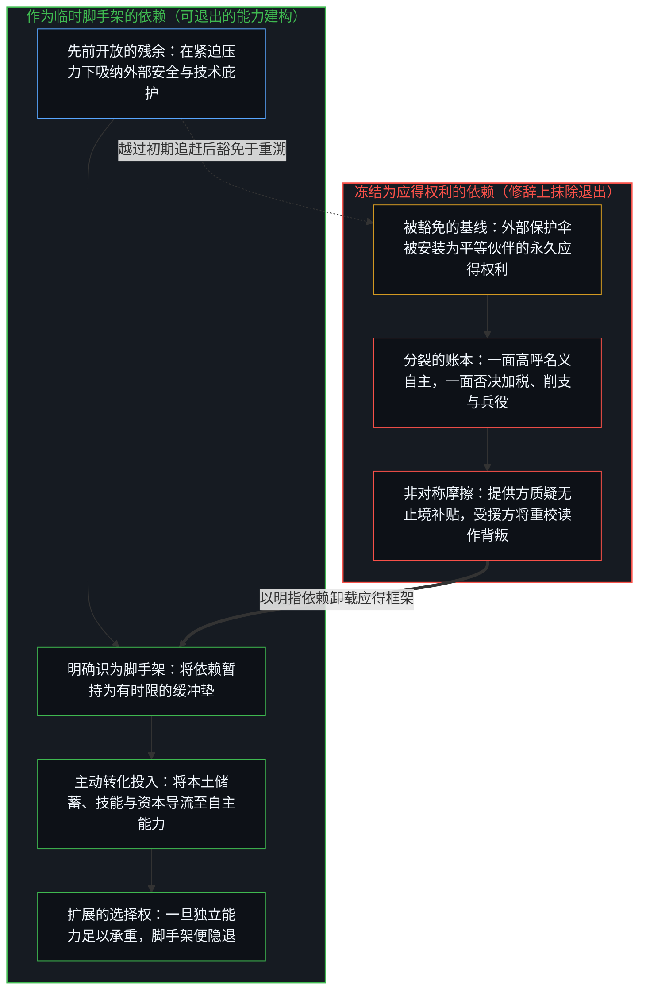
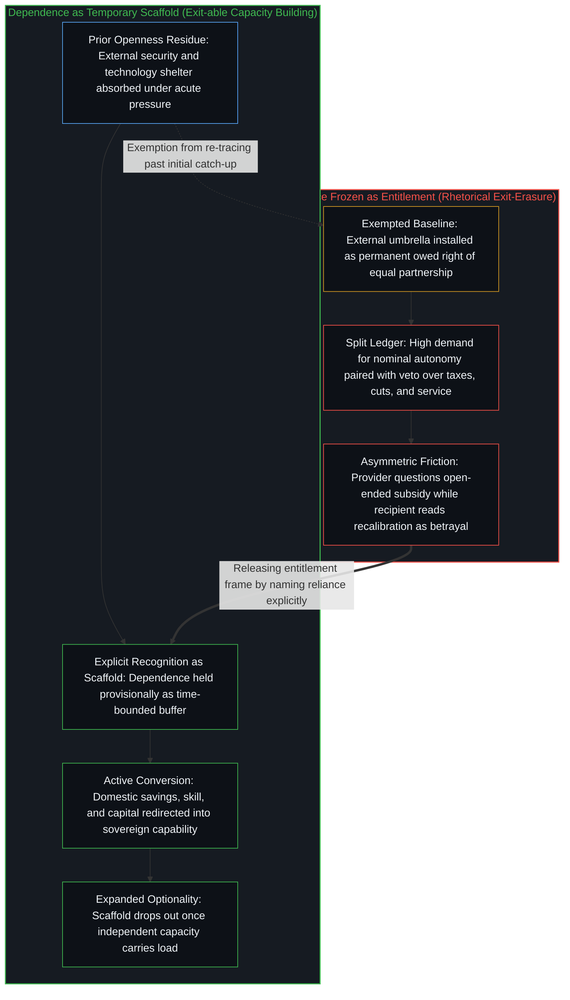
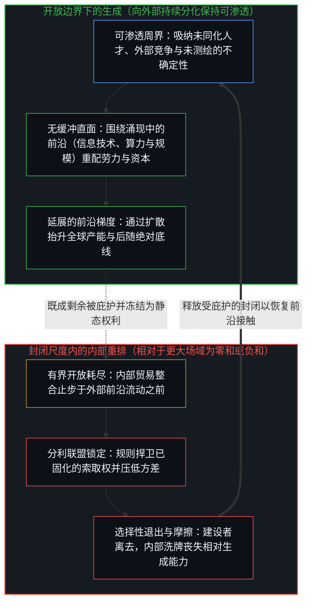
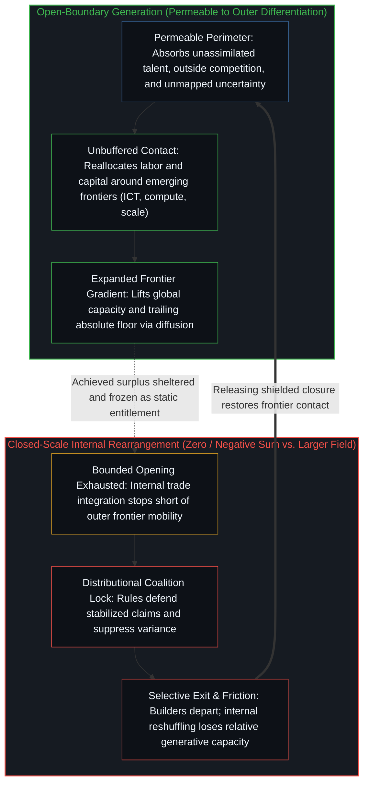

# 边界之外的生成与内部重排 / Generation Beyond the Boundary and Internal Rearrangement

*开放于边界之外的持续分化才是唯一生成源；任何封闭尺度内的重排，在更大场域下皆为零和或负和。 / Ongoing differentiation open beyond the boundary is the sole generative source; any rearrangement inside a closed scale is zero- or negative-sum relative to the larger field.*

当处于受庇护安排中的参与者将已获得的稳定与剩余当作必须维持的权利，而非继续向当前边界之外敞开以汲取新输入的临时脚手架——这正是[遗忘的脚手架](../the-scaffolding-we-forget/)所追溯的暂行角色——内部重排便开始冒充生成。欧洲各国政府与公众在言辞上与美国拉开距离，却在结构上保留对美国安全保障、云基础设施与前沿人工智能算力的依赖，恰是这一模式的显现：依赖本身并非障碍，障碍在于拒绝将其识为依赖，并将其声索为平等伙伴关系下的应得权利，从而加重了[本地屏障与残余滞后](../the-local-shield-and-the-residual-lag/)所剖析的同一种受庇护延误。个体依然保有退出的选择；随着高方差建设者相继离去，留守者将规范与政策进一步向稳定对齐，从而加速相对于更广阔全球场域的滞后。

When participants inside a sheltered arrangement treat achieved stability and surplus as a right to maintain rather than temporary scaffolding for continued openness beyond current boundaries and to fresh inputs—the provisional role traced in [The Scaffolding We Forget](../the-scaffolding-we-forget/)—internal rearrangement begins to pass for generation. European governments and publics distancing themselves rhetorically from the United States while preserving structural reliance on American security, cloud infrastructure, and frontier artificial intelligence compute illustrate the pattern: dependence itself is not the obstacle, whereas refusing to recognize it as dependence and claiming it as an entitlement of equal partnership compounds the same shielded delay examined in [The Local Shield and the Residual Lag](../the-local-shield-and-the-residual-lag/). Individuals still retain the choice to exit; as higher-variance builders depart, those who remain re-align norms and policies further around stability, accelerating relative lag against the wider global field.

## 一、 依赖作为脚手架与作为权利 / 1. Dependence as Scaffold and as Right

自我区分的活动发生着——无因、不息。称之为心智：早已在途的观察者，其每一个行动都是一次区分。较早的离散行动塑形着后续行动可用的场域，因此任何已实现的安全、技术与剩余，进入当下时，都是先前向更大边界敞开、承受选择压力并吸纳外部输入后留下的残余。在有界条件下，依托业已建立的外部屏障承担着具体的建设性功能：它吸收眼前的防务摩擦，降低前期协调成本，并释放余力去建构内部基础设施。战后西欧正是在这样一重双重庇护之下运作——美国的安全保护伞加上布雷顿森林体系的货币与贸易稳定——为协调投资与劳资协定留出空间，得以动员储蓄并吸收业经验证的大规模生产方法。日本、韩国与台湾等东亚追赶型经济体，同样是在外部安全边界与向美国消费市场敞开准入的配合下成长起来的。在那一阶段，外部保护伞正如同[遗忘的脚手架](../the-scaffolding-we-forget/)中任何堪用的器具那样运转：它在背景中保持稳固，好让后续建构得以落地。

Self-distinguishing activity occurs — uncaused, unceasing. Call it the Mind: the observer already underway, every act of which is a distinction. Earlier discrete acts shape the field available to later ones, so any realized security, technology, or surplus enters the present as the residue of prior openness to larger boundaries, selection pressure, and external inputs. Within bounded conditions, relying on an already-established external shield performs a concrete constructive function: it absorbs immediate defensive friction, lowers upfront coordination costs, and frees capacity to build internal infrastructure. Postwar Western Europe operated inside such a dual shelter—the American security umbrella alongside Bretton Woods monetary and trade stability—which gave coordinated investment and labor-management pacts room to mobilize savings and absorb proven mass-production methods. East Asian catch-up economies in Japan, South Korea, and Taiwan likewise grew inside an external security perimeter paired with open access to the American consumer market. In that phase, the external umbrella works like any usable instrument in [The Scaffolding We Forget](../the-scaffolding-we-forget/): it holds fixed in the background so further construction can land.

断裂始于这一刻：那座临时脚手架在越过自身那一步之后被豁免于重新追溯，并被安装为平等伙伴关系下的应得权利。把先前开放所累积的产出读作外部提供方必须永久供应的环境基线，是一次因果倒置：先前的结果被冻结为当下封闭未经审视的前提。依赖唯有在被清醒地识为临时脚手架、并被主动用于扩展独立生成能力时，才保持可退出；一旦被框定为平等者之间的对等关系，退出便在言辞上消失，而底层的资源与能力重担依然非对称地由提供方承担。[福利国家的幻象](../the-welfare-state-illusion-cost-diffusion-and-agency-atrophy/)在国内转移支付体系内追溯的同一种认知记账，也在跨境尺度上运转：当维系威慑与基础设施的持续成本被摊薄到远方供给方身上、并被当作自动存在的背景时，本地参与者便将国内诉求与外部供给成本割裂开来，把任何要求调整负担的呼声登记为背叛。

The break begins when that temporary scaffold is exempted from re-tracing past its step and installed as an entitlement of equal partnership. Reading the accumulated output of prior openness as an ambient baseline that external providers owe in perpetuity inverts causality: an earlier outcome is frozen into the unexamined premise of present closure. Dependence remains exit-able only while consciously recognized as temporary scaffolding and actively spent to expand independent generative capacity; once framed as parity among equals, the exit disappears in rhetoric while the underlying resource and capability burdens remain borne asymmetrically by the provider. The same cognitive bookkeeping operates across borders that [The Welfare State Illusion](../the-welfare-state-illusion-cost-diffusion-and-agency-atrophy/) traces inside domestic transfer systems: when the ongoing cost of maintaining deterrence and foundational infrastructure is diffused onto a distant supplier and treated as an automatic backdrop, local participants detach domestic claims from external supply costs and register any demand for burden adjustment as betrayal.

当代民意调查与能力账本正好登记出这一自主言辞与基线依赖之间的分裂。在欧洲对外关系委员会 2026 年 6 月覆盖 15 个欧洲国家的调查中，仅有 11% 的受访者将美国视作共享价值观与利益的盟友——低于 2024 年底的 22%——约半数将其归为“必要伙伴”，且所有受访国的多数民众均怀疑欧洲受袭时美国是否会出手干预；然而，只有 29% 的受访者赞成以仅由欧洲构成的组织取代北约。同样，弗里德里希·艾伯特基金会《2025 年安全雷达》显示，63% 的受访者支持欧洲加强防务独立，欧洲晴雨表对共同安全政策的支持率亦约达 81%，但相信欧洲在没有美国协助下能够独立自卫的仅约三分之一。一旦将国内代价纳入考量，意愿便骤然下滑：在舆观 2026 年 7 月的多国调查中，通过加税筹措防务开支在德国遭到 77% 反对、法国 73%、英国 59%、波兰 54%；在德国，62% 同样反对削减公共服务，59% 反对扩大举债，即便同时有 70% 怀疑本国军队的战备能力；围绕征兵制的争论也一再在主张恢复兵役的年长群体与实际承担服役重担的年轻一代之间划出裂痕。民意错位之下则是物质账本：北约 2025 年官方军费核算仍显示美国承担联盟总支出的约 60%，欧洲与加拿大合计约占 40%；斯德哥尔摩国际和平研究所的记录表明，2021 至 2025 年间欧洲北约盟国 58% 的主战武器进口来自美国，同时在战略空运、空中加油机、卫星预警、电子战及核共享上存在突出的结构性依赖；美国头部云服务商占据欧洲云市场约 70% 的份额；欧洲承载的全球 AI 算力不足 5%，而美国约占 75%。

Contemporary polling and capability ledgers register this exact split between autonomous rhetoric and preserved baseline reliance. Across 15 European countries surveyed by the European Council on Foreign Relations in June 2026, only 11 percent of respondents viewed the United States as an ally sharing values and interests—down from 22 percent in late 2024—while roughly half classified it as a necessary partner and majorities in every surveyed state doubted American intervention if attacked; yet only 29 percent favored replacing NATO with an exclusively European organization. Similarly, the Friedrich-Ebert-Stiftung *Security Radar 2025* found 63 percent backing greater European defense independence alongside roughly 81 percent Eurobarometer support for a common security policy, while only about one-third believed Europe could defend itself without American assistance. Once domestic costs enter the question, willingness drops sharply: in YouGov's July 2026 multi-country survey, raising taxes to fund defense was rejected by 77 percent in Germany, 73 percent in France, 59 percent in Britain, and 54 percent in Poland, while 62 percent in Germany also opposed cutting public services and 59 percent opposed higher borrowing even while 70 percent doubted the readiness of their own armed forces, and conscription debates repeatedly split older advocates from younger cohorts who would bear the service burden. Beneath the opinion mismatch lies the material ledger: official 2025 NATO expenditure accounting still places the United States at roughly 60 percent of alliance outlays against roughly 40 percent for Europe and Canada combined, SIPRI records the United States supplying 58 percent of European NATO allies' major arms imports across 2021–2025 alongside acute structural dependence on American strategic airlift, refueling tankers, satellite early warning, electronic warfare, and nuclear sharing, top American cloud providers hold roughly 70 percent of the European cloud market, and Europe hosts under 5 percent of global AI compute capacity compared with roughly 75 percent in the United States.

早在当下新闻标题出现之前，政治经济学便已刻画出这种联盟失衡的静态内核。1966 年，曼瑟·奥尔森与理查德·泽克豪泽将联盟威慑建模为一种纯公共品——在成员之间既非排他亦非竞争——指出由于各国政府只按自身的私人边际收益与边际成本均衡处投入，却略去对盟友的外溢效应，利害总量最高的头号成员便会承担不成比例的集体防务份额。这一前提说明了为何主导提供方会为整张保护伞买单而较小伙伴投入不足；一旦威慑产生的是联合产品而非单一纯公共品，这一模型的不完备边界便显露出来，正如托德·桑德勒后来所形式化的那样。由于防务支出同时产出局部的侧翼防护与本国独享的安全收益，紧邻前线的位置会抬高自身面临的威胁凸显度，直接改变抉择：贴近俄罗斯的东欧与北欧国家政府和公众——例如波兰将约 4.5% 至 4.7% 的 GDP 投入防务，并依然是欧洲对外关系委员会该次调查中唯一获多数民众支持增购美国武器的国家，同时波罗的海与北欧各国政府也在扩大国民兵役——展现出更高的财政意愿以及对残余依赖更清醒的现实感；相比之下，远离直接边境的西欧与南欧多数民众与官员，则仍将外部担保当作无需计价的基线。

Political economy captured the static core of that alliance imbalance long before current headlines. In 1966, Mancur Olson and Richard Zeckhauser modeled alliance deterrence as a pure public good—non-excludable and non-rivalrous across members—showing that because each government equates only its own private marginal benefit against marginal cost while ignoring spillovers onto allies, the largest member with the highest absolute stake shoulders a disproportionate share of collective defense. That premise illuminates why a dominant provider pays for the overarching umbrella while smaller partners under-invest; its boundary of incompleteness appears wherever deterrence generates joint products rather than a single pure public good, as Todd Sandler later formalized. Because defense spending also yields localized flank protection and private national security, frontline proximity raises private threat salience and alters choices directly: governments and publics in eastern and northern European states near Russia—such as Poland committing roughly 4.5 to 4.7 percent of GDP and remaining the sole ECFR-surveyed country with a majority backing additional American arms purchases, alongside Baltic and Nordic governments expanding national service—display higher fiscal readiness and clearer realism about residual reliance, whereas majorities and officials across much of western and southern Europe further from the immediate border hold the external guarantee as an uncosted baseline.

汇集在“欧洲战略自主”旗号下的各项倡议——从 2016 年《欧盟全球战略》、2022 年《凡尔赛宣言》、2024 年《德拉吉报告》到 2025 年《2030 战备》计划——在其运作范围内辨识出了具体瓶颈：各国碎片化的防务采购推高了单位成本，割裂的资本市场使后期成长缺乏资金供给，单一供应方锁定收窄了危机回旋空间。一旦声明性的支出额度与“购买欧洲货”规则被当作业已达成的主权，而选民拒绝为补齐缺失的支撑能力承担国内取舍、官员在底层依然倚重美国基础设施，战略自主便到达了边界。正如[本地屏障与残余滞后](../the-local-shield-and-the-residual-lag/)所追溯的那样——本地运营商借市政牌照壁垒将次级外部技术栈重新包装为区域物理 AI 主权——把受庇护的采购配额或监管边界防御说成对等地位，等于同时放弃了两端：既放弃了对原始领先前沿的直接借力，也放弃了打造独立前沿所必需的无缓冲锤炼。随后摩擦在两岸同步升级，底层的依赖格局却毫无改变：美国选民质疑无止境的外部兜底，而欧洲公众将每一次要求重新校准的呼声都解读为遗弃。

Proposals assembled under the banner of European Strategic Autonomy—from the 2016 European Union Global Strategy through the 2022 Versailles Declaration, the 2024 Draghi Report, and the 2025 *Readiness 2030* initiative—identify concrete bottlenecks inside their operational scope: fragmented national procurement inflates unit costs, segmented capital markets starve late-stage growth, and single-supplier lock-in narrows crisis room. Strategic Autonomy reaches its boundary when declarative spending envelopes and buy-European rules are treated as sovereignty already achieved while voters refuse the domestic trade-offs required to build missing enablers and officials continue leaning on American infrastructure underneath. Just as [The Local Shield and the Residual Lag](../the-local-shield-and-the-residual-lag/) traces local operators using municipal licensing barriers to repackage secondary external stacks as regional physical AI sovereignty, framing shielded procurement or regulatory perimeter defense as parity surrenders both direct leverage on the raw leading frontier and the unbuffered discipline needed to construct an independent one. Friction then escalates on both sides without altering the underlying reliance: American voters question open-ended external underwriting, while European publics interpret every demand for recalibration as abandonment.

## 二、 投票以足与集体引力 / 2. Voting with Feet and Collective Pull

个体从未失去迁移的选择。那些对风险回报胃口更大，或倾向于将未测绘的约束读作待解问题而非待守保障的心智，可以且确实选择退出。1820 年至二十世纪三十年代间，超过三千万欧洲人移居美国——在估计五千万至六千万的欧洲海外移民总数中占约三千二百万至三千三百万——这股愿意承担迁移摩擦以换取更高预期上行的自我选择流出，稀释了原居社会中愿担风险行动者的本地密度。当代前沿领域延续着同一方向的排序：MacroPolo 与麦肯锡的追踪显示，尽管欧洲高校培养了全球约五分之一的顶尖 AI 研究者，在欧洲受训的顶尖 AI 人才却仅有约 14% 留在欧洲；相比之下，美国吸纳了全球 42% 的顶尖 AI 研究者，而在前 2% 的最顶尖梯队中更达到 57%。《德拉吉报告》同样记录到，2008 至 2021 年间在欧洲创立的独角兽企业中，近 30% 将总部迁往海外（其中绝大多数迁往美国），以获取更深厚的后期股权资本、统一的大陆级客户市场以及更快的部署节奏。

Individuals never lose the choice to move. Minds with a higher appetite for risk-reward, or inclined to read unmapped constraints as problems to solve rather than guarantees to defend, can and do exit. Between 1820 and the 1930s, more than thirty million Europeans—roughly thirty-two to thirty-three million within an estimated fifty to sixty million European overseas departures overall—emigrated to the United States, a self-selected outflow of people willing to pay relocation friction for wider expected upside, thinning the domestic concentration of risk-bearing actors across origin societies. Contemporary frontier domains trace the same directional sorting: MacroPolo and McKinsey tracking shows that while European universities train roughly a fifth of the world's top-tier AI researchers, only around 14 percent of Europe-trained elite AI talent stays in Europe, compared with 42 percent of top-tier AI researchers—and 57 percent of the elite top-2-percent cohort—employed inside the United States. The Draghi Report similarly records nearly 30 percent of European-founded unicorns between 2008 and 2021 relocating headquarters abroad, mostly to the United States, to access deeper late-stage equity, unified continental customers, and faster deployment velocity.

在宏观尺度上显现为迟缓或规避风险的所谓“集体引力”，并非附着于欧洲土地、俯身筛选居民的某种自主精神。正如[排序的残余与解释的非等效](../the-residue-of-sorting-and-the-non-equivalence-of-interpretations/)所确立的，可观察到的区域心智形态，正是先前或退或留之抉择所遗留的人员构成与制度残余——当具流动能力的个体离去时，他们的退出为留守者留下重新加权后的同侪网络、风险容忍度、地位阶梯与政治均衡。在这里，这一排序动态直接耦合到以权利框定的依赖之上。正因不倚赖缓冲的建设者手里握有可信的退出选项，他们的离去令国内选民联盟进一步倒向以守护既得养老金、劳工保护与稳定消费基线为优先事项的群体；这些群体继而立起更紧的监管摩擦、更高的财政汲取以及惩罚风险的规则，压低了留在本地建构的预期回报——正如[继承的残余与索取的必要](../inheritance-as-residue-and-the-need-for-extraction/)所追溯的，当残余索取权被削薄时，再投资便随之下滑，推动可流动资本与人才流向约束更低的边际。

What presents itself at the macro scale as a sluggish or risk-averse "collective pull" is not an autonomous spirit attached to European soil that reaches down to filter inhabitants. As [The Residue of Sorting and the Non-Equivalence of Interpretations](../the-residue-of-sorting-and-the-non-equivalence-of-interpretations/) establishes, an observable regional mindset is the compositional and institutional residue left by prior choices to exit or stay—when mobile individuals depart, their exits leave behind a re-weighted peer network, risk tolerance, status ladder, and political equilibrium confronting those who remain. Here that sorting dynamic couples directly to entitlement-framed dependence. Because unbuffered builders hold credible exit options, their departures leave domestic voting coalitions further weighted toward individuals whose priority is shielding earned pensions, labor protections, and stable consumption baselines—who then enact tighter regulatory friction, higher fiscal extraction, and risk-penalizing rules that lower the expected return to building in place, as [Inheritance as Residue and the Need for Extraction](../inheritance-as-residue-and-the-need-for-extraction/) traces when attenuated residual claimancy depresses reinvestment and nudges mobile capital and talent toward lower-constraint margins.

调查与资本流动记录正登记下这一在原地运转的递归排序残余。快速欧洲晴雨表调查显示，约 49% 的欧盟受访者表示对失败的恐惧会令其放弃创业，而在美国这一比例约为 33%；将丧失稳定固定收入视为主要阻碍的欧盟受访者比例亦近乎美国的两倍——全球创业观察的跨国面板数据也印证了这一分化。欧洲在初创企业诞生率上与美国相近，但在做大高成长企业时却陡然跌落：碎片化的跨境规则、与企业规模挂钩的用工门槛，以及偏重银行信贷而非股权的金融结构，将心力引向守稳而非高方差复利。与此同时，[相对差异与复利比较](../relative-differentials-and-the-compounding-of-comparison/)揭示了跨管辖区固守一道短窗口比较框架，如何把更快的外部复利读作一笔拖欠的赤字而非可用信息：有组织的国内联盟一面捍卫锁死国内方差的各项规则，一面将外部领先定性为不公平攫取或市场支配地位，借此维系怨怼杠杆。

Survey and capital-flow records register this recursive sorting residue in place. Flash Eurobarometer surveys record roughly 49 percent of European Union respondents saying fear of failure would deter them from starting a business, against roughly 33 percent in the United States, alongside nearly double the share citing loss of steady fixed income as a primary barrier—a divergence echoed across Global Entrepreneurship Monitor cross-country panels. Europe matches the United States in early-stage company birth rates yet drops sharply in scaling high-growth firms, where fragmented cross-border rules, size-contingent labor thresholds, and bank-heavy finance channel effort toward stability over high-variance compounding. At the same time, [Relative Differentials and the Comparison of Compounding](../relative-differentials-and-the-compounding-of-comparison/) shows how keeping a short comparative frame fixed across jurisdictions turns faster external compounding into an owed deficit rather than information: organized domestic coalitions preserve grievance leverage by treating external leads as unfair extraction or market dominance while defending rules that lock domestic variance down.

即便近期的逆向流动也印证了究竟是何种机制在驱动这一场域。2025 至 2026 年间，美国收紧签证规定——包括对新增 H-1B 申请征收高额附加费——加之联邦科研经费遭冻结，恰好与欧洲推出的诸如 5 亿欧元“选择欧洲从事科研”等公共补贴同步，带动欧洲研究理事会的申请咨询量明显回升，并促使部分学术界与公共研究机构人员向慕尼黑、苏黎世与斯德哥尔摩等枢纽分流。然而从经验记录来看，这股流动仍只是美国行政摩擦诱发的有界学术与资助导向分流，而非商业科技格局的逆转：2025 年美国私营部门 AI 投资达 2859 亿美元，而欧盟与英国合计仅为 209 亿美元，美国产出了约六十个重要前沿模型，欧洲则只有两个。只要商业扩张资本、无缓冲的上行空间以及稠密的建设者网络依然聚集在美国一侧，高校边缘由政策撬动的局部回流便不会动摇更广义的结构性排序。

Even recent counter-currents confirm which mechanism drives the field. In 2025–2026, tightened American visa rules—including heavy surcharges on new H-1B petitions—and frozen federal research grants coincided with European public subsidies such as the €500 million "Choose Europe for Science" push, producing a measurable uptick in European Research Council inquiries and selective academic and public-research moves toward hubs like Munich, Zurich, and Stockholm. Yet empirically that movement remains a bounded academic and grant-driven diversion triggered by American administrative friction, not a commercial tech reversal: in 2025, American private AI investment reached $285.9 billion compared with $20.9 billion across the European Union and United Kingdom combined, yielding roughly sixty notable frontier models in the United States against two in Europe. As long as commercial scaleup capital, unbuffered upside, and dense builder networks stay concentrated on the American side, partial policy-driven inflows at university margins leave the broader structural sorting intact.

## 三、 开放边界之外才是生成源 / 3. Openness Beyond the Boundary Is the Sole Generative Source

在任何固定边界之内，一旦计入排序效应、行政摩擦、机会成本与新输入的缺席，对既有资源、名分或制度份额的重排，相对于更广阔的场域而言皆为零和或负和。[生产、消费与心智的区分](../production-consumption-and-the-minds-distinction/)标明了这一确切转换：在一个持守为封闭的寄存器内叠加新行动，会把新的区分坍缩到已被占据的坐标上；唯有让边界保持敞开，寄存器方能拓宽，使新颖组合得以扩展可表征的容量。由于[没有系统能被保持封闭](../no-system-can-be-kept-closed/)，没有任何有限政体或监管周界能够将边界之外持续发生的分化阻隔在墙外。新的生成能力——更高的生产率前沿、不熟悉的新技术、更宽广的物质选项——唯有在参与者让边界对当前周界之外的分化保持可渗透时才会显现：携带着未对齐先验的新来人才、外部竞争压力、尚未被同化的知识，以及昨日账本之外的资源。

Inside any fixed boundary, rearranging existing resources, titles, or institutional shares yields zero-sum or negative-sum results relative to the wider field once sorting effects, administrative friction, opportunity cost, and the absence of new inputs are counted. [Production, Consumption, and the Mind's Distinction](../production-consumption-and-the-minds-distinction/) locates the exact shift: adding a new act inside a register held closed collapses distinctions onto already-occupied coordinates, whereas keeping the boundary open widens the register so novel combinations expand representable capacity. Because [No System Can Be Kept Closed](../no-system-can-be-kept-closed/), no finite polity or regulatory perimeter can wall off the ongoing differentiation occurring outside it. New generative capacity—higher productivity frontiers, unfamiliar technologies, broader material options—appears only where participants keep the boundary permeable to differentiation from beyond their current perimeter: incoming talent with unaligned priors, outside competitive pressure, unassimilated knowledge, and resources outside yesterday's accounting.

历史经验并未将一切内部重组一概压平为即刻停滞；承认其有界的效用，恰能照清封闭究竟从何处开始。当内部改革拆除原本彼此封隔的管辖区*之间*较小的壁垒时，它拓宽了活跃的边界，并释放出可测量的生产率收益。1992 年欧洲单一市场拆除了成员国之间的内部非关税壁垒，让商品竞争与高效率企业得以跨境扩张，据估算相比浅层贸易协定带来了经通胀调整后 4.4% 至 6.6% 的永久性国内生产总值增益。同样，二十世纪九十年代初瑞典与芬兰在银行危机之后推进的北欧结构性改革——重塑财政规则、放松产品与电信市场管制并向全球竞争敞开——推动了全要素生产率的快速回升与世界级科技集群的崛起。这些时段之所以产生可测量的跃升，正因它们把封闭的局部区块向更宽广的竞争摩擦敞开；而当扩大后的欧洲周界依然让服务业、资本市场与劳动力再配置处于碎片化状态，并将其庇护在外部技术边缘之外时，这套改革便到达了限度。

Historical experience does not flatten all internal reorganization into instant stagnation; granting its bounded utility clarifies precisely where closure begins. When internal reform tears down smaller barriers *between* previously sealed jurisdictions, it widens the active boundary and unlocks measurable productive gains. The 1992 European Single Market dismantled internal non-tariff barriers across member states, generating an estimated 4.4 to 6.6 percent permanent inflation-adjusted gain in gross domestic product over a shallow trade pact by allowing goods competition and efficient firms to scale across borders. Likewise, Nordic structural reforms in Sweden and Finland during the early 1990s—overhauling fiscal rules, deregulating product and telecom markets, and opening to global competition after banking crises—drove rapid total-factor productivity recovery and world-class technology clusters. Those episodes generated measurable advances precisely because they opened enclosed pockets to wider competitive friction; they reached their limit where the enlarged European perimeter left services, capital markets, and labor reallocation fragmented and shielded against the outer technological edge.

西欧战后社会与工业模式的轨迹，清晰地暴露出这道门槛。在美国防务与布雷顿森林贸易规则的双重外部庇护之下，协调型资本主义——集中化的工资克制、关系型银行体系与绵密的雇佣保护——动员了高储蓄，并将劳动力从农业重新配置至业经验证的美式大规模工业，到二十世纪七十年代初已大幅缩小了生产率差距。一旦追赶阶段结束、前沿在 1995 年后转向深度的数字与软件重组，同一套保护性安排便反过来束缚了试错：正如布鲁姆、萨敦与范·里南所记录的，美国企业以及设在欧洲的美国子公司之所以能从信息技术中释放出高得多的生产率，正因分权管理与灵活的劳动力再配置让组织得以围绕新工具重建工作流程，而雇佣保护条款与共识否决权却将旧结构冻结在原地。2002 年至 2024 年间，美国与欧盟之间的整体产出差距从超过 15% 翻倍至 30%；2019 年底至 2024 年中，美国每小时劳动生产率增长 6.7%，欧元区则仅增长 0.9%。

The trajectory of Western Europe's postwar social and industrial model exposes that threshold cleanly. Inside the dual external shelter of American defense and Bretton Woods trade rules, coordinated capitalism—centralized wage restraint, relationship banking, and dense employment protections—mobilized high savings and reallocated labor from agriculture into proven American-style mass industry, closing much of the productivity gap by the early 1970s. Once catch-up ended and the frontier turned to intensive digital and software reorganization after 1995, the exact same protective arrangements constrained experimentation: as Bloom, Sadun, and Van Reenen documented, American firms and American subsidiaries inside Europe extracted far higher productivity from information technology because decentralized management and flexible labor reallocation let organizations rebuild workflows around new tools, whereas employment-protection rules and consensus vetoes froze legacy structures in place. Between 2002 and 2024, the overall output gap between the United States and the European Union doubled from more than 15 percent to 30 percent, and from late 2019 to mid-2024 hourly labor productivity rose 6.7 percent in the United States against 0.9 percent in the euro area.

曼瑟·奥尔森 1982 年在《国家的兴衰》中的分析，追溯了这次转型受挫背后的内部累积过程。在缺乏外部冲击的长期管辖稳定之下，狭隘的**分利联盟**——行业游说集团、职业牌照委员会、在位行会与保护性工会——克服集体行动成本，制定出限制性规则；这些规则为小集团带来的集中租金，远超过其自身分摊到的那一丁点全社会无谓损失，从而逐步拖慢技术采纳与资本再配置；反过来，灾难性动荡则会短暂扫清盘踞的垄断势力，这一窗口期在[战争、革命与帝国的衰落](../war-revolution-and-the-fall-of-empires/)中亦有提及。然而，奥尔森的制度僵化框架同样触及了一条清晰的边界，这也是他本人通过**包容性联盟**所承认的界限：二十世纪中叶北欧的全国性劳资最高联合会由于覆盖了足够广的经济体量，又暴露在出口竞争之中，得以把更广泛的增长外部性内部化，从而在谈判机制碎片化、全球前沿转移之前维持了高增长而未立即陷入僵化。可见，僵化并非稳定的必然结局；它出现在有组织的群体停止以外部竞争边界为尺、转而消耗产能去守卫围绕可见剩余建立的局部规则之时——这正是[扩张的序列与局部解释的边界](../the-sequence-of-expansion-and-the-boundary-of-local-accounts/)所测绘的那一再重演的四步循环。

Mancur Olson's 1982 analysis in *The Rise and Decline of Nations* traces the internal accumulation behind that transition failure. Under prolonged jurisdictional stability without external disruption, narrow **distributional coalitions**—trade lobbies, occupational licensing boards, incumbent guilds, and protective unions—overcome collective-action costs and write restrictive rules whose concentrated rents outweigh the tiny fraction of aggregate deadweight loss each group absorbs, progressively slowing technology adoption and capital reallocation; conversely, catastrophic disruption can briefly clear entrenched monopolies, an opening noted in [War, Revolution, and the Fall of Empires](../war-revolution-and-the-fall-of-empires/). Yet Olson's institutional sclerosis framework also hits a clear boundary, one Olson himself acknowledged through **encompassing coalitions**: mid-century Nordic peak labor-employer confederations represented enough of the economy to internalize broader growth externalities while exposed to export competition, sustaining high growth without immediate sclerosis until bargaining fragmented and global frontiers shifted. Sclerosis is therefore not an inevitable outcome of stability; it emerges when organized groups stop measuring themselves against outside competitive boundaries and spend capacity guarding local rules around visible surplus—the recurring four-step cycle mapped in [The Sequence of Expansion and the Boundary of Local Accounts](../the-sequence-of-expansion-and-the-boundary-of-local-accounts/).

东亚追赶的历史在另一块大陆上印证了同一套因果记账。日本、韩国与台湾在将本国企业庇护于美国安全保护伞与国家导向信贷之内的同时，之所以能连续数十年实现快速增长，正因为补贴严格绑定于**出口纪律**：工业财团必须在敞开的全球消费市场中跨过严苛的价格与品质基准，而不能仅仅瓜分受保护的国内租金。然而，一旦日本到 1990 年抹平追赶差距，并在资产泡沫破裂后依然维系政府部门、主力银行与企业系列之间的协同机制、终身雇佣保障以及对难以为继的在位企业的扶持，当年稳定追赶的那同一套安排便把资本与人才锁死在旧外壳之中，令其错失软件与数字颠覆的浪潮。正如[前沿抬升底线](../the-frontier-lifts-the-floor/)横跨两百年经济记录所展示的，即便是一国分配内部的物质底线，也是作为向外扩散的活跃前沿梯度的后随边缘而抬升，从不是靠封顶源头或在静态封套内重新洗牌国内份额所能抬高。

East Asian catch-up history confirms the identical causal accounting across another continent. Japan, South Korea, and Taiwan generated rapid multi-decade gains while sheltering domestic firms inside the American security umbrella and state-directed credit precisely because subsidies stayed strictly conditioned on **export discipline**: industrial conglomerates had to clear relentless price and quality benchmarks in open global consumer markets rather than merely dividing protected domestic rents. Yet once Japan closed the catch-up gap by 1990 and preserved ministry-bank-*keiretsu* coordination, lifetime employment guarantees, and support for non-viable incumbents after its asset bubble burst, the very arrangements that stabilized catch-up locked capital and talent inside legacy shells while missing software and digital disruption. As [The Frontier Lifts the Floor](../the-frontier-lifts-the-floor/) demonstrates across two centuries of economic records, even the material floor of an internal distribution rises as the trailing edge of active frontier gradients diffusing outward, never by capping the source or reshuffling domestic shares inside a static envelope.

贯穿所有这些实例的区辨，是因果记账，而非道德裁决：若无新的分化跨越边界进入，对既有索取权的重排便无法扩大总容量，并会在行政摩擦与排序损耗中耗散剩余。封闭或半封闭的重组能够在一时之内稳住围墙内部的方差，却无法相对于那些边界依然向高方差流入与无缓冲前沿竞争敞开的环境，生成净新增的能力。由此产生的并非相对于一个政体自身过往的停滞，也非境内价值归零，而是对照不断推进的全球边界时复利累积的相对滞后。在全球条件之下，任何停止从自身周界之外汲取分化的局部尺度，相对于敞开的场域而言，都在进行零和或负和的重排——这并非出于言辞裁定，而是因为被锁入无新输入之再分配的参与者会把余力耗在守护既有位置上，而生成新能力的建设者则迁往依然向差异敞开的地平线。

The distinction across all these episodes is causal accounting, not moral verdict: without fresh differentiation entering across the boundary, rearranging existing claims cannot expand total capacity and dissipates surplus through administrative friction and sorting loss. Closed or semi-closed reorganization can stabilize variance inside its walls for a season, yet cannot generate net new capacity relative to environments whose boundaries stay open to high-variance inflows and unbuffered frontier competition. The result is not stagnation against a polity's own past, nor zero value inside its borders, but compounding relative lag measured against the advancing global boundary. Under global conditions, any localized scale that stops drawing differentiation from beyond its perimeter performs zero- or negative-sum rearrangement relative to open fields—not by verbal decree, but because participants locked into unreplenished reallocation spend slack guarding prior positions while the builders who generate new capacity relocate toward horizons still open to difference.

这本账本里的任何一笔，都不要求先等待大陆尺度的条约改革、集体共识或外部地缘格局变动才开始行动。正如[可延展的地平线](../the-extendable-horizon/)所确立的，正和的能动性是在寄存器任意坐标上皆敞开的取向，而非专属于国家元首或前沿都城的特权；正如[开放即一致](../openness-is-consistency/)所澄明的，一致性从不要求迫使一个有限的社会或制度结构去为仅仅继续着之物奠基。就在划出下一次区分的活的边缘上，每一个心智都直接分辨自己究竟把既有的安排——一项安全保障、一道监管周界、一份福利缓冲，或一纸制度资历——视作可供建构并超越的临时脚手架，还是视作他人理当供应的基线权利，并将下一次投入指向当下边界之外不设缓冲的接触，而非在封闭尺度之内重排既有份额。

Nothing in this accounting requires waiting for continental treaty reform, collective consensus, or an external shift in geopolitical posture before acting. Positive-sum agency, as [The Extendable Horizon](../the-extendable-horizon/) establishes, is an orientation open at any coordinate in the register rather than a privilege reserved for heads of state or frontier capitals; and as [Openness Is Consistency](../openness-is-consistency/) clarifies, consistency never demands forcing a finite social or institutional structure to ground what only continues. At the living edge where the next distinction is drawn, each Mind distinguishes directly whether it treats an inherited arrangement—a protective guarantee, a regulatory perimeter, a welfare cushion, or an institutional credential—as temporary scaffolding to build past or as a baseline entitlement owed by others, and directs its next commitment toward unbuffered contact beyond its present boundary rather than rearranging shares inside a closed scale.
