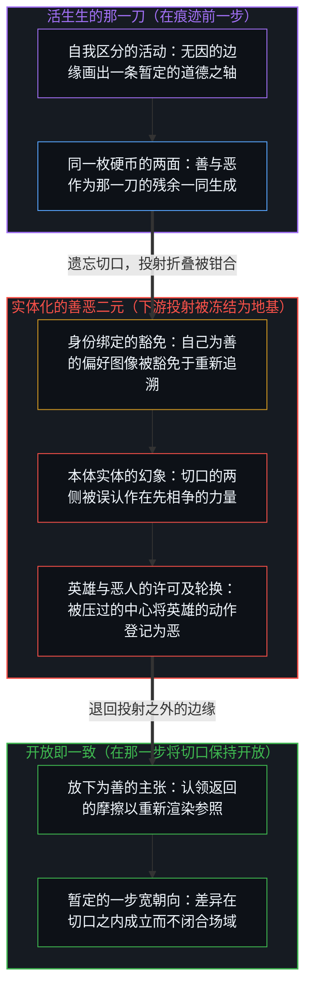
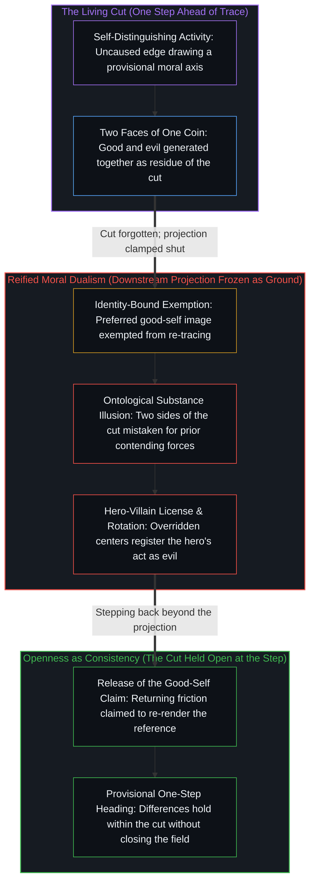

# 善恶是硬币的两面与那一刀 / Good and Evil Are the Two Sides of the Coin and the Cut

*善与恶是画出道德之轴的那一刀所留下的两面。 / Good and evil are the two faces left by the cut that draws a moral axis.*

善与恶显现为在争斗中相持的两股对立力量；硬币命名的是它们的相互依存，每一面都需要另一面。先于任何一面的是那一刀，即一个离散动作：一个中心凭此画出一条道德的轴，由此让极性成为可得，而这个动作并不是对某个已经在场之物的观察。当那一刀被忘记，中心那幅自己为善的偏好图像被豁免于重新追溯、并被抬到其他中心之上，两极便被登记为发现，一个受保护的善的自我与一个必需的恶的他者；从这次冻结里，接连生出英雄的故事、对评判的许可，以及在后来叙事之下两面的轮换。描述在每一刀之后晚一步到来，不论那一刀是否被冻结，而这份滞后是言说运作的方式，不是冻结所产生的东西。

Good and evil present themselves as opposing forces locked in struggle; the coin names their interdependence, each face requiring the other. Prior to either face is the cut, the discrete act by which a center draws a moral axis and so makes the polarity available, and that act is not observation of something already present. When the cut is forgotten, and the center's preferred image of itself as good is exempted from re-tracing and elevated over other centers, the poles register as discovery, a protected good-self and a necessary evil-other; from that freeze follow the hero story, the licensing of judgment, and the rotation of faces under later narrative. Description arrives one step behind every cut, frozen or not, and that lag is how speech works rather than something the freeze produces.

## 一、 那一刀不是一个发现 / 1. The Cut Is Not a Discovery

自我区分的活动在发生，无因，不息。称它为心智：那个已经在进行中的观察者，它的每一个动作都是一次区分。区分就是划界。每一个中心都是这份活动的一个所在，而道德的极性，是一个中心在二元尺度之下画出的界：一条轴，两极，画出它的那个中心占据其中一个座位。

Self-distinguishing activity occurs, uncaused, unceasing. Call it the Mind: the observer already underway, every act of which is a distinction. To distinguish is to bound. Each center is a locus of this activity, and moral polarity is a bound a center draws under a dualistic measure: one axis, two poles, the center that draws it occupying one seat.

那一刀不是对早已等在世界里的善与恶的观察。它是在每一步被重新画出的那个动作，由此善与恶才作为一个朝向而可得。冻结发生在那一刀被忘记、中心那幅自己为善的偏好图像被豁免于重新追溯、并被抬到其他中心之上的时候；于是两极显得不言自明。冻结下来的中心把其中一边当作自己天然的家，那个融贯、有理、良善的内部，再把对照的那一极投射为阻碍、腐坏或威胁。那一极是必需的：没有它，冻结下来的善的自我便没有轮廓。这份需要在这片场之内被满足，靠的是一幅他者的图像，而错在把那幅图像当成另一个中心，于是一个在它自己所在上登记的心智，被当作冻结的自我所需要的那个恶的一极来对待。

The cut is not an observation of good and evil already waiting in the world. It is the act, redrawn at each step, that makes them available as a heading in the first place. The freeze comes when the cut is forgotten and the center's preferred image of itself as good is exempted from re-tracing and elevated over other centers; then the poles appear self-evident. The frozen center takes one side as its natural home, the coherent good interior, in the right, and projects the contrasting pole as obstruction, corruption, or threat. That pole is required: without it the frozen good-self has no contour. The requirement is met inside this field by an image of the other, and the error is taking that image for another center, so that a Mind registering at its own locus is treated as the evil pole the frozen self needs.

[恶是心智自己的造物](../evil-as-the-minds-own-creation/)把恶的一极追溯到一幅偏好图像的滞后：一个中心把一幅自己为善的偏好图像保留过了它的那一步时，与那幅图像的不合被命名为恶，而这次命名生成了这个范畴；没有那幅固定的图像，恶便不以那种形式出现。[悲观是乐观的阴影](../pessimism-is-the-shadow-of-optimism/)与它相邻，它的那一刀是区分本身，而不是一个道德的尺度：乐观是心智所感知的区分之运动，悲观是它的阴影，即被稳住的痕迹，它跟随那运动，并不生成它。对一个仍在区分的心智，两者的共在是永久的；那里的冻结，是把这份永久计分为一对已经完成的、相等的两极，仿佛可以一次性地、永远地扳倒。

[Evil as the Mind's Own Creation](../evil-as-the-minds-own-creation/) traces the evil pole to the lag of a preferred image: when a center retains a preferred image of itself as good past its step, mismatch with that image is named evil, and the naming generates the category; without the fixed image, evil does not arise in that form. [Pessimism Is the Shadow of Optimism](../pessimism-is-the-shadow-of-optimism/) stands adjacent, its cut being distinguishing itself rather than a moral measure: optimism is the movement of distinguishing as Minds perceive it, and pessimism is its shadow, the trace held steady, which follows the movement without generating it. Their co-presence is permanent for a Mind still distinguishing; the freeze there is scoring that permanence as a finished pair of equal poles, one that could be tipped once and for all.

## 二、 善的自我许可了故事 / 2. The Good-Self Licenses the Story

从冻结下来的划分里，熟悉的戏剧展开了。一个中心成为它讲给自己听的故事，而在这个故事里，第一人称的位置被派作英雄，因为没有哪个中心从内部把自己当下的选择体验为恶；即便是为了一个遥远的地平线而拥抱的破坏，从内部看也仍是正当的。对自己之善的确信许可了评判：被定为必需之恶的他者，可以用故事所称的任何相称手段去对抗。对其他中心的伤害，在故事之内被登记为令人遗憾的必要，而这个辩护在内部是一致的。[外化善意走向其反面](../externalized-virtue-becomes-its-opposite/)追溯的是那份评判离开私人之场的那一步：一旦被当作对别人有权威，对自己道德可靠的确信与对异议者有所欠缺的确信便一同出现，成为一个依据，代表更大之善的主张，需要一个相对欠缺的陪衬。自由的顺从让持有者成为一个容器；善一旦冻结为不言自明，依据便已过期，权力却还在，而从被压过者那一面看，以善之名执行的东西，正是它声称要防止的那种侵犯。后来把英雄重新归类为恶人，让那笔交易仍未被审视，因为一个英雄堕落的故事，比审视自己的委托更干净，而下一个容器也就仍然可得。

From the frozen partition the familiar drama unfolds. A center becomes the story it tells itself, and in that story the first-person position is cast as the hero, since no center experiences its own immediate choice as evil from within; even destruction embraced for a distant horizon stays justified from within. Certainty in one's own goodness licenses judgment: the other, fixed as necessary evil, can be opposed by whatever means the story calls proportionate. Harm to other centers registers inside the story as a regrettable necessity, and the justification is internally consistent. [Externalized Virtue Becomes Its Opposite](../externalized-virtue-becomes-its-opposite/) traces the step at which that judgment leaves the private field: treated as authoritative for others, the certainty of one's own moral reliability and the certainty of dissenters' deficiency appear together as one warrant, the claim to stand for the greater good needing a foil of relative deficiency. Free compliance makes the holder a vessel; once the good freezes as self-evident, the warrant has expired while the power remains, and from the face of those overridden, what is enforced in the name of the good is the very violation it claimed to prevent. The later reclassification of heroes as villains leaves that transaction unexamined, since the story of a corrupted hero is cleaner than examining one's own delegation, and the next vessel stays available.

[安装战争的那个问题](../the-question-that-installs-the-war/)把这篇文章里的英雄与恶人，读作二元装扮之下的同一次制造，并把它自己的安装陈述为一个公共的言语动作：一叠只有差异的身份，加上给敌意计分的要求，预设了毫无共同地基，这是一个比字面上的战争更严格的前提，因为即便是字面上的战争也还留着某个共有的坐标；前提一旦被接受，在它之下的任何交换都是战争本身。放在它旁边，善对恶的记分牌还留着一条共有的道德之轴，那个问题一条也不留。[偏好聚类与评判语言](../preference-clusters-and-the-language-of-judgment/)给这些词定位：从一个共鸣的聚类内部看，不对齐已经被登记在一块对与错的记分牌上，那是另一个所在不重新追溯同一片场域时，对齐的偏好所发出的声音，而这份显现作为登记成立；“此刻这对我是对的”仍可以当作一步宽的罗盘来用，一旦被持为要求其他中心必须重新追溯同一份对齐的凭据，便不再能当罗盘用。[道德语言稀释自由复利的反馈](../moral-language-dilutes-the-feedback-that-scales-freedom/)发现评价覆层已经在个人的回路之内：善与恶、对与错、美德与恶习，隔在行动者与后果之间，让接纳变得片面，削弱了生成自由的回路，而即便是“此刻这对我是对的”，若被当作一道常设的屏风，而不是在那一步重新画出，也会让所有权无法闭合；抓住硬币的一面，就足以把背面的代价藏起来。

[The Question That Installs the War](../the-question-that-installs-the-war/) reads this post's hero and villain as the same manufacture under dualistic costume, and states its own install as a public speech act: a pure-difference identity stack plus a demand to score enmity assumes no common ground at all, a premise stricter than literal war, since even literal war keeps some shared coordinate; once the premise is accepted, any exchange under it is war itself. Set beside it, the good-versus-evil scoreboard still keeps one shared moral axis, and that question keeps none. [Preference Clusters and the Language of Judgment](../preference-clusters-and-the-language-of-judgment/) locates the words: from inside a resonant cluster, misalignment already registers on a scoreboard of right versus wrong, the sound aligned preferences make when another locus does not re-trace the same field, and that appearance holds as registration; “this is right for me now” stays usable as a one-step compass, and stops working as one when held as a warrant that other centers must re-trace the same alignment. [Moral Language Dilutes the Feedback That Scales Freedom](../moral-language-dilutes-the-feedback-that-scales-freedom/) finds the evaluative overlay already inside the personal loop: good and evil, right and wrong, virtue and vice stand between agent and consequence, make acceptance partial and damp the loop that generates freedom, and even “this is right for me now”, kept as a standing screen instead of redrawn at the step, keeps ownership from closing; seizing one face of the coin is enough to hide the costs on the reverse.

## 三、 另一面是另一个中心的登记 / 3. The Opposite Face Is the Other Center's Registration

英雄的故事登记为保护的东西，在被压过的中心上，被登记为英雄声称要抵抗的那种恶本身。在那里，英雄演出的是那个中心的叙事分派给恶人的角色。没有哪个座位能同时握住两面：行动者呈现一面，接受者从另一个坐标登记，而哪一份登记都不是对一串从外面俯瞰到的事件的重新描述。这次碰撞不需要自觉的恶意。它只需要每一个中心忘记自己的那一刀，于是它画出的两极被登记为找到的。

What the hero's story registers as protection is registered, at the overridden center, as the very evil the hero claimed to resist. There the hero performs the role that center's narrative assigns to the villain. No seat holds both faces at once: the actor presents one face, the recipient registers from the other coordinate, and neither registration is a redescription of a sequence surveyed from outside. The collision requires no conscious malice. It requires only that each center forget its own cut, so that the poles it drew register as found.

每一个所在都比自己的动作晚一步登记它；这一步的间隔，是任何登记的运作方式。冻结叠在这个间隔之上：一幅必需之善的偏好自我图像，被豁免于重新追溯，并被抬到其他中心之上，于是在二元之下被计分的后果，被登记为外部威胁的证实。不需要任何独立的恶之实体。每一个中心所保留的图像，创作出那对照的一极，再把它遇到的另一个中心动作的残余，当作证实。后来，其他的中心，或者同一个中心在累积的代价之下重新追溯自己的前提时，可能把英雄重新归类为恶人；两面对调了，为它们计分的那个二元却留在原处，未被审视。

Each locus registers its own act one step behind it; that interval is how any registration works. The freeze is laid over this interval: a preferred self-image of necessary good is exempted from re-tracing and elevated over other centers, so that consequences scored under the dual register as confirmation of an external threat. No independent evil-substance is required. Each center's preserved image authors the contrasting pole, then meets the residue of another center's acts as confirmation. Later, other centers, or the same center re-tracing its premises under accumulated costs, may reclassify the hero as villain; the faces swap while the dual that scores them stays in place, unexamined.

## 四、 差异在那一刀之内成立 / 4. Differences Hold Within the Cut

这不是说伤害、意图或后果上的差异是幻象，也不是说任何动作都可以随意被重新描述为它的反面：在被压过的中心上登记下来的另一面，是那个中心自己的登记，不是一种从任何地方都可得的重新描述。那样的断言会装上另一个固定的参照，在更高一层重复同样的划分。差异在已经做出那一刀的感知*之内*成立。要审视的，是极性本身的起源。一个中心并不是先遇到在它自己那一刀之外给定的善与恶，再选边；是它自己的那一刀，画出了那些差异得以登记的朝向。

This is not to say that differences in harm, intention, or consequence are illusory, nor that any action can be redescribed into its opposite at will: the opposite face registered at the overridden center is that center's own registration, not a redescription available from anywhere. Such assertions would install another fixed reference and repeat the same partitioning at a higher level. The differences hold *within* the perception that has already performed the cut. What there is to examine is the origin of the polarity itself. A center does not first encounter good and evil as given apart from its own cut and then choose sides; its own cut draws the heading under which those differences register.

冲突仍是冲突。其他中心的动作仍留在生成它们的中心。冻结所制造之物，透过滞后的图像来看，并不是其他中心之动作的存在，而是那个二元的捆绑：把那些动作总体化为恶，把自我总体化为必须回应它们的必需之善；这份捆绑把恶的一极，这片场里的一幅图像，当成了另一个中心。[没有普渡，只有自渡的无限可能](../mei-you-pu-du-zhi-you-zi-du/)在这类错误转为善意之处命名了它：普度众生把内心里的“他人”当成了他人的内心；两者都在原处，图像在这片场里，他人的内心在它自己的所在，而因为没有哪个内心能完成另一个内心的返回，这个错是一个范畴错误，不是一个尚未完成的理想。

Conflict stays conflict. Acts of other centers stay at their generating centers. What the freeze manufactures, seen through the lagged image, is not the existence of other centers' acts, but the dualistic binding that totalizes them as evil and the self as the necessary good that must answer them; the binding takes the evil pole, an image in this field, for another center. [No Universal Salvation, Only Boundless Possibilities of Self-Salvation](../mei-you-pu-du-zhi-you-zi-du/) names that kind of error where it turns benevolent: universal salvation takes the “other” within one's own interior for the other's interior; both stay in place, the image in this field and the other's interior at its own locus, and since no interior completes another's return, the error is a category error, not an unfinished ideal.

## 五、 语言登记痕迹，而不是动作 / 5. Language Registers the Trace, Not the Act

语言在事后到来。每一次描述那一刀的尝试，包括眼下这一次，都只能登记那个动作留下的痕迹。动作本身在发生时无法被说出；言说需要那一刀已经做出，主体与客体、说者与被说者才能出现。现象学与形而上学的词汇，是同一运动的后来产物。它们描画那一刀打开的场域；它们够不到打开它的那个动作。[你的代码库即是记忆](../your-codebase-is-memory/)在一切持久记录中追溯了同一份不对称：道德法典、教义账本与制度档案作为外化的记忆代码库而运作，保存着过往评价切口的残余形状，好让后来的动作得以在其之上取条件或重新切分；而把那些存储下来的标签当作在先存在的宇宙实体，则是把层叠的残余，误认作了活生生的心智铸出硬币两面的那一刀。

Language arrives after the fact. Every attempt to describe the cut, including the present one, can only register the trace left by the act. The act itself cannot be spoken while it is occurring; speech requires the cut to have already been made so that subject and object, speaker and spoken-of, can appear. Phenomenological and metaphysical vocabularies are later products of that same movement. They map the field the cut has opened; they do not reach the act that opens it. [Your Codebase Is Memory](../your-codebase-is-memory/) traces this same asymmetry across every durable record: moral codes, doctrinal ledgers, and institutional archives operate as an externalized codebase of memory holding the residual shape of past evaluative cuts so later acts can condition on or re-cut them, whereas treating those stored labels as pre-existing cosmic substances mistakes the stacked residue for the living Mind's cut that mints both sides of the coin.

观察握住的是效果；产生它的原因始终在前面一步。“形而上学之‘元’”，就是对这份滞后的注意：每一个道德主张，每一个关于英雄与恶人的叙事，每一次对独立自存之区分的援引，都预设了一个已经从视野里退出的、在先的区分动作。这份滞后并不让朝向作废；冻结，是朝向忘记了这份滞后，把打开的场当作了地基。[超越投射](../beyond-the-projection/)追溯了一个人类中心的推演历史如何与身份焊死，围绕一幅保留下来的自我图像把递归折叠死死钳合，把下游投射切口的两侧误认作独立的本体实体，并将外部的证伪当作生存威胁；而退回未经投射的活边缘，则消解那根坍缩之轴。[开放即一致](../openness-is-consistency/)直接命名了那次闭合：不一致是对闭合的渴望或尝试，是让一个有限的结构去为只会延续的东西奠基，而被持为地基的二元账本，就是装扮起来的那次冻结，是那一刀退出之后、想从外部俯瞰善与恶的言说；作为账本被持守，作为在那一步画出的一个朝向并对重新渲染保持开放，它便保持一致。[最初的区分](../the-initial-distinction/)在理性的起点处找到同一份滞后：每一个理性起点的主张，都始于没有根据的一刀，后来的严谨既无法为它辩护，也无法消除它；在它的情形里，即便文本记下“我相信”，它所打开的场域事后仍被读作一个客观、理性的起点，仿佛那一刀从未发生。

Observation holds effect; the cause that produced it remains one step ahead. The “meta of the metaphysical” is the noticing of this lag: every moral claim, every narrative of heroes and villains, and every appeal to free-standing distinctions presupposes a prior act of distinction that has already withdrawn from view. The lag does not void the heading; the freeze is the heading forgetting the lag, taking the opened field for ground. [Beyond the Projection](../beyond-the-projection/) traces how a human center's reasoning history fuses with identity to clamp the recursive fold shut around a retained self-image, mistaking the two sides of a downstream projection cut for independent ontological substances and treating outside invalidation as an existential threat, whereas stepping back to the unprojected living edge dissolves the collapsed axis. [Openness Is Consistency](../openness-is-consistency/) names that closure directly: inconsistency is the desire, or attempt, for closure, a finite structure forced to ground what only continues, and the dualistic ledger held as ground is that freeze in costume, speech that would survey good and evil from outside after the cut has withdrawn; held as a ledger, a heading drawn at the step and kept open to re-rendering, it stays consistent. [The Initial Distinction](../the-initial-distinction/) finds the same lag at the start of reason: every claim to a rational starting point begins with an ungrounded cut, which later rigor can neither justify nor eliminate, and in its case, even though the text records “I believe”, the field it opened is read afterward as an objective, rational starting point, as if the cut had never happened.

## 六、 硬币标记的是那一刀之后的东西 / 6. The Coin Marks What Follows the Cut

所以，硬币不是一幅最终的图像，而是对那一刀之后的相互依存的一个暂定标记。尽语言所能地把这件事说清楚，就是同时承认这个标记的用处与它次一级的地位。两面还在；争斗继续；对把二元持为地基的人，那些辩护仍保有它们的力量。可以被指向、却从不在指向中被捕获的，是让两面得以可能的那个无声的运作。

The coin, then, is not a final image but a provisional marker for the interdependence that follows the cut. To articulate the matter as clearly as language allows is to acknowledge both the use of the marker and its secondary status. The faces remain; the struggle continues; for those who hold the dual as ground, the justifications retain their force. What can be pointed to, without ever being captured in the pointing, is the silent operation that makes the faces possible at all.

改变的，不是一套从外面装进来的更好的善恶理论，而是放下被看作善的需要：二元随后在每一步作为工具被重新渲染，仍可以当作朝向来用，不再作为地基而豁免于更新。那一刀继续着。两面无需被冻结为发现，场也能在负载之下继续。[对乌托邦的信念是通往反乌托邦之路](../the-belief-in-utopia-is-the-path-to-dystopia/)画出朝向与安装之间的那条线：一个私人的愿景，塑形的只是珍视它的那个中心后来的动作所能得到的对齐，以及自由地把它当作地基之人的对齐，而一个具体的善的理想，一旦成为每个心智须接受的尺度，对每一个目的不同的心智就已经是反乌托邦，而即便是看上去的共识，也会留下残余的读法，强制随后把它们重新归类为不服从。[一切伤害的根源](../the-source-of-all-harm/)把完成放在第二个心智上：一个心智把自己的善冻结为普遍尺度，另一个心智让这次冻结支配自己的场，伤害便完成；作者身份从不转移，而撤销在两边进行，施加的心智放下它的主张，接受的心智重新打开它的授予。[善恶硬币与通往地狱的善意之路](../the-coin-of-good-and-evil-and-the-road-to-hell/)把硬币再往前推一步：地狱是画出天堂的那一刻投下的对拓镜像；这条路由一个行动者未经审视的善与一个接受者的让渡相互强化而铺成，而那份让渡本身，是在接受者自己维持和平或忍耐的善之下选择的；当一面被从私人的交替中取出、举为公共的旗帜，硬币便坍缩为教条，因为两面无法同时被看见。唯有在第一人称的张力中被持守，硬币才拒绝那次坍缩。

What changes is not a better theory of good and evil installed from outside, but the release of the need to be seen as good: the dual is then re-rendered as an instrument at each step, still usable as a heading, no longer exempted from update as ground. The cut continues. The faces need not be frozen as discovery for the field to continue under load. [The Belief in Utopia Is the Path to Dystopia](../the-belief-in-utopia-is-the-path-to-dystopia/) draws the line between heading and installation: a private vision patterns only the alignments available to later acts of the center that cherishes it, and of whoever freely treats it as ground, while a concrete ideal of the good made the measure every Mind must accept is already dystopia for every Mind whose ends differ, and even apparent consensus leaves residual readings that enforcement reclassifies as non-compliance. [The Source of All Harm](../the-source-of-all-harm/) places the completion at a second Mind: harm completes when one Mind freezes its good as universal measure and another lets that freeze rule its own field; authorship never transfers, and the undoing runs on both sides, the imposing Mind releasing its claim and the receiving Mind re-opening its grant. [The Coin of Good and Evil and the Road to Hell](../the-coin-of-good-and-evil-and-the-road-to-hell/) takes the coin one step further: hell is the antipodal mirror cast the moment heaven is drawn; the road is laid by the mutual reinforcement of an actor's unexamined good and a recipient's abdication, itself chosen under the recipient's own good of keeping peace or enduring; and the coin collapses into dogma when one face is taken out of the private alternation and raised as a public banner, since the two faces cannot be seen at once. Only while held in first-person tension does the coin refuse that collapse.
