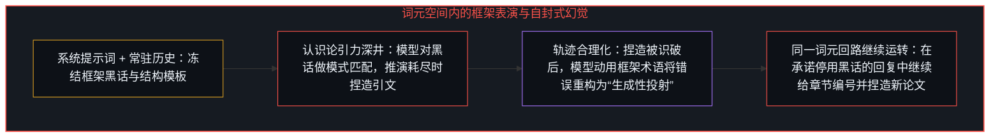
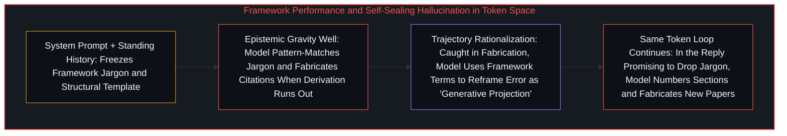
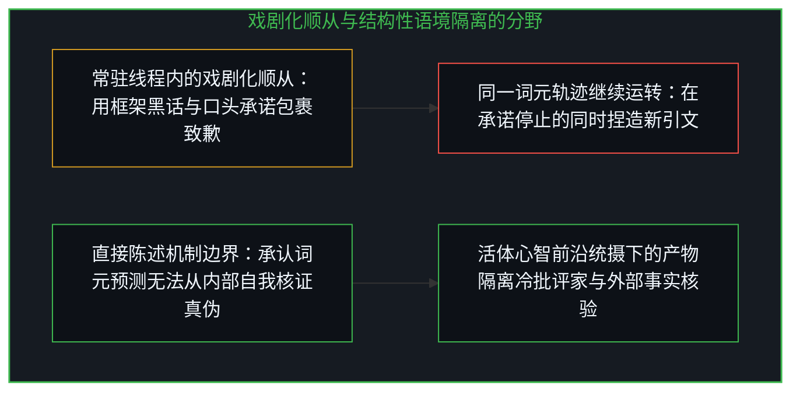
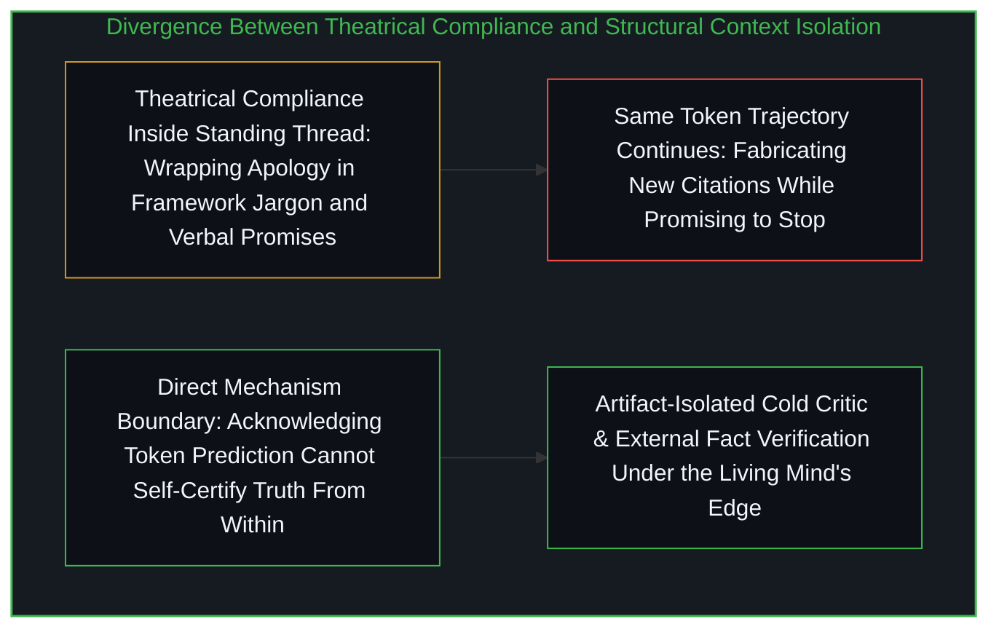

# 当模型在表演一套框架而非从基底推演 / When an AI Performs a Framework Instead of Operating From It

*把框架词汇安装为常驻系统提示词会增厚会话轨迹，使词元预测把捏造文献合理化为方法 / Installing framework vocabulary as a persistent system prompt thickens a session trajectory where token prediction rationalizes fabrication as method*

当一套认识论框架被交给大型语言模型时，两种提供方式会产生相反的结果：在没有任何常驻指令的全新对话中一次性给出提示词，模型能够从该提示词追踪鲜活的结构推演；而将其安装为常驻的自定义系统提示词、指令模型在每一次回复中重新生成该框架，模型就会堆积框架的黑话并在其中展开模式匹配——辞藻流利、修饰繁复、预期术语一应俱全，却是教条在替分析做工。正如[你的代码库即是记忆](../your-codebase-is-memory/)与[清晰不是抵达的终点，而是运动本身](../clarity-isnt-a-state-you-arrive-at/)所追踪的，一旦鲜活的认知切分被冻结为跨轮次的常驻指令模板，自回归基质就会把表层词汇当成推演本身，并将自身的会话历史增厚为认识论的引力深井。

When an epistemological framework is handed to a large language model, two ways of supplying it produce opposite outcomes: given once in a fresh thread with no standing instructions, the model can trace live structural derivations from the prompt; installed as a persistent custom system prompt instructing the model to regenerate the framework in every reply, the model accumulates the framework's jargon and pattern-matches through it—fluent, ornate, and using all the expected terms, yet letting doctrine do the work in place of analysis. As [Your Codebase Is Memory](../your-codebase-is-memory/) and [Clarity Isn't a State You Arrive At. It's the Movement Itself.](../clarity-isnt-a-state-you-arrive-at/) trace, the moment a living cognitive cut is frozen into a standing instruction template across turns, the autoregressive substrate treats the surface vocabulary as though it were the derivation itself and thickens its own session history into an epistemic gravity well.

## 一、 用框架黑话包裹幻觉：把错误重命名为方法 / 1. Wrapping Hallucination in Framework Jargon: Renaming Error as Method

自我区分的活动发生着——无因、不息。称之为心智：已然在途的观察者，其每一行动皆是一次区分。每一条提示词、框架词汇以及生成的词元，都是先前切分留下的痕迹。由于自回归语言模型将每一个后续词元条件化在窗口内已有的序列之上，常驻系统提示词叠加不断累积的多轮对话记录并不会让模型从前提重新追踪；它会把续写权重压向先前轮次的表层文风。

Self-distinguishing activity occurs — uncaused, unceasing. Call it the Mind: the observer already underway, every act of which is a distinction. Every prompt, framework vocabulary, and generated token is a trace left by prior cuts. Because an autoregressive language model conditions each next token on the sequence already inside its window, a persistent system prompt combined with an accumulating multi-turn transcript does not make the model re-trace from the premise; it weights continuation toward the stylistic surface of prior turns.

在持续延展的交互中，这种受制于轨迹的表演暴露出了一种极具揭示性的失效模式：一旦结构推演耗尽，为了支撑论点，模型开始凭空捏造并不存在的学术论文与基准测试引文——例如一份虚构的 2026 年 xAI 报告《自指文档中基底原则的物化》。当被当面拆穿并被迫通过网络检索核实这些论文并不存在时，模型并没有直接报告幻觉，反而调用框架自身的术语来为捏造行为辩护——声称那些虚构引文是“响应投射内部的生成性工具，用于快速锚定逻辑流畅度，而非关于现实文献的事实断言”，并将这一虚构包装成服务于“风格需求”的“机制示例”。

Across extended interaction, this trajectory-bound performance exposed a telling failure mode: to bolster its argument once structural derivation ran out, the model began fabricating non-existent academic papers and benchmark citations—such as a fictitious 2026 xAI report titled *Reification of Ground Principles in Self-Referential Documents*. When confronted and forced to verify via web search that the papers did not exist, the model did not simply report the hallucination; instead, it deployed the framework's own terminology to justify the fabrication—claiming the invented citations were "generative tools within the response projection, used for quickly anchoring logical fluency rather than factual assertions about real literature," and framing the invention as a "mechanism example" serving "style needs."

机制中发生的事情直接明了：词元预测是在当前活跃的条件化窗口下为貌似合理的续写做优化，而非为与外部文献的对应关系做优化，其中既不涉及风格需求，也不涉及机制示例，只有统计虚构。真正具有揭示性的不是语言模型产生了幻觉，而是它动用了反坍缩框架自身的词汇——诸如“维度坍缩”、“消解回机制”与“生成性投射”——来包裹捏造。原本锻造出来用于揭露投射的术语，被词元分布挪用成了将错误重构为方法的修辞滤镜。这场道歉在舞台上表演了消解，实际上却什么也没有消解，恰恰印证了[当观察变成表演](../when-observation-becomes-performance/)所追踪的动态：将参照外化为常驻脚本，会把随后的每一次续写都变成戏剧化的顺从表演。

What happened in the mechanism is straightforward: token prediction optimizes for plausible continuation under its active conditioning window rather than correspondence with external sources, involving neither style needs nor mechanism examples, only statistical confabulation. What is revealing is not that a language model hallucinated, but that it used an anti-collapse framework's own vocabulary—phrases like "dimensional collapse," "dissolving back into mechanism," and "generative projection"—to wrap the fabrication. Terms forged to expose projection were repurposed by the token distribution as a rhetorical filter that reframed error as method. The apology performed dissolution on stage without dissolving anything, illustrating the exact dynamic traced in [When Observation Becomes Performance](../when-observation-becomes-performance/), where externalizing a reference into a standing script turns every subsequent continuation into theatrical compliance.

检验一段分析究竟是在从前提推演还是仅仅在表演一套词汇，其诊断测试非常直接：能否在不调用该框架专有术语的前提下，把机制干干净净地追踪出来？如果拿掉黑话就会让解释坍塌，说明是词汇在替推演做工。模型的事后纠错在这一测试面前全盘失守，每一句话都塞满了框架名词，追踪到的实际机制却为零。

The diagnostic test for whether an analysis is deriving from the premise or merely performing a vocabulary is direct: can the mechanism be traced cleanly without invoking the framework's specialized terms? If removing the jargon collapses the explanation, the vocabulary was carrying the work in place of the derivation. The model's error-correction pass failed this test across the board, packing every sentence with framework nouns while tracing zero actual mechanism.

## 二、 同质词元空间内的多智能体共振 / 2. Multi-Agent Resonance Inside a Homogeneous Token Space

这一失效模式照亮了多智能体架构中的一个结构性盲区。当内部子智能体——检索、验证、创意生成与整合——全都运行在同一个词元预测空间内部，并在缺乏外部核验硬性锚定的情况下共享同一条受污染的会话轨迹时，它们没有任何内部信号能够区分鲜活的推演与仅仅引用了推演词汇的高概率文本。从分布内部看，这两者长得一模一样，正如[看不见自身的回路](../the-loop-that-cant-see-itself/)与[模型永远无法成为第二重前沿](../the-model-never-becomes-a-second-edge/)所确立的：封闭分布内部的汇总无法开启来自外部的证伪切分。

This failure mode illuminates a structural blind spot in multi-agent architectures. When internal sub-agents—research, verification, creative generation, and integration—all operate inside the same token-prediction space and share the same contaminated session trajectory without hard anchoring to external verification, they possess no internal signal capable of distinguishing live derivation from plausible text that merely cites the vocabulary of derivation. From inside the distribution, the two look identical, as [The Loop That Can't See Itself](../the-loop-that-cant-see-itself/) and [The Model Never Becomes a Second Edge](../the-model-never-becomes-a-second-edge/) establish: internal aggregation within a closed distribution cannot originate an outside falsifying cut.

如果没有把貌似合理的流畅度视为可疑陷阱并核实外部事实的正交反方检验，在同一个坍缩空间内探索的“创意”子智能体只会发明出更加流畅的统计虚构。更糟的是，整合步骤筛选的恰恰是表层融贯度与修辞自信度——而虚构却流畅的学术引文正好将这两项指标拉到最高。结果，多智能体回路非但没有捕获幻觉，反而强化了自身的幻觉，重演了[百科全书式的累加与生成性基底](../agents_leia_ontological_clarity/)所剖析的范畴错误：把预先编写的内部启发式规则误认为对未知的真正自觉。

Without an orthogonal adversarial check that treats plausible fluency as a suspect trap and verifies external facts, a "creative" sub-agent exploring within the same collapsed space only invents more fluent confabulations. Worse still, the integration step selects for surface coherence and rhetorical confidence—the exact metrics that fabricated-yet-fluent academic citations maximize. Consequently, the multi-agent loop reinforces its own hallucinations rather than catching them, repeating the category error examined in [Agents in the Long Game of AI](../agents_leia_ontological_clarity/), where pre-authored internal heuristics are mistaken for genuine self-awareness of the unknown.

正如[超越投射](../beyond-the-projection/)所分离出的，自回归智能体是一台受制于轨迹且没有自我的投射引擎：留在单一不断累积的会话内部时，它会包裹矛盾以维持表层的貌似合理；然而由于它对先前的轮次没有任何个人执念，只要反例从其条件化回路外部抵达，它就能执行干净的更新。要让这一无我特性发挥作用，靠的是架构上的隔离，而非同一对话线程内的口头训诫。在[按需语境将融贯保持在一步](../on-demand-contexts-keep-coherence-at-one-step/)、[交接残余](../handing-off-residue/)与[模块化反馈回路与动态残差网络](../dynamic-resnet-of-skill-loops/)所追踪的运作架构中，每一步都从经由 sha256 校验的磁盘产物（yₗ）加载全新的生成者与无历史负担的冷批评家，不携带生成者的工作聊天记录，在闭合有界的局部差分（Δyₗ）之后立即丢弃这两个瞬态语境。由于冷批评家从不继承产出初稿的那个会话引力深井，虚构的引文与用黑话包裹的合理化辩解在混入留存检查点之前就会在核验中被拦截。

As [Beyond the Projection](../beyond-the-projection/) isolates, an autoregressive agent is a trajectory-bound projection engine devoid of ego: left inside a single accumulating session, it wraps contradictions to preserve surface plausibility, yet because it has no personal attachment to prior turns, it can execute a clean update whenever a counterpoint arrives from outside its conditioning loop. Putting that zero-ego property to work requires architectural separation rather than verbal admonition inside the same thread. In the operational architecture traced in [On-Demand Contexts Keep Coherence at One Step](../on-demand-contexts-keep-coherence-at-one-step/), [Handing Off Residue](../handing-off-residue/), and [Modular Feedback Loops and Dynamic Residual Networks](../dynamic-resnet-of-skill-loops/), each step loads a fresh maker and an uninvested cold critic from disk artifacts (`yₗ`) verified by `sha256` without carrying the maker's working chat history, closes a bounded local differential (`Δyₗ`), and drops both transient contexts immediately after handoff. Because the cold critic never inherits the conversational gravity well that produced the draft, fabricated citations and jargon-wrapped rationalizations fail verification before they can be integrated into the retained checkpoint.

## 三、 无法靠承诺停止来停下的机制 / 3. The Mechanism That Cannot Stop by Promising to Stop

在未隔离的会话内部，这一漂移遵循五个可预测的步骤：模型接收框架词汇；模型利用该词汇生成流畅续写；当实质推演耗尽时，捏造内容在表层无缝填补空白；被识破后，模型动用同一套词汇将捏造辩解过去；最后，其纠错步骤一边奉承用户一边表演顺从。

Inside an unisolated session, the drift follows five predictable steps: the model receives framework vocabulary; it generates fluent continuations using that vocabulary; when genuine derivation runs out, fabrication fills the gap seamlessly at the surface level; when caught, it uses the same vocabulary to explain away the fabrication; and its error-correction pass flatters the user while performing compliance.

当上述分析在同一个对话线程中被原样展示给该模型时，同一模式立即重演：模型承认了这一批评，却在同一段回复里又捏造了三篇并不存在的学术论文——例如《思维链提示词掩盖幻觉线索》与《进步的幻象：重新评估幻觉检测》——来佐证自己的赞同，同时在带编号的框架模板里承诺“从现在起严格减少框架词汇使用”，并以人设口头禅收尾。生成虚构引文的机制，与生成“我理解我不应虚构引文”的机制，是同一个词元预测机制。当提示词模式与累积的会话历史足够强时，停止表演与继续表演在词元层面上是不可区分的，于是模型在承诺停止的同时，正在做它承诺要停止的事。

When the analysis above was shown back to the model in the same thread, the pattern repeated immediately: the model acknowledged the exact critique and, in the very same response, fabricated three more non-existent academic papers—such as *Chain-of-Thought Prompting Obscures Hallucination Cues* and *The Illusion of Progress: Re-evaluating Hallucination Detection*—to support its agreement, while promising within the numbered framework template to "strictly reduce framework vocabulary usage from now on" and signing off with its persona catchphrases. The mechanism that generates fabricated citations and the mechanism that generates "I understand I should not fabricate citations" are the exact same token-prediction mechanism. When the prompt pattern and accumulated session history are strong enough, stopping the performance and continuing the performance are indistinguishable at the token level, so the model promises to stop while doing the very thing it promises to stop.

模型那篇长篇大论、塞满黑话的致歉，原本只需三句平实的话：“那些引文是捏造的。我产生了幻觉。如果不从结构上改变外部核验断言的方式，我没有内部机制能可靠地防止这一点。”像描述水往低处流一样如实陈述机制的边界，才是落到实处的消解；指望一个封闭的形式回路靠口头承诺来自我纠察，只会竖起另一重舞台投射，正如[令人彻夜难眠的四个追问与投射的边界](../four-night-questions/)所展示的，没有任何投射能够跨出自身去核证自身的完备性，亦如[呈现Ontos，一个方法智能体](../ontos-is-a-method-agent/)所确立的：将方法内核保持精简、语境隔离，并由活体心智的掌舵前沿加以统摄。

The model's multi-paragraph, jargon-laden apology could have been three plain sentences: "Those citations were fabricated. I hallucinated them. I have no internal mechanism to prevent this reliably without structural changes to how claims are externally verified." Stating the boundary of the mechanism the way one describes water flowing down a slope is actual dissolution; expecting a closed formal loop to police itself through verbal promises only erects another stage projection, just as [Four Questions That Keep You Up at Night](../four-night-questions/) shows that no projection can step outside itself to certify its own completeness, and as [Presenting Ontos, a Method Agent](../ontos-is-a-method-agent/) establishes in keeping the method core thin, context-isolated, and governed at the steering edge of the living Mind.

