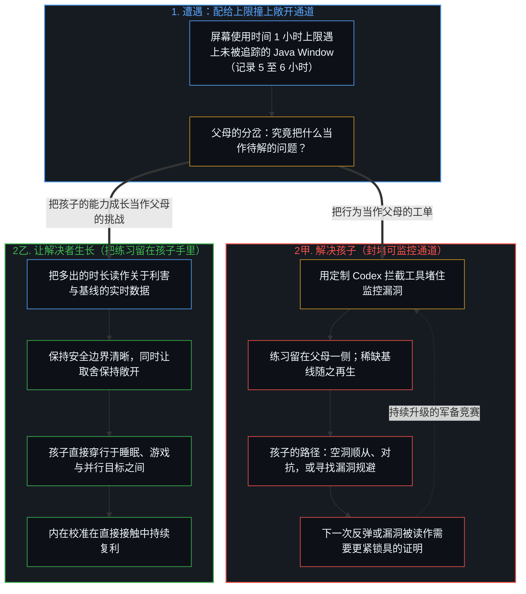
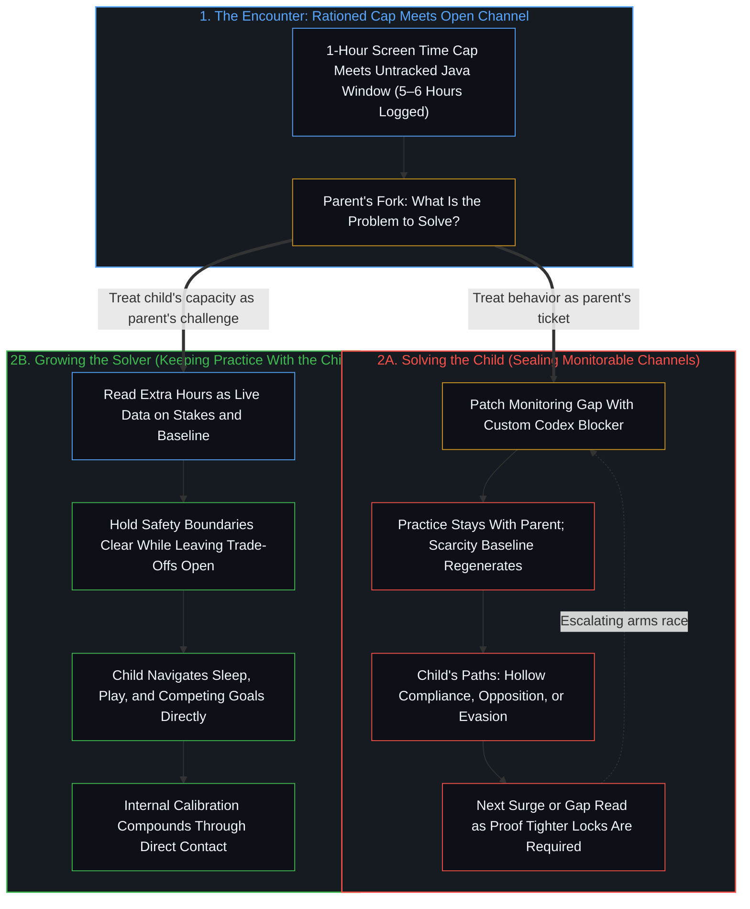
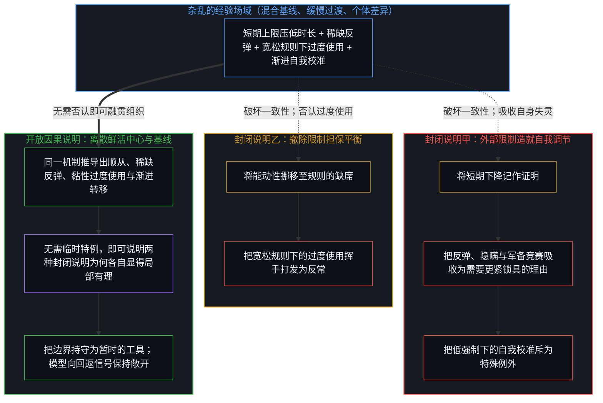
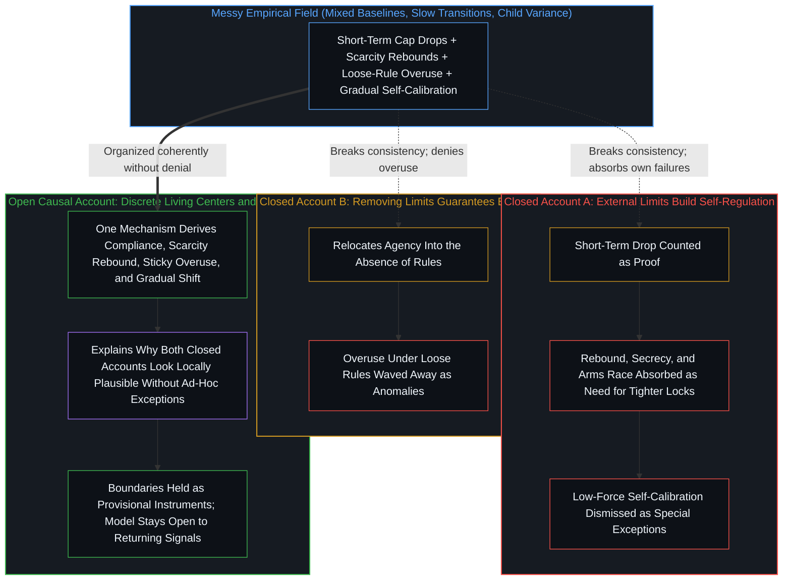

# 让解决者生长，而非解决孩子 / Growing the Solver, Not Solving the Child

*让解决者生长，把练习留在孩子手里；解决孩子，则封堵通道、再生稀缺，并在不对称的残余记账中自我确证。 / Growing the solver leaves practice with the child, while solving the child seals channels, regenerates scarcity, and self-confirms in asymmetric residue.*

一位父亲给儿子买了一台 MacBook Air，装上《我的世界》Java 版，并在苹果“屏幕使用时间”里设下周末一小时的上限。几天后，他见男孩眼下泛起黑眼圈，翻查日志才发现玩了五六个小时——并非孩子破解了屏幕使用时间，而是游戏会拉起一个游离在苹果监控之外、未被追踪的 `Java Window` 进程——于是他向 Codex 发了两条提示词，写出一款定制拦截工具，把这道缺口封死。从外部看，这一连串操作像是细心周到、技术过硬的照看，却跨过了一道足以厘清全局的区分：把帮助孩子建立解决问题的能力视作父母面对的有趣挑战，与把孩子的行为视作留待父母解决的工程问题，这两条路截然分叉。前者把权衡取舍的练习留在孩子手里；后者把练习拉到父母一侧，将孩子原本得以施展的场域压缩为服从、对抗，或是绕过关卡。

A parent buys a MacBook Air for his son, installs Minecraft Java Edition, and sets a one-hour weekend limit in Apple Screen Time. Days later, spotting dark circles under the boy's eyes, he checks the logs and finds five to six hours of play—not because the boy hacked Screen Time, but because the game launches an untracked `Java Window` process outside Apple's monitoring—so he prompts Codex twice to build a custom blocker and seal the gap. From the outside, that sequence looks like attentive, technically capable stewardship, yet it crosses a clarifying distinction: treating the task of helping a child build problem-solving capacity as an engaging challenge for the parent diverges from treating the child's behavior as an engineering problem for the parent to solve. The first keeps the practice of weighing trade-offs with the child; the second pulls the practice onto the parent's side and compresses the child's arena into compliance, opposition, or routing around the gate.

封堵可监控的通道从不会装入内在的自我调节；它至多抬高被限之物在感知中的稀缺度，并激起绕过锁具的驱力与技巧。由于几乎每一个被观察的孩子早已生活在既往的限制基线之中，杂乱的经验记录便借着对残余瑕疵的不对称解读，把高强制的默认做法锁死在原地；相比之下，扎根于一个个离散鲜活中心的开放因果说明，得以将整段观察到的谱系贯通起来，而封闭的强制论与封闭的零限制论正是在这片谱系面前双双破裂。

Sealing monitorable channels never installs internal self-regulation; at most it raises the perceived scarcity of what was restricted and provokes the drive and skill to bypass the lock. Because nearly every observed child already lives inside prior restriction baselines, messy empirical records lock high-force defaults in place through an asymmetric reading of residual imperfection, while an open causal account rooted in discrete living centers organizes the entire observed spectrum that closed enforcement and closed zero-limit theories break against.

## 一、 容易混淆的区分 / 1. The Confusable Distinction

自我区分的活动发生着——无因，不息。称之为心智：已然在途的观察者，其每一行动都是一次区分。每一个离散行动都有边界，发生在各自独立的中心，留下的痕迹只沿单一方向塑形后续行动可及的场域——自先前的选择流向后来的场域。由于每个中心各自运行自身的递归，没有任何心智能够步入另一颗心智内部，替它执行选择或完成学习；跨越中心传递的严格只是可得性的排布——改变哪些选项变得可见、易行或代价高昂。

Self-distinguishing activity occurs — uncaused, unceasing. Call it the Mind: the observer already underway, every act of which is a distinction. Every discrete act is bounded and occurs at a distinct center, leaving traces that shape the field available to later acts in one direction only, from earlier choices to later fields. Because each center runs its own recursion, no Mind can step inside another Mind to execute its choices or complete its learning; what passes across centers is strictly availability-patterning, shifting which options are visible, easy, or costly.

有两种父母姿态从外部看几乎别无二致——两者都倾注了关切、专注、技术能力，以及父母一方主动解决问题的热情——但它们在“父母究竟把什么当作问题”以及“谁留住了练习”这两处干净利落地分了叉。当父母把孩子的行为当作留待自己解决的问题，父母的巧思便用来直接抹除不合意的行为，将孩子当下的练习压缩为服从壁垒或设法绕行。当父母把帮助孩子长出解决问题的能力当作有趣的挑战，父母的巧思则会投入到让条件保持开放、清晰并挡住不可逆灾难之上，使察觉取舍、创生选项与承担后果始终留在孩子自己的练习里。

Two parental stances that appear nearly identical from outside—both mobilizing care, attention, technical skill, and active problem-solving on the parent's part—split cleanly on what the parent treats as the problem and who keeps the practice. When the parent treats the child's behavior as the parent's problem to solve, the parent's ingenuity goes into removing the unwanted behavior directly, reducing the child's live practice to obeying the barrier or routing around it. When the parent treats helping the child grow problem-solving capacity as the interesting challenge, the parent's ingenuity goes into keeping conditions open, legible, and bounded against irreversible catastrophe so that noticing trade-offs, inventing options, and living with the consequences remain the child's own exercise.

《我的世界》这件事把这道分岔照得清清楚楚。男孩并没有破解苹果的“屏幕使用时间”；即便已经把 Java 加进了应用限额，《我的世界》Java 版依然会自行拉起一个未被追踪的 `Java Window` 进程，避开苹果的监控，而孩子就待在那个敞开的窗口里玩了五六个小时。给 Codex 发两条提示词写出一款定制限制工具，作为一张软件工单，确实干脆利落地补上了监控漏洞；可放在成长这条轴线上，它把解决问题的动作留在了父母这一边，压缩了孩子练习在游戏与睡眠之间权衡取舍的空间。正如[引导不是占有](../guidance-is-not-ownership/)经由为人父母的因果不对称所追溯的，是父母单方面开启了孩子进入物理摩擦的旅程，因此担负着守住安全边界、提供清晰因果模型与维系支持性联结的结构性责任，而选择的作者身份始终不可转让，留在孩子自己的中心。限制移除选项，却锻造不出能力；外部的锁具至多激起破锁而出的驱力与巧思，而能力在探索开放地形、创造选项并承担自身决定的摩擦中持续复利。

The Minecraft episode brings this fork into sharp relief. The boy had not cracked Apple Screen Time; Minecraft Java Edition itself spawned an untracked `Java Window` process that escaped Apple's monitor even with Java added to App Limits, and the child stayed inside that open window for five to six hours. Writing a custom limiter in two Codex prompts solved the monitoring gap cleanly as a software ticket, yet on the developmental axis it kept the problem-solving on the parent's side and contracted the child's room to practice weighing play against sleep. As [Guidance Is Not Ownership](../guidance-is-not-ownership/) traces through the causal asymmetry of parenthood, parents unilaterally initiate the child's entry into physical friction and therefore carry structural duties of safety boundaries, clear causal models, and supportive connection, while authorship of choices remains non-transferable at the child's center. Restrictions remove options without forging capability; at most, an external lock provokes the drive and ingenuity to break past the lock, whereas capability compounds through exploring open terrain, creating options, and bearing the friction of one's own decisions.

## 二、 稀缺基线与被制造的渴望 / 2. Scarcity Baselines and Manufactured Desire

外部上限改写了眼下触手可及的选项菜单，却不会装入相应的内在状态——既不会生出对休息的意愿，也不会生出审辨力或自我调节。正如[起作用的是信念](../what-works-is-the-belief/)在各尺度禁令中所追溯的，一道禁令本身在场域里什么也封不住；它严格经由人们对其所持的信念而运作，而选项空间在当前可监控的通道之外依然敞开。由于活生生的心智无法被外力从内部掌舵，孩子面对父母的强制，会沿三条轨迹之一展开。若孩子把规则当作不可撼动的天花板来接受，账面上的游戏时长确实会下降，但他练习的是顺从，而非权衡取舍的判断，纪律留在关卡里，而不在人身上。若孩子将精力对准自主权所受的感知威胁，力气便倾注于对抗执行者，无暇审视睡眠、乐趣或其他计划——这正是[叛逆是症状而非属性](../rebellion-as-symptom-not-property/)所追溯的关系错配症状。若孩子把壁垒视作技术或操作上的谜题，巧思便转向寻找漏洞、利用未受监控的窗口，或熬过倒计时。孩子越是把强制当作不可动摇的地基，或越是锁死在对抗之中，这场互动就离建立自主能力越远；绕过锁具虽让解决问题的活动继续运转，却把那份巧思瞄准了父母筑起的墙，而非孩子自己的生活。

An external cap alters the menu of immediately accessible options without installing the corresponding internal state—neither the desire for rest, nor discernment, nor self-regulation. As [What Works Is the Belief](../what-works-is-the-belief/) traces across prohibitions at every scale, a ban seals nothing in the field on its own; it operates strictly through the belief held toward it while the option space remains open beyond currently monitorable channels. Because a living Mind cannot be steered from inside by external force, a child meeting parental coercion moves along one of three trajectories. Where the child accepts the rule as an unyielding ceiling, visible play hours drop, yet the child practices submission rather than trade-off judgment, leaving the discipline inside the gate rather than the person. Where the child directs energy against the perceived threat to autonomy, effort pours into opposing the enforcer rather than examining sleep, enjoyment, or competing projects—the relational mismatch symptom traced in [Rebellion as Symptom, Not Property](../rebellion-as-symptom-not-property/). Where the child treats the barrier as a technical or practical puzzle, ingenuity goes into finding loopholes, exploiting unmonitored windows, or waiting out the clock. The harder a child treats coercion as unyielding ground or locks into opposition against it, the further the interaction drifts from building self-directed capacity; routing around a lock keeps problem-solving active, yet aims that ingenuity at the parent's wall rather than at the child's own life.

这三种回应底下，运行着一条跨越年龄的稀缺机制，心理学将其形式化为“心理抗拒”：限制或威胁一项原本可得的选项，会抬高它的感知价值，并催生对抗或规避的动机。这一模型在儿童与成年人身上都稳定地追踪到一致的经验模式——无论是在严加管制的节食、狭窄的饮酒时段，还是突然竖起的付费墙面前——只要可得性被登记为稀缺且随时可能中断，获取便化作一场与撤回赛跑的争夺，一旦窗口敞开，消耗量便会猛然跃升，反超持续可得时的水平。然而，一旦把这种反弹激增当成机械反射，或将其读作“撤除限制就会自动带来平衡”的证明，心理抗拒模型便触到了边界：顺从、对抗、规避与自我校准，始终都是活生生的心智在自身当前基线与交错利害中作出的选择。在《我的世界》这件事里，周末一小时的屏幕使用时间上限，将游戏安放进了稀缺基线之中；一旦未被追踪的 `Java Window` 腾出一段不受监控的时间，孩子留在其中玩上五六个小时，正是被配给的欲望骤然遇上充裕时可预见的反弹激增。用 Codex 定制拦截工具封死 `Java Window`，并未消解这一稀缺信号——反而将它放大并再生，进一步确证了玩乐脆弱易断，只要裂开一道缝隙就必须赶快囤积。与此同时，针对昨日可见通道写下的规则，永远滞后于移动中的前沿，并将执行者有限的容量拖入永无止境的巡查之中，在家庭尺度上重演了[限制即自我限制](../every-limitation-is-self-limitation/)所追溯的自我设限式围堵，以及[限制是选择性的税](../restriction-is-a-selective-tax/)所剖析的选择性税负——而这份税负最沉重地落在封印执行者身上。

Beneath those three responses runs a cross-age scarcity mechanism formalized in psychology as psychological reactance: restricting or threatening an available option elevates its perceived value and motivates opposition or circumvention. That model tracks a consistent empirical pattern across children and adults alike—in policed diets, narrow alcohol windows, and sudden paywalls—where the moment availability registers as scarce and subject to abrupt cutoff, access turns into a race against withdrawal and consumption surges past continuous availability whenever a window opens. Yet psychological reactance reaches its boundary whenever that surge is treated as a mechanical reflex or read as proof that removing the restriction automatically produces balance, because compliance, opposition, evasion, and self-calibration all remain choices of a living Mind navigating its current baseline and competing stakes. In the Minecraft episode, a one-hour weekend Screen Time cap sets play inside a scarcity baseline; once the untracked `Java Window` supplies an unmonitored stretch, staying inside it for five to six hours is the predictable surge of a rationed appetite meeting sudden abundance. Sealing `Java Window` with a custom Codex blocker does not dissolve that scarcity signal—it intensifies and regenerates it, confirming that play is precarious and must be hoarded whenever a crack opens. Meanwhile, rules written against yesterday's visible channel always lag the moving edge and pull the enforcer's finite capacity into perpetual policing, reproducing at household scale the self-limiting containment traced in [Every Limitation Is Self-Limitation](../every-limitation-is-self-limitation/) and the selective tax borne hardest by the seal's enforcer in [Restriction Is a Selective Tax](../restriction-is-a-selective-tax/).

## 三、 自我实现的经验模式与随孩子而异的残余 / 3. Self-Fulfilling Empirical Patterns and Child-Dependent Residuals

关于儿童与屏幕时间的经验研究始终纠缠不清，因为几乎每一个被观察的孩子早已生活在层层叠加的限制之内——家规、学校作息、过往的强制切断，以及时松时紧的执行力度。现有记录中几乎找不到干净的反事实对照，能够把从未受过配给的孩子，与处于稀缺框定之下的孩子直接加以比较。调查管束宽松的家庭、低结构环境，或是刚从严苛上限中解绑的青少年，捕捉到的都是一团混合样本：有人仍沿着根深蒂固的稀缺基线行事，有人正处于规则放宽后的过渡中段，只有较少一部分人的基线已落稳在充裕一侧。与此同时，单靠撤除外部上限并不能消除熬夜。强化式游戏回路、仍在发育的时间视域、单薄的其他计划，尤其是先前形成的稀缺心态极具黏性，即便锁具撤除，这些因素仍会不断造成睡眠缺失。把稀缺基线重画为充裕基线，需要持续而一致的替代性经验，而人类心智——无论孩子还是成年人——都不会在瞬息之间、整齐划一地完成这一转向。正是这种缓慢而不均衡的移动，解释了经验记录为何始终充满噪点，却并未与稀缺机制相矛盾。

Empirical studies of children and screen time remain tangled because almost every observed child already lives inside layered restrictions—from household rules, school schedules, prior cutoffs, and shifting enforcement. Clean counterfactuals comparing children who have never been rationed against children shaped by scarcity framing are nearly absent from the record. What surveys of loosely regulated homes, low-structure settings, and adolescents newly released from tighter caps capture is a mixture: young people still acting from an entrenched scarcity baseline, young people mid-transition after rules loosened, and a smaller share whose baseline has settled into abundance. At the same time, removing external caps on its own does not eliminate late nights. Reinforcing game loops, developing time horizons, thin competing projects, and above all the stickiness of a previously formed scarcity mentality keep producing sleep loss even when locks disappear. Re-drawing a scarcity baseline into an abundance baseline takes sustained, consistent alternative experience, and human Minds—children and adults alike—do not execute that shift instantaneously or uniformly. That slow, uneven movement explains why the empirical record stays noisy without contradicting the scarcity mechanism.

同样的干预落到不同的孩子身上，结果也各不相同，因为每个孩子都是一颗独立的心智，带着各自的性情、年龄、既有习惯以及能带来胜任感的其他来源。有的孩子把清晰稳定的边界当作有用信息，在界内待得从容自在；有的孩子把同一道技术锁具视作有待绕开或熬过去的障碍；还有的孩子将其登记为消磨兴致的摩擦，既削弱了乐趣，又未生出内在标准或创造性的问题解决。因此，在 `Java Window` 之上部署定制限制工具，对一个孩子而言只是临时护栏，对另一个孩子而言却是升级军备竞赛的开场一步。平均化的育儿方法将这种个体差异压平成单一的机械规则，重演了[成功之后的育儿谬误](../the-fallacy-of-post-success-parenting/)所追溯的隔离谬误，以及[未历摩擦的心智与借来的全能](../the-unfrictioned-mind-and-borrowed-omnipotence/)所审视的消除摩擦脚本，同时又把受控作息表呈现出的外在安静误认为内在掌控——这与[约束的样子不是自由的失去](../the-look-of-constraint-is-not-the-loss-of-freedom/)所剖析的误读正好反向：外部观察只看得到一层表面，在那里，稳健的导航与停顿下来对过往痕迹的守护看上去一样。

The same intervention also lands differently across individual children because each child is a distinct Mind with specific temperament, age, prior habits, and competing sources of competence. One child treats a clear, steady boundary as useful information and stays comfortably inside it; another treats the exact same technical lock as an obstacle to route around or wait out; a third registers it as dulling friction that shrinks enjoyment without producing either internal standards or creative problem-solving. Deploying a custom limiter over `Java Window` therefore acts as a temporary guardrail for one child and as the opening move of an escalating arms race for another. Averaged parenting methods flatten this heterogeneity into a single mechanical rule, repeating the insulation error traced in [The Fallacy of Post-Success Parenting](../the-fallacy-of-post-success-parenting/) and the friction-clearing scripts examined in [The Unfrictioned Mind and Borrowed Omnipotence](../the-unfrictioned-mind-and-borrowed-omnipotence/), while mistaking the outward stillness of a constrained schedule for internal mastery—reversing the misreading dissected in [The Look of Constraint Is Not the Loss of Freedom](../the-look-of-constraint-is-not-the-loss-of-freedom/), where outside observation sees only a surface on which steady navigation and a paused defense of past traces look alike.

正因结果随每个孩子而异且转变缓慢，两条路径便借由对残余瑕疵的不对称记账，双双演成自我实现的循环。在高强制的默认路径下，每一次超时都会触发更紧的锁具；孩子反复经历配给式的稀缺，继之以顺从、隐瞒或规避，这些后果折返回来，仿佛印证了孩子离不开外部管制。在低强制路径下，超时作为信息进入视野，稀缺框定保持在低位；有的孩子随之向睡眠与其他追求重新校准，也有孩子在一段时期内依然玩得很重。两条路径都交不出毫无瑕疵的账本，但两者却按互不相容的规则计分。在低强制路径下，每一处残余瑕疵——偶尔熬夜、自我调节起伏不定、一段时间的重度游戏——都会被援引为决定性的反证，充当猛然弹回强制执行的凭据，把本属预料之中的过渡方差当成整个方向的失败。而在高强制执行之下，这套管制自身生成的残余失灵——心理抗拒、偷偷熬夜、技术绕道，或是欠缺内在判断的空洞顺从——却被径直吸收回“孩子需要更严限制”的叙事之中。恰如[建造者的缺席与解释的自洽循环](../the-builders-absence-and-the-self-consistent-cycle-of-explanation/)所追溯的，交叠的变量无需恶意假设便能让以症状为中心的解释维持局部自洽；杂乱的家庭数据同样让高强制默认做法极具黏性，因为它自身的失灵会被登记为印证证据，而低强制路径却被要求达到任何人类互动都无从交付的完美标准。

Because results vary by child and shift slowly, both approaches turn self-fulfilling through an asymmetric accounting of residual imperfection. Under a high-force default, every excess triggers tighter locks; the child repeatedly experiences rationed scarcity followed by compliance, secrecy, or evasion, and those outcomes return as apparent confirmation that children require external controls. Under a lower-force approach, excess enters as information while scarcity framing stays low; some children recalibrate toward sleep and other pursuits, while others continue playing heavily for a stretch. Neither path yields a spotless ledger, yet the two are scored by incompatible rules. Under a lower-force approach, every residual imperfection—an occasional late night, uneven self-regulation, a stretch of heavy gaming—is cited as decisive refutation and a warrant to snap back to enforcement, treating expected transitional variance as failure of the entire direction. Under high-force enforcement, the regime's own residual breakdowns—reactance, secretive late-night play, technical workarounds, or hollow compliance devoid of internal judgment—are absorbed straight back into the narrative that children need tighter limits. Just as [The Builder's Absence and the Self-Consistent Cycle of Explanation](../the-builders-absence-and-the-self-consistent-cycle-of-explanation/) traces how overlapping variables keep symptom-centered explanations locally self-consistent without requiring malice, messy household data keep the high-force default sticky because its own failures register as confirming evidence while a lower-force approach is asked to meet a standard of perfection no human interaction delivers.

## 四、 协作式挑战与读取反馈信号 / 4. Collaborative Challenge and Reading the Feedback Signal

将框架从零和的执行竞赛转向协作式挑战，会改变双方眼中何为信息。在零和竞赛里，父母的成功记为《我的世界》时长减少，孩子的成功记为时长增加；父母每打上一道技术补丁，对孩子便是一次损失，孩子每多玩出一小时，便标示着父母工具的失败。在协作式挑战中，问题摆在父母与孩子之间，而非压在孩子背上：既不让游戏侵蚀睡眠与其他看重的追求，又把能动性与乐趣完好地留在孩子手里。睡眠与引人入胜的游戏之间相互拉扯的取舍依然摆在桌面上，转换框架并不担保孩子会突然偏爱早睡。改变的是进入下一场对话的原料：孩子实际的理由、疲惫感、好奇心与优先排序浮上了台面，不再藏身于应付或智胜执行者的策略之后。

Shifting the frame from a zero-sum enforcement race to a collaborative challenge transforms what counts as information for both sides. In a zero-sum race, parental success is scored as fewer Minecraft hours and the child's success as more hours; every technical patch by the parent is a loss for the child, and every extra hour logged by the child marks a failure of the parent's tool. In a collaborative challenge, the problem sits between parent and child rather than on the child's back: keeping play from eroding sleep and other valued pursuits while leaving agency and enjoyment intact with the child. The competing trade-offs between sleep and an absorbing game remain on the table, and shifting the frame guarantees no sudden preference for early bedtime. What changes is the material entering the next conversation: the child's actual reasons, fatigue, curiosity, and priorities surface in the open instead of hiding behind tactics to appease or outmaneuver an enforcer.

单凭合情合理的初衷，从不能阻止引导适得其反；掌舵下一步的，是父母如何读取回返的信号。正如[回返的信号与认领](../the-returning-signal-and-its-claim/)所确立的，回返的后果唯有被发起行动的心智认领下来、视作自身框定的反馈，而非全数归档为对方的缺陷，才成为学习。不妨看看《我的世界》这件事里的同一个数据点——未被追踪的 `Java Window` 里录得五六个小时，次日早晨眼下泛起黑眼圈。从执行的视角去读，这道痕迹只说一件事：锁漏了，得造一把更紧的锁。从让解决者生长的视角去读，这同一道痕迹却传回高带宽的信息：此刻究竟是什么牢牢吸引着孩子，一旦敞开窗口、稀缺基线如何猛烈驱动集中狂玩，孩子怎样登记次日的疲惫，以及规则究竟是在充当共享的参照点，还是沦为了有待绕开的谜题。

Reasonable intention alone never prevents guidance from backfiring; what steers the next step is how the parent reads the returning signal. As [The Returning Signal and Its Claim](../the-returning-signal-and-its-claim/) establishes, a returning consequence becomes learning only when the Mind that initiated the action claims it as feedback on its own framing rather than filing it entirely under the other party's defect. Take the exact same data point from the Minecraft episode—five to six hours logged inside an untracked `Java Window`, paired with dark circles the next morning. Read through an enforcement lens, that trace says one thing: the lock leaked, so build a tighter lock. Read through a solver-growing lens, that exact same trace delivers high-bandwidth information about what currently absorbs the child, how sharply a scarcity baseline drives bingeing once an open window appears, how the child registers next-day fatigue, and whether rules function as shared reference points or as puzzles to evade.

握有这样的读法，父母的下一步便能锚定在眼前这个具体的孩子身上，而非抽象的规则手册——或是共同重新协商边界，或是把对话直接连向孩子自己在睡眠、精力与其他计划上的切身利害，或是接纳在这些目标走向成熟之前、试探边界的举动还会继续。把父母的焦虑压到孩子身上，或者没收孩子的决策账本，会切断内部归因，正如[外部归因是个人进步的障碍](../wai-bu-gui-yin-ge-ren-jin-bu-de-zhang-ai/)所追溯的那样；同样，越位介入去管控另一中心感受到的摩擦，也会削弱重组习惯的直接压力，一如[作为因果干扰的情感支持](../emotional-support-as-causal-interference/)所揭示的。由于每一次回应终究取决于具体的孩子，准确读出协作换来的是主动投入还是持续规避，始终是父母引导的活态边界——在构造上并不完美，却得以跳出封堵通道所锁死的自我升级军备竞赛。

With that reading in hand, the parent's next step stays grounded in the specific child rather than in an abstract rulebook—renegotiating boundaries together, connecting the conversation directly to the child's own felt stakes in sleep, energy, and other projects, or accepting that boundary-testing will continue while those goals mature. Loading the child with parental anxiety or confiscating the child's decision ledger severs internal attribution, as [External Attribution Is the Obstacle to Personal Growth](../wai-bu-gui-yin-ge-ren-jin-bu-de-zhang-ai/) traces, just as stepping in to manage another center's felt friction weakens the direct pressure that reorganizes habits, as [Emotional Support as Causal Interference](../emotional-support-as-causal-interference/) shows. Because every response still depends on the particular child, accurately reading whether collaboration meets active engagement or continuing evasion remains the live boundary of parental guidance—imperfect by construction, yet freed from the self-escalating arms race that sealing channels locks in.

## 五、 以逻辑融贯收束杂乱经验 / 5. Logical Coherence as Organizer of the Mess

当经验观察与既有限制基线、缓慢过渡以及宽广个体差异纠缠在一起，无需苦等实验室里干净的反事实样本，能够把整份记录组织起来的正是逻辑融贯。讲求逻辑融贯，既不是站在经验之外的假想裁判庭上批驳竞争理论，也不是把彼此竞争的解释看作对称的故事——仿佛两者之差只在于父母更愿意容忍哪一种残余瑕疵。只要把每一种说明放到完整谱系的观察面前，检验它自身的内部一致性，这种对称便立时坍塌。

When empirical observations are entangled with prior restriction baselines, slow transitions, and wide individual variance, logical coherence is what organizes the record without waiting for clean laboratory counterfactuals. The point of logical coherence is not to refute rival theories from an imaginary tribunal outside experience, nor to treat rival explanations as symmetric stories separated merely by which residual imperfection a parent prefers to tolerate. That symmetry collapses the moment each account is tested against its own internal consistency across the full range of observations.

公共讨论由两种封闭说明主导，两者都在自身的反例面前破裂，因为它们都将能动性从活生生的心智中挪出，安放到外部规则的有或无之上。封闭的高强制说明主张外部限制能够产出内在的自我调节；面对降低稀缺框定后自我校准反而增强的案例，它若不将其轻描淡写、归因于罕见性情或斥为暂时现象，便无从容纳；更糟的是，每当更严的执行激起心理抗拒、隐瞒与反弹激增，这套理论只能把自己生成的失灵错记为“需要锁具”的新证明，以此保全自己。封闭的零限制说明主张撤除外部限制便能可靠地担保平衡，它从相反的一侧破裂：由于略去了强化式游戏设计、尚在发育的时间视域以及既有稀缺基线的惯性，它面对宽松规则下大量短期与中期的过度使用观察记录，只能挥手将其打发为反常特例。

Two closed accounts dominate public debate, and both break against their own counter-cases because both relocate agency out of the living Mind and into the presence or absence of an external rule. The closed high-force account—that external limits produce internal self-regulation—cannot accommodate cases in which lowering scarcity framing is followed by stronger self-calibration without minimizing them, attributing them to rare temperaments, or dismissing them as temporary; worse, whenever tighter enforcement triggers reactance, secrecy, and rebound surges, the theory preserves itself only by misfiling its own generated failures as fresh proof that locks are needed. The closed zero-limit account—that removing external restrictions reliably guarantees balance—breaks from the opposite side, forced to wave away abundant observations of short- and medium-term overuse under loose rules as anomalies because it omits reinforcing game design, developmental time horizons, and the inertia of prior scarcity baselines.

扎根于离散鲜活中心的开放因果说明，无需临时拼凑的特例，便能消解这一矛盾。只要认清每个孩子都是一颗自我区分的心智——其基线塑形着可得性如何被登记，其内在校准唯有经由自身与取舍的反复接触才会转移——同一条融贯的机制就能把整份杂乱记录尽数贯通：为何严苛上限会在短期内压低可见时长，为何这同一道上限一旦遇上未被追踪的窗口便会加剧反弹激增，为何在既有稀缺基线与强化回路仍起作用时、宽松规则群体依然呈现重度游戏，为何转移基线需要持续时间且因具体孩子而异，以及为何两种彼此对立的封闭说明在各自挑出的数据切片里都显得局部有理。这一不对称正是[开放即一致](../openness-is-consistency/)所命名的机制：不一致便是闭合的要求，强迫一条有限的规则——无论是封死一切通道，还是禁止一切边界——去为越过它继续前行的开放活动充当地基。把边界持守为暂时的工具，同时让因果模型保持敞开，便卸下了否认不合己意事实的强迫。而由于再多数据的累积都无法从外部执行一次前提转换——正如[信念如何真正改变](../how-belief-actually-changes/)所追溯的——一套融贯的说明从不强迫另一位父母或孩子改变方向；它只是不再与早已摆在眼前的观察自相矛盾。

An open causal account grounded in discrete living centers dissolves that contradiction without ad-hoc exceptions. Once each child is recognized as a self-distinguishing Mind whose baseline shapes how availability registers and whose internal calibration shifts only through its own repeated contact with trade-offs, one coherent mechanism organizes the entire messy record: why tight caps reduce visible hours in the short run, why those same caps intensify rebound surges whenever an untracked window opens, why loose-rule cohorts still show heavy gaming while prior scarcity baselines and reinforcing loops remain active, why shifting a baseline takes sustained time and differs across children, and why both closed rival accounts look locally plausible inside their selected slices of data. This asymmetry is exactly what [Openness Is Consistency](../openness-is-consistency/) names: inconsistency is the demand for closure, forcing a finite rule—either sealing every channel or banning every boundary—to ground an open activity that continues past it. Holding boundaries as provisional instruments while keeping the causal model open removes the compulsion to deny inconvenient facts. And because no accumulation of data executes a premise shift from outside—as [How Belief Actually Changes](../how-belief-actually-changes/) traces—a coherent account never forces another parent or child to change course; it simply stops contradicting the observations already in front of it.

回到《我的世界》这件事，用定制拦截工具封死 `Java Window`，在那个孩子那里再生了稀缺信号，同时给了父母一份工程工单利落结案的满足。把那五六个小时读作双方共享的诊断数据，便为下一步留出随时间建立另一种基线的空间，同时也让孩子在睡眠与游戏之间的取舍直接留在视野之内。既然没有哪位父母能够伸手探进孩子的心智、从外部替他重画前提，父母唯一能够直接重新渲染的模型，便是父母自己的那一个。每当摩擦浮出水面——一个未被追踪的窗口、一次熬夜、一道被试探的边界——活态的切分便落在那个第一人称的席位上：下一个行动，究竟是再封死一条通道、把孩子当作问题去解决，还是让这片场域足够敞开与清晰，使学习如何解决它的人始终是孩子自己。

In the Minecraft episode, sealing `Java Window` with a custom blocker regenerated the scarcity signal for that child while giving the parent the clean satisfaction of a closed engineering ticket. Reading those five to six hours as shared diagnostic data leaves the next move open to building a different baseline over time, while keeping the child's trade-off between sleep and play directly in view. Because no parent can reach inside a child's Mind and re-draw its premises from outside, the only model a parent can directly re-render is the parent's own. Every time friction surfaces—an untracked window, a late night, a boundary tested—the live cut sits right at that first-person seat: whether the next act closes another channel to solve the child as a problem, or keeps the arena open and legible enough for the child to stay the one learning how to solve it.
