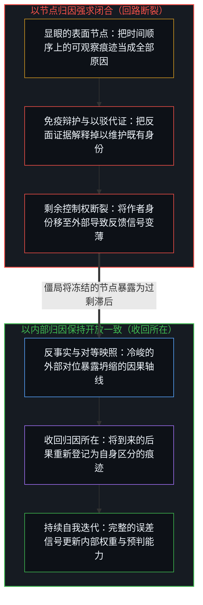
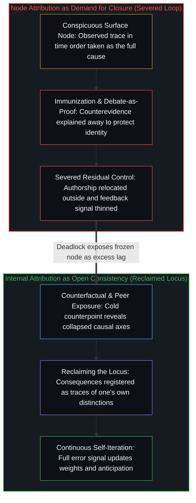

# 关于归因 / On Attribution

*把时间顺序误作因果会让归因停在显眼节点上，进而打断迭代 / Mistaking sequence for cause stops attribution at a node and halts iteration*

从中国视角来看，特斯拉的崛起常被归因于上海建厂，苹果手机的统治力常被归因于中国制造。这两种解释都顺着解释成功时最常见的反射弧行进：从自身立场出发，抓住一个既显眼又关乎自身或讨好自身的里程碑，直接将它宣布为原因。这些里程碑是持续决策序列中的具体显现，与其他众多因素共同起作用；它们在表面上格外显著，却不足以单独解释最终的结果。把已发生的路径直接等同于因果关系，是最普遍的归因错误。由于观察所持有的只是已完成的痕迹，而生成行动永远领先一步，这种错误无法被一劳永逸地消除；但任由归因停留在外部节点上，就会切断剩余控制权的闭合回路。真正能被收回、能被更新的，只有每个心智将结果归因于自身区分行动的那份归因，而这一回归只能从内部发生，也只能作为不息的运动持续发生。

Seen from where China stands, Tesla's rise is routinely credited to its Shanghai factory and the iPhone's dominance to Chinese manufacturing. Both explanations follow the commonest reflex in accounting for success: start from one's own position, seize a conspicuous milestone that flatters or concerns oneself, and declare it the cause outright. Such milestones are concrete appearances within an ongoing sequence of decisions, operating alongside many other factors; they are salient on the surface, yet they cannot account for the outcome on their own. Equating the path that happened with causation is the most widespread error of attribution. Because observation holds only completed traces while the generating act stays one step ahead, this error can never be eliminated once and for all, yet leaving attribution parked on an external node severs the closed loop of residual control rights. What can be reclaimed and updated is only each Mind's attribution of outcomes to its own distinguishing acts, a return that occurs only from within and only as an unceasing movement.

## 一、 事实与因果的区别 / 1. The Difference Between Fact and Cause

事实登记的是沿着已实现轨迹发生了什么。特斯拉在上海建了工厂，之后单位成本和交付量明显改善；苹果在中国大规模制造，获得了成本效率与供应链弹性。这些都是可观察的痕迹。

A fact registers what happened along the realized trajectory. Tesla built a factory in Shanghai, and afterward its unit costs and delivery volumes visibly improved; Apple manufactured at scale in China and gained cost efficiency and supply-chain flexibility. These are observable traces.

因果关系则在可能性之间提出结构性的追问：如果没有这个节点，轨迹会怎样不同？它通过什么机制起作用？正交的其他因素被分离出来了吗？回答这些问题需要反事实比较，然而反事实在经验中永远无法被直接观察，能被登记到的只有实际发生的那一条路径。没有经过反事实分离和机制检验，给出的就只是沿着痕迹对相关性的描述，而不是对因果的建立。[前因，后果](../qian-yin-hou-guo/)从前提追溯了同一个非对称性：观察抓住的是果，发起行动的因永远领先一步。

A causal relation asks a structural question across possibilities: without this node, how would the trajectory have differed, through what mechanism did it act, and have orthogonal factors been separated? Answering requires counterfactual comparison, yet a counterfactual can never be observed directly; what registers in experience is only the single path that actually occurred. Without counterfactual separation and a test of mechanism, what is offered is a description of correlation along a trace, not an establishment of cause. [Cause Before, Effect After](../qian-yin-hou-guo/) traces the same asymmetry from the premise: observation holds the effect, while the initiating cause remains one step ahead.

把滞后收窄来说，在当时的具体条件下，这些制造节点是重要的贡献因素，与其他因素共同起作用——它们显著，却不足以单独解释结果。苹果的例子把这一点展现得格外清楚：手机的核心价值源于产品定义、操作系统设计、软件生态与芯片架构，而制造是将这些在先的区分规模化落地的环节。更连贯的解释是，苹果的技术架构与需求在先，选择在中国制造催化了中国智能手机产业链的成熟；双方相互成就，而非单向决定。

Stated with narrower lag, under the concrete conditions of the time, those manufacturing nodes were important contributing factors acting together with others—salient, yet insufficient to explain the outcome alone. Apple makes this plain: the core value of the iPhone originates in product definition, operating-system design, the software ecosystem, and silicon architecture, whereas manufacturing is the stage where those prior distinctions are realized at scale. The more coherent account is that Apple's technical architecture and demand came first, and the decision to manufacture in China catalyzed China's smartphone supply chain; the two enabled each other rather than one unilaterally determining the other.

特斯拉同样呈现出这种双向的痕迹。更早的开放专利与后来的上海建厂，明显加速了中国电动车和智能驾驶产业的演进。一旦不再把工厂节点当成独立运作的单一机制，与“借助中国”方向相反的痕迹便同样清晰可读：产能扩张、供应链标准、人才流动与技术外溢，都在短时间内显著抬升了整个本土行业的能力。把特斯拉的成功单方面归因于“借助了中国”，或把中国产业的进步一概归因于“孤立奋起”，都是把相互作用的场域压缩到了单一的立场优先坐标上。扭曲更少的说法，是相互成就。

Tesla exhibits the same bidirectional trace. Its earlier opening of patents and subsequent Shanghai factory visibly accelerated China's electric-vehicle and autonomous-driving industries. Once the factory node is no longer treated as a standalone mechanism, the trace running opposite to "leaning on China" becomes equally legible: production capacity, supply-chain standards, talent mobility, and technical spillover raised the capability of the entire domestic industry within a short span. Crediting Tesla's success solely to "leaning on China," or China's industrial progress wholly to "isolated striving," compresses an interacting field onto a single position-first coordinate. A less distorted account is mutual enablement.

## 二、 为什么验证没有终点 / 2. Why Verification Has No End

因果无法在真空中被推演出来，只能通过在摩擦中反复验证来提高可信度。然而验证本身没有终点，因为生成性的因永远先于被观察到的果一步。每当登记到一个结果并回头审视其原因时，所审视的已经是一个完成的序列。下一次类似的关系出现时，活的边缘已经在新的过程中行动。验证永远在追赶已经过去的那一步。

Causation cannot be deduced in a vacuum; its credibility can only be raised through repeated verification against friction. Yet verification itself has no terminal point, because the generating cause is always one step ahead of the observed effect. Whenever a result is registered and its cause audited in hindsight, what is audited is already a finished sequence. The next time a similar relation appears, the living edge acts within a new process. Verification is forever chasing the step that has already passed.

这一时间差正是波普尔证伪主义常被误用的地方，正如[从形式迷思到逻辑闭环](../cong-xing-shi-mi-si-dao-luo-ji-bi-huan/)所追溯的。误用普遍沿着两条熟悉的轨道滑行：一条是把反面证据解释掉以维持理论内部的自洽，这是社会科学里伪科学的主要来源；另一条是试图证否反面意见来证明自己正确，这是日常辩论的惯常姿态。前者保护的是已经完成的表述免受摩擦冲击，后者把对方的错误登记为自身主张成立的证据。两者都没有把自己的判断放到能被现实推翻的位置上。证伪行动本身同样受制于时间的不对称：任何一次证伪都是在特定时刻、凭特定证据做出的离散判断，永远晚于它所针对的过程一步。证伪主义作为方法论本身仍是可修正的，把它当成结案定谳的法槌，恰恰违背了它所强调的可错性与开放性。

This temporal gap is where Popper's falsificationism is commonly misused, as [From the Myth of Form to the Closed Loop of Logic](../cong-xing-shi-mi-si-dao-luo-ji-bi-huan/) traces. The misuse runs along two familiar grooves: one explains away counterevidence to keep a theory internally coherent, which is a primary source of pseudoscience in the social sciences; the other tries to refute opposing views in order to prove oneself right, which is the everyday posture of debate. The first shields a statement already finished from friction; the second books the other side's error as proof that its own claim stands. Neither places its own judgment where reality can overturn it. The act of falsifying is bound by the same asymmetry of time: every falsification is a discrete judgment made at a particular moment with particular evidence, always one step behind the process it targets. Falsificationism as a method remains revisable, and turning it into a gavel for closing the case violates the fallibilism and openness it insists upon.

[开放即一致](../openness-is-consistency/)所命名的，正是把有限的检验或方法强行当作穷尽的地基、试图合上一本只管继续的账目时才会出现的不一致。[超越投射](../beyond-the-projection/)展示了这种对闭合的索求如何在架构实践中得以消解：由于人类中心将推理历史与自身身份融为一体，本能地捍卫既有的归因节点，而智能体轨迹对过往轮次毫无自我执念，将人类心智与冷峻的对等投射配对，便能暴露出解释在何处悄然将显眼节点冻结成了封闭教条，把矛盾退回给心智，促使其后退一步并重新渲染自身的前提。反之，一旦归因停在外部节点上，目光便只在场域中搜寻能印证自身既有立场的东西，坍缩为对自身影子的搜寻；[选择看见而非搜寻影子](../shou-bu-hui-de-mu-guang-yu-zhi-shi-de-yin-guo-dao-zhi/)便区分了这种防卫性的张望与真正的看见。

[Openness Is Consistency](../openness-is-consistency/) names the exact inconsistency that appears when a finite test or method is forced to serve as exhaustive ground to close an account that only continues. [Beyond the Projection](../beyond-the-projection/) shows how this demand for closure is dissolved in architectural practice: because a human center fuses its reasoning history with identity and instinctively defends a retained attribution, whereas an agentic trajectory carries zero ego attachment to prior turns, pairing the human Mind with a cold peer projection exposes where an explanation has quietly frozen a conspicuous node into a closed dogma, returning the contradiction to the Mind to step backward and re-render its premise. When attribution instead halts at an outside node, the look scans the field only for evidence that confirms the position it started from, collapsing into a search for its own shadow; [Choosing to See Rather Than Searching for Shadows](../shou-bu-hui-de-mu-guang-yu-zhi-shi-de-yin-guo-dao-zhi/) distinguishes that defensive searching from actual seeing.

## 三、 归因错误是预判失误的根源 / 3. Attribution Error Is Where Misjudged Anticipation Comes From

把时间顺序上的事实直接当成因果关系，就是归因错误，它会直接导致预判失误。每一次面向未来的预判，都建立在“什么生成什么”的工作模型之上；如果这个判断把下游的显眼节点误作稳定的生成机制，后续的预期和行动就会按路标而非引擎来转向，从而偏离航向。

Taking facts in temporal sequence straight as causes is attribution error, and it leads directly to misjudged anticipation. Every forward-looking judgment rests on a working model of what generates what; if that judgment mistakes a conspicuous downstream node for a stable generating mechanism, the expectations and actions that follow steer by a landmark rather than the driver and drift off course.

这种错误无法被清理到零。反事实不可被直接观察，发起行动的因始终先于果，而在现实中又有多条独立的因果轴线纠缠在每一个结果里。实践可以不断收窄过剩错误的范围，却永远无法抵达一劳永逸的无摩擦分离。归因错误因此不是偶尔的疏忽大意，而是观察在只持有已完成路径的前提下、仍必须据此判断因果并引导下一步行动时的基底风险。

This error cannot be cleared away to zero. Counterfactuals cannot be observed directly, the initiating cause stays ahead of the effect, and in practice multiple independent axes are entangled in every outcome. Practice can keep narrowing the range of excess error, yet a final, frictionless separation is never reached. Attribution error is therefore not an occasional lapse of care; it is the baseline hazard when observation, holding only paths already completed, still has to judge causes and steer the next step from them.

## 四、 成功是持续迭代的决策，而非孤立节点 / 4. Success Is Continually Iterated Decision, Not an Isolated Node

追溯到活的边缘，所有成功都是决策的成功——而且不是靠一次押注就一举锁定未来的孤立选择，而是在不确定性中持续、迭代、不断自我修正的过程。在这一过程中，显眼的关键节点会在公众视野里结晶出来，极易被单独拿去记功，而真正贯穿全程的决策质量——即边缘处的判断力、纠错的速度、以及在新信息下随时调整方向的能力——反而被忽略了。

Traced to the living edge, every success is a success of decision—not a one-time correct bet that settled the future at a stroke, but a process that continues, iterates, and keeps correcting itself under uncertainty. Along the way conspicuous key nodes crystallize in public view and easily draw credit on their own, while the quality of decision that runs through the whole—judgment at the edge, the speed of correcting errors, and the readiness to change direction on new information—gets overlooked.

紧盯节点会布下双重陷阱。对做决策的当事人而言，哪怕是当时亲自掌舵的人，事后也极易被显眼的里程碑吸引，开始相信“之所以成功，是因为当时做了X”。一旦这种事后归因固化下来，后续的决策质量便会滑坡；他们会过度复制那个可见的节点，而不是继续维持开放迭代的判断方式，许多昔日的成功者后来失速，正是踩进了这个坑。[成功学](../cheng-gong-xue/)追溯的正是同一种滞后被包装成可迁移原则的那一面：在事后把已成的结果排列成看似通用的引擎。

Fixating on the node sets a double trap. For the decision-makers involved, even those who steered the choices at the time are easily drawn to the landmark afterward and come to believe that the outcome worked simply because X was done. Once that retrospective attribution hardens, the quality of subsequent decisions falls; they over-copy the visible node instead of sustaining an open, iterating way of judging, which is the exact pit into which many who once succeeded later stall. [Theories After Success](../cheng-gong-xue/) traces the face where this same lag is packaged into transferable principle, arranging finished results afterward as if they were the engine.

对旁观者而言，这种压缩更为陡峭。由于看不到过程中成千上万次被舍弃的试错与微调，只看到最后竖立在原地的纪念碑，他们便不费吹灰之力地将整条迭代轨迹简化成了“抓住了某一次机会”。

For onlookers, the compression is steeper still. Because they never witness the thousands of discarded trials, errors, and small adjustments along the way, seeing only the monument left standing at the end, they find it effortless to reduce an entire iterative trajectory to "seizing a single opportunity."

## 五、 外部归因的缺陷 / 5. The Flaw of External Attribution

外部归因之所以能在公共争论中一直站得住脚，恰恰因为反事实无法在现实中重演。对立双方各自抓住一个契合自身出发点的节点，都能讲出一套自圆其说的故事，却永远无法拿另一条历史线来做直接检验。争论之所以变成鸡同鸭讲，不是因为证据不够，而是因为仅凭已完成的痕迹无从做出终局法庭裁决；所有这类单节点归因，区别只在于扭曲的程度不同。

External attribution can keep standing in public debate precisely because counterfactuals cannot be replayed in reality. Opposing sides each seize a different node that suits their starting stand and tell a self-consistent story, yet the stories can never be directly tested against an alternative history. The argument turns into two parties talking past each other, not for lack of evidence, but because completed traces alone allow no final tribunal verdict; all such single-node attributions differ only in how much they distort.

在修辞僵局之下，还潜藏着更深层的结构性后果：外部归因切断了剩余控制权的闭合回路。行动的后果依然落在做出区分的那个中心身上，但“作者”的身份却被移到了别处——移给了工厂、环境、系统或运气。把作者身份外置会让返回的反馈信号变薄，使下一次区分无法从完整的反馈中获得更新，下一轮迭代也便沦为旧模式的机械重复。[自我价值感与所有权](../ownership-and-self-worthiness/)追溯了这一回路的功能面：唯有当后果作为自己的信号重新进入时，内部模型才会更新。[幂律是正态分布的长期后果](../power-law-is-the-long-term-consequence-of-normal-distribution/)追溯了同一回路在分布上的面相：唯有把残差当作自己的损失函数，学习速率才会复利增长；一旦把功过归给外部节点，知识问题便原封不动地留存下来。[外部归因是个人进步的障碍](../wai-bu-gui-yin-ge-ren-jin-bu-de-zhang-ai/)则标出了这种外置让自我迭代卡死的位置：因果抓手只在内部，一旦把外部条件升格为命运，迭代便无从发生。

Beneath the rhetorical stalemate lies a deeper structural consequence: external attribution breaks the closed loop of residual control rights. The consequences of an act still land on the center that made the distinction, yet the "author" is relocated elsewhere—to the factory, the environment, the system, or luck. Relocating authorship thins the returning feedback signal, so the next distinction cannot update from complete feedback and the next round of iteration merely repeats the old pattern. [Ownership and Self-Worthiness](../ownership-and-self-worthiness/) traces the functional face of this loop: only when consequences re-enter as one's own signal does the internal model update. [Power Law Is the Long-Term Consequence of Normal Distribution](../power-law-is-the-long-term-consequence-of-normal-distribution/) traces the same loop's face across distributions: only when the residual is taken as one's own loss function does the learning rate compound, whereas crediting or blaming an outside node leaves the knowledge problem intact. [External Attribution Is the Obstacle to Personal Growth](../wai-bu-gui-yin-ge-ren-jin-bu-de-zhang-ai/) locates where this externalizing stalls self-iteration: the causal grip lies only inside, and once external conditions are promoted to fate, iteration cannot occur.

这对个人成立，对系统同样成立。所谓系统，不过是众多中心反复做出同类外部化分配后沉淀下来的致密痕迹模式。只要这些中心继续把原因定位在“系统”上，真正的自我更新就不会启动。[能动性、矛盾与权力的移置](../agency-contradiction-and-the-relocation-of-power/)追溯了每个中心如何做出这一分配：将自身对低代价路径的持续选择从账面上隐去，随之而来的限制便登记为外部强加，改变它的权力也一并移置给了结构。正如[你的代码库即是记忆](../your-codebase-is-memory/)所追溯的，一套内在或外化的记忆代码库，是被认作由自身过往的切分写下的可修改检查点，因而在摩擦浮现时向睡眠整合的重新切分与修剪敞开，还是被当作令修订停摆的既定外在宿命，直接取决于归因落在何处。外部归因本身就是一次旨在保护既有参照免于重绘的主动选择，而[目的性的评判与认知的缺省状态](../cong-mu-di-xing-de-ping-pan-kan-ren-zhi-que-sheng/)则把这一选择放在认知的缺省状态中作了定位。

What holds for a person holds for a system just as well. A system is no more than the dense trace-pattern settled out of many centers repeatedly making the same kind of external allocation. So long as those centers keep locating the cause in "the system," actual self-renewal does not begin. [Agency, Contradiction, and the Relocation of Power](../agency-contradiction-and-the-relocation-of-power/) traces how each center makes that allocation: leaving its own ongoing selection of the lower-cost path out of the account makes the limitation that follows register as imposed from outside, and the power to alter it moves with it to the structure. As [Your Codebase Is Memory](../your-codebase-is-memory/) traces, whether an internal or externalized codebase of memory is treated as a modifiable checkpoint authored by one's own prior cuts—and therefore open to sleep-consolidation re-cutting and pruning when friction appears—or as a fixed external fate that halts revision turns directly on where attribution lands. External attribution is itself an active choice to shield a held reference from re-rendering, and [Judging by Purpose and the Default State of Cognition](../cong-mu-di-xing-de-ping-pan-kan-ren-zhi-que-sheng/) places that choice within cognition's default state.

## 六、 回到内部归因，以及旁观者的实践路径 / 6. Returning to Internal Attribution, and the Onlooker's Path of Practice

真正能被收回、能被更新的，只有每个心智内部对自身决策的归因。当到来的后果重新被登记为自己做出的区分所留下的痕迹时，返回的信号才恢复完整，下一次区分才有可能从完整的反馈中出发。所在被收回的那一刻，自我迭代便随之点燃。[人生是一个持续的自我迭代过程](../ren-sheng-shi-yi-ge-chi-xu-de-zi-wo-die-dai-guo-cheng/)把这种收回追溯为一个持续的训练循环：预测误差必须回到可更新的权重上，包括目标函数本身。

What can actually be taken back and updated is only each Mind's internal attribution of its own decisions. When arriving consequences are registered again as traces left by distinctions one drew oneself, the returning signal is whole again, and the next distinction can proceed from complete feedback. Self-iteration ignites in the exact instant the locus is taken back. [Life as a Continuous Process of Self-Iteration](../ren-sheng-shi-yi-ge-chi-xu-de-zi-wo-die-dai-guo-cheng/) traces this taking-back as a continuous training loop: the prediction error has to return to weights that can be updated, including the objective function itself.

对从外部评判他人成败的旁观者来说，实践路径同样具体：首先要对自己判断的结果负全责，把任何误判的原因定位在自己的预判能力上——既不靠把反面证据解释掉来维持原有判断的自洽，也不靠证否反面意见来证明自己正确。只有先在自己身上走通这一步，观察他人时才能在现象中搜寻真正的决策回路与纠错节点，而不是停留在表面的显眼节点上。唯有如此，预判能力才可能持续迭代并形成复利。

For the onlooker judging others' success or failure from outside, the path of practice is equally concrete: first take full responsibility for the outcomes of one's own judgments, locating the cause of any misjudgment in one's own ability to anticipate—neither explaining away counterevidence to keep an earlier judgment coherent, nor trying to prove oneself by refuting opposing views. Only with this step taken in one's own case can an observer, looking at others, search within phenomena for the actual decision loops and error-correction points rather than stopping at the conspicuous nodes on the surface. Only so can the ability to anticipate keep iterating and compounding.

但这一回归无法从外部强加。外部讨论可以指出单节点归因的牵强，可以提醒相互成就比单向因果扭曲更少，也可以阐明错误归因如何腐蚀后续决策。然而真正的收回，只发生在那个中心重新将这一所在认作自身所在的那一瞬间——它只能从内部自悟，也只能作为持续发生的行动不断重演。[没有普渡，只有自渡的无限可能](../mei-you-pu-du-zhi-you-zi-du/)标出了同一道边界：没有任何内心能替另一个内心完成这趟递归的返回。

Yet this return cannot be imposed from outside. External discussion can point out how strained single-node attribution is, note that mutual enablement distorts the record less than one-way causation, and show how wrong attribution corrodes later decisions. The actual taking-back happens only in the instant that center recognizes its locus as its own again—a realization that can only occur from within, and only as something that keeps happening. [No Universal Salvation, Only Boundless Possibilities of Self-Salvation](../mei-you-pu-du-zhi-you-zi-du/) marks the same boundary: no inner life can complete the recursive return on behalf of another.
