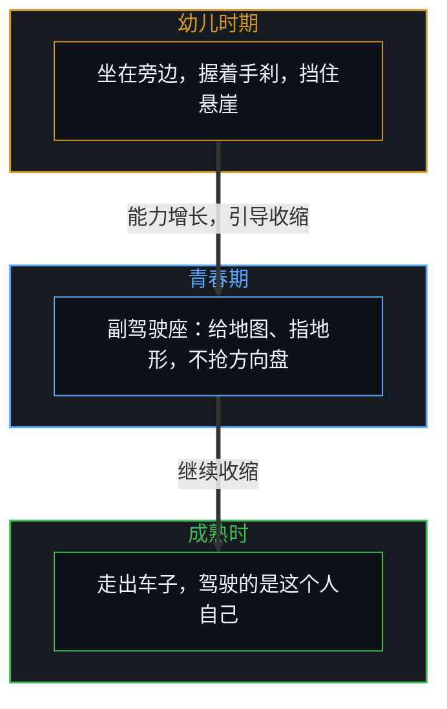
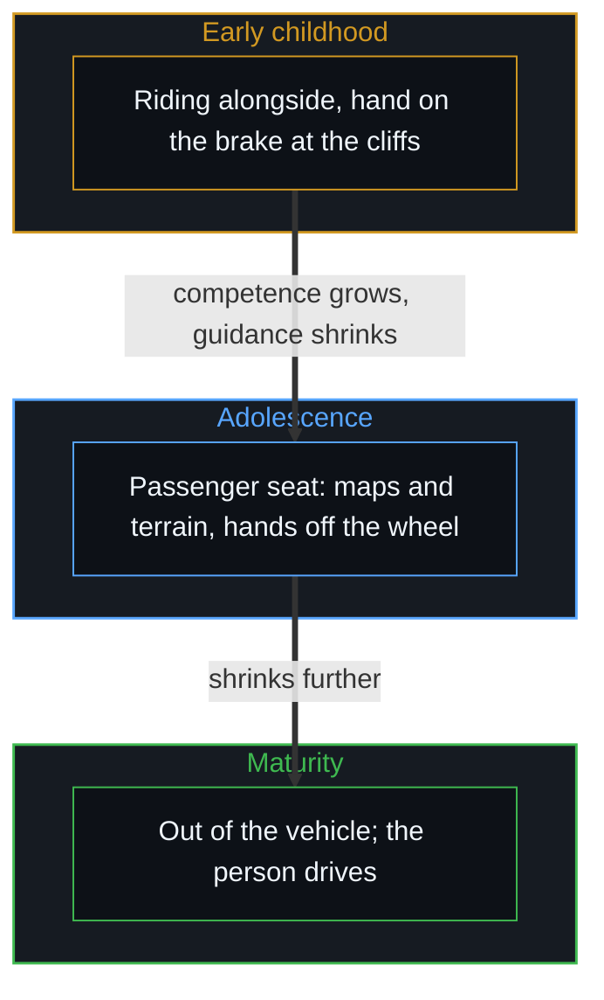

# 引导不是占有 / Guidance Is Not Ownership

*每个心智都是自己选择的作者，父母给出边界、示范与支持，不占驾驶座，也不担保未来 / Every Mind authors its own choices; parents give boundaries, models and support, not the wheel or a guaranteed future.*

当代文化多把亲子之间的冲突诊断为孩子固有的缺陷。流行心理学与常见的育儿话语，习惯把青少年贴上冲动、被激素劫持、神经发育未成熟的标签。神经影像研究显示，青少年大脑的回路开始对陌生的声音、而不是对母亲的声音作出更强的反应，大众媒体就条件反射地把这种感知的扩展解读成生物的故障。

Conflict between parents and teenagers is mostly diagnosed in contemporary culture as a defect inherent in the child. Popular psychology and common parenting discourse habitually label adolescents impulsive, hijacked by hormones, neurologically incomplete. When neuroimaging shows that an adolescent's brain circuitry begins responding more strongly to unfamiliar voices than to the mother's, popular media reflexively reads this sensory expansion as a biological malfunction.

把能动性从做选择的心智那里挪开，把年轻人的决定全归于亚个人的神经机制，社会就造出一个破坏性的反馈回路：研究者造出生物决定论的借口，父母拿来为自己渐失的控制辩护，由此生出的摩擦被全怪到孩子头上，而不是父母不肯调整自己的模型。

By moving agency away from the choosing Mind and attributing young people's decisions wholly to sub-personal neural mechanics, society builds a destructive feedback loop: researchers produce excuses of biological determinism, parents take them up to justify their fading control, and the resulting friction is blamed wholly on the child rather than on the parents' refusal to adjust their own models.

## 一、 被病理化的青少年与斯坦福的声音研究 / 1. The Pathologised Adolescent and the Stanford Voice Study

斯坦福一项关于声音处理的神经影像研究，2022 年由丹尼尔·艾布拉姆斯等人发表在《神经科学杂志》上，为这种诊断上的扭曲开了一扇窗：大约在十三岁前后，年轻人大脑中与奖赏和社会评估有关的回路，从对母亲的声音反应更强，转向对陌生的声音反应更强。神经生物学的测量是真的，因果的归属却倒了过来。这项研究描述的是一次朝向更广世界的自然的感知再校准，认知装置在扩展观察的地平线，把外面的地形纳进来；常见的话语却立刻把这个转变病理化，把一个健康的发展节点变成青少年缺陷的证据。

A Stanford neuroimaging study of voice processing, published in 2022 by Daniel Abrams and colleagues in the Journal of Neuroscience, opens a window on this diagnostic distortion: around the age of thirteen, a young person's brain circuitry linked to reward and social valuation shifts from responding more strongly to the mother's voice to responding more strongly to unfamiliar voices. The neurobiological measurement is real; the causal attribution runs backward. The study describes a natural sensory recalibration toward the wider world, the cognitive apparatus widening its observational horizon to take in outside terrain; common discourse at once pathologises the shift, turning a healthy developmental milestone into evidence of adolescent defect.

[宏观现象的生成图谱](../the-generative-atlas-of-macroscopic-phenomena/)确立过，生物学的测量，功能磁共振的激活、神经递质的级联与激素的激增，是观察者地平线之内的感知相关与物质反馈约束，不是生成的第一原因。父母与心理学家把这些生物标记当作压过意志的自主操纵者，就犯了一个范畴错误：把选择借以显现的物质基底，误认为选择的发起者。

As [The Generative Atlas of Macroscopic Phenomena](../the-generative-atlas-of-macroscopic-phenomena/) establishes, biological measurements, fMRI activations, neurotransmitter cascades and hormonal surges, are sensory correlations and material feedback constraints within an observer's horizon, not generating first causes. When parents and psychologists treat these biological markers as autonomous puppet-masters that override will, they make a category error: taking the material substrate through which choices appear for the originator of the choice.

## 二、 存在的因果不对称 / 2. The Causal Asymmetry of Existence

这种病理化底下，是一种普遍的文化偏向：把父母当作与“难管”的孩子苦斗的长期受难者，条件反射地给予同情。大众媒体常把父母描绘成青少年叛逆的无助受害者，为他们的苦恼提供无尽的安慰。可正如[同情是缺乏清晰时的占位符](../sympathy-is-a-placeholder-for-lack-of-clarity/)所分析的，同情常作为一剂情感的镇静剂，遮住了起作用的因果链。

Beneath this pathologising lies a widespread cultural bias: reflexive sympathy for parents as long-suffering figures struggling against "unruly" offspring. Popular media often portrays parents as helpless victims of adolescent rebellion and offers endless consolation for their distress. Yet as [Sympathy Is a Placeholder for Lack of Clarity](../sympathy-is-a-placeholder-for-lack-of-clarity/) analyses, sympathy often works as an emotional sedative that hides the operative causal chain.

存在的根基从一个因果不对称开始：孩子从没有选择、也没有要求被带到这个世界上。是父母单方面做出了开始一个新的意识存在的因果选择。走了这单方面的一步，父母就欠孩子照看的基本责任：保护孩子免受灾难性的、不可逆的伤害；提供一个为清楚的因果反馈而安排的环境；给出诚实的、高带宽的因果推理模型；培养一种带来信任的、稳定而支持的关系。可这份责任的范围要说准，不能夸大：父母欠的是引导与一个支持的基础，不欠孩子的未来。

The ground of existence begins with a causal asymmetry: the child never chose or asked to be brought into the world. It was the parents who unilaterally made the causal choice to start a new conscious existence. Having taken that unilateral step, the parents owe the child the basic duties of stewardship: protection from catastrophic, irreversible harm; an environment arranged for clear causal feedback; honest, high-bandwidth models of causal reasoning; and a steady, supportive relationship that brings trust. Yet the scope of this obligation must be stated precisely and not overstated: parents owe guidance and a supportive foundation; they do not owe the child its future.

未来由孩子书写、拥有、承担。说父母欠孩子一个有保证的命运、成功或幸福，是父母控制的反面错觉：它养出一种应得与向外归咎的文化，成年的子女把自己的不足算到父母头上。这里的自主是对称的：父母不拥有孩子的意志，无权驾驶这辆车；孩子不能把书写自己人生的作者身份外包出去，无权要求父母担保目的地。父母提供发射台与照看，孩子书写轨迹。[成功之后的育儿谬误](../the-fallacy-of-post-success-parenting/)追溯过，精英父母想复制自己的历史路径时，怎样把这个发射台倒了过来。

The future is written, owned and carried by the child. Saying that parents owe their children a guaranteed destiny, success or happiness is the reverse illusion of parental control: it breeds a culture of entitlement and outward blame in which adult offspring charge their own shortcomings to their parents. Self-direction here is symmetric: parents do not own the child's will and have no right to drive the vehicle; children cannot outsource the authorship of their lives and have no right to demand that parents guarantee the destination. The parent supplies the launchpad and the stewardship; the child writes the trajectory. [The Fallacy of Post-Success Parenting](../the-fallacy-of-post-success-parenting/) traces how elite parents turn this launchpad upside down when they try to clone their own historical paths.

## 三、 作者身份的守恒 / 3. The Conservation of Authorship

先于青春期的本体事实是：每一个有意识的心智，都是自己选择唯一的、不可转让的作者。幼儿时期，体力不足、知识较窄、冲动调节不成熟，需要父母的保护与教导；可身体上的脆弱与认识上的不对称，在任何情况下都不会把孩子的意志转为父母的所有。父母可以把一个蹒跚学步的孩子从热灶边抱开，可以安排可供选择的食物，可以限制进入危险的环境；这些干预改变外部的约束，不建立一个父母的意志在先、孩子的意志只是临时的本体等级。[个体抉择是唯一的因果杠杆](../individual-choices-as-the-only-causal-levers/)与[自由变量的同构与先验主权](../zi-you-bian-liang-de-tong-gou-yu-xian-yan-zhu-quan/)都说过，能动性不能被分割、出租或转让。即使孩子服从了一个压倒性的命令，这次服从仍是孩子为了穿过父母施加的约束而做出的选择。

An ontological fact comes before adolescence: every conscious Mind is the sole, non-transferable author of its own choices. In early childhood, limited strength, narrower knowledge and immature impulse regulation call for parental protection and instruction; yet bodily vulnerability and epistemic asymmetry never turn the child's will into the parent's possession. A parent can lift a toddler away from a hot stove, arrange which foods are available and restrict access to hazardous places; these interventions change outside constraints and set up no ontological hierarchy in which the parent's will comes first and the child's is only provisional. As [Individual Choices as the Only Causal Levers](../individual-choices-as-the-only-causal-levers/) and [The Isomorphism of Free Variables and Prior Sovereignty](../zi-you-bian-liang-de-tong-gou-yu-xian-yan-zhu-quan/) both put it, agency cannot be divided, leased or transferred. Even when a child complies with an overwhelming command, the compliance is still a choice the child makes to navigate the constraint the parent imposed.

## 四、 引导与驾驶 / 4. Guiding and Driving

一个逻辑一致的框架，要求父母把两种不相容的姿态分清楚。引导的姿态，父母的位置是次要的、建议性的：管理环境的边界，防止不可逆的身体伤害，讲明长期的因果取舍，培养支持的共振，让孩子与自然的后果直接接触；随着年轻人显出越来越多的能力，这份引导的范围自然收缩。驾驶的姿态，父母想抢方向盘，把年轻人的决定、品味、关系与人生轨迹当作属于父母自我的财产。

A logically consistent framework asks parents to tell apart two incompatible stances. In the stance of guidance the parent's place is secondary and advisory: managing environmental boundaries, preventing irreversible bodily harm, setting out long-term causal trade-offs, building supportive resonance, and leaving the child in direct contact with natural consequences; as the young person shows growing competence, the envelope of guidance shrinks of itself. In the stance of driving the parent tries to seize the wheel, treating the young person's decisions, tastes, relationships and life trajectory as property of the parent's self.

一个孩子或青少年可以挑起、引发某一次具体的分歧，可对关系动态本身握着决定性结构杠杆的，是父母。来自年轻人的一个孤立的火花，撑不起长期的、系统性的冲突，除非父母继续用错的方法，升级控制，想覆写孩子自主的选择回路。[情感支持作为因果干扰](../emotional-support-as-causal-interference/)探讨过，从外部调节另一个行动者的决定，会割断产生内部责任的反馈回路。亲子摩擦变得长期而有破坏性时，问题主要出在治理的模型上：父母越过了设定环境边界，侵入了孩子的能动性。

A child or teenager can provoke or start a particular disagreement, but the one who holds the decisive structural leverage over the relationship's dynamic is the parent. An isolated spark from a young person cannot sustain chronic, systemic conflict unless the parent keeps applying the wrong method, escalating control and trying to overwrite the child's self-directed loop of choice. As [Emotional Support as Causal Interference](../emotional-support-as-causal-interference/) explores, regulating another agent's decisions from outside cuts the feedback loop that produces inner responsibility. When parent–child friction becomes chronic and destructive, the problem lies mainly in the model of governance: the parent has gone past setting environmental boundaries into the child's agency.

## 五、 挪动能动性的错误 / 5. The Error of Relocating Agency

这种混淆不只在家庭里，它也渗进人类社会的各种制度等级。制度的角色分配不对称的杠杆、信息与权力：首席执行官调配公司的资源，军事指挥官下达作战命令，国家颁布法定的强制。可这些不对称的角色分配的只是后果的菜单，不是意志的程度。法律的强制或物理的强力可以改变一个人可选的选项，可没有哪种外部力量能成为选择本身的作者。从社会杠杆的不平等推出上面的人在“选择”、下面的人只是在“执行”，是把外部约束的形状与内部能动性的挪动混为一谈。[涌现的伪因果](../yong-xian-de-wei-yin-guo-yu-ji-ti-gui-yin-dao-cuo/)表明，把生成的能动性归给结构的容器，而不是微观起点上一个个行动者，是一种反复出现的目的论错觉。

This confusion is not confined to families; it runs through institutional hierarchies across human society. Institutional roles distribute asymmetric leverage, information and power: a chief executive directs corporate resources, a military commander issues operational orders, a state enacts statutory mandates. Yet these asymmetric roles distribute only the menu of consequences, not degrees of will. Legal mandate or physical force can change the options open to a person, but no outside power can become the author of the choice itself. Inferring from unequal social leverage that the one at the top "chooses" while the one below merely "executes" confuses the shape of an outside constraint with a relocation of inner agency. As [The Pseudo-Causality of Emergence](../yong-xian-de-wei-yin-guo-yu-ji-ti-gui-yin-dao-cuo/) shows, crediting generative agency to the structural container rather than to the particular actors at the micro origin is a recurring teleological illusion.

## 六、 约束界定菜单，不界定选择者 / 6. Constraints Define the Menu, Not the Chooser

拒绝决定论式地挪动能动性，不是一个天真的主张，说选择在没有约束的真空里运作。每一个决定都在不容商量的身体、生物与社会的限度之内做出：生物禀赋、历史的惯性、恐惧、权力的不平衡与可用的认知带宽。约束说明桌上有哪些选项，不消解从中做选择的那个心智；一个受约束的选择仍然是一个真实的选择。

Refusing the deterministic relocation of agency is not a naive claim that choice works in an unconstrained vacuum. Every decision is made within non-negotiable bodily, biological and social limits: biological endowment, historical momentum, fear, imbalances of power and the cognitive bandwidth available. Constraints explain which options are on the table; they do not dissolve the Mind choosing among them, and a constrained choice is still a real choice.

替父母开脱、把青少年幼儿化的生物还原论，本身就是一个被选择的立场。父母采纳“激素劫持”的叙事，因为怪生物在情感上比面对控制的丧失、认领自己权威的结构性限度更便宜；心理学家与机构推销这些叙事，因为把个人病理化会造出对外部管理与治疗调解的持续需求；年轻人把这些叙事内化，拿“大脑发育”当借口，不为自己行动的后果负责。[自我价值感与所有权](../ownership-and-self-worthiness/)与[外部归因：个人进步的障碍](../wai-bu-gui-yin-ge-ren-jin-bu-de-zhang-ai/)都表明，结果一旦被向外归于生物或外部力量，信号就回不到真正能更新的那些内部权重上；外部归因冻结学习的回路，让人缺少真正成熟所需的误差信号。

The biological reductionism that excuses parents and infantilises adolescents is itself a chosen stance. Parents take up "hormonal hijacking" narratives because blaming biology is emotionally cheaper than facing the loss of control and owning the structural limits of their authority; psychologists and institutions market these narratives because pathologising the individual creates a continuing demand for outside management and therapeutic mediation; young people internalise them and use "brain development" as an excuse not to answer for the consequences of their own actions. As both [Ownership and Self-Worthiness](../ownership-and-self-worthiness/) and [External Attribution: The Obstacle to Personal Growth](../wai-bu-gui-yin-ge-ren-jin-bu-de-zhang-ai/) show, once outcomes are attributed outward to biology or outside forces, the signal never returns to the inner weights that can actually update; outward attribution freezes the learning loop and leaves a person without the error signal that real maturity needs.

## 七、 走出车子 / 7. Stepping Out of the Vehicle

幼儿时期需要更紧的环境边界，能力的发展需要有意识的、系统的退出。在操作责任上，角色可以非常不平等，而不否认对方意志的自主地位。幼儿时期，父母坐在旁边，握着手刹，挡住灾难性的悬崖，同时培养温暖的、支持的联系；青春期，父母挪到副驾驶座，给地图、指地形，不去抢方向盘；成熟时，父母整个走出车子。

Early childhood calls for tighter environmental boundaries; developing competence calls for deliberate, systematic withdrawal. Roles can be very unequal in operating responsibility without denying the self-directed standing of the other person's will. In early childhood the parent rides alongside, holding the handbrake against catastrophic cliffs while building a warm, supportive bond; in adolescence the parent moves to the passenger seat, offering maps and pointing out terrain while declining to grab the wheel; in maturity the parent steps out of the vehicle altogether.

育儿，以及任何声称为有意识的行动者服务的权威，唯一正当的终点，不是让自己的操控机制无限期地运作下去，也不是背起目的地的重担，而是走出车子，培养一种以相互尊重为根基的支持关系，让这个自主的人驾驶一段只属于自己的人生。

The one rightful end of parenting, and of any authority that claims to serve conscious agents, is neither to keep its own steering mechanisms running indefinitely nor to carry the burden of the destination, but to step out of the vehicle, build a supportive relationship grounded in mutual respect, and let the self-directed person drive a life that is theirs alone to navigate.