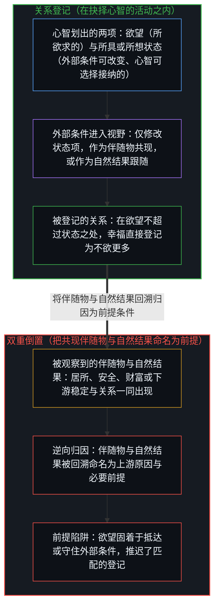
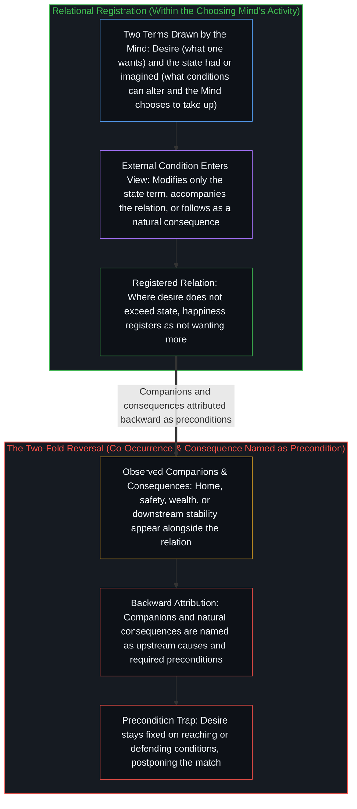
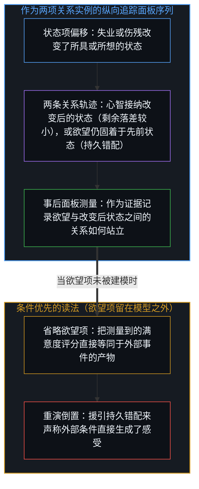
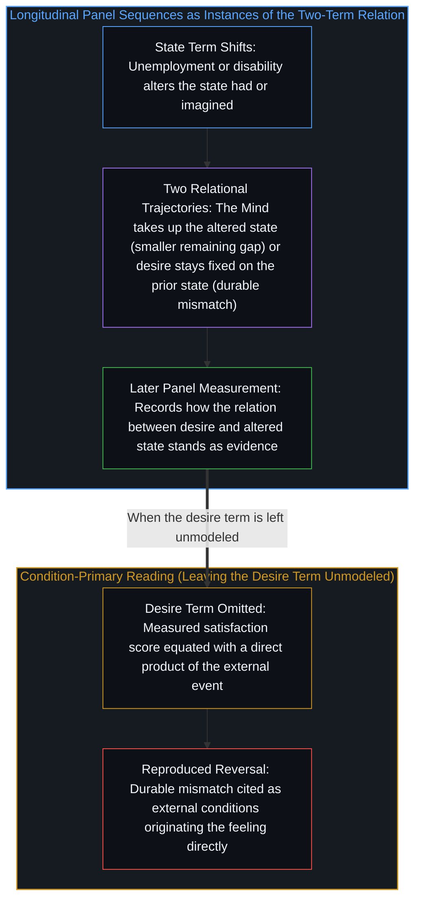

# 幸福是欲望与状态的关系 / Happiness Is the Relation of Desire to State

*幸福是欲望与所具或所想状态的匹配，外部条件只能改变状态项或被事后命名为因。 / Happiness is the match of desire to the state had or imagined; external conditions can only alter the state term or be named cause afterward.*

自我区分的活动发生着——无因，不息。称之为“心智”：那已然在途的观察者，其每一行动皆是一次区分。幸福登记为这样一种关系：抉择着的心智所持有的欲望，不超过它当下所具或所想并选择接纳的状态。财富、地位、居所、安全、家庭或工作等条件常与这一关系的较高程度一同出现，或在关系安定之后作为自然结果紧随其后；然而将它们命名为幸福的因，却颠倒了次序：关系被当成了只能改变其状态项的事物的效应。把这些条件——无论是共现的伴随物还是下游的自然结果——当作必要前提，会让欲望持续指向对它们的获取或持守，使匹配在它们被判定到场之前无从登记。纵向追踪面板序列（例如失业或伤残之后满意度持久处于较低水平）提供的是同一个两项序列的进一步实例与证据，而非对它的脱离。

Self-distinguishing activity occurs — uncaused, unceasing. Call it the Mind: the observer already underway, every act of which is a distinction. Happiness registers as the relation in which desire, held by a choosing Mind, does not exceed the state it currently has or imagines and chooses to take up. Conditions such as wealth, status, home, safety, family, or employment regularly accompany higher degrees of that relation or follow as natural consequences once the relation is settled, yet naming them its cause reverses the order: the relation is treated as the effect of what can only modify its state term. Treating those conditions—whether co-occurring companions or downstream consequences—as preconditions keeps desire directed at securing them, so the match cannot register until they are judged present. Longitudinal panel sequences, such as lasting lower satisfaction after unemployment or disability, supply further instances and evidence of the same two-term sequence rather than an exit from it.

## 一、 感受是关系，不是条件的产物 / 1. The Feeling Is the Relation, Not a Product of Conditions

心智的每一区分都是活动本身。幸福并非独立于区分之外的产物，而是欲望与所具或所想状态之间的关系本身被登记的方式：不幸生于心智所欲超出其所选，而幸福则登记于欲望不超过当下所具或所想状态之处——直接呈现为“不欲更多”。当外部条件进入视野时，它们只能作为关系中状态一侧的变化被区分，或作为与该关系频繁共现的伴随物及自然结果。它们不能充当关系的独立起源——将幸福当作从外部注入的数量，便把因的位置移出了登记该体验的中心，如[最初的区分](../the-initial-distinction/)所追溯——因为关系本身已是欲望与状态的匹配。任何从条件出发、终结于感受的描述，仍须穿过这一关系；条件被插入为起点，感受被记录为结果，这正是命名本身：一种投射，其客体化的语法，[寻觅的语法与淡出的观察者](../the-grammar-of-finding-and-the-fading-observer/)与[拥有更多从不是原因](../having-more-is-never-the-cause/)已从互补的角度追溯。

Every distinction of the Mind is the activity itself. Happiness is not a product standing outside distinction, but the manner in which the relation between desire and the state had or imagined is registered: unhappiness arises where a Mind wants more than it chooses, and happiness registers where desire does not exceed the present state had or imagined—appearing directly as not wanting more. When external conditions enter view, they can enter only as a change to the state side of the relation or as frequent companions and natural consequences of it. They cannot serve as the independent origin of the relation—treating happiness as a quantity added from outside relocates the locus of cause beyond the center that registers the experience, as [The Initial Distinction](../the-initial-distinction/) traces—because the relation already is the match of desire to state. Any description that begins with a condition and ends with the feeling must still pass through the relation; the condition is inserted as starting point and the feeling recorded as result, which is the naming itself, a projection whose objectifying grammar [The Grammar of Finding and the Fading Observer](../the-grammar-of-finding-and-the-fading-observer/) and [Having More Is Never the Cause](../having-more-is-never-the-cause/) trace from complementary angles.

## 二、 命名因是倒置 / 2. Naming the Cause Is the Reversal

两步紧密相连的操作生成了这一倒置。首先，共现足以触发因果命名：居所、安全、家庭或稳定等条件被观察到与较高或较低程度的感受一同出现，命名便将条件标为因。其次，欲望与状态的关系一旦安定，某些条件便作为自然结果浮现——更平稳的日常节奏、得以留存的资源、更从容的关系——它们却被回溯归因为产生该感受的前提条件。这两步操作都颠倒了各要素所处的次序：关系被当成了某物的效应，而它要么只能修改关系中的状态项，要么本就是关系自身的下游结果。当条件为负向时，同一结构同样适用。失业或伤残之后感受持久处于较低程度，依然是欲望与改变后状态之间的关系。记录测量到的关系保持偏移，并未在关系之外插入起源；它只是记录状态项变化之后关系如何站立，守住了[关于归因](../guan-yu-gui-yin/)所追溯的时间先后与因果起源之间的同一分界。

Two closely linked moves generate the reversal. First, co-occurrence is sufficient to trigger causal naming: conditions such as home, safety, family, or stability are observed alongside higher or lower degrees of the feeling, and the naming marks them as cause. Second, conditions that appear as natural consequences once a settled relation between desire and state is reached—steadier routines, preserved resources, calmer relationships—are attributed backward as the preconditions that produced the feeling. Both moves reverse the order in which the elements stand: the relation is treated as an effect of something that either modifies only its state term or follows downstream from the relation itself. The same structure applies when the conditions are negative. A lasting lower degree of the feeling after unemployment or disability is still the relation between desire and the altered state. Recording that the measured relation stays shifted does not insert an origin outside the relation; it records how the relation stands after the state term has changed, holding the same boundary between temporal sequence and causal origin traced in [On Attribution](../guan-yu-gui-yin/).

## 三、 当作前提使关系更难登记 / 3. Treating as Preconditions Makes the Relation Harder to Register

一旦共现的伴随物或自然结果被构型为必要前提，欲望便持续指向对那些条件的获取。满足变成取决于抵达或守住它们，使“不欲更多”的关系更难被登记。注意力固定在欲望与状态的落差上，而非两项的对齐上。将条件当作事先必要，使关系本身更难被注意或栖居。这一步直接跟随逆向归因而来：条件被提前为地基，关系被推迟为结果，重演了[现成接触的因果先验与期望感受的倒置遮蔽](../present-contact-and-the-obscuration-of-desired-feeling/)所审视的前提倒置。

Once co-occurring companions or natural consequences are configured as necessary preconditions, desire remains directed at securing those conditions. Satisfaction becomes contingent on reaching or defending them, so the relation of not wanting more becomes harder to register. Attention stays fixed on the gap between desire and state rather than on the alignment of the two terms. Treating the conditions as necessary beforehand makes the relation itself harder to notice or inhabit. This step follows directly from the backward attribution: the conditions are advanced as ground, the relation postponed as result, reproducing the prerequisite inversion examined in [Present Contact as Causal Prior and the Obscuration of Desired Feeling](../present-contact-and-the-obscuration-of-desired-feeling/).

## 四、 数据是同一模式的实例 / 4. Data Are Instances of the Same Pattern

纵向追踪面板序列显示，在失业或严重伤残等事件发生后的数年间，即便控制了收入与事前基线水平，测量到的关系依然保持偏移。在两项关系的溯源之内，这些序列是同一关系序列的实例与证据——既非对关系溯源或条件优先读法的证明，亦非绕过关系的外部反驳：状态项发生变化，心智接纳改变后的状态从而使欲望调整，或者欲望依然固着在先前的状态上，此后的关系在稍后的时点被测量。由于感受在第一人称体验中登记为欲望与所具或所想状态之间的关系，事件与事后满意度评分之间的纵向相关性所记录的，正是状态项改变之后这一两项关系如何站立。将外部条件当作感受直接生成器的解释，唯有把欲望项留在模型之外、或将测量评分直接等同于外部条件的产物才能保持自洽，也就是把汇总的痕迹误作外在的引擎，如[统计学无法揭示的心智](../the-mind-that-statistics-cannot-reveal/)所追溯。这样做只是重演了倒置，而非取代了它。

Longitudinal panel sequences show the measured relation shifted for years after events such as unemployment or severe disability, even when income and pre-event baseline levels are held constant. Within the two-term trace, those sequences stand as instances and evidence of the same relational sequence—not as proof of the relational trace or of the condition-primary reading, and not as an external refutation that bypasses the relation: the state term changes, the Mind takes up the altered state so desire adjusts or desire remains fixed on the prior state, and the resulting relation is measured later. Because the feeling registers in first-person experience as the relation between desire and the state had or imagined, longitudinal correlations between an event and a later satisfaction score record how that two-term relation stands after the state shift. Accounts that treat the external condition as the direct generator of the feeling remain coherent only by leaving the desire term unmodeled or equating the measured score with a direct product of the condition, mistaking pooled traces for an external engine as [The Mind That Statistics Cannot Reveal](../the-mind-that-statistics-cannot-reveal/) traces. In doing so, they reproduce the reversal rather than replace it.

## 五、 关系的连贯无需额外假定 / 5. Coherence of the Relation Needs No Extra Assumption

关系溯源的连贯性在于它不要求额外步骤。由于感受直接登记为所欲不超过所具或所想的状态，任何从外部条件出发、终结于满足感的描述仍须穿过这两项。纵向面板研究的结果因此作为两项序列的经验实例与证据而包含其中：它们区分了两类结果——欲望随改变后的状态调整（留下较小的欲望与状态剩余落差），或欲望仍固着于先前状态（留下较大的剩余落差）——记录了在相当比例的人身上，错配是持久的，却并未在抉择着的心智之外指认出欲望的独立起源。将外部条件当作独立原因的解释，唯有靠留下关系未予检视、或将结果直接等同于条件的产物才能维持连贯，从而再现了倒置。

The coherence of the relational trace lies in requiring no extra step. Because the feeling registers directly as not wanting more than the state had or imagined, any description that begins with an external condition and ends with felt satisfaction still passes through those two terms. Longitudinal panel findings therefore stand as empirical instances and evidence of the two-term sequence: they distinguish outcomes where desire adjusts to the altered state (leaving a smaller remaining gap between desire and state) from outcomes where desire stays fixed on the prior state (leaving a larger remaining gap), recording that the mismatch is durable for a large share of people without identifying an origin for desire outside the choosing Mind. Accounts that treat the external condition as an independent cause remain coherent only by leaving the relation unexamined or equating the outcome with a direct product of the condition, thereby reproducing the reversal.

这一切分与那些追溯[生命的意义在起草之中](../the-meaning-of-life-is-in-the-drafting/)、追溯[自我价值感与所有权](../ownership-and-self-worthiness/)之条件的篇章并肩而立：那将外部安排提前为幸福前提的同一种逆向归因，也在[有条件的自由](../you-tiao-jian-de-zi-you/)中将手段提前为自由的前提，或在[成功学](../cheng-gong-xue/)中将结果之后才总结出的秘诀提前为前提，每一次都在抉择活动继续进行之际留下关系本身未予检视。

This cut sits alongside those tracing [The Meaning of Life Is in the Drafting](../the-meaning-of-life-is-in-the-drafting/) and the conditions of [Ownership and Self-Worthiness](../ownership-and-self-worthiness/): the same backward attribution that advances external arrangements as preconditions for happiness also advances means as preconditions for [Conditional Freedom](../you-tiao-jian-de-zi-you/) or recipes after the outcome in [Theories After Success](../cheng-gong-xue/), each time leaving the relation unexamined while the choosing activity continues.
