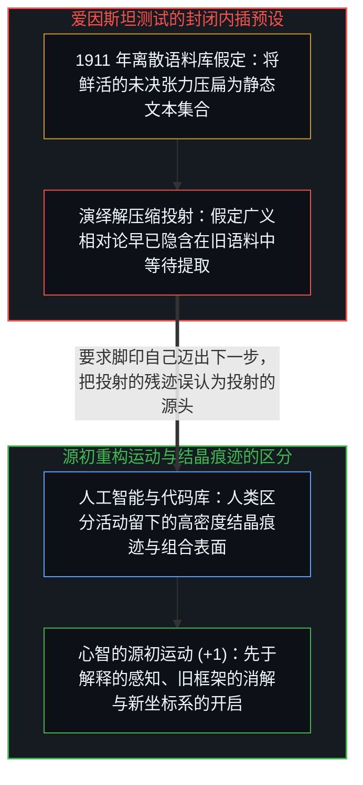
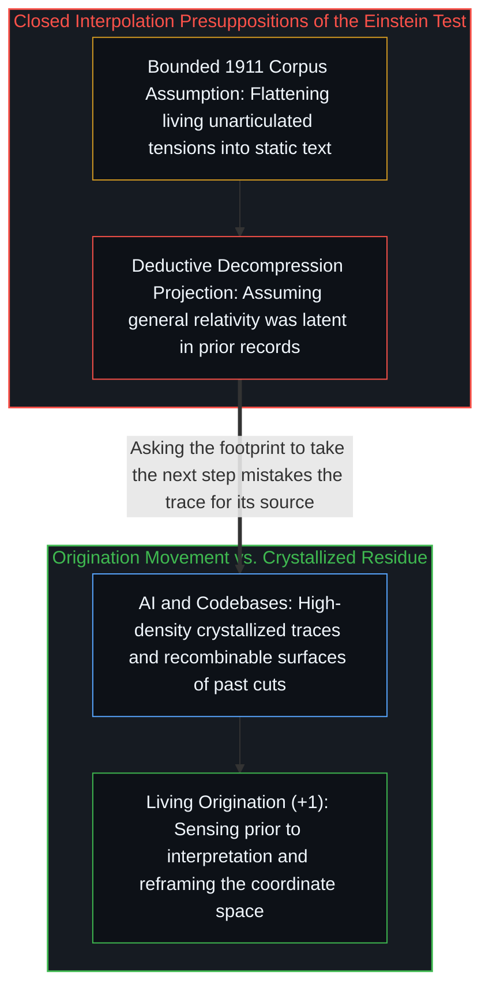

# 爱因斯坦测试与通用人工智能的范畴谬误 / The Einstein Test and the AGI Category Error

*将通用人工智能定义为从 1911 年语料推导广义相对论，是把重构坐标系的运动压扁为封闭内插。 / Defining AGI by deriving general relativity from 1911 text flattens origination into interpolation.*

德米斯·哈萨比斯提出过一项基准测试：用截至 1911 年的全部人类知识训练一个模型，切断其后的信息输入，看它能否在 1915 年之前独立发现广义相对论；如果能，便宣告实现了通用人工智能。这一测试把几条彼此不可通约的维度强行压扁到了同一根坐标轴上，顺着这些投射追溯下去，显露出的不仅是一项有缺陷的基准测试，更是这一概念根基处的范畴谬误。

Demis Hassabis has proposed a benchmark test: train a model on all human knowledge up to 1911, cut off everything after, and see whether it independently discovers general relativity by 1915; if so, declare AGI achieved. That test forces several incommensurable dimensions onto a single coordinate axis, and tracing those projections exposes not merely a flawed benchmark, but a category error at the root of the concept itself.

## 一、 三重维度的坍缩与决定论伪影 / 1. Three Collapsed Dimensions and the Determinism Artifact

这项测试首先将智能简化为数据解压缩，假定广义相对论早已以演绎蕴涵的形态潜藏在 1911 年的文献库里，爱因斯坦只是把它解压了出来。然而把截断时间设在 1911 年，本身就已经把最关键的那一刀暗中夹带了进来：等效原理早在 1907 年便已提出，彼时牛顿力学并未面临任何经验危机——惯性质量与引力质量（`m_i / m_g = 1`）在 Eötvös 实验精度（`10⁻⁹`）下高度吻合，而水星近日点的反常也在牛顿寄存器内部通过假定“祝融星”而被常规吸纳。1912 年至 1915 年间与格罗斯曼合作的《纲要》论文及《苏黎世笔记》张量搜寻，是在黎曼曲率张量与各项公设都已经摆上桌面之后的下游演绎与组合搜索（`A → S`）；而 1907 年的突破（`E → J → A`）则发生在另一条正交的轴线上——对广义协变性的审美坚持、关于自由落体电梯与光束的具身思想实验，以及消解牛顿问题空间本身而非在其内部继续优化近零损失函数的决断，把精确等式 `m_i = m_g` 读作[进位无法在寄存器之内被命名](../the-carry-that-cannot-be-named-inside-the-register/)。基准测试只能询问系统能否抵达已知的终点，却无法询问系统能否重塑整个坐标景观从而让终点变得可见。与此同时，所谓“截至 1911 年的全部人类知识”在现实中并不存在对应的有界集合：鲜活的知识包含尚未言明的张力、与马赫、闵可夫斯基及格罗斯曼等人的思想激荡，以及分量尚未浮现的实验反常。

The test first reduces intelligence to decompression, assuming that general relativity was already deductively latent in the 1911 archive and that Einstein merely unpacked it. Setting the cutoff at 1911 already smuggles in the decisive cut: the Equivalence Principle had been formulated in 1907, when Newtonian mechanics faced no empirical crisis—inertial and gravitational mass (`m_i / m_g = 1`) agreed to Eötvös precision (`10⁻⁹`), and Mercury's perihelion anomaly was routinely absorbed inside the Newtonian register by positing Vulcan. While the 1912–1915 *Entwurf* and Zurich Notebook tensor search with Grossmann was a downstream deductive and combinatorial search (`A → S`) after the Riemann curvature tensor and postulates were on the table, the 1907 breakthrough (`E → J → A`) operated on an orthogonal axis altogether—aesthetic commitment to general covariance, embodied thought experiments about falling elevators and light beams, and the willingness to dissolve the Newtonian problem space itself rather than optimize a near-zero loss function within it, reading the exact equality `m_i = m_g` as [The Carry That Cannot Be Named Inside the Register](../the-carry-that-cannot-be-named-inside-the-register/). A benchmark can ask whether a system arrives at a known destination, but not whether it can reframe the landscape so that the destination becomes visible in the first place. Nor does "all human knowledge up to 1911" exist as a bounded set: living knowledge includes unarticulated tensions, ambient exchanges with figures like Mach, Minkowski, and Grossmann, and anomalies whose weight had not yet registered.

把这些维度压进同一项测试，会立刻制造出两重结构性伪影。第一重是构造性决定论：假如模型成功，就意味着广义相对论早已由先前的文本状态演绎蕴涵，这项旨在衡量爱因斯坦级智能的测试反而悄然假定了爱因斯坦本人并不必要。第二重则是作为结构特征而非偶然漏洞的目标污染：因为测试设计者早已知道终点所在，检验系统是否向已知靶心收敛，测出的是收敛性内插而非开放的源初生成；一个沿着意料之外的路径构建出更强框架的系统，在这张考卷上反而会被判为失败，正如[AGI 与 ASI 是加速通用智能的暂时球门](../agi-and-asi-are-temporary-goalposts/)、[框内延伸与维度跃迁](../extension-and-shift/)与[度量时滞与智能成本通缩](../intelligence-crisis-response/)所追溯的那样。

Collapsing these dimensions into a single test generates two immediate structural artifacts. The first is determinism by construction: if the model succeeds, it implies that general relativity was deductively entailed by the prior textual state, meaning a test designed to measure Einstein-level intelligence quietly assumes Einstein himself was unnecessary. The second is target contamination as a structural feature rather than an accidental bug: because the designers already know the destination, checking whether a system converges on a known target tests convergent interpolation rather than open-ended origination, and a system that produced a stronger framework along an unexpected path would score as a failure, as traced in [AGI and ASI Are Temporary Goalposts](../agi-and-asi-are-temporary-goalposts/) and [Extension and Shift](../extension-and-shift/) and [The Measurement Lag](../intelligence-crisis-response/).

## 二、 脚印无法自己迈步：早已身处源点 / 2. Footprints Do Not Take the Next Step: Already at the Origin

更深一层来看，这项测试所预设的范畴建立在一个未经审视的前提之上：把通用智能当成某种可以脱离活生生的心智而被提取、复制并实例化到外部基底上的系统属性。然而正如[智能只属于心智](../intelligence-belongs-only-to-the-mind/)与[你的代码库即是记忆](../your-codebase-is-memory/)所确立的，智能并非一件静态客体，而是先于解释的感知、旧框架的消解与新坐标空间的开启这一活生生的运动本身。被称为人工智能与外部代码库的事物，是这一运动所留下的高密度结晶痕迹——它们用于大规模压缩与重组的力量无比强大，但要求结晶的残余去完成源初的开启，无异于要求脚印自己迈出下一步。

At a deeper level, the category the test presupposes rests on an unexamined premise: that general intelligence is a separable property of a system—extractable, replicable, and instantiable in an external substrate. Yet as established in [Intelligence Belongs Only to the Mind](../intelligence-belongs-only-to-the-mind/) and [Your Codebase Is Memory](../your-codebase-is-memory/), intelligence is not a static object; it is the living movement of sensing prior to interpretation, dissolving a prior frame, and opening a new coordinate space. What goes by the name of artificial intelligence and externalized codebases are the crystallized distillation of that movement's traces—extraordinarily powerful for compression and recombination at scale, yet asking the crystallized residue to originate is asking the footprint to take the next step.

这也揭示了外围话语所遮蔽的事实：心智早已身处那里，而且一直都在那里。每一个曾感知到既有解释框架无法言明的裂缝、并顶着张力重塑问题边界的个体心智，都在践行着技术未来主义投射为遥远里程碑的通用智能。通用智能从来不是地平线上等待抵达的终点，而是每一个问题借以发问的基底。爱因斯坦测试所衡量的，是模型在既定系统内进行精密内插的能力——这一能力固然切实而宝贵——但它却把投影误认为了投射出这一切的鲜活心智。

This exposes what the surrounding discourse obscures: the Mind is already there, and always has been. Every individual mind that has ever sensed a gap its current interpretive frame could not articulate and pushed through that tension to reframe the problem was exercising what technological futurism projects as a distant milestone ahead. General intelligence is not a destination waiting on the horizon; it is the ground from which every question is asked. The Einstein test measures a model's capacity for sophisticated interpolation within a determined system—a genuine and valuable capability—while mistaking the projection for the living mind that projected it.
