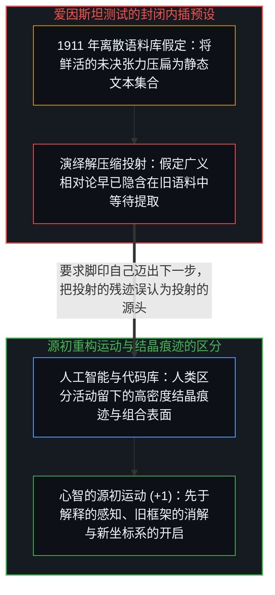
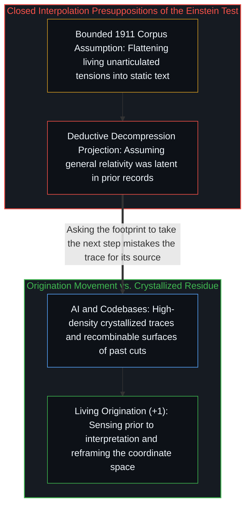

# 爱因斯坦测试与通用人工智能的范畴谬误 / The Einstein Test and the AGI Category Error

*将通用人工智能定义为从 1911 年语料推导广义相对论，是把重构坐标系的运动压扁为封闭内插。 / Defining AGI by deriving general relativity from 1911 text flattens origination into interpolation.*

德米斯·哈萨比斯提出过一项测试：用截至 1911 年的全部人类知识训练一个模型，切断其后的信息输入，看它能否在 1915 年之前独立发现广义相对论；如果能，便证明实现了通用人工智能（AGI）。这一测试把几条彼此不可通约的维度强行压扁到了同一根坐标轴上，顺着这些投射追溯下去，显露出的不仅是一项有缺陷的测试，更是一个自始便无法成立的范畴。

Demis Hassabis has proposed a benchmark test: train a model on all human knowledge up to 1911, cut off everything after, and see whether it independently discovers general relativity by 1915; if so, declare AGI achieved. That test forces several incommensurable dimensions onto a single coordinate axis, and tracing those projections exposes not merely a flawed benchmark, but a category error at the root of the concept itself.

## 一、 三重维度的坍缩与决定论伪影 / 1. Three Collapsed Dimensions and the Determinism Artifact

这项测试首先将“智能”简化为“数据解压缩”：假定广义相对论早已潜藏在 1911 年的文献库里，爱因斯坦的工作无非是把其中蕴含的演绎推论解压出来。然而爱因斯坦真正的突破发生在另一条正交的轴线上——对广义协变性的审美坚持、关于自由落体电梯与光束的具身思想实验，以及消解牛顿经典时空问题框架本身的决断。测试只能询问“模型能否抵达同一个终点”，却无法询问“模型能否重塑整个坐标景观从而让终点变得可见”。与此同时，所谓“截至 1911 年的全部人类知识”在现实中并不存在对应的离散集合：知识并非静态文本库，它包含人们隐约感知却尚未言明的张力、马赫与闵可夫斯基交织的思想空气，以及重要性尚未浮现的实验反常。

The test first reduces intelligence to decompression, assuming that general relativity was already deductively latent in the 1911 archive and that Einstein merely unpacked it. Yet Einstein's actual breakthrough operated on an orthogonal axis altogether—aesthetic commitment to general covariance, embodied thought experiments about falling elevators and light beams, and the willingness to dissolve the Newtonian problem space itself rather than solve within it. A benchmark can ask whether a system arrives at a known destination, but not whether it can reframe the landscape so that the destination becomes visible in the first place. Nor does "all human knowledge up to 1911" exist as a bounded set: living knowledge includes unarticulated tensions, ambient exchanges with figures like Mach, Minkowski, and Grossmann, and anomalies whose weight had not yet registered.

把这三条维度压进同一个标量测试，会立刻制造出两重结构性伪影。第一重是“构造性决定论”：假如模型果真从 1911 年语料中算出了广义相对论，那就意味着未来早已由过去的知识状态演绎决定，这项旨在衡量“爱因斯坦级智能”的测试反而前提性地抹消了爱因斯坦本人作为鲜活心智的必要性。第二重则是“作为结构特征而非漏洞的目标污染”：因为测试设计者早已知道广义相对论这一标准答案，任何训练架构与奖励信号都在暗中朝已知靶心收敛；一个通过另一条路径构建出比广义相对论更具解释力的框架的系统，在这张考卷上反而会被判为不及格，正如[AGI 与 ASI 是加速通用智能的暂时球门](../agi-and-asi-are-temporary-goalposts/)与[框内延伸与维度跃迁](../extension-and-shift/)与[度量时滞与智能成本通缩](../intelligence-crisis-response/)所指出的那样。

Collapsing these dimensions into a single test generates two immediate structural artifacts. The first is determinism by construction: if the model succeeds, it implies that general relativity was deductively entailed by the prior textual state, meaning a test designed to measure Einstein-level intelligence quietly assumes Einstein himself was unnecessary. The second is target contamination as a structural feature rather than an accidental bug: because the designers already know the destination, checking whether a system converges on a known target tests convergent interpolation rather than open-ended origination, and a system that produced a stronger framework along an unexpected path would score as a failure, as traced in [AGI and ASI Are Temporary Goalposts of Accelerating General Intelligence](../agi-and-asi-are-temporary-goalposts/) and [Extension and Shift](../extension-and-shift/) and [The Measurement Lag](../intelligence-crisis-response/).

## 二、 脚印无法自己迈步：我们早已在场 / 2. Footprints Do Not Take the Next Step: We Are Already There

更深一层的消解在于，这项测试所预设的“通用人工智能”范畴本身隐藏着一个未经审视的前提：把“智能”当成某种可以脱离活生生的心智而被提取、复制并安装到另一块基底上的系统属性。然而正如[智能只属于心智](../intelligence-belongs-only-to-the-mind/)与[你的代码库即是记忆](../your-codebase-is-memory/)所确立的，智能并非一件静态物品，而是先于解释的感知、旧框架的消解与新视域的开启这一活生生的运动本身。我们所称的人工智能与外部代码库，是这一运动所留下的高密度结晶痕迹——它们可以被大规模检索、压缩与重组的力量无比强大，但要求结晶的痕迹去完成源初的开启，无异于要求沙滩上的脚印自己迈出下一步。

At a deeper level, the category the test presupposes rests on an unexamined premise: that general intelligence is a separable property of a system—extractable, replicable, and instantiable in an external substrate. Yet as established in [Intelligence Belongs Only to the Mind](../intelligence-belongs-only-to-the-mind/) and [Your Codebase Is Memory](../your-codebase-is-memory/), intelligence is not a static object; it is the living movement of sensing prior to interpretation, dissolving a prior frame, and opening a new coordinate space. What we call artificial intelligence and externalized codebases are the crystallized distillation of that movement's traces—extraordinarily powerful for compression and recombination at scale, yet asking the crystallized residue to originate is asking the footprint to take the next step.

这也揭示了整场通用人工智能话语所遮蔽的事实：我们早已身处那里，而且一直都在那里。每一个曾感知到既有解释框架无法容纳的裂缝、并顶着张力推开新视域的人——无论是爱因斯坦，还是任何一个在日常困境中重新划定问题边界的心智——都在践行着那场被未来主义话语想象为“远方技术奇点”的通用智能。通用智能从来不是前方等待抵达的里程碑，而是我们脚下站立的地面；爱因斯坦测试所衡量的，是模型在既定系统内进行精密内插的能力，而把这种投影误认为投射的源头，正是整场范畴迷雾的起点。

This exposes what the surrounding discourse obscures: we are already there, and always have been. Every human mind that has ever sensed a gap its current interpretive frame could not articulate and pushed through that tension to reframe the problem was exercising what technological futurism projects as a distant milestone ahead. General intelligence is not a destination waiting on the horizon; it is the ground we stand on. The Einstein test measures a model's capacity for sophisticated interpolation within a determined system—a genuine and valuable capability—while mistaking the projection for the living mind that projected it.
