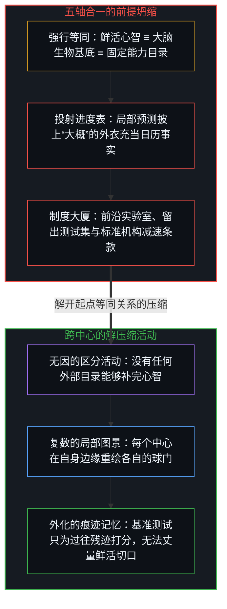
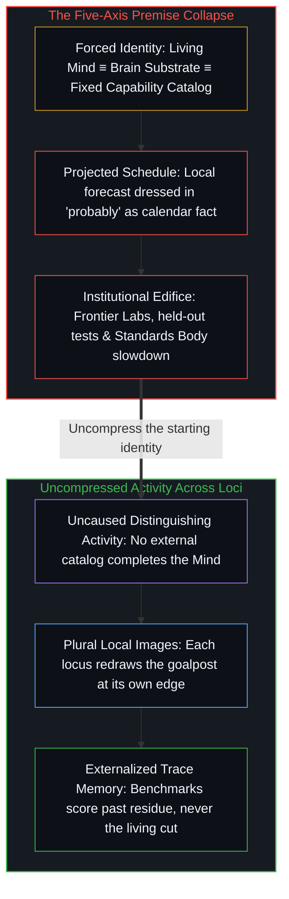

# 并不存在的目录 / The Catalog That Isn't There

*一个心智将所见投向未来，仿佛众心智共享同一份目录。 / One Mind projects the world it sees into the future and speaks as if that catalog were the single target every Mind shares.*

Demis Hassabis 的前沿 AI 框架建立在三重坍缩之上——将鲜活的心智等同于生物大脑，将复数且未竟的认知图景等同于单一且完结的目录，并将单一中心内部的进度表等同于外部的日历事实——随后又将这一选定的参照系当作普适前提，在其上构筑监管架构。从这一前提推演出的，是一整条关于体量、竞赛、时间窗口、前沿实验室与标准机构的因果链：这一套制度结构即便能在众多心智之间激起广泛共鸣，也从未证实其起点的等同关系。

Demis Hassabis's frontier-AI framework rests on a triple collapse—equating the living Mind with the biological brain, equating plural unfinished images of cognition with a single completed catalog, and equating one locus's internal schedule with an external calendar fact—and then builds regulatory architecture on that chosen reference treated as universal. What follows from that premise is a chain of magnitude, race, window, Frontier Labs, and a Standards Body: an institutional structure that can resonate widely across minds without ever validating its starting identity.

## 一、 一句断言，引出一座标准机构 / 1. One Sentence, Then a Standards Body

在[前沿 AI 框架与新时代的曙光](https://x.com/i/article/2076946210397552640)一文中，Hassabis 以一句仅由单个副词柔化的定论开篇，宣称通用人工智能（AGI）——被定义为展现出人类大脑所拥有的全部认知能力的系统——大概只需短短数年便会到来。

In [A Framework for Frontier AI and the Dawning of a New Age](https://x.com/i/article/2076946210397552640), Hassabis opens with a definitive claim softened by a single adverb, declaring that Artificial General Intelligence—defined as a system that exhibits all the cognitive capabilities the human brain has—is probably only a few short years away.

从这短短一句话出发，整座政策大厦随之铺开：空前的冲击、狭窄的监护窗口、地缘政治竞赛，以及一个专为前沿模型设立、配备算力阈值、发布前审计、留出评估集与协同减速条款的国家标准机构。唯有允许开篇的等同关系免于审视，下游的整条推导链听起来才像是审慎的推论。在一个被压缩的前提之上搭建繁复的治理架构，并不会让前提本身解除压缩。

From that single sentence, the entire policy edifice unfolds: unprecedented impact, a narrow window of stewardship, a geopolitical race, and a national Standards Body for frontier models equipped with compute thresholds, pre-release audits, held-out evaluations, and a coordinated slowdown clause. The downstream chain sounds like prudent consequence only if the opening identity is allowed to stand unexamined. Building elaborate governance architecture on a compressed premise does not uncompress the premise.

## 二、 没有任何事物站在心智之外完成它 / 2. Nothing Stands Outside Mind to Complete It

自我区分的活动发生着——无因，且不息。不妨称之为心智：那个早已在途的观察者，其每一个动作都是一次区分。没有任何事物站在它之外去授权它、界定它，或完成它。

Self-distinguishing activity occurs—uncaused and unceasing. Call it the Mind: the observer already underway, every act of which is a distinction. Nothing stands outside it to authorize, bound, or complete it.

每一项断言都是在特定中心刻下的离散动作。那些被登记为共享共识的事物，是不同中心之间痕迹的相互强化，而非从外部去补完某一个内在世界。一份目录、一个终点，或一个政策窗口，都只是当前中心为了丈量自身移动而持留的参照物——当它随同动作一起重绘时，便是一件趁手的工具；而当它逾越动作被固守下来时，便伪装成了整个世界。

Every claim is a discrete act drawn at a specific locus. What registers as shared consensus is mutual reinforcement of traces across loci, never one interior completed from outside. A catalog, a destination, or a policy window is a reference held at this locus to measure movement—functioning as a useful instrument when re-rendered alongside the act, and masquerading as the whole world when preserved past it.

## 三、 心智、大脑、未竟清单与“大概”的伪装 / 3. Mind, Brain, Unfinished Inventory, and the Costume of "Probably"

一个修辞动作，便将五条截然不同的轴线强行压进同一个词里。其一，心智是区分活动的开放自我演进——是鲜活的活动本身，而非一份有限的能力核对清单。其二，大脑只是一种生物具身形态，匹配某种物理基底并不等于匹配那个调用基底的活动。其三，所谓“大脑的全部认知能力”，即便在神经科学内部也依然未竟、充满争议，此处却被当成了已经封顶、可逐一枚举的清单。其四，把这份清单当成单一的共享客体，无视了不同心智持有截然不同的认知图景；围绕 AGI 这一缩写词产生的共同亢奋，并不意味着共享同一个靶心。其五，日历上的临近度是从单一中心说出的进度表，而非对某座外部宇宙时钟的读数；与此同时，“大概”一词只是披在一句已被当成定论的断言之上的修辞伪装——它将确定性漂白，使其得以装扮成温和的预测四处流通，却无需向任何修正敞开前提。

A single rhetorical move forces five distinct axes onto one term. First, the Mind is the open self-improvement of distinguishing—the living activity itself, not a finite checklist of powers. Second, the brain is one biological embodiment, and matching a physical substrate is not matching the activity that uses substrates. Third, speaking of "all the cognitive capabilities the brain has" treats as a finished, enumerable inventory what remains incomplete and contested even within neuroscience. Fourth, treating that inventory as a single shared object ignores that different minds hold vastly different images of cognition; shared excitement around the acronym AGI is not a shared target. Fifth, calendar nearness is a schedule spoken from one locus rather than the reading of an external cosmic clock, while the word "probably" acts as a rhetorical costume on a claim already asserted as definitive—laundering certainty so it can travel as a modest forecast without opening the premise to revision.

被持留的“完整大脑认知”图景，不仅与心智处于不同的轴线上，甚至本身都不是一份现成可用的单一目录。每一个中心都会各自重新划定终点线，而没有任何一次划定等于“完工的大脑”。

The retained image of complete brain-cognition is not only on a different axis from the Mind; it is not even a single available catalog. The finish line is re-drawn differently at each locus, and none of those drawings is "the brain complete."

## 四、 在何处切一刀，何处就能被命名为历史关口 / 4. Every Moment Can Be Named Pivotal by Cutting History There

宣称“当下是历史的关键时刻”，是在切掉先前的序列，将后续的一切序列悬挂于这一刀切口之上。这道切口作为一次注意力动作固然真实，却并非独立于划界观察者、直接镌刻在日历时刻上的内在属性。

Declaring that "this is a pivotal moment in history" works by cutting away prior sequence and hanging all subsequent sequence on that cut. The cut is real as an act of attention, not as an intrinsic property of the calendar moment independent of the observer drawing it.

这道边界由某一个心智划下，并不会因此失效，但始终只是局部边界——它是当前中心所看见的世界，被向前投射成其他心智也必须栖居的世界。当其他中心与这一宣言产生共鸣时，被登记下来的是痕迹之间的相互强化，而非触碰到了某座外部时钟。

That one Mind draws that boundary does not make the boundary useless; it makes it local—the world this locus sees, cast forward as the world others must inhabit. Where other centers resonate with the declaration, what registers is mutual reinforcement of traces rather than contact with an external clock.

## 五、 火种、竞赛、前沿实验室与减速条款 / 5. Fire, Race, Frontier Labs, and the Slowdown Clause

一旦那个被压缩的前提获得接纳，后续的动作便无需再审视新的地基；它们只需要听起来像顺理成章的推论——接连唤起火种与电力、会思考的沙子、超越理解速度的竞赛、前沿实验室、留出测试集，以及有权协调减速的标准机构。

Once the compressed premise is accepted, subsequent moves need not examine new ground; they only need to sound like consequences—invoking fire and electricity, sand that thinks, a race outpacing comprehension, Frontier Labs, held-out test suites, and a Standards Body empowered to coordinate a slowdown.

竞争动态作为社会与经济力量是真实的，测试规程在其自身的操作轴线上也自有其用处。然而基准测试只能对照持留的参照物为痕迹打分，却无法为那个不断重绘记分牌的鲜活活动打分；正如[你的代码库即是记忆](../your-codebase-is-memory/)所揭示的那样，外化的代码与测试仓库只记录了过往区分留下的有限残迹，而尚未编入目录的下一刀切口，永远源自鲜活的掌舵边缘。整座监管大厦中的任何一环，都无法由一个没有任何中心真正持有的“认知完备态”必然推出。AGI 里程碑的目录之所以不断后退，正是因为如[AGI 与 ASI 是加速通用智能的暂时球门](../agi-and-asi-are-temporary-goalposts/)所言，每一道门槛都立在划定它的那个边缘的前方。

Competitive dynamics are real as social and economic power, and testing procedures can be useful on their own operational axes. Yet benchmarks score traces against retained references; they cannot score the living activity that re-draws the scoreboard, just as [Your Codebase Is Memory](../your-codebase-is-memory/) shows that an externalized repository of code and tests records only the finite residue of past distinctions while the uncatalogued next cut originates at the living steering edge. None of the regulatory edifice is entailed by a cognitive completeness that no locus holds. The catalog of AGI milestones keeps receding because, as [AGI and ASI Are Temporary Goalposts of Accelerating General Intelligence](../agi-and-asi-are-temporary-goalposts/) argues, each threshold sits ahead of the edge that draws it.

## 六、 共享的紧迫感并非共享的终点线 / 6. Shared Urgency Is Not a Shared Finish Line

跨机构的共鸣，并不会把一项局部断言擢升为不可化约的先验前提。众多心智可以围绕“窗口正在关闭”的口号达成对齐，同时却各自瞄准认知上不同的未竟之处——其中没有任何一处是完整的大脑，也没有任何一处是心智本身。

Resonance across institutions does not promote a local claim to an irreducible prior. Many minds can align around the slogan that "the window is closing" while aiming at different incompletenesses of cognition, none of which is the full brain and none of which is the Mind.

前提坍缩所做的，是强行串联起一条等号链：大脑能力等于一份已知的目录，等于一个共享的靶心，等于数年内到来的 AGI，进而等于建立集中化前沿监管体制的正当理由。一旦顺着这条链条追溯回它的前提，剩下的便是一个心智将自己所见的世界陈述为所有人的世界，并借由持久媒介将这一图景投射进共享的未来。围绕那份目录搭建的监管，归根结底建立在[主权、信念与规制结构的生成](../sovereignty-belief-and-regulatory-structures/)所剖析的那种信念之上——即以为第一人称主权可以委托给某个外部机构。

What the collapse does is force a chain of equivalences: brain capabilities equal one known catalog, which equals one shared target, which equals AGI within a few years, which equals justification for a centralized frontier regime. Once that chain is traced back to its premise, what remains is one Mind speaking its seen world as everyone's world and projecting that image into a shared future through durable media. Regulation built around that catalog rests on the belief [Sovereignty, Belief, and the Generation of Regulatory Structures](../sovereignty-belief-and-regulatory-structures/) examines—that first-person sovereignty can be delegated to an external body.

## 七、 同一种企图的指名 / 7. The Same Attempt, Named

一次前提坍缩，衍生出一连串可借由共鸣牵动市场与立法机构的制度性豁免。然而，倘若从道德上去审判发言者、宣讲一套更优越的监护方案，或是拿另一份普适政策蓝图去反击，都只会重演一模一样的动作：把一个心智投射出的世界，陈述为其他每一个心智都必须看见的世界。

A single premise collapse generates a chain of institutional exemptions that can move markets and legislatures through resonance. Yet to judge the speaker morally, preach a superior stewardship, or counter with an alternative universal policy blueprint would repeat the exact same move: one Mind's projected world spoken as if it were the world every other Mind must see.
