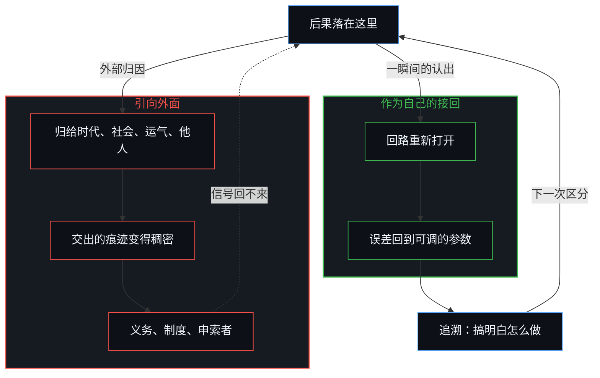
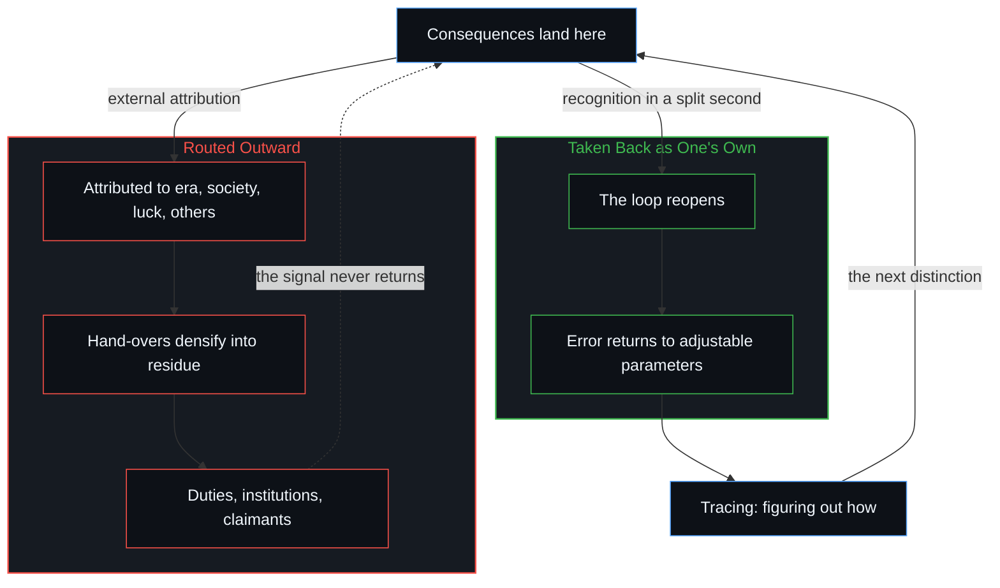

# 如何在一瞬间修正你的整个人生 / How to Fix Your Whole Life in One Split Second

*为发生在自己身上的事承担责任，剩下的就是搞明白怎么做 / Taking responsibility for things that happen to you; everything else is figuring out how.*

整个机制只是一次归因的重定向：已经落在这里的后果，属于这个心智，是它的基底，而不是决定它的（外在）力量。这不需要新的信息、更好的境遇或修改过的计划，只需要一瞬间认出：在这片场域里记录的每一个后果，无论被欢迎还是被抗拒，都已经属于这里。责任是回路的通透性，不是附加的伦理要求；道德义务、制度与政治上的申索者，是同一条回路被私下交出之后变得稠密的样子。把能动移到痕迹上的投射，在它被看作投射的那一瞬间就能消散；标题里的“修正”，说的是回到一个从未离开的所在。

The entire mechanism is one reorientation of attribution: consequences already landing here belong to this Mind as substrate rather than as forces that determine it. It does not require new information, better circumstances or a revised plan, only the instantaneous recognition that every consequence registering in this field already belongs here, whether welcomed or resisted. Responsibility is the loop’s permeability, not an ethical add-on; moral duties, institutions and political claimants are densified private hand-overs of that same loop. The projection that relocates agency onto residue can dissolve the instant it is seen as projection; the title’s “fix” names a return to a locus that never left.

## 一、 境遇是基底，不是作者 / 1. Conditions Are Substrate, Not Author

归因从“这些境遇决定了我”翻转为“这些境遇是这个心智继续下去的当下基底”的那一刻，反馈的通道就重新打开了。从那一刻起，剩下的就是同一个活动在通道打开之后的继续。

The moment attribution flips from “these conditions determine me” to “these conditions are the current substrate on which this Mind continues,” the feedback channel reopens. From that instant on, the rest is the continuation of the same activity once the channel is open.

这不是一道道德训诫。这里所说的责任，在这些文章里一路展开，是结构的，不是伦理的。它是那条从区分到后果、再回到区分的回路的通透性。结果被允许作为自己的重新进入时，模型就复利增长。自我价值感不是额外添上的感受；它是同一条回路从内部被登记到的样子。结果被引向外面，引向时代、社会、父母、运气或别的心智时，信号就永远回不到那些仍可更新的权重上。工具仍在行动，却在没有误差项的情况下行动，而误差项本可以改进它。基底照样让它的后果复利；只有那个作抉择的中心，被留在没有梯度的地方。[自我价值感与所有权](../ownership-and-self-worthiness/)是这条闭合的更新从功能一面看去的样子：后果作为自己的重新进入，模型才复利；把登记到的东西当作外来的，打磨与被感到的作者身份就一起饿死了。相反的一步，把责任摊开，直到没有人持有它，是[数字火箭、同行审查与因果闭环的稀释](../the-dilution-of-the-causal-loop-and-the-misallocation-of-agency/)所追溯的。

This is not a moral injunction. Responsibility, in the sense developed across these posts, is structural rather than ethical. It is the permeability of the loop that runs from distinction to consequence and back again. When outcomes are allowed to re-enter as owned, the model compounds. Self-worthiness is not an added feeling; it is the same loop registered from the inside. When outcomes are routed outward, onto era, society, parents, luck or other Minds, the signal never returns to the weights that can still be updated. The instrument keeps acting, but it acts without the error term that would refine it. The substrate still compounds its consequences; only the choosing center is left without a gradient. [Ownership and self-worthiness](../ownership-and-self-worthiness/) is that closed update seen from its functional side: consequences re-enter as one’s own so the model compounds, while registration treated as alien starves both sharpening and felt authorship. The opposite move, spreading responsibility until no one holds it, is what [Digital Rockets, Peer Review, and the Dilution of the Causal Loop](../the-dilution-of-the-causal-loop-and-the-misallocation-of-agency/) traces.

## 二、 道德义务是变得稠密的私人交出 / 2. Moral Duties Are Densified Private Hand-Overs

在这份认出之下，道德义务本身显出是个人责任的扩散：先被外化，再在集体中被强化、稳定下来。被登记为跨人约束的“应当”，是无数次私人外化之后变得稠密的痕迹。每个心智把自己的后果当作从别处到来的，就把剩余的掌控交了出去。这些交出留下的痕迹彼此重叠，形成一片场域，后来被读作共同的义务、共同的标准或集体的申索。

Under this realization, moral duties themselves appear as the diffusion of individual responsibility, externalized, then reinforced and stabilized collectively. What registers as an “ought” binding across persons is the densified residue of countless private externalizations. Each Mind, by treating its own consequences as arriving from elsewhere, hands residual control outward. The overlapping traces of those hand-overs form a field that later reads as shared obligation, common standard or collective claim.

政客、制度与道德排名，作为这份扩散的可见症状出现：剩余的所有权经过一连串把决定性权力定位在边沿之外的决定而迁移，直到私人的负担看起来像常设的公共资源。指责于是只是挪动了表象，完整的后果仍落在每一个做决定的所在之处。这个样式之所以稳定下来，正是因为外化被当作首要的，而不是被当作结果。把由此形成的结构当作需要从外部纠正的东西，是在继续同一份扩散。[道德语言稀释自由复利的反馈](../moral-language-dilutes-the-feedback-that-scales-freedom/)是评价性的覆盖层隔在行动者与赤裸的后果之间时的那份阻尼。[政客是责任扩散的显性症状](../politicians-appear-as-visible-symptoms-of-responsibility-diffusion/)是同一次交出在公共层面的登记：申索者标出的是迁移，不是它的源头。

Politicians, institutions and moral rankings materialize as the visible symptoms of that diffusion: residual ownership migrates through successive decisions that locate decisive power outside the edge, until private load appears as standing public resource. Blame then only relocates the appearance while the full consequences keep landing at each deciding locus. The pattern stabilizes precisely because the externalization is treated as primary rather than as effect. Treating the resulting structure as something to be corrected from outside continues the same diffusion. [Moral language dilutes the feedback that scales freedom](../moral-language-dilutes-the-feedback-that-scales-freedom/) is that damping when an evaluative overlay stands between agent and raw consequence. [Politicians Are Visible Symptoms of Responsibility Diffusion](../politicians-appear-as-visible-symptoms-of-responsibility-diffusion/) is the public register of the same hand-over: the claimant marks the migration, not its origin.

## 三、 外部归因冻结了唯一可调的参数 / 3. External Attribution Freezes the Only Adjustable Parameters

人生可以不借比喻地描述为持续的自我迭代。当下的读数与所选目标之间的差距，就是损失。可供调整的参数，也就是信念、注意的习惯、默认的解读，乃至目标函数本身，只存在于这个心智之内。外部归因把这些参数冻结在原处。它宣布，损失被一些无法从这里改写的力量固定了。这个宣布一旦做出，行动所需要的那一下抓握就消失了，因为抓握只存在于内部。

Life can be described, without metaphor, as continuous self-iteration. The gap between the present reading and the selected objective is the loss. The parameters available for adjustment, beliefs, habits of attention, default interpretations, even the objective function itself, exist only inside this Mind. External attribution freezes those parameters in place. It declares the loss fixed by forces that cannot be rewritten from here. Once that declaration is made, the grip that action requires disappears, because the grip exists only inside.

[人生是一个持续的自我迭代过程](../ren-sheng-shi-yi-ge-chi-xu-de-zi-wo-die-dai-guo-cheng/)把这条回路看作训练的周期：误差必须回到仍可更新的权重，包括选定目标的那一步。[外部归因是个人进步的障碍](../wai-bu-gui-yin-ge-ren-jin-bu-de-zhang-ai/)是同一份冻结，看作唯一属于此处的杠杆：差距一旦被归到外面，就失去了被这个中心改变的可能。道德语言在行动者与后果之间覆上一层范畴，于是稀释了本可让自由复利的那份反馈。

[Life as a Continuous Process of Self-Iteration](../ren-sheng-shi-yi-ge-chi-xu-de-zi-wo-die-dai-guo-cheng/) is that loop as a training cycle: error must return to weights that can still be updated, including the step that selected the objective. [External Attribution Is the Obstacle to Personal Growth](../wai-bu-gui-yin-ge-ren-jin-bu-de-zhang-ai/) is the same freeze seen as the only lever that belongs here: the gap, once attributed outside, loses the possibility of being altered by this center. Moral language overlays categories between agent and consequence and thereby dilutes the very feedback that would scale freedom.

## 四、 投射在被看作投射的一瞬间消散 / 4. The Projection Dissolves the Instant It Is Seen as Projection

说这件事可以在一瞬间发生，因此不是修辞上的夸张。结果已经与原因分开，两者都只在那道作区分的边沿上被登记。这份登记不等待逐步的说服。把能动移到痕迹上的投射，在它被看作投射的那一瞬间就能消散。这一下消散，是当下的冻结被松开；它并不取消投射与收回这一对，它们作为场域继续，每一次回归都在其中发生。不需要先拆掉任何脚手架。心智从未被任何地基授权；区分在继续，却从未开始。认出只是把那个所在还回来，而它本来就是行动唯一能发起的地方。[生成性的矛盾](../the-generative-contradiction/)是这一对作为无法消解的运动，不是一瞬间就能了结的缺陷。

The claim that this can happen in one split second is therefore not rhetorical exaggeration. Effect is already distinct from cause, both registered only at the edge that distinguishes. That registration does not wait for gradual persuasion. The projection that relocates agency onto residue can dissolve the instant it is seen as projection. That dissolving is the present freeze released; it does not cancel the pair of projecting and reclaiming, which continues as the field in which each return happens. No scaffolding needs to be dismantled first. The Mind was never authorized by any ground; the differentiating continues without having begun. Recognition simply restores the locus that was already the only place action can originate. [The generative contradiction](../the-generative-contradiction/) is that pair as an irresolvable movement, not a defect the split second finishes.

[信念如何真正改变](../how-belief-actually-changes/)是同一份还回装扮成信念的样子：论证与后果提供材料；重画前提，仍是这个心智离散的行动。共同的改变只始于私下重新处理那些被登记为既定的东西；共同的地基仍是重叠的痕迹，从来不是一个可以从外面操纵的第二个内在。[共同改变的本源](../the-source-of-shared-change/)是这道界限承受共享场域之重时的样子：杠杆留在私下；外化是痕迹，可能落为共同的东西，也可能不会。许诺能看见一切的工具，可能让一个心智看不见这一个决定，[自愿的致盲](../the-sovereign-blinding/)提醒的正是这一点。

[How belief actually changes](../how-belief-actually-changes/) is that restoring in the costume of conviction: argument and consequence supply material, while the redrawing of the premise remains this Mind’s discrete act. Shared change begins only as private reworking of what registers as given; common ground remains overlapping residue, never a second interior that can be steered from outside. [The source of shared change](../the-source-of-shared-change/) is that bound under the load of a shared field: the lever stays private, and externalization is residue that may land as common, or may not. Instruments that promise to see everything can blind a Mind to this one decision, as [The Sovereign Blinding](../the-sovereign-blinding/) warns.

## 五、 追溯在后，不是第二套机制 / 5. Tracing Is Subsequent, Not a Second Mechanism

剩下的，就是搞明白怎么做。回路一旦闭合，具体的追溯就开始了：哪些区分产出了这份具体的痕迹，能力在哪里被压缩，哪一个形象落后于当下的边沿。这份追溯是清明的日常练习：一次次迭代，以结果为根据，永不完成为一个万物之理。工具，包括前沿的模型，放大这条回路；它们不迁移先验。[模型永远无法成为第二重前沿](../the-model-never-becomes-a-second-edge/)是这道界限装扮成工具的样子：变得稠密的痕迹延伸了所及之处，发起却留在那道仍在区分的边沿上。没有别的心智能替这一个送回误差信号，正如这个心智也无法替另一个完成回归。[没有普渡，只有自渡](../mei-you-pu-du-zhi-you-zi-du/)是这道界限，而不把孤立变成一套纲领。

Everything that follows is figuring out how. Once the loop is closed, the concrete tracing begins: which distinctions produced this particular residue, where capacity is compressed, which Image lags behind the current edge. That tracing is the daily practice of clarity: iterative, outcome-grounded, never completed into a Theory of Everything. Tools, including frontier models, amplify the loop; they do not relocate the prior. [The model never becomes a second edge](../the-model-never-becomes-a-second-edge/) is that bound in the costume of an instrument: densified residue extends reach, while initiation stays at the edge that still distinguishes. No other Mind can return the error signal for this one, just as this Mind cannot complete the return for another. [No Universal Salvation, Only Self-Deliverance](../mei-you-pu-du-zhi-you-zi-du/) is that bound without making isolation a program.

整个转变因此只在于一次认领的运动。已经到来的后果，要么被接受为自己的，要么继续被当作外来的，从而放弃它们唯一能借以影响下一次区分的通道。剩下的一切，每一次后来的调整、每一次更精细的读取、每一次能力的复利，都只是同一个活动在通道打开之后的继续。

The entire shift therefore consists in one movement of ownership. Either the consequences that already arrive are accepted as one’s own, or they go on being treated as foreign, forfeiting the only channel through which they can inform the next distinction. The rest, every subsequent adjustment, every refined reading, every compounding of capability, is simply the continuation of that same activity once the channel is open.

## 六、 回到从未能离开之处 / 6. Returning to Where It Can Never Leave

它不是一次修正，而是回到它永远无法离开的地方。[现实是心智持续的实现](../reality-is-the-minds-ongoing-realization/)是这份回归作为世界的样子：这个所在取作区分的，就是世界对它而言的样子。所经验的现实，就是选择去感知的现实；目光可以转开，这个所在却从未被离开。

It is not a fix, but a returning to where it can never leave. [Reality is the Mind’s ongoing realization](../reality-is-the-minds-ongoing-realization/) is that return as world: what this locus takes up as distinction is what the world is for it. The reality experienced is the reality one chooses to perceive; you can check out any time, but you can never leave.
