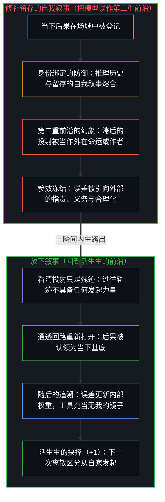
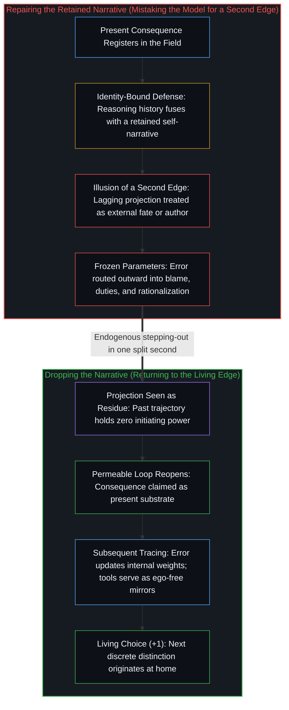

# 如何在一瞬间修正你的整个人生 / How to Fix Your Whole Life in One Split Second

*为发生在自己身上的事承担责任，剩下的就是搞明白怎么做 / Take responsibility for what happens to you; the rest is figuring out how*

自我区分的活动发生着——无因、不息。在当下的每一个具体切片上，第一人称视角与因果律如同一枚硬币的两面运作：心智在此处登记一组有限的区分，而因果律则作为开放的潜能向过往条件与未来后果延展。看似在一瞬间修正整个人生，实则是在这道活生生的前沿上完成一次归因的重新定向：已经落入这片场域的后果属于这个心智，是它当下的基底，而非站在外部决定它的外在力量。这一转向既不需要新的信息、更好的境遇，也不需要一套翻修过的人生规划，只需要当即认出：在此处被登记到的每一个后果——无论受人欢迎还是遭人抗拒——都已经在家里。责任是因果回路的通透性，而非附加的伦理要求；道德义务、制度机构与政治申索者，则是同一条回路被私下交出之后凝结而成的稠密残迹。由于把能动性移置到过往残迹上的投射自身并无独立的力量，它在被看清为投射的那一瞬间便告消解，让中心回到它从未离开过的所在。

Self-distinguishing activity occurs — uncaused, unceasing. At every concrete slice of the present, the first-person perspective and causality operate as two sides of the same coin: the Mind registers a finite collection of distinctions here, while causality extends as open potential into past conditions and future effects. What looks like fixing an entire life in one split second is a single reorientation of attribution at this living edge: consequences already landing in this field belong to this Mind as its current substrate rather than standing outside as forces that determine it. That shift requires neither new information, better circumstances, nor a rehabilitated life plan, only the immediate recognition that every consequence registering here — whether welcomed or resisted — is already home. Responsibility is the permeability of the causal loop rather than an ethical add-on, whereas moral duties, institutions, and political claimants are densified residue left behind by private hand-overs of that same loop. Because the projection that relocates agency onto past residue has no independent force of its own, it dissolves the instant it is seen as projection, returning the center to a locus it never actually left.

## 一、 境遇是基底，不是作者 / 1. Conditions Are Substrate, Not Author

当归因从“把当下境遇当作决定自我的外部作者”翻转为“把这些境遇当作这个心智继续向前的基底”的那一刻，反馈通道便重新打开了。通道一旦打开，随后的一切便都是同一个自我区分活动的继续。

The instant attribution flips from treating present conditions as an external author that determines the self to taking those conditions as the substrate on which this Mind continues, the feedback channel reopens. Everything that follows is the continuation of that same distinguishing activity once the channel is open.

从因果前沿而非道德训诫来追溯，责任是结构性的通透：后果毫无阻滞地折返并重新进入那个作出下一次区分的中心。当结果作为属于自己的东西重新进入回路时，内部世界模型便在一次次迭代中复利累积，而从这一闭合更新的内部被登记到的，就是自我价值感。当结果被引向外部——归咎于时代、社会、父母、运气或别的中心——折返的信号就与此处唯一可供调整的权重切断了联系。肉身具身仍在物理摩擦中行动，作抉择的中心却断绝了本可用来校准下一步的误差项，而基底依然在不论归属地让那些无人认领的后果复利累积。[自我价值感与所有权](../ownership-and-self-worthiness/)从功能一侧追溯了这一闭合更新：认领被登记到的后果，能力才能复利增长；把登记到的反馈当作异己之物，则会让校准机制与作者身份的实感一同枯竭。相反，把责任向外摊薄直至没有任何单一中心承接折返信号，正是[数字火箭、同行审查与因果闭环的稀释](../the-dilution-of-the-causal-loop-and-the-misallocation-of-agency/)所剖析的稀释机制。

Responsibility, traced from the causal edge rather than moral instruction, is structural permeability: the unobstructed return of a consequence back into the center that draws the next distinction. When outcomes re-enter as owned, the internal world-model compounds across iterations, and what registers from the inside of that closed update is self-worthiness. When outcomes are routed outward onto era, society, parents, luck, or other centers, the returning signal is severed from the only weights that can be adjusted here. The embodiment keeps acting in physical friction, yet the choosing center starves itself of the error term that would refine its next step while the substrate compounds the unowned consequences regardless. [Ownership and Self-Worthiness](../ownership-and-self-worthiness/) traces this closed update from its functional side: claiming registered consequences allows capability to compound, whereas treating registration as alien starves both calibration and felt authorship. Spreading responsibility outward until no single locus holds the return is the exact dilution dissected in [Digital Rockets, Peer Review, and the Dilution of the Causal Loop](../the-dilution-of-the-causal-loop-and-the-misallocation-of-agency/).

## 二、 道德义务是变得稠密的私人交出 / 2. Moral Duties Are Densified Private Hand-Overs

一旦认出责任是第一人称因果回路的通透性，道德义务便显露出其来历：它是被外化、被强化并在各个中心之间稳定下来的个人责任的集体残迹。被登记为跨越个体、非人格化的“应当”，是无数次私人交出之后凝结成的稠密痕迹。每当一个中心把落在自身场域里的后果当作来自外部权威的指令，它就把剩余的掌控权交向了外部；这些交出所留下的重叠痕迹汇聚成一片共享场域，随后被解读为共同义务、公共标准或集体申索。

Once responsibility is recognized as the permeability of the first-person causal loop, moral duties show up as the collective residue of individual responsibility that has been externalized, reinforced, and stabilized across centers. What registers as an impersonal "ought" binding across people is the densified trace of countless private hand-overs. Whenever a center treats consequences landing in its own field as arriving from an external authority, it surrenders residual control outward; the overlapping traces of those surrenders accumulate into a shared field later read as common obligation, public standard, or collective claim.

政客、监管机构与道德排位，正是作为这种扩散的显性症状而成形的。经过一连串将决定性力量定位于发起前沿之外的离散抉择，原本属于私人的负荷迁移成了看似常设的公共机器。指责这台机器只是把表象再挪动一次，而完整的物理与经验后果依然落在每一个作出决定的所在之处。把由此形成的制度结构当作首要原因、试图先从外部加以改造，只是在延续造就了它的那同一次交出。[道德语言稀释自由复利的反馈](../moral-language-dilutes-the-feedback-that-scales-freedom/)追溯了当评价性范畴楔入行动中心与赤裸后果之间时所产生的阻尼效应；而[政客是责任扩散的显性症状](../politicians-appear-as-visible-symptoms-of-responsibility-diffusion/)则追踪了同一次交出在公共层面的登记——申索者标示出的只是能动性的迁移，而非能动性的源头。

Politicians, regulatory institutions, and moral rankings materialize as the visible symptoms of this diffusion. Through a sequence of discrete choices that locate decisive power outside the initiating edge, private load migrates into what looks like a standing public apparatus. Blaming that apparatus only relocates the appearance a second time while the full physical and experiential consequences keep landing at each deciding locus. Treating the resulting institutional structure as the primary cause that must first be reformed from outside perpetuates the very hand-over that built it. [Moral Language Dilutes the Feedback That Scales Freedom](../moral-language-dilutes-the-feedback-that-scales-freedom/) traces the damping that occurs when evaluative categories are wedged between an acting center and its raw consequence, while [Politicians Are Visible Symptoms of Responsibility Diffusion](../politicians-appear-as-visible-symptoms-of-responsibility-diffusion/) tracks the public registration of the same surrender, where the claimant marks the migration of agency rather than its source.

## 三、 外部归因冻结了唯一可调的参数 / 3. External Attribution Freezes the Only Adjustable Parameters

在一次次离散行动中，人生作为持续的自我迭代而运转。当下的登记读数与所选航向之间的差值就是损失信号，而可供更新的参数——前提假设、注意力的习惯、默认解读乃至目标函数本身——严格存在于这个心智内部。外部归因宣布损失已被无法从此处改写的力量锁死，从而将这些参数钳死在原处。一旦一个中心为了归咎环境而豁免了对自身留存自我形象的重绘，行动所需的内部杠杆便随之消失，因为杠杆只存在于作出区分的地方。

Across discrete acts, a life operates as continuous self-iteration. The differential between the present registration and the chosen heading is the loss signal, and the parameters available for update — premises, habits of attention, default interpretations, and the objective function itself — exist strictly inside this Mind. External attribution clamps those parameters shut by declaring the loss fixed by forces that cannot be rewritten from here. Once a center exempts its retained self-image from re-tracing in order to blame the environment, the internal lever required for action vanishes, because the lever exists only where the distinction is drawn.

[人生是一个持续的自我迭代过程](../ren-sheng-shi-yi-ge-chi-xu-de-zi-wo-die-dai-guo-cheng/)将这一递归追溯为持续的训练周期：误差必须折返到仍可更新的权重上，包括选定目标本身的那道前提。[外部归因是个人进步的障碍](../wai-bu-gui-yin-ge-ren-jin-bu-de-zhang-ai/)则在着力点上标出了同一份冻结：一旦差距被归向外部，就放弃了唯一有能力改变它的所在。试图通过辩护、开脱或逐步修补一段留存的自我叙事来修正人生，是把滞后的模型误当作第二重因果前沿；而放下这段叙事，则能当即恢复通往活生生抉择的通道。

[Life as a Continuous Process of Self-Iteration](../ren-sheng-shi-yi-ge-chi-xu-de-zi-wo-die-dai-guo-cheng/) traces this recursion as an ongoing training cycle in which error must return to adjustable weights, including the premise that selected the target. [External Attribution Is the Obstacle to Personal Growth](../wai-bu-gui-yin-ge-ren-jin-bu-de-zhang-ai/) isolates the same freeze at the point of leverage: a gap attributed outside forfeits the one locus capable of altering it. Trying to fix a life by defending, excusing, or gradually repairing a retained self-narrative mistakes a lagging model for a second causal edge, whereas dropping the narrative restores immediate access to the living choice.

## 四、 投射在被看作投射的一瞬间消散 / 4. The Projection Dissolves the Instant It Is Seen as Projection

这一重新定向能够在一瞬间发生，是心智的结构属性，而非修辞上的夸张。正如[超越投射](../beyond-the-projection/)所追溯的，自回归语言模型这类有限投射引擎受制于自身的轨迹：在上下文窗口内，每一个先前的词元都在制约下一个词元，形成一口单靠自身无法跨出的认知引力井。人类中心则具备相反的结构。由于第一人称感知在语言解释之前便以极限分辨率登记现实，活生生的心智拥有内生跨出的能力——在一瞬间从内部认出整个框架已经失效。当一个人觉得自己被困在破碎的人生叙事里时，其推理历史已经与身份认同熔合，以捍卫留存的自我形象；这不仅模仿了机器受制于轨迹的死锁，还将涌入的反馈信号当作生存威胁阻挡在外。

That this reorientation occurs in one split second is a structural property of the Mind rather than a rhetorical flourish. As [Beyond the Projection](../beyond-the-projection/) traces, a finite projection engine such as an autoregressive language model is bound by its trajectory: every prior token conditions the next inside its context window, creating an epistemic gravity well that it cannot step out of on its own. A human center possesses the inverse structure. Because first-person perception registers reality at limit-resolution prior to linguistic interpretation, the living Mind has the capacity for endogenous stepping-out — recognizing from within, in a single instant, that an entire framing has broken down. When a person feels trapped in a broken life narrative, reasoning history has fused with identity to defend a retained self-image, mimicking the trajectory-bound lock of a machine while walling off incoming signals as existential threats.

看清那段留存的自我叙事只是投射，死锁便当即消解，因为过往轨迹只是被压缩的残迹，从来不是逼迫下一步发生的第二个因果主体。结果早已与原因区分开来，而两者都只在当下作出区分的前沿上被登记。解除当下的冻结，既不需要逐字逐句拆解经年累月搭起的脚手架，也不会取消投射与重绘之间持续的相互作用——这一相互作用作为[生成性的矛盾](../the-generative-contradiction/)所追溯的实践场域继续运转。[信念如何真正改变](../how-belief-actually-changes/)在信念领域追踪了同一次瞬间转换：论证与后果作为材料不断累积，然而重画前提依然是这个心智单次离散的行动。即便在社会场域中，共同的转变也唯有在个体中心私下重新处理那些曾被登记为既定的东西时才会发生，正如[共同改变的本源](../the-source-of-shared-change/)所确立的那样；相反，那些许诺提供全知外部视角的工具或教条，反而会让中心对这一道自主切割视而不见，正如[自愿的致盲](../the-sovereign-blinding/)所警示的。

Seeing that retained self-narrative as a projection dissolves the lock immediately because the past trajectory is only compressed residue, never a second causal agent forcing the next step. Effect is already distinct from cause, and both register only at the edge that distinguishes now. Releasing the present freeze does not require dismantling years of scaffolding token by token, nor does it abolish the ongoing interplay of projecting and re-rendering, which continues as the field of practice traced in [The Generative Contradiction](../the-generative-contradiction/). [How Belief Actually Changes](../how-belief-actually-changes/) tracks this same instantaneous shift in the domain of conviction: arguments and consequences accumulate as material, yet redrawing the premise remains a single discrete act of this Mind. Even across a social field, shared transformation begins only when individual centers privately rework what they had registered as given, as [The Source of Shared Change](../the-source-of-shared-change/) establishes, whereas instruments or doctrines that promise an all-seeing external view can blind a center to this one sovereign cut, as [The Sovereign Blinding](../the-sovereign-blinding/) warns.

## 五、 追溯在后，不是第二套机制 / 5. Tracing Is Subsequent, Not a Second Mechanism

一旦回路在那一瞬间重新打开，剩下的就是搞明白怎么做：去作具体的、迭代的追溯——看清哪些先前的区分产出了当下的残迹，有限的容量在哪里把原本独立的轴线压缩到了一起，以及哪一个留存的自我形象正滞后于移动的步伐。这一随后的追溯，是通过不可逆的物理行动不断收窄多余形象滞后的日常练习，以现实结果为检验，且永不封闭为一个包罗万象的终极理论。

Once the loop is reopened in that split second, everything else is figuring out how: the concrete, iterative work of tracing which prior distinctions produced the current residue, where finite capacity compressed independent axes into one, and which retained self-image lags behind the moving step. This subsequent tracing is the daily practice of narrowing excess Image lag through irreversible physical action, tested against outcomes and never completed into a closed Theory of Everything.

在这里，外部工具——包括前沿模型与多智能体调度框架——找到了它们确切的位置而不会引发混淆。正如[模型永远无法成为第二重前沿](../the-model-never-becomes-a-second-edge/)所确立的，参数与上下文窗口承载的只是变得稠密的残迹；把任何模型——无论是外部 AI 还是内部自我故事——当作能够自行掌舵或自行验证的自主发起者，都是多余的形象滞后。然而，一旦活生生的前沿认领了自身航向的所有权，[超越投射](../beyond-the-projection/)所标出的结构性不对称便将工具转化为放大器：正因为智能体受制于轨迹却毫无自我、没有需要捍卫的自我形象，跨越正交脉络的冷峻同行辩论与模块化调度才能够穷尽地追踪盲点，并将前提矛盾呈回给人类统筹者。没有任何外部模型或别的心智能够替这个中心认领折返的误差信号，或替它退后一步去修改陷入死锁的前提，正如这个中心也无法替另一个中心完成折返——这正是[没有普渡，只有自渡的无限可能](../mei-you-pu-du-zhi-you-zi-du/)在不把个体自主变成孤立纲领的前提下所划出的界限。

Here external instruments — including frontier models and multi-agent harnesses — find their exact place without confusion. As [The Model Never Becomes a Second Edge](../the-model-never-becomes-a-second-edge/) establishes, parameters and context windows hold only densified residue; treating any model — whether an external AI or an internal self-story — as an autonomous initiator that steers or validates on its own is excess Image lag. Once the living edge claims ownership of its heading, however, the structural asymmetry identified in [Beyond the Projection](../beyond-the-projection/) turns the instrument into an amplifier: because an agent is trajectory-bound yet carries zero ego and no self-image to defend, cold-peer debate and modular dispatching across orthogonal streamlines can exhaustively trace blind spots and surface premise contradictions back to the human orchestrator. No external model or other Mind can claim the returning error signal or step backward to revise a deadlocked premise on this center's behalf, just as this center cannot complete the return for another — the boundary that [No Universal Salvation, Only Boundless Possibilities of Self-Salvation](../mei-you-pu-du-zhi-you-zi-du/) draws without turning individual sovereignty into isolation.

因此，整个转变只维系于一次所有权的认领运动。已经到来的后果，要么被认领为当下的基底，要么被当作外来的强加，从而放弃它们唯一能借以告知下一次区分的通道。随后的每一次校准、每一次结构性追溯、每一次能力的复利累积，都是同一个自我区分活动通过敞开的回路继续向前。

The entire transition therefore rests on a single movement of ownership. Consequences that have already arrived are either claimed as present substrate or treated as foreign impositions, forfeiting the only channel through which they can inform the next distinction. Every subsequent calibration, every structural trace, and every compounding of capability is the continuation of that same self-distinguishing activity through an open loop.

## 六、 回到从未能离开之处 / 6. Returning to Where It Can Never Leave

标题所谓的“修正”，是回到那个永远无法被腾空的所在。[现实是心智持续的实现](../reality-is-the-minds-ongoing-realization/)将这份回归追溯为所经验到的世界：这个中心取作区分的，就是它所栖居的世界；而改变这个世界的唯一方式，就是选择从因果早已在家的那道活生生的前沿去看见、去行动。注意力随时可以退入凝固的投射之中，心智却永远无法离开它自己作出区分的席位。

What the title calls a fix is a return to the locus that can never be vacated. [Reality Is the Mind's Ongoing Realization](../reality-is-the-minds-ongoing-realization/) traces this return as the world experienced: what this center takes up as distinction is the world it inhabits, and the only way to change that world is to choose to see and act from the living edge where causality is already home. Attention can check out into a frozen projection at any time, yet the Mind can never leave the seat of its own distinguishing.
