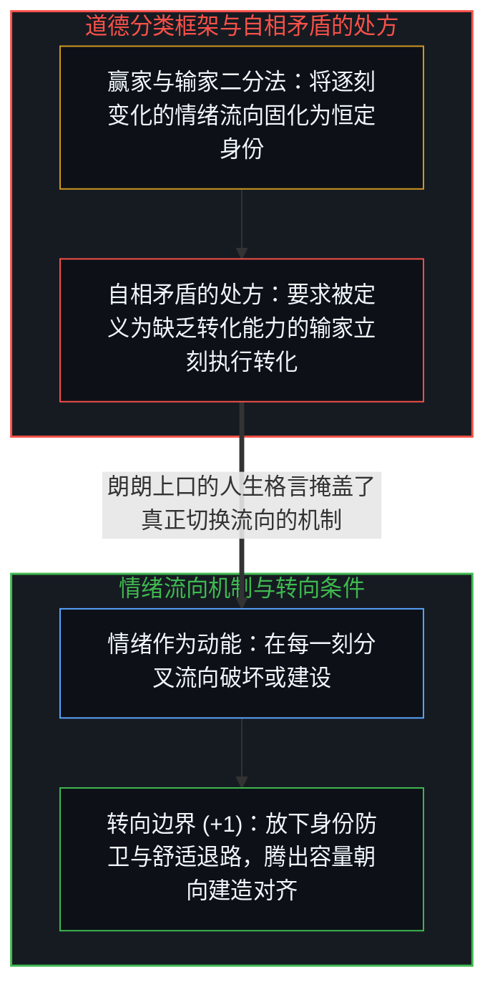
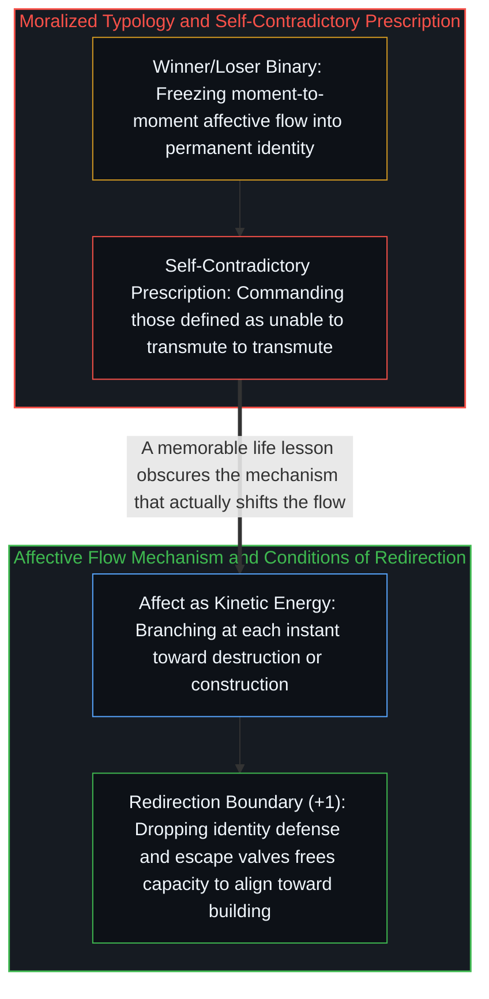

# 赢家与输家的转化框架 / Winners and Losers in the Transmutation Frame

*把情绪流向固化为赢家与输家的身份，以自我形象取代了转向机制。 / Freezing affective flow into winner and loser identities substitutes self-image for redirection.*

安德鲁·休伯曼曾引用过一种把人分成两类的说法：输家在遭遇痛苦事件时沉溺其中，将其引向自我毁灭或向外伤害；而赢家无论体验到何种痛苦情绪，都将其转化为建设性的行动。尽管这一观察指出了一个真实的方向差异——负面情绪既可以流向毁灭，也可以流向生产——但把这种差异包装为“赢家与输家”，却将逐刻发生的行动固化成了恒定的人格类别。

Andrew Huberman once cited a saying that divides humanity into two types: losers, who take painful events, wallow in them, and channel them into self-destruction or outward harm; and winners, who take whatever painful affect they feel and transmute it into constructive action. While the observation points at a genuine directional difference—negative affect can flow toward either destruction or production—packaging that difference as "winners and losers" freezes a moment-to-moment act into a permanent category of person.

## 一、 将方向固化为身份及宣称与否定的耦合 / 1. Freezing Direction into Identity and Claim-Negation Coupling

“赢家”与“输家”的划分伪装成中立定义，实则是披着观察外衣的道德训诫。在机制层面上，发生的是一次离散的导引行动：在这一刻，当负面情绪涌起时，这股能量究竟流向建设还是破坏？没有任何人永远是赢家或输家。在活生生的心智中，逐刻变化的是对齐方向，而容量也随之改变，既非固着不变的天生特质，也不是横跨不同心智的常数：执守自我防卫或沉溺反刍，会钳闭递归回折并压缩容量；而把注意力引向具体建造，则会腾出边界并扩展容量，正如[作为认知主动延伸的工具](../extended-cognition-refined/)对耦合的追溯，以及[个体抉择是唯一的因果杠杆](../individual-choices-as-the-only-causal-levers/)对每次离散行动皆自成杠杆的追溯所展现的那样。

Dividing people into "winners" and "losers" presents itself as neutral definition while operating as moral exhortation dressed as observation. At the level of mechanism, what occurs is a discrete act of channeling: in this specific moment, when negative affect arises, does that energy flow toward construction or toward tearing down? No one is permanently a winner or a loser. What varies from moment to moment is the direction of alignment in a living mind, and capacity shifts with that alignment rather than sitting fixed as either an innate trait or a constant across minds: clinging to self-defense or rumination clamps the recursive fold and compresses capacity, whereas steering attention toward concrete building clears boundary and expands capacity, just as [Tools as Active Extensions of Cognition](../extended-cognition-refined/) traces for coupling and [Individual Choices as the Only Causal Levers](../individual-choices-as-the-only-causal-levers/) traces for each discrete act as its own lever.

一旦把方向上的行动固化为“我是能够转化痛苦的赢家”这一身份宣称，宣称与否定的耦合便会立刻启动。维护自我形象需要消耗持续的注意力；每将一分注意力花在擦亮“逆境转化者”这一身份上，便是从实际的转化工作中分流出一分注意力。大声认领这一标签，优化的是徽章而非行动；真正把压力导向结构建造的人——就像[你的代码库即是记忆](../your-codebase-is-memory/)里那些将艰辛求得的解法直接刻入外化记忆的建造者——无须宣称这一头衔，因为他们的注意力正全神贯注于眼前的材料。

The moment a directional act is reified into the identity claim "I am a winner who transmutes pain," claim-negation coupling takes hold. Maintaining a self-image requires ongoing attention, and every unit of attention spent polishing the identity of "someone who transmutes adversity" is attention diverted from the actual work of transmutation. Loudly identifying with the label optimizes for the badge rather than the act; those actually redirecting pressure into structure—much like builders inscribing hard-won resolutions directly into externalized memory in [Your Codebase Is Memory](../your-codebase-is-memory/)—have no need to claim the title because their attention is absorbed by the material in front of them.

## 二、 预设结果与缺失的转向机制 / 2. Presupposing the Outcome and the Missing Mechanism of Redirection

当这套框定被包装成建议给出——“做个赢家，别做输家；去转化你的痛苦”——它便坍缩成自相矛盾。倘若一个人此刻正把苦恼导入瘫痪或破坏，先将他定义为“输家”，再指令他去转化，恰恰是在索要这一类别本身判定他所匮乏的能力。正如督促人“建立韧性”的口号早已预设了建立它所需的韧性（参见[成功学](../cheng-gong-xue/)），这条处方把自己的结论当成了起点条件。

When packaged as advice—"be a winner, not a loser; transmute your pain"—the framing collapses into self-contradiction. If someone is currently channeling distress into paralysis or destruction, defining them as a "loser" and then instructing them to transmute demands the very capability the category says they lack. Like exhortations to "build resilience" that presuppose the resilience required to build it (see [Theories After Success](../cheng-gong-xue/)), the prescription assumes its own conclusion as a starting condition.

更重要的是，这句格言制造出一种虚假的抵达感。把“会转化的人会赢”这一观察包装成朗朗上口的人生格言，遮蔽了唯一关键的因果之问：究竟是边界条件与注意力发生了哪些转变，才使一个此刻正陷入崩溃或破坏的人，得以把这股压力重新导向建设？当对舒适退路与身份维护的依赖脱落下来，注意力便不再耗散于自怜或看守徽章，建设性工作也作为一条活生生的路径敞开眼前——然而，边界条件只是重塑回报之场并腾出容量，并不会自动完成这次转向。剥去“赢家”与“输家”的道德化标签，留下的只是每一刻最赤裸的抉择：这股能量下一步流向何处。

Most importantly, the aphorism produces a false sense of arrival. Packaging the observation that "people who transmute win" as a memorable life lesson obscures the only causal question that matters: what shifts in boundary conditions and attention allow someone currently caught in collapse or tearing down to redirect that pressure toward construction? When reliance on comfortable escape valves and identity maintenance drops away, attention stops draining into self-pity or guarding a badge and constructive work stands open as a live path—yet boundary conditions only reshape the payoff field and free capacity rather than making the turn automatically. Stripping away the moralized labels of winner and loser leaves the raw, moment-to-moment choice of where the energy flows next.
