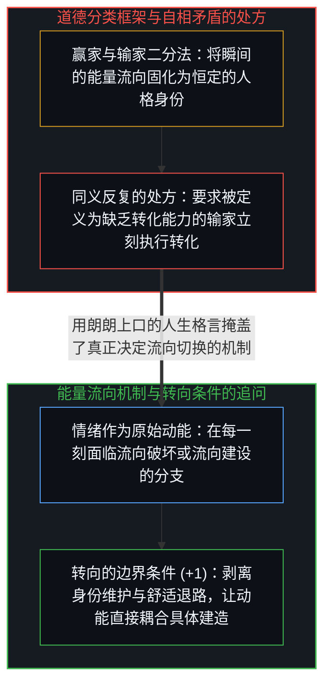
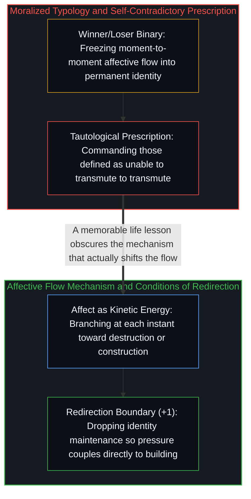

# 赢家与输家的转化框架 / Winners and Losers in the Transmutation Frame

*把情绪能量的瞬间流向固化为赢家与输家的身份标签，用维护形象取代了转向机制。 / Freezing affective flow into winner and loser identities substitutes self-image for redirection.*

安德鲁·休伯曼曾引用过一段话：“世上基本上只有两种人：赢家和输家。输家在遭遇变故时沉溺其中，并将其化作自我毁灭或向外破坏的力量；而赢家则接纳糟糕的感受，并将其转化为对自己和世界有益的事物。”这番话指出了一个真实的现象——负面情绪的能量既可以流向毁灭，也可以流向建设——但“赢家与输家”的包装却把一场随境流转的瞬间行动固化成了两种人格属性。

Andrew Huberman once cited a saying that divides humanity into two types: losers, who take painful events, wallow in them, and channel them into self-destruction or outward harm; and winners, who take whatever painful affect they feel and transmute it into constructive action. While the observation points at a genuine directional difference—negative affect can flow toward either destruction or production—packaging that difference as "winners and losers" freezes a moment-to-moment act into a permanent category of person.

## 一、 常数与变量的混淆及身份宣称的自我否定 / 1. Constant-Variable Confusion and Claim-Negation Coupling

“赢家”与“输家”的划分伪装成客观定义，实则是披着观察外衣的道德训诫。在现实的因果层面上，被描述的机制只是一次具体的“转化行动”：在这一刻，当负面情绪涌起时，这股能量究竟流向了生产还是破坏？没有任何人永远定格在“赢家”或“输家”的标本盒里。转化的潜能作为心智的基底能力是一个常数，真正随每一刻的选择而变化的是能量的对齐方向，正如[作为认知主动延伸的工具](../extended-cognition-refined/)与[个体抉择是唯一的因果杠杆](../individual-choices-as-the-only-causal-levers/)所剖析的那样。

Dividing people into "winners" and "losers" presents itself as neutral definition while operating as moral exhortation dressed as observation. At the level of mechanism, what occurs is a discrete act of channeling: in this specific moment, when negative affect arises, does that energy flow toward construction or toward tearing down? No one is permanently a winner or a loser. The capacity to channel energy is a constant across living minds; what varies from moment to moment is the direction of alignment, just as traced in [Tools as Active Extensions of Cognition](../extended-cognition-refined/) and [Individual Choices as the Only Causal Levers](../individual-choices-as-the-only-causal-levers/).

一旦把方向上的行动固化成“我是能够转化痛苦的赢家”这一身份标签，宣称与否定之间的耦合便会立刻启动。维护“赢家”的自我形象需要消耗真实的注意力，而每一分花在擦亮身份招牌上的注意力，都是从当下具体的转化行动中抽走的能量。大声标榜自己“善于把痛苦转化为力量”的人，优化的目标早已滑向了自我形象的展示；相反，真正在困境中动手重构局面的行动者无暇顾及头衔，正如那些将认知与经验直接锻造为外部工具与结构（如[你的代码库即是记忆](../your-codebase-is-memory/)所揭示的）的建造者只关心眼前的阻力如何化解。

The moment a directional act is reified into the identity claim "I am a winner who transmutes pain," claim-negation coupling takes hold. Maintaining a self-image requires ongoing attention, and every unit of attention spent polishing the identity of "someone who transmutes adversity" is attention diverted from the actual work of transmutation. Loudly identifying with the label optimizes for the badge rather than the act; those actually redirecting pressure into structure—much like builders inscribing hard-won resolutions directly into externalized memory in [Your Codebase Is Memory](../your-codebase-is-memory/)—have no need to claim the title because their attention is absorbed by the material in front of them.

## 二、 预设结果的处方与被掩盖的转向机制 / 2. Presupposing the Outcome and the Missing Mechanism of Redirection

当这套分类被当作建议给出——“做个赢家，别做输家，去转化你的痛苦”——它便陷入了隐蔽的自相矛盾。如果一个人当前正处于未能转化痛苦的状态（按定义属于“输家”），这条建议等于是在要求他去执行按定义他恰好做不到的事。正如“你要建立韧性”的口号预先假定了听者已经拥有足以支撑他建立韧性的那份韧性（参见[成功学](../cheng-gong-xue/)），这种处方把结果当成了前提。

When packaged as advice—"be a winner, not a loser; transmute your pain"—the framing collapses into self-contradiction. If someone is currently channeling distress into paralysis or destruction, defining them as a "loser" and then instructing them to transmute demands the very capability the category says they lack. Like exhortations to "build resilience" that presuppose the resilience required to build it (see [Theories After Success](../cheng-gong-xue/)), the prescription assumes its own conclusion as a starting condition.

更要紧的是，这句听起来充满人生智慧的格言给出了一种虚假的“抵达感”。把“转化痛苦的人会赢”包装成令人点头称是的金句，恰恰遮蔽了唯一值得追问的因果机制：究竟是什么具体的边界条件变化，促使一个原本在消耗自己的人把同一股情绪动能转向了建设？当舒适的退路与借口被现实剥离、当注意力不再耗散于身份自怜时，动能才会沿着唯一敞开的建设通道倾泻而出。剥去“赢家”与“输家”的道德贴纸，剩下的只有每一刻不假外求的流向抉择。

Most importantly, the aphorism produces a false sense of arrival. Packaging the observation that "people who transmute win" as a memorable life lesson obscures the only causal question that matters: what specific shift in boundary conditions redirects affective energy from destruction to construction in someone who has not been doing it? Redirection occurs when comfortable escape valves and identity maintenance drop away, leaving constructive action as the open channel for the pressure. Stripping away the moralized labels of winner and loser leaves the raw, moment-to-moment choice of where the energy flows next.
