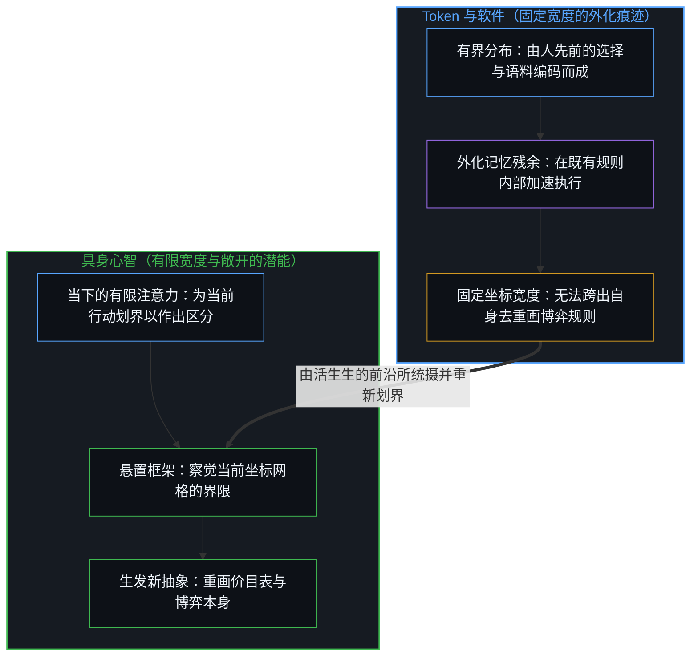
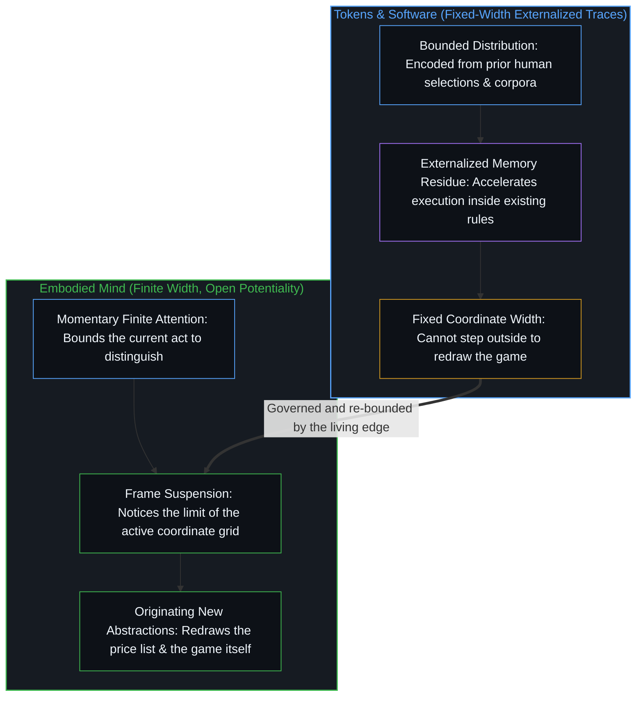

# 人、Token 与估值的范围 / Humans, Tokens, and the Scope of Valuation

*投入之间的比价，无法衡量重画价目表本身的能力。 / A price between inputs is not a measure of the capacity that can redraw the price list.*

“人有史以来第一次比软件更便宜”的说法，记录了在当前管理与规模化条件下，两项运作投入之间相对成本的真实转移。这一判断唯有在规则与成功标准已经固定的生产博弈内部才成立。人以有限宽度的抽象运作，却依然能够生发出新的抽象；Token 则是人所选定的固定宽度抽象，用来延展已经划定边界的事物。将“人”与“Token”按集体抽象进行比价的估值方式，抹去了个体差异，也抹去了超出任何特定角色的能力。成本核算依然可用；失误在于把核算当成了关于价值的形而上学。

The claim that humans are cheaper than software for the first time registers a real shift in relative cost between two inputs under present management and scaling. That claim holds only inside a production game whose rules and success criteria are already fixed. Humans operate as finite-width abstractions that can still originate new ones; tokens are human-selected fixed-width abstractions that extend what has already been bounded. Collective valuation that prices "humans" against "tokens" erases both individual difference and the capacity that exceeds any role. Cost accounting remains usable; the error is letting the accounting become a metaphysics of worth.

## 一、 比较是局部的 / 1. The Comparison Is Local

[“历史上第一次，人比软件更便宜”](https://x.com/gsivulka/status/2077070925154161101)这一广为流传的观察，是以叙事冲击的面目出现的。它记录了在当前的管理、提示词编写与规模化条件下，人类协作与 Token 生成这两项运作投入之间相对成本的转移。在产生这一比较的框架内部，这一说法在运作层面上言之成理：含糊的指令会让 Token 消耗在自指循环中成倍膨胀，而人的摩擦尽管缓慢，却能将误差传播控制在局部。

The viral observation that ["for the first time in history, humans are cheaper than software"](https://x.com/gsivulka/status/2077070925154161101) is offered as a narrative shock. It registers a shift in relative cost between two operational inputs—human coordination and token generation—under present conditions of management, prompting, and scaling. Within the frame that produces this comparison, the claim can be defended on operational grounds: poorly specified instructions cause token spend to multiply through self-referential loops, while human friction, however slow, tends to contain error propagation locally.

然而，这一比较预先假定了双方已经被转化为可通约的量。它把人与 Token 当作既有生产博弈内部的同类量项，而这场博弈的规则、产出与成功标准都被视为既定前提。该框架排除在外的，正是双方与这场博弈本身建立关系时的结构性差异。

The comparison, however, presupposes that both sides have already been rendered commensurable. It treats humans and tokens as quantities inside an existing production game whose rules, outputs, and success criteria are taken as given. What remains outside the frame is the structural difference in how each side relates to the game itself.

## 二、 有限宽度与敞开的潜能 / 2. Finite Width, Open Potentiality

人在任意特定时刻，都通过有限宽度的注意力与区分来运作。语言、感知与行动经由特定的抽象得以展开，而将大部分实在留在了未选中的状态。这种有限性并非有待克服的缺陷，而是具身活动的日常条件——唯有划定边界，落于特定中心的离散活动才能作出区分。

A human being operates through a finite width of attention and distinction at any given moment. Language, perception, and action are channeled through particular abstractions that leave most of reality unselected. This finitude is not a defect to be overcome; it is the ordinary condition of embodied activity—discreteness at a locus that must bound in order to distinguish at all.

然而，同一个人在下一刻就能察觉当前有效框架的界限，将其悬置，或生成一项并未潜藏在既有选择中的新区分。这并非神秘过剩意义上的无穷，而是可观察到的生发新抽象的能力——不止于重组或延展既有抽象。有限宽度指明了当前行动的边界，而潜能则指明了能够重画这道边界的活生生的前沿：人通过带有敞开潜能的有限宽度抽象来运作。

Yet the same human can, in the next moment, notice the limits of the active frame, suspend it, or generate a distinction that was not already latent in prior selections. That is not infinity as mystical surplus; it is the observable power to originate new abstractions rather than merely recombine or extend existing ones. Finite width names the bound of the current act, while potentiality names the living edge that can redraw the bound: humans operate through finite-width abstractions with open potentiality.

## 三、 作为固定宽度抽选的 Token / 3. Tokens as Fixed-Width Selections

Token 并不具备这样的能力。它们是从人类已经生产、编码并划定边界的分布中抽选出的结果——技术作为外化的痕迹运作，在已经铺设好的残余内部延伸触角。即便模型给出了令使用者感到新颖的组合，这种新颖性依然停留在既定训练语料、架构与提示词所界定的可选空间内部。正如[你的代码库即是记忆](../your-codebase-is-memory/)所展示的，外化的代码库或 Token 流是能够规模化保存既往切分结果的持久人工记忆，但它无法站到自身坐标空间之外去重画边界，也无法决定什么应当算作一次选择。

Tokens possess no such power. They are selections drawn from distributions that humans have already produced, encoded, and bounded—technology operating as externalized trace, extending reach within residue already laid down. Even when a model yields combinations that feel novel to a user, that novelty remains internal to the space of what was selectable given the training corpus, the architecture, and the prompt. As [Your Codebase Is Memory](../your-codebase-is-memory/) demonstrates, an externalized codebase or token stream is durable artificial memory that preserves prior cuts at scale, yet it cannot stand outside its own coordinate space to redraw its boundaries or decide what should count as a choice.

它的宽度是由人先前的选择所固定的；Token 是人所选定的固定宽度抽象。一段 Token 流究竟算作生产还是消费，取决于心智所持守的边界，正如[生产、消费与心智的区分](../production-consumption-and-the-minds-distinction/)所揭示的那样。

Its width is fixed by prior human selections; tokens are human-selected fixed-width abstractions. Whether a token stream counts as production or consumption depends on the boundary the Mind holds, as [Production, Consumption, and the Mind's Distinction](../production-consumption-and-the-minds-distinction/) shows.

## 四、 集体抽象抹去了关键差异 / 4. Collective Abstraction Erases the Relevant Difference

当估值在集体抽象的层面上推进——把“人”当成汇总的劳动力投入，把“Token”当成汇总的推理成本——它就抹去了对于任何价值判断而言最为关键的个体差异。一个人在狭窄界定的角色内部的产出，可以与 Token 消耗进行比价。但这种比价触及不到另一重能力：同一个人在转换注意力或语境之后，随时可以退出该角色，或重新界定评判该角色的标准。

When valuation proceeds at the level of collective abstractions—"humans" as an aggregate labor input and "tokens" as aggregate inference cost—it erases the individual differences that matter most for any claim about worth. One person's output inside a narrowly defined role can be priced against token spend. That pricing exercise does not reach the capacity of that same person, under different attention or in another context, to withdraw from the role or redefine the criteria by which the role itself is judged.

这种估值对潜能保持沉默，因为潜能正是超出对一个人的任何既定抽象的那部分。抹去个体差异而对“人”与“Token”作出的权宜排位，只展示出所选抽象层级能够看见的东西——以及它已经丢弃的东西。

The valuation remains silent on potentiality because potentiality is what exceeds any given abstraction of a person. A momentary ranking of "humans" against "tokens," with individual differences ignored, only shows what the chosen level of abstraction can see—and what it has already discarded.

## 五、 划定范围而非全盘拒斥 / 5. Scope, Not Rejection

因此，这一经济学观察在其局部条件内并非谬误；它专属于将人与 Token 一并抽象为服务于固定目的的可替代单元。只要不实施上述还原，就无法将它拔高为关于人之价值的本体论断言。把这种还原当成整体，就是在当前博弈内部进行优化，同时却忽略了使新博弈成为可能的条件：人有能力将任何既有抽象——包括那本宣称人更便宜的账本——视为可选项。拿 Token 与人比价，错失了[Token 效率、模拟与无法弥合的间隙](../token-efficiency-emulation-and-the-unclosable-gap/)所揭示的任何模型都无法生发的切身利害。

The economic observation is therefore not false within its local terms; it is specific to abstracting both humans and tokens into substitutable units for fixed ends. It cannot be promoted into an ontological statement about what humans are worth without performing the reduction traced above. To mistake the reduction for the whole is to optimize inside the current game while losing sight of the condition that makes new games possible: the human capacity to treat any existing abstraction—including the ledger that declares humans cheaper—as optional. Pricing tokens against people misses the stake [Token Efficiency, Emulation, and the Unclosable Gap](../token-efficiency-emulation-and-the-unclosable-gap/) shows no model can originate.

在这一问题上保持澄明，并不要求拒斥成本核算或管理技术。它要求将每一层抽象的适用范围保持在视野之内，以免一项运作比率悄然演变为形而上学。Token 延展并加速已经被抽象出来的事物；而鲜活的心智生发出供 Token 随后去延展的那些抽象。

Clarity on this point does not require rejecting cost accounting or management technique. It requires keeping the scope of each abstraction in view so that an operational ratio does not quietly become a metaphysics. Tokens extend and accelerate what has already been abstracted; living minds originate the abstractions that tokens then extend.
