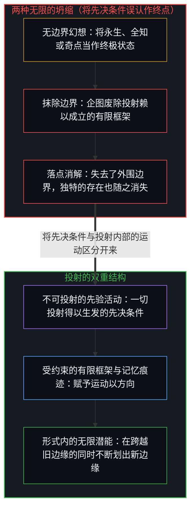
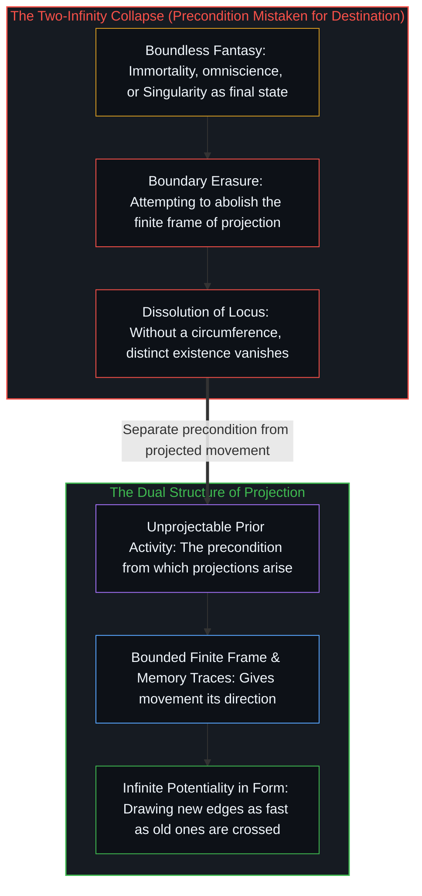

# 永生与两种无限的混淆 / Immortality and the Two-Infinity Confusion

*混淆不可投射的先验与形式内的无限潜能，是错把投射的前提当成了终点。 / Confusing the unprojectable prior with infinite potentiality in form mistakes projection's precondition for a goal.*

永生常被描绘成终极奖赏——逃离死亡、绵延不绝，以及毫无边界的存在。然而，这种描绘把运作于不同层面、结构截然有别的两种“无限”混为一谈。

Immortality is routinely framed as the ultimate prize—escape from death, endless duration, and existence without a boundary. Yet that framing collapses two structurally distinct meanings of "infinite" that operate at different levels.

## 一、 无限潜能与不可投射的先验 / 1. Infinite Potentiality and the Unprojectable Prior

无限潜能是在第一人称边缘所栖居的开放视界：边界持续延展，每迈出一步，可能性便随之倍增。当前激活的画布在任何一个单一时刻都是有限的，但它的边缘会随着注意力划出新的区分而不断推移。这是第一种无限——形式在开放进程中的不断展开，意义之所以能够在其中运作，正是因为框架赋予了运动以方向。

Infinite potentiality is the open horizon inhabited at the first-person edge: the ongoing extension of boundaries where possibility multiplies with every step. The active canvas is finite at any single moment, yet its edge moves as attention draws new distinctions. This is the first infinity—the open-ended elaboration of form where meaning operates because the frame gives the movement direction.

而人们在指向所谓“终极无限”时所触及的，并不是同一根轴线上更大的数值，而是先在的自我区分活动本身——即先于任何特定坐标系、不可投射的先决条件。任何一个试图将这一先验捕捉为完备客体的形式化框架，都已经将它缩减为了一个有限的投射。前者是使投射成为可能的活动；后者则是在投射内部展开的开放潜能。它们并不是同一条道路上的两个站点。

What people gesturing at "absolute infinity" point toward is not a larger quantity on that same axis, but the prior self-distinguishing activity itself—the unprojectable precondition prior to any specific coordinate frame. Every formal framework that tries to capture that prior as a completed object has already reduced it to a finite projection. One is the activity that makes projection possible; the other is the open potentiality unfolding within projection. They are not two stops along the same road.

## 二、 永生的结构性困境 / 2. The Structural Issue with Immortality

有区分的存在——拥有边界、是此而非彼，并跨越时间而延展——是源自区分活动的一个有限投射。有限性并不是存在的一种瑕疵；它是成为一个独特实体的结构性前提。

Differentiated existence—having boundaries, being this rather than that, and extending across time—is a finite projection from the distinguishing activity. Finitude is not a flaw in existence; it is the structural condition of being a distinct entity at all.

有限的投射无法把未投射的先验当作静态状态来栖居，因为“栖居”本身就以投射所划出的边界条件为前提。为了追求无边无际而消解每一道边界，并不意味着抵达某种更优越的状态；它意味着消解掉那个能够抵达任何地方的独特落点。当永生被想象为废除一切限制、而非跨越限制的开放延展时，它便设定了一个结构性矛盾：既想不再作为受边界约束的投射，又指望依然保留为一个具体的“某人”。

The unprojected prior cannot be inhabited as a static state by a finite projection, because inhabiting requires the exact boundary conditions that projection creates. To dissolve every boundary in pursuit of boundlessness would not mean arriving at a superior state; it would mean dissolving the distinct locus capable of arriving anywhere. When immortality is imagined as the abolition of all limits rather than open extension across limits, it posits a structural contradiction: ceasing to be a bounded projection while hoping to remain a someone.

## 三、 随处可见的同一种混淆 / 3. The Same Confusion Appears Everywhere

一旦命名了这一坍缩，它在技术与文化领域反复出现的变体便清晰可辨。在超级智能的讨论中，投射内部的智能本是开放潜能——可无限延展，总是不断揭示出新的问题与新的边缘——然而神话叙事却想象某个 AI 抵达完备的全知状态，仿佛一个被投射出来的器物能够吞没它自身的先决条件。正如[你的代码库即是记忆](../your-codebase-is-memory/)所追踪的，哪怕是再庞大的外化代码库或权重矩阵，也只是由过往切分构成的有限记忆结构，必须依赖受边界约束的鲜活边缘以自我区分的活动去驾驭并重新渲染，而不可能成为将现实封闭在内的完备总体。

Once this collapse is named, its recurring variants across technology and culture become legible. In superintelligence discourse, intelligence within projection is open potentiality—endlessly extensible, always uncovering another problem and another edge—yet the mythic narrative imagines an AI reaching completed omniscience, as if a projected artifact could swallow its own precondition. Even the largest externalized repository or weight matrix is, as [Your Codebase Is Memory](../your-codebase-is-memory/) traces, a finite memory structure of past cuts that depends on the self-distinguishing activity of a bounded living edge to steer and re-render it, never a completed totality closing over reality.

在奇点神话中，技术变革被投射为不断加速，直到变革逃逸出投射本身——这就好比画框企图变成悬挂它的那面墙。在乌托邦式的丰裕叙事中，延展物质富足作为开放潜能是可行的，而想象废除一切有限约束，则会抹去位置、时间与注意力这些使价值评估得以被理解的边界条件。而在日常用语中，诸如“百分百”、“终极”与“无条件”之类的词汇，都在借用未投射先验的分量，并将其粘贴到局部受条件制约的现象之上。

In singularity mythology, technological change is projected as accelerating until transformation escapes projection altogether—as if the picture frame could become the wall it hangs on. In utopian abundance narratives, extending material plenty works as open potentiality, whereas imagining the total abolition of all finite constraints removes the boundary conditions of position, time, and attention that make valuation intelligible. And in everyday speech, words like "100 percent," "final," and "unconditional" borrow the weight of the unprojected prior and paste it onto local, conditioned phenomena.

## 四、 这一模式 / 4. The Pattern

底层的模式，是错把运动的先决条件当成了道路尽头的目的地。先在的活动并不是轨迹尽头的某个终点；它是每一步借以投射的源头。企图通过积累足够多的投射时长或算力来抵达那个先验，就像一幅画企图通过增添更多线条来爬出画纸。只要按照[非万物之理](../not-a-theory-of-everything/)所确立的框架来把握因果关系——果有别于因，且果随因后——这两个层面就会保持清晰分野。

The underlying pattern is mistaking the precondition of movement for a destination at the end of the road. The prior activity is not a destination at the end of a trajectory; it is what every step projects from. Trying to reach the prior by accumulating enough projected duration or compute is like a drawing trying to climb off the paper by adding more lines. The two levels stay distinct once causality is held as [Not a Theory of Everything](../not-a-theory-of-everything/) frames it: effect distinct from cause, and effect following cause.

无限潜能正在此时此地运作：延展在形式内部持续推进，跨越旧边缘的速度有多快，生成新边缘的速度就有多快。这种有界性并不是某种有待通过工程手段抹除的缺陷；它正是存在在践行存在本身。

Infinite potentiality operates here and now: extension continues within form, generating new edges as fast as it crosses old ones. That boundedness is not a defect to engineer away; it is existence doing what existence does.
