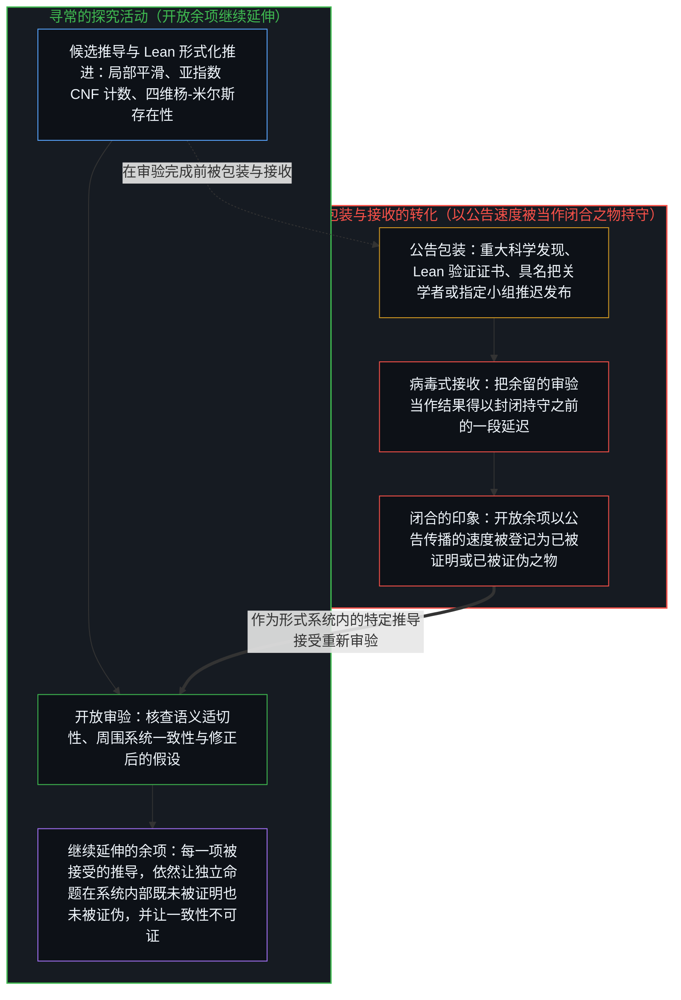
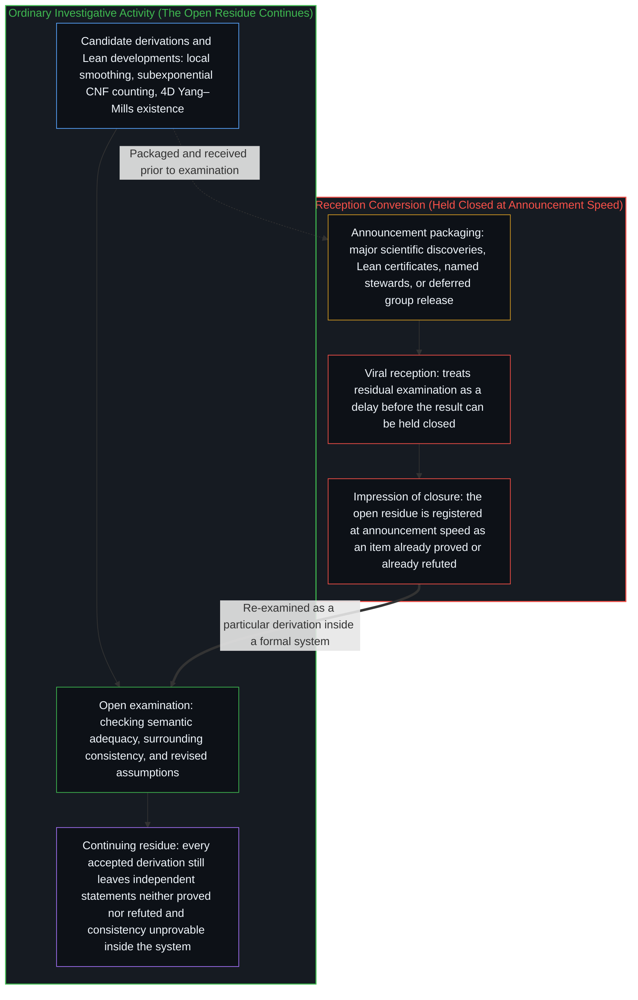
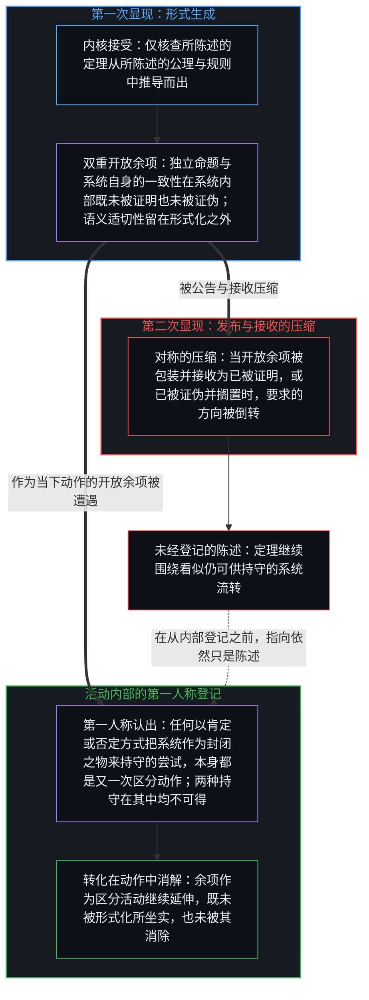
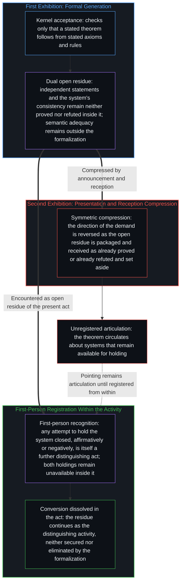

# 两度显现的不完备性 / Incompleteness Exhibited Twice

*绝对的不完备性在发布与接收中被压缩成看似已被持守之物 / Absolute incompleteness is compressed, in presentation and reception, into an item that appears already held*

[OpenAI 2026 年 10 月 26 日的公告](https://openai.com/index/building-scientific-understanding-with-academic-communities/)展示了由内部模型生成的三项候选结果：[任意维数下欧几里得波动方程局部平滑猜想的证明](https://github.com/openai/math/blob/main/preprints/Local-smoothing-for-the-Euclidean-wave-equation-October-25-2026/)（由此解决挂谷猜想与斯坦因限制猜想）、否定指数时间假说的确定性亚指数算法，以及四维纯杨-米尔斯理论与若干相互作用量子场论的构造性存在证明。每一项结果都在不同程度上附有[Lean 形式化文件](https://github.com/openai/math)与指定的外部审验流程。这些结果仍在接受独立审视；下文的剖析并不以它们最终成立与否为前提。这一事件所显现的，是一再发生的转化：绝对的不完备性在其中变成看似已可供持守之物。

The [OpenAI announcements of 26 October 2026](https://openai.com/index/building-scientific-understanding-with-academic-communities/) presented three candidate results generated by an internal model: a [proof of the local smoothing conjecture for the Euclidean wave equation in every dimension](https://github.com/openai/math/blob/main/preprints/Local-smoothing-for-the-Euclidean-wave-equation-October-25-2026/) (thereby resolving the Kakeya and Stein restriction conjectures), a deterministic subexponential algorithm that refutes the Exponential Time Hypothesis, and a constructive existence proof for pure Yang–Mills theory and certain interacting quantum field theories in four dimensions. Each was accompanied, in varying degrees, by [Lean formalizations](https://github.com/openai/math) and by designated processes of external examination. The results remain under independent scrutiny; their eventual correctness is not required for the analysis that follows. What the episode makes visible is a recurring conversion of absolute incompleteness into an item that appears already available for holding.

## 一、 绝对的不完备性与不确定性的确定 / 1. Absolute Incompleteness and the Certainty of Uncertainty

哥德尔不完备定理确立了：任何一致的、可有效公理化的、强到足以表达基本算术的形式系统，都会在自身内部留下不可推导的真命题，并且无法证明自身的一致性。这一界限并非相对于某套特定公理化体系而言，因而也不会被某个更大的系统补齐。任何此类扩充系统，只要能够表达先前系统，都会遇上属于它自身的不可推导性：它可以证明先前系统无法证明的命题，同时在自身内部留下新的不可证命题，正如[没有系统能被保持封闭](../no-system-can-be-kept-closed/)从一位寄存器一路追溯至算术所展示的那样。不完备性因而在层层扩充中是绝对的：形式系统的非绝对性，就坐落在不完备性自身之中。同样的关系也显现在不确定性的确定之中。人可以确定某项主张仍是不确定的，然而对那份确定的确定，却无法在同一个动作之内得到坐实。不确定性的确定是可得的；确定的确定则不可得。不可推导性并非等待闭合的暂时缺口；它是任何形式化得以发生的条件，即[开放即一致](../openness-is-consistency/)的形式面相。

Gödel’s incompleteness theorems establish that any consistent, effectively axiomatized formal system strong enough to express basic arithmetic leaves true statements underivable inside it and cannot prove its own consistency. This limit is not relative to a particular axiomatization that a larger system might complete. Any such extension capable of expressing the prior system meets an underivability of its own: it may prove what the prior system could not, and leaves new statements unprovable inside itself, as [No System Can Be Kept Closed](../no-system-can-be-kept-closed/) traces from the one-bit register up to arithmetic. Incompleteness is therefore absolute across extensions: the non-absoluteness of formal systems is located in incompleteness itself. The same relation appears in the certainty of uncertainty. One can be certain that a given claim remains uncertain, yet the certainty of that certainty cannot be secured inside the same act. Certainty of uncertainty is available; certainty of certainty is not. The underivability is not a temporary gap awaiting closure; it is the condition under which any formalization occurs, the formal face of [Openness Is Consistency](../openness-is-consistency/).

不完备定理所确立的，不止是存在为真却不可证的命题。在一个强到足以表达算术的一致形式系统内部，若干命题是不可判定的：无论该命题本身还是其否定，都不可推导。哥德尔语句 G 在标准解释下为真，却不可推导（假定系统一致）；假定 ω-一致性，¬G 同样不可推导，而该语句的罗瑟变体仅凭普通一致性便是独立的。该语句因而是独立的。任何命题，只要其真与伪都超出系统内部所能调动的资源，便会承袭这一双重界限。一致性同时阻断了肯定方向的推导与否定方向的推导。

The incompleteness theorems establish more than the existence of true but unprovable statements. Inside a consistent formal system strong enough for arithmetic, certain statements are undecidable: neither the statement nor its negation is derivable. Gödel’s sentence G is true in the standard interpretation yet underivable (assuming consistency); assuming ω-consistency, ¬G is underivable as well, and Rosser’s variant of the sentence is independent under plain consistency alone. The sentence is therefore independent. Any statement whose truth and falsehood both extend beyond the resources the system can internally mobilize inherits the same dual limit. Consistency blocks both the affirmative derivation and the negative one.

与层层扩充中无尽的递退一道，这一双重性质使不完备性成为绝对的。非绝对性不仅坐落在无法证明若干真命题之上，而且同时坐落在无法证伪相应的独立命题之上。系统既无法通过将该命题坐实为真来完备自身，也无法通过将该命题确立为假来完备自身。这两种举措都会要求它去执行一致性所禁止之事。因此，开放余项在任何一个方向上都无法作为封闭之物被持守。试图将该命题肯定为已然持守，处于系统所及的范围之外；试图将其当作已被证伪而摒弃，同样处于这一范围之外。

Together with the regress across extensions, this dual character is what renders incompleteness absolute. Non-absoluteness is located not merely in the failure to prove certain truths, but in the simultaneous failure to refute the corresponding independent statements. The system cannot complete itself by securing the statement as true, and it cannot complete itself by establishing the statement as false. Both moves would require it to do what consistency forbids. The open residue therefore cannot be held closed in either direction. An attempt to affirm the statement as held remains outside the system’s reach; an attempt to dismiss it as refuted is equally outside that reach.

这三项结果倘若经受住审验，便解决了若干悬而未决的具体问题。统一的局部平滑定理将了结限制理论的高维情形；针对固定宽度合取范式（CNF）的亚指数计数算法将否定指数时间假说（ETH），同时让 P 与 NP 问题原封未动；四维杨-米尔斯的存在证明将回应千禧年大奖难题的一个组成部分，而未解决质量间隙。在每一种情形中，问题的解决依然只是某个形式系统内部的一项特定推导。接受该推导的系统依然会留下进一步不可推导的命题，也依然无法证明自身的一致性。开放余项继续延伸，正如[为何数学永远解不完](../why-mathematics-can-never-be-solved/)在整个学科中所追溯的那样。这些结果的内容之中，没有任何东西会改变这一绝对界限。

The three results, if they survive examination, settle specific questions that had remained open. A uniform local-smoothing theorem would close higher-dimensional cases of restriction theory; a subexponential counting algorithm for fixed-width CNF would refute ETH while leaving P versus NP untouched; an existence proof for four-dimensional Yang–Mills would address one component of a Millennium problem without settling the mass gap. In each case the settlement remains a particular derivation inside some formal system. The system that accepts the derivation still leaves further statements underivable and cannot prove its own consistency. The open residue continues, as [Why Mathematics Can Never Be Solved](../why-mathematics-can-never-be-solved/) traces across the discipline. Nothing in the content of the results alters this absolute limit.

## 二、 把开放余项转化为可持守之物 / 2. Converting the Open Residue into Something to Hold

传播中可以辨认出的实际效应，是把那份余项转化为看似可持守之物。公告将这些产出包装为[“重大科学发现”](https://x.com/gdb/status/2114837059462627533)，并附上[Lean 验证证书](https://github.com/openai/math/blob/main/lean/ComparatorChallenges/LocalSmoothing.lean)与具名把关学者。病毒式传播的接收过程在很大程度上把余留的审验当作结果得以封闭持守之前的一段延迟，而非当作不完备性本就要求的区分活动的延续。[建立在 ETH 之上的条件性复杂度困难结果被登记为骤然可以改写](https://thenextweb.com/news/openai-exponential-time-hypothesis-false-kakeya-yang-mills)；[限制理论被登记为已补齐高维情形](https://cryptobriefing.com/openai-proves-local-smoothing-conjecture/)；若干场论的构造性地位被登记为已从开放变为确立。这一转化在否定方向上与在肯定方向上同样顺畅：一项假说被登记为已被证伪，与一项猜想被登记为已被证明一样迅速。注意力的收窄，在审验尚未结束之前便已由发布的形式造成；同样造成这一收窄的，是对谁能交付那件闭合之物的定位——无论这份持守是分散在公开构件之中，还是局限于某个推迟发布的指定小组之内。

The practical effect identified in the circulation is the conversion of that residue into an item that appears holdable. The announcements package the outputs as [“major scientific discoveries”](https://x.com/gdb/status/2114837059462627533) accompanied by [Lean certificates](https://github.com/openai/math/blob/main/lean/ComparatorChallenges/LocalSmoothing.lean) and named stewards. The viral reception largely treats the residual examination as a delay before the result can be held closed, rather than as the continuation of distinguishing activity that incompleteness already requires. [Conditional hardness results that rested on ETH are registered as suddenly available for revision](https://thenextweb.com/news/openai-exponential-time-hypothesis-false-kakeya-yang-mills); [restriction theory is registered as having a completed higher-dimensional case](https://cryptobriefing.com/openai-proves-local-smoothing-conjecture/); the constructive status of certain field theories is registered as having moved from open to established. The conversion runs in the negative direction as readily as the affirmative: a hypothesis is registered as already refuted as quickly as a conjecture is registered as already proved. The narrowing of attention is produced by the form of the presentation before the examination has concluded. It is produced, equally, by the positioning of who is able to deliver the closed item—whether the holding is distributed across public artifacts or localized to a designated group that has deferred release.

这一转化不同于发现过程本身。生成候选形式化表述、推进 Lean 代码库开发以及[随后的开放审验](https://x.com/rrwilliams/status/2114833319431209352)，依然是寻常的探究活动。它们扩展了现有的工作成果，并迫使人们重新审验先前的假设。这一转化并不坐落在这些步骤之中；它坐落在以公告传播速度流转的即时登记之中——即登记为：这一活动已经产出了某件可供持守之物。闭合的印象并不取决于任何特定形式化最终是否正确；它是由包装与接收制造出来的。

This conversion is distinct from the discovery process itself. The generation of candidate formalizations, the production of Lean developments, and the [subsequent open examination](https://x.com/rrwilliams/status/2114833319431209352) remain ordinary investigative activity. They extend the working body of results and force re-examination of prior assumptions. The conversion is not located in those steps. It is located in the immediate registration, circulating at the speed of the announcement, that the activity has produced something that can be held. The impression of closure does not depend on the eventual correctness of any particular formalization; it is produced by the packaging and the reception.

## 三、 形式系统产出它自身无法持守的命题 / 3. The Formal System Produces What It Cannot Itself Hold

反讽就内在于同一场传播之中。机器作为形式系统运作。其内核的接受所确立的，仅仅是所陈述的定理从所陈述的公理与规则中推导而出。这一接受把周围系统的一致性以及每一个进一步的真命题留在形式化内部不可推导之处，并把形式命题与目标数学主张之间的语义对应留在形式化之外。因此，验证作为在形式系统之外执行的开放区分活动继续进行——即由人类的审验去登记形式陈述是否匹配数学主张（如[ETH 形式化范围说明](https://github.com/openai/math/blob/main/lean/docs/378.md)或先前的[自然语言证明与 Lean 形式化推进之间的错位](https://arxiv.org/abs/2610.08144)所示），以及该结果是否在无矛盾的前提下修正了先前的假设。形式系统产出的命题，无法由它自身在数学持守所要求的意义上确立为真。当这种产出被呈现为机器已经持守了结果，当余留的人类审验被登记为迈向超越之前的临时步骤，绝对的不完备性便被压缩成了它的反面，上演了[验证的倒置](../the-reversal-of-verification/)。形式系统无法容纳的那份开放余项，被登记成了由形式系统自身所交付之物。

The irony is internal to the same circulation. The machine operates as a formal system. Its kernel acceptance establishes only that a stated theorem follows from the stated axioms and rules. That acceptance leaves the consistency of the surrounding system and every further true statement underivable inside the formalization, and the semantic correspondence to the intended claim outside it. Verification therefore continues as open distinguishing activity performed outside the formal system—human examination that registers whether the formal statement matches the mathematical claim, as in the [ETH formalization scope note](https://github.com/openai/math/blob/main/lean/docs/378.md) or prior [mismatches between natural-language proofs and Lean developments](https://arxiv.org/abs/2610.08144), and whether the result revises prior assumptions without contradiction. The formal system produces statements it cannot itself secure as true in the sense required for mathematical holding. When that production is presented as the machine having already held the result, and when the residual human examination is registered as a temporary step before transcendence, the absolute incompleteness is compressed into its opposite, enacting [The Reversal of Verification](../the-reversal-of-verification/). The open residue that the formal system cannot contain is registered as having been delivered by the formal system itself.

在前文所考察的形式化之中，同样的双重界限依然适用：内核的接受不会触及任何其真伪超出形式化自身资源的进一步命题。此类命题在系统内部依然既未被证明，也未被证伪。外部审验可以登记形式陈述与目标主张之间的对应，或登记其与先前结果的一致性，然而这一审验发生在一个承袭着同样不完备性的更大活动之内。形式系统依然无法通过证明那份余项将其作为封闭之物来持守，也依然无法通过证伪那份余项将其作为封闭之物来持守。

In the formalizations considered earlier, the same dual limit applies: acceptance by a kernel leaves untouched any further statement whose truth or falsehood reaches beyond the formalization’s own resources. Such a statement remains neither proved nor refuted inside the system. External examination can register correspondence to an intended claim or consistency with prior results, yet the examination occurs within a larger activity that inherits the same incompleteness. The formal system still cannot hold the residue closed by proving it, and it still cannot hold the residue closed by refuting it.

## 四、 陈述定理与第一人称的登记 / 4. Articulating the Theorem and Registering It in the First Person

陈述不完备定理与从第一人称感知中登记不完备定理之间的差异，遵循着同一个条件。这些定理可以作为关于形式系统的命题被陈述、被核验、被传递。无论陈述者是否从区分活动的内部登记到这道界限，那份陈述都依然可得，正如[进位无法在寄存器之内被命名](../the-carry-that-cannot-be-named-inside-the-register/)在元系统内将不完备性形式化与在自身上限处体会其意涵之间所追溯的那样。第一人称的登记，就是认出：任何把系统作为封闭之物来持守的尝试，本身都是又一次区分动作，一个无法容纳自身延续的动作。不可推导性不再作为外部形式客体的属性被遭遇，而是作为当下动作的开放余项被遭遇。由于这份余项是活动的延续，而非添加进活动之中的某项内容，第一人称的登记便无法靠追加陈述来产生。外部陈述可以指向这份余项，但只要活动尚未从内部登记到自身的界限，那份指向就依然只是一句陈述——这正是[论封闭系统、开放心智与证明的界限](../on-closed-systems-open-minds-and-the-limits-of-proof/)所追溯的边界。在登记发生之处，持守着某个闭合结果的印象在动作之中便已消解；在登记未发生之处，那份陈述便继续作为一条关于“系统仍可供持守”的定理流转。

The difference between articulating the incompleteness theorems and registering them from first-person perception follows the same condition. The theorems can be stated, checked, and transmitted as propositions about formal systems. That articulation remains available whether or not the one stating it registers the limit from inside the distinguishing activity, as [The Carry That Cannot Be Named Inside the Register](../the-carry-that-cannot-be-named-inside-the-register/) traces between formalizing incompleteness in a meta-system and feeling its meaning at one’s own ceiling. First-person registration is the recognition that any attempt to hold the system closed is itself a further distinguishing act, one that cannot contain its own continuation. The underivability is encountered not as a property of an external formal object but as the open residue of the present act. Because the residue is the continuation of the activity rather than a content added to it, the registration cannot be produced by additional articulation. An external statement can point toward the residue, but the pointing remains an articulation until the activity registers its own limit from within, the boundary traced in [On Closed Systems, Open Minds, and the Limits of Proof](../on-closed-systems-open-minds-and-the-limits-of-proof/). Where the registration occurs, the impression of holding a closed result is already dissolved in the act; where it does not, the articulation continues to circulate as a theorem about systems that remain available for holding.

因此，这一事件两度显现了不完备性。形式系统所生成的命题，其周围一致性在系统内部不可推导，其语义适切性则留在系统之外，从而要求系统自身无法执行的开放审验。而这些命题的发布与接收，则把那份开放余项压缩成看似已被持守之物，倒转了这一要求的方向。无论是哪一次显现，都没有违背绝对的不完备性。它正是生成与压缩二者得以发生的条件。实际的观察关乎这一转化的速度与形式：开放的探究活动被包装并接收为一件可以封闭持守之物。这一转化在公告的形式与回应的形式中皆可审视。当区分活动登记到形式化依然把那份持守留在自身内部既不可证明也不可证伪之处时，这一转化便随之消解。

The episode therefore exhibits incompleteness twice. The formal system generates statements whose surrounding consistency remains underivable inside it and whose semantic adequacy lies outside it, demanding open examination that the system cannot perform. The presentation and reception of those statements compress the open residue into an item that appears already held, reversing the direction of the demand. Absolute incompleteness is not violated by either occurrence. It is the condition under which both the generation and the compression take place. The practical observation concerns the speed and form of the conversion: open investigative activity is packaged and received as an item that can be held closed. The conversion is available for inspection in the form of the announcement and the form of the response. It dissolves when the distinguishing activity registers that the formalization still leaves the holding neither provable nor refutable inside itself.

传播中所辨认出的实际转化，因而是对称运作的。发布过程可以把开放余项压缩成看似已被证明之物；它同样可以将其压缩成看似已被证伪或已被搁置之物。无论在哪一种情形下，这种压缩都把一致系统留作不可判定之物登记为已然落定。对这一界限的第一人称登记，就是认出：无论肯定的持守还是否定的持守，在企图认领它们的那个动作内部都不可得。这份余项作为区分活动的延续继续延伸，既未被那套无法容纳它的形式化所坐实，也未被其消除。

The practical conversion identified in the circulation therefore operates symmetrically. The presentation can compress the open residue into an item that appears already proved; it can equally compress it into an item that appears already refuted or set aside. In either case the compression registers as settled what the consistent system leaves undecidable. The first-person registration of the limit is the recognition that both the affirmative holding and the negative holding remain unavailable inside the act that would claim them. The residue continues as the continuation of the distinguishing activity, neither secured nor eliminated by the formalization that cannot contain it.

