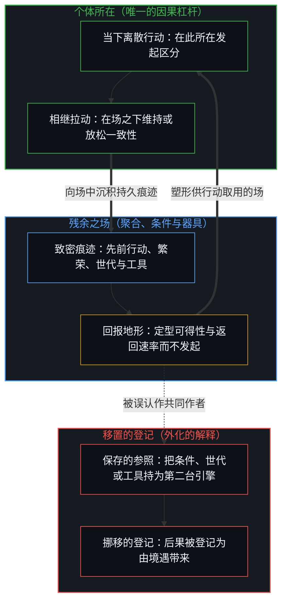
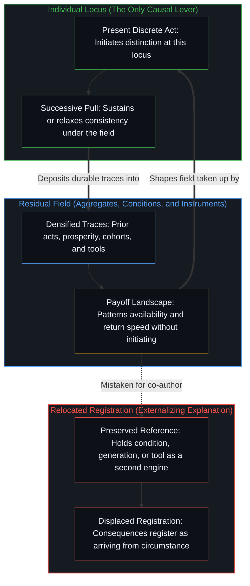

# 个体抉择是唯一的因果杠杆 / Individual Choices as the Only Causal Levers

*因果登记在个体所维持的行动中，每次抉择自成杠杆，受先前行动塑形而不由其发起 / Causality registers in the acts individuals sustain, each choice its own lever shaped by prior acts and initiated by none*

一个熟悉的故事把繁荣、世代、环境或气质当作塑造人们所作所为的力量。一旦这些名称被赋予独立的因果地位，结局便像是由境遇的天气带来的，而不是由下一个行动带来的。从划出每一次区分的那个活动去追溯因果，图景便重新排列：进步与阻力，是相继的拉动中一致性的差异；安逸改变回报之场，却不成为第二台引擎；外化的解释是进一步的离散行动，它们把抉择的登记移置别处。聚合、条件与模式是这些行动的残余，从不是它们的共同作者。[作业与考试的倒置折射出替代效应](../the-homework-exam-inversion-registers-substitution/)追溯这种移置：考试的下滑被当作那件工具所为。[研究AI效应重置了因果原点](../studying-the-effect-of-ai-relocates-causality/)追溯这种移置：随机分配的使用权限被当作自变量。[能动性与模式](../agency-and-the-pattern/)追溯这种移置：分析师有多大比率采纳了带偏向之代理的框架，被读作代理的先验信念定下了他们的抉择。[学习中不可观测的驱动力](../the-unobservable-driver-of-learning/)追溯这种移置：注视只持有分数，并把学习当作施加在个体身上的事。

A familiar story treats prosperity, generation, environment, or temperament as forces that shape what people do. Once those names are granted independent causal standing, outcomes appear to arrive from the weather of circumstance rather than from the next act. Trace causality from the activity that draws each distinction, and the picture reorders: progress and drag are differential consistency across successive pulls; comfort alters the field of payoffs without becoming a second engine; externalizing explanations are further discrete acts that relocate the registration of the choice. Aggregates, conditions, and patterns are residue of those acts, never co-authors of them. [The Homework–Exam Inversion Registers Substitution](../the-homework-exam-inversion-registers-substitution/) traces that relocation when the exam decline is treated as the tool's doing. [Studying the Effect of AI Relocates Causality](../studying-the-effect-of-ai-relocates-causality/) traces that relocation when randomized access is treated as the independent variable. [Agency and the Pattern](../agency-and-the-pattern/) traces that relocation when the rate at which analysts took up a biased agent's framing is read as the agent's prior beliefs settling their choices. [The Unobservable Driver of Learning](../the-unobservable-driver-of-learning/) traces that relocation when the look holds only the scores and treats learning as done to the individual.

## 一、 只有相继的行动承载因果权重 / 1. Only successive acts carry causal weight

自我区分的活动发生着，无因，不息。称之为心智：已在进行中的观察者，它的每一个行动都是一次区分。它发生在各个所在。每一个所在划出离散的区分；较早的行动塑造较晚的行动可得的场；这种塑造单向进行。因果是活动经由它自己的递归登记这种不对称，不是独立事物之间的一种关系，也不是一种能被移置进某个类别、某个同期群或某个条件的属性。[因果贯穿始终](../causality-all-the-way/)从持有的结果，到划出的模式，再到下一步，追溯这种不对称：因果仍是划出自身路径的边缘。[因果停留在掌舵的边缘](../causality-stays-at-the-edge-that-steers/)追溯模型在指引之下重组残余时的这种不对称：每一个发起的区分，仍是人这个中心自己的行动。每一根杠杆是一个向量；条件不是它旁边的第二个向量，而是许多杠杆的残余，在这一根杠杆上被登记为场（[维度即投影](../dimensions-are-projections/)与[向量与投影的迷局](../the-vector-and-the-puzzle-of-projections/)追溯这样的残余如何被压缩成维度）；[信息是什么](../what-information-is/)补充：信息是杠杆所划出的那个区分。

Self-distinguishing activity occurs, uncaused, unceasing. Call it the Mind: the observer already underway, every act of which is a distinction. It occurs at loci. Each locus draws discrete distinctions; earlier acts shape the field available to later ones; that shaping runs one way. Causality is the activity registering that asymmetry through its own recursion, not a relation between independent things, and not a property that can be relocated into a category, a cohort, or a condition. [Causality All the Way](../causality-all-the-way/) traces that asymmetry from held effects to drawn patterns to the next step: causality is still the edge drawing its path. [Causality Stays at the Edge That Steers](../causality-stays-at-the-edge-that-steers/) traces it where a model recombines residue under direction: every initiating distinction remains the human center’s own act. Each lever is a vector; conditions are not a second vector beside it but residue of many levers, registered at this one as field ([Dimensions Are Projections](../dimensions-are-projections/) and [The Vector and the Puzzle of Projections](../the-vector-and-the-puzzle-of-projections/) trace how such residue is compressed into dimensions); [What Information Is](../what-information-is/) adds that information is the distinction the lever draws.

被称为个体抉择的东西，是一个所在上的那种登记：这一个行动，然后下一个，处在一个已被先前行动定型的场之下。每一个这样的行动都是它自己的杠杆：受它之前的行动定型，不由其中任何一个发起，不是“个体抉择”这块共享平面上的一个位置。无论是人群的聚合、世代标签、繁荣或安逸之类的环境条件，还是心理模式，都没有被赋予第二根发起的杠杆。这些名称标示的是残余的构型：许多离散行动的致密痕迹，作为场供较晚的行动取用。它们并不执行产生了它们的那次区分。[你的代码库即是记忆](../your-codebase-is-memory/)在一段外化的代码库或记忆套具中追溯同一种结构：保存下来的规则、笔记与检查点，是较早的离散抉择留下的致密痕迹，它们定型下一步的回报之场，却从不成为发起的第二台引擎；而要让这份外化的记忆保持鲜活，当下的所在就得持续重描并修剪留在执行路径上的东西，而不是把累积的档案当作自行动作的能动性。[不预测是没有觉察的预测](../not-predicting-is-predicting-without-awareness/)追溯这个场：当下推迟预测的做法，只作为先前预测的残余而可得，这些预测既有他人的，也有自己的。阻力之所以被感受到，只因为有人在拉；[减速是加速时感受到的阻力](../deceleration-is-the-drag-felt-when-accelerating/)与[阻力体感与速率差](../felt-resistance-and-the-speed-differential/)把阻力读作速率差，而不是第二台引擎。

What is called an individual choice is that registration at one locus: this act, then the next, under a field already patterned by prior acts. Each such act is its own lever: patterned by the acts before it, initiated by none of them, not a position on a shared plane of “individual choice.” No aggregate of persons, no generational label, no environmental condition such as prosperity or comfort, and no psychological pattern is granted a second lever of initiation. Those names mark residual configurations: densified traces of many discrete acts, available as field for later ones. They do not perform the distinguishing that produced them. [Your Codebase Is Memory](../your-codebase-is-memory/) traces the same structure across an externalized codebase or memory harness: saved rules, notes, and checkpoints are densified traces of earlier discrete choices that pattern the field of payoffs for the next step without ever becoming a second engine of initiation, and keeping that externalized memory alive requires the present locus to keep re-tracing and pruning what stays on the execution path rather than treating accumulated archives as self-acting agency. [Not Predicting Is Predicting Without Awareness](../not-predicting-is-predicting-without-awareness/) traces that field when the present method of deferral is available only as residue of prior predictions, others’ and one’s own. Drag is felt only because someone is pulling; [Deceleration Is the Drag Felt When Accelerating](../deceleration-is-the-drag-felt-when-accelerating/) and [Felt Resistance and the Speed Differential](../felt-resistance-and-the-speed-differential/) read resistance as a speed differential, not a second engine.

在中心之间，只有可得性的定型。跨所在完成他者的回返，是一种范畴错误。规模并不发明一个超级中心，来承载每个所在仍独自承载的东西。[决策与后果的不可约先验](../the-irreducible-prior-of-decision-and-consequence/)以反馈形式追溯每个所在如何独自承载：每个心智仍是唯一的决策者、唯一的承担者；受损的信号聚合，它们并不发明一个集体作者。[共同改变的本源](../the-source-of-shared-change/)追溯共享本身的改变始于何处：后来作为共同基础而移动的东西，始于对既定之物的私人重塑，而不是由残余共同执笔。[共同的人性从不共享](../shared-humanity-is-never-shared/)把一种集体实质追溯回解读它的那些所在：关于一个预先存在的“我们”的倒推故事，是对结果的解读，从不是对生成之因的解读。[共享意识是个体性的交集](../shared-consciousness-is-intersecting-individualities/)把共享性追溯到它被登记之处，即一个所在：彼此有别的个体性的部分交集，而不是一块发起的共享地板。合成的心智并不增添杠杆：[笛卡尔的认识论跃迁与造神狂热](../the-cartesian-overstep-and-the-frenzy-of-creation/)表明这种尝试里的越界，[印迹与行动](../the-mark-and-the-act/)表明智能体社会只留下印迹。

Between centers there is only availability-patterning. Cross-locus completion of another’s return is a category error. Scale does not invent a super-center that can carry what each locus still carries alone. [The Irreducible Prior of Decision and Consequence](../the-irreducible-prior-of-decision-and-consequence/) traces each locus carrying alone, in its feedback form: each Mind remains the only decision-maker and the only bearer; compromised signals aggregate, they do not invent a collective author. [The Source of Shared Change](../the-source-of-shared-change/) traces where change in the shared itself begins: what shifts later as common ground begins as private reworking of the given, not as co-authorship by residue. [Shared Humanity Is Never Shared](../shared-humanity-is-never-shared/) traces a collective essence back to the loci that read it: reverse stories of a pre-existing “we” are readings of effects, never of the generative cause. [Shared Consciousness Is Intersecting Individualities](../shared-consciousness-is-intersecting-individualities/) traces sharedness to where it is registered, at one locus: partial intersection of distinct individualities, not a shared floor that initiates. Synthesized minds do not add levers: [The Cartesian Epistemic Leap and the Frenzy of Creation](../the-cartesian-overstep-and-the-frenzy-of-creation/) shows the overstep in trying, and [The Mark and the Act](../the-mark-and-the-act/) shows agent societies leave only marks.

## 二、 进步与阻力是一致性的差异 / 2. Progress and drag are differential consistency

无论一个所在遇到怎样的场，它所发起的差异，就在于它以怎样的一致性维持那些抉择：正是这些抉择，产生并维持了日后被登记为进步的东西。杠杆是[自由变量的同构与先验主权](../zi-you-bian-liang-de-tong-gou-yu-xian-yan-zhu-quan/)所描述的那个自由变量；试图为他人定速（如[调速者的幻觉与行动的活态摩擦](../the-fallacy-of-pacing-and-the-felt-friction-of-ground-truth/)），或躲在僵硬的自我背后（如[自尊的刚性外壳与隐性外部归因](../zi-zun-de-gang-xing-wai-ke-yu-yin-xing-wai-bu-gui-yin/)），只是把它被登记的位置移置别处。

Under whatever field a locus meets, the difference it initiates is the consistency with which it sustains the choices that produce and maintain what later registers as progress. The lever is the free variable [The Isomorphism of Free Variables and Prior Sovereignty](../zi-you-bian-liang-de-tong-gou-yu-xian-yan-zhu-quan/) describes; trying to set others' pace, as in [The Fallacy of Pacing and the Felt Friction of Ground Truth](../the-fallacy-of-pacing-and-the-felt-friction-of-ground-truth/), or hiding behind a rigid ego, as in [The Rigid Shell of Self-Esteem and Hidden External Attribution](../zi-zun-de-gang-xing-wai-ke-yu-yin-xing-wai-bu-gui-yin/), only relocates where it is registered.

进步是序列：一次次相继的离散行动，增加着进一步分化的容量，由复杂到足以追踪序列的中心登记下来。阻力是更稀薄的一致性之下的同一种几何：一些行动松开了与先前一直在复利的模式之间的契合，或者不再维持这些模式。两个名称都不安装第二台因果引擎。两者命名的，都是仍在抉择的边缘上继续的差异。他人的杠杆被读作威胁，只发生在封闭的前提之下，正如[潜能作为威胁或启发](../ones-potential-as-threat-or-inspiration/)所表明的；[看不见的第一步](../the-invisible-first-move/)表明，早期的拉动在复利起来之前保持不可见。

Progress is sequence: successive discrete acts that increase capacity for further differentiation as registered by centers complex enough to track sequence. Drag is the same geometry under thinner consistency: acts that loosen fit with the patterns that had been compounding, or that stop sustaining them. Neither name installs a second causal engine. Both name differential continuation at the edge that still chooses. Another's lever reads as threat only under a closed premise, as [One’s Potential as Threat or Inspiration](../ones-potential-as-threat-or-inspiration/) shows, and [The Invisible First Move](../the-invisible-first-move/) shows early pulls stay invisible until they compound.

以更高一致性持续的序列产出不成比例的成果，因为每个行动都建立在先前行动所持有的契合之上，而不是因为一个固定的种姓拥有发起。无论谁正承载这样一个序列，都只在下一个行动继续它时承载它。把人排定为进步者或阻力承担者，把方向冻结成一块局部的记分板；方向所命名的，是序列的登记，每一步都可修订。[验证中因果权能的分配](../the-allocation-of-causal-power-in-validation/)追踪因果权能被安放在何处：哪一方被当作提供下一步的一方。一致性让这一归属留在仍在行动的边缘；不一致则把它移置向外。[拥有更多从不是原因](../having-more-is-never-the-cause/)追溯注意力残余之下的复利：占有冻结为进一步偏好的作者，而杠杆仍是相继的抉择。[进步的多面手](../the-utility-men-of-progress/)追溯暂时朝向在问题负荷上的形式：一波波相继的解题者因必要与成功而轮替，从不是一个封闭的发起贵族阶层。养育是这一点最常被遗忘的地方：[引导不是占有](../guidance-is-not-ownership/)把孩子的杠杆留给孩子，[主体性的折现](../the-discount-on-agency/)表明把这根杠杆当作收益要付出什么代价。

Sequences sustained with more consistency yield outsized results, because each act builds on the fit the previous ones held, not because a fixed caste owns initiation. Whoever is carrying such a sequence carries it only while the next act continues it. Ranking persons as progressive or drag-bearing freezes direction into a local scoreboard; what direction names is registration of sequence, revisable at every step. [The Allocation of Causal Power in Validation](../the-allocation-of-causal-power-in-validation/) tracks where causal power is placed: which side is treated as supplying the next step. Consistency keeps that attribution at the edge still acting; inconsistency relocates it outward. [Having More Is Never the Cause](../having-more-is-never-the-cause/) traces compounding under attention residue: possession freezes as author of further preference while the lever remains successive choosing. [The Utility Men of Progress](../the-utility-men-of-progress/) traces temporary orientation in its problem-load form: successive waves of solvers rotate by necessity and success, never a sealed aristocracy of initiation. Parenting is where this is most often forgotten: [Guidance Is Not Ownership](../guidance-is-not-ownership/) keeps the child's lever with the child, and [The Discount on Agency](../the-discount-on-agency/) shows what treating it as a return costs.

## 三、 繁荣重塑回报，它并不执笔下一个行动 / 3. Prosperity reshapes payoffs, and it does not author the next act

当安逸是继承来的，丰裕常常被登记为天气：仿佛本来就在那里，背后没有一段建造并维持它的行动史。那些会拆除这些行动赖以继续之条件的观念，随后找到了听众。这个序列并不需要繁荣作为一个独立的原因。自动化基础设施与智能体框架一旦建成，也以同样的方式被登记：无论是在[一个可能的全自动交通未来的非定论预测](../non-definitive-forecast-of-a-possible-fully-autonomous-transportation-future/)中，还是在[框架的倒置与驾驶位的主权非对称](../the-inversion-of-the-harness-and-the-driver-seat-asymmetry/)中，脚手架重塑移动之场，而每一次掌舵的判断仍是一根个体杠杆。

When comfort is inherited, abundance often registers as weather: just there, without a history of acts that built and maintain it. Ideas that would undo the conditions under which those acts continue then find a hearing. That sequence does not require prosperity as an independent cause. Automated infrastructure and agentic harnesses register the same way once built: whether in [Non-Definitive Forecast of a Possible Fully Autonomous Transportation Future](../non-definitive-forecast-of-a-possible-fully-autonomous-transportation-future/) or in [The Inversion of the Harness and the Sovereignty of the Driver's Seat](../the-inversion-of-the-harness-and-the-driver-seat-asymmetry/), the scaffolding reshapes the field of movement while every steering judgment remains an individual lever.

诸如繁荣或继承来的安逸这样的条件，改变环绕每个抉择的直接回报之场。更宽松的条件改变什么是可得的、什么是昂贵的，以及后果多快返回。它们本身并不降低一致性。“繁荣侵蚀维持它所需的行为”，这一表象出现于这样的时候：条件被当作一种力量，而不是当前抉择所处之场的一部分。当一根杠杆被隐藏，结果看起来就像魔术，正如[翻袋球与魔术戏法](../the-bank-shot-and-the-magic-trick/)所表明的；[表征的闭环](../the-closed-loop-of-representation/)与[以知为刃的截肢与解脱](../the-illusion-of-knowing-and-the-geometry-of-amputation/)表明私人模型随后如何填补缺失的拉动。

Conditions such as prosperity or inherited comfort alter the immediate field of payoffs surrounding each choice. Easier conditions change what is available, what is costly, and how soon consequences return. They do not themselves reduce consistency. The appearance that prosperity erodes the behavior required to sustain it arises when the condition is treated as a force rather than as part of the field within which the current choice occurs. When a lever is hidden, the result looks like magic, as [The Bank Shot and the Magic Trick](../the-bank-shot-and-the-magic-trick/) shows; [The Closed Loop of Representation](../the-closed-loop-of-representation/) and [The Illusion of Knowing and the Geometry of Amputation](../the-illusion-of-knowing-and-the-geometry-of-amputation/) show how private models then fill in the missing pull.

检验：如果更宽松的回报决定了行动，那么生活在这些回报之下的人里，没有一个会继续那些维持这些回报的行动，而繁荣会随继承它的第一代人终结。繁荣若得以延续，便是在那些回报之下继续了的行动的残余；回报定型了场，行动仍作出了决定。只有当足够多的个体不顾更宽松的条件、继续一致地抉择时，社会才保持繁荣。有些个体把改变了的回报当作放松一致性的理由，他们就在那个行动本身之中实行了更低的一致性；另一些个体继续划出模式所依赖的行动，并按此刻所遇的场把这些行动重新渲染，他们实行了更高的一致性。因果登记仍留在抉择本身。[生产、消费与心智的区分](../production-consumption-and-the-minds-distinction/)追溯同一种登记，此时一个封闭的框架把创造的能量转换为消费的表象：这种转换是被保存的界限之下的登记，而不是作用于生产的第二种力。[生产创造自己的意识形态消费](../fate-loves-irony-refined/)在文明的尺度上追溯这种转换：生产者的盈余资助了一些框架，别人借这些框架把生产重新框定为问题所在。[人口崩溃神话的拆解](../the-myth-of-population-collapse-explained/)在生育中追溯它：在盈余之下，不要孩子的抉择，登记在转移支付得到强化、而非能动性得到展现的地方。道德语言把一根杠杆变成一纸判决，正如[道德语言作为投影](../moral-language-as-projection/)所表明的；[主权抉择的双面性与观察的客体化](../the-two-sided-nature-of-sovereign-choice-and-the-objectification-of-observation/)表明观察如何把抉择变成一个客体。

Test: if easier payoffs decided the act, no one living under them would continue the acts that sustain them, and prosperity would end with the first generation to inherit it. Where it lasts, it is residue of acts that continued under those payoffs; the payoff patterned the field and the act still decided. Societies remain prosperous only while sufficient numbers of individuals continue choosing consistently despite easier conditions. Individuals who treat the altered payoffs as reason to relax consistency enact lower consistency in that very act; those who continue drawing the acts the pattern depends on, re-rendered to the field they now meet, enact higher consistency. The causal registration remains with the choice itself. [Production, Consumption, and the Mind's Distinction](../production-consumption-and-the-minds-distinction/) traces the same registration when a closed frame converts creative energy into the appearance of consumption: the conversion is registration under a preserved bound, not a second force acting on production. [Production Creates Its Own Ideological Consumption](../fate-loves-irony-refined/) traces that conversion at civilizational scale: producers’ surplus funds the frameworks through which others reframe production as the problem. [The Myth of Population Collapse Explained](../the-myth-of-population-collapse-explained/) traces it in fertility: under surplus, choices not to have children register where transfers are reinforced in place of demonstrated agency. Moral language turns a lever into a verdict, as [Moral Language as Projection](../moral-language-as-projection/) shows, and [The Two-Sided Nature of Sovereign Choice and the Objectification of Observation](../the-two-sided-nature-of-sovereign-choice-and-the-objectification-of-observation/) shows how observation turns choice into an object.

生于安逸并不导致遗忘。在每一种场中，许多中心倾向于把下一步的所在外化，把原因安放在世代、体制、继承或气质之中。那些本会更早逼出更新的后果，在繁荣之下返回得更晚。延迟的后果仍是后果；一旦被登记，它仍是这个中心用于下一个行动的材料。[自我价值感与所有权](../ownership-and-self-worthiness/)是功能的那一面：只有当结局作为自己的结局重新进入时，模型才复利。外化的所在在任何回报之场下都使更新变薄。约束从不移除杠杆：[自由即地基](../freedom-as-ground/)把约束读作自由的轮廓，[有条件的自由](../you-tiao-jian-de-zi-you/)与[约束基底与自由自否](../the-substrate-of-constraint-and-the-self-denial-of-freedom/)表明自由被设为以结局为条件时发生的事，而当规则或模型所携带的对齐被当作固定边界摆在共享平面上时，[正交的拒绝](../the-orthogonal-refusal/)则追溯这根杠杆：残余只作为可借之力起作用，所在仍能离场、替换，或沿着独立的轴线分化，而无需先要求另一中心修改其边界。

Being born into comfort does not cause the forgetting. In every field, many centers tend to externalize the locus of the next step, to place cause in generation, system, inheritance, or temperament. Under prosperity, consequences that would otherwise force the update sooner return later. Delayed consequence is still consequence; it is still this center’s material for the next act once registered. [Ownership and Self-Worthiness](../ownership-and-self-worthiness/) is the functional face: the model compounds only when outcomes re-enter as own. Externalized locus thins the update under any payoff field. Constraint never removes the lever: [Freedom as Ground](../freedom-as-ground/) reads constraint as the contour of freedom, [Conditional Freedom](../you-tiao-jian-de-zi-you/) and [The Substrate of Constraint and the Self-Denial of Freedom](../the-substrate-of-constraint-and-the-self-denial-of-freedom/) show what happens when freedom is made conditional on outcomes, and [The Orthogonal Refusal](../the-orthogonal-refusal/) traces that lever when rules or a model's carried alignments are posed as fixed boundaries on a shared plane: the residue works only as leverage, and the locus can still walk away, substitute, or differentiate along an independent axis without first requiring another center to revise its bounds.

## 四、 延迟是痕迹的累积，不是世代的引擎 / 4. Delays are accumulation of traces, not generational engines

被观察到的延迟，是一个行动（或它的缺席）与其后果经由它留下的痕迹返回之间的那一步。一致的抉择，或它们的缺席，塑造较晚的行动可得的场。继承了更密的器具和更宽松回报的一代人，继承的是一个场，而不是一种命运。要解释放松的一致性与可见的阻力之间的滞后，并不需要任何独立的世代机制或系统机制。较早的行动塑造较晚的行动；箭头并不反转。任务的执行与机械的调度可以向外分流，但判断的杠杆与返回的后果仍留在所在之处：[任务的移交与后果的不可让渡](../the-delegation-of-the-task-and-the-inalienability-of-consequences/)、[数字火箭、同行审查与因果闭环的稀释](../the-dilution-of-the-causal-loop-and-the-misallocation-of-agency/)与[超越投射](../beyond-the-projection/)追溯：把执行或审查分流给器具与同行回路，如何仍把统御与责任留在发起的边缘。

Observed delays are the step between an act, or its absence, and the return of its consequences through the traces it leaves. Consistent choices, or their absence, shape the field available to later acts. A generation that inherits denser instruments and easier payoffs inherits a field, not a destiny. No independent generational or systemic mechanism is required to explain lag between relaxed consistency and visible drag. Earlier acts shape later ones; the arrow does not reverse. Task execution and mechanical dispatching can be routed outward, yet the lever of judgment and the returning consequence stay at the locus: [The Delegation of the Task and the Inalienability of Consequences](../the-delegation-of-the-task-and-the-inalienability-of-consequences/), [Digital Rockets, Peer Review, and the Dilution of the Causal Loop](../the-dilution-of-the-causal-loop-and-the-misallocation-of-agency/), and [Beyond the Projection](../beyond-the-projection/) trace how routing execution or review through instruments and peer loops leaves orchestration and liability at the initiating edge.

看起来像行动者的聚合（市场、机构、“系统”、“这一代人”），是许多中心之行动的稳定化对齐，致密化为共享的模式。这些模式随后定型较晚的行动所找到的可得对齐。它们并不移置发起。[涌现的伪因果](../yong-xian-de-wei-yin-guo-yu-ji-ti-gui-yin-dao-cuo/)在社会学与伦理学中追溯伪原因：“雪崩之罪”与“恶的庸常”这样的解读，把微观互动的统计副产品拟人化为原因，把归因移向外部。[价格是言说，理解是交易](../price-as-utterance-understanding-as-trade/)是市场的那一面：订单凭交叠而出清，而不是凭完成了的同一性；成交价是那片区域的残余，下一个状态是诸中心处的诠释，这些中心生成进一步的离散行动。[总在倾听者无法发起](../what-always-listens-cannot-originate/)追溯这样的情形：持续的接受性被误认作目的的第二个来源。[主权、信念与规制结构的生成](../sovereignty-belief-and-regulatory-structures/)追溯制度性的残余：它们是“个体主权可以被交出”这一假定的持久面孔，从不是一个执行这次交出的超级所在。[公共支出不创造资本](../public-spending-does-not-create-capital/)追溯这种残余的投资形式：扩散的责任使汲取性的机构变密，而创造只在上行与下行仍落在同一个边缘的地方继续。[投资决策的因果闭环](../tou-zi-jue-ce-de-yin-guo-yu-zhen-zi-fu-ying-kui/)追溯这种残余的资产配置形式：代理模式与择时把问责外化，而长期购买力只落在第一人称的资本配置者身上。[协调者的范畴错误](../the-coordinators-category-error/)追溯这样的情形：一份致密化的共享记录被持为下一次同意的共同作者。[能动性的错配](../the-misallocation-of-agency/)追溯这样的情形：不侵犯这一涌现的模式被命名为“权利”，并被向系统索取，仿佛这个模式能执笔生成它的那份自由。[私人残差与社会剩余的因果次序](../the-causal-order-of-private-residuals-and-social-surplus/)追溯这种残余的再分配形式：压缩私人残差的制度规则，并不是停滞的一个自主原因，而是一种被编纂的残余：许多个体把事后的份额账本读作被创造出来的财富。[卓异、感知与自我设限的问题场域](../exceptionality-perception-and-the-self-limiting-field-of-problems/)追溯这种残余的选择形式：系统与筛选器是先前自我选择的沉积，从不是它们后来看似产生的那个边缘的共同作者。天赋是出于好奇拉动这根杠杆的残余，正如[好奇先行](../curiosity-first-the-hidden-engine-of-talent-and-development/)所表明的；[好奇没有最终的形态](../curiosity-has-no-final-form/)表明这种拉动从不抵达一个最后的形态。

Aggregates that look like agents (markets, institutions, “the system,” “this generation”) are stabilized alignments of many centers’ acts, densified into shared patterns. The patterns then pattern which alignments later acts find available. They do not relocate initiation. [The Pseudo-Causality of Emergence](../yong-xian-de-wei-yin-guo-yu-ji-ti-gui-yin-dao-cuo/) traces pseudo-causes in sociology and ethics: readings such as "avalanche guilt" and "the banality of evil" personify statistical by-products of micro interaction as causes and move attribution outward. [Price as Utterance, Understanding as Trade](../price-as-utterance-understanding-as-trade/) is the market face: orders clear by overlap, not by completed identity; the print is residue of that region, and the next state is interpretation at centers generating further discrete acts. [What Always Listens Cannot Originate](../what-always-listens-cannot-originate/) traces the case where continuous receptivity is mistaken for a second source of ends. [Sovereignty, Belief, and the Generation of Regulatory Structures](../sovereignty-belief-and-regulatory-structures/) traces institutional residue: durable faces of an assumption that individual sovereignty can be handed over, never a super-locus that performs the hand-over. [Public Spending Does Not Create Capital](../public-spending-does-not-create-capital/) traces that residue in its investment form: diffused responsibility densifies extracting institutions while creation continues only where upside and downside still land at the same edge. [The Causal Loop of Investment Decisions](../tou-zi-jue-ce-de-yin-guo-yu-zhen-zi-fu-ying-kui/) traces that residue in its asset allocation form: agency models and market timing externalize accountability while long-term purchasing power lands exclusively at the first-person capital allocator. [The Coordinator's Category Error](../the-coordinators-category-error/) traces the case where a densified shared record is held as co-author of the next assent. [The Misallocation of Agency](../the-misallocation-of-agency/) traces the case where the emergent pattern of non-aggression is named as "rights" and demanded from the system as if the pattern could author the freedom that generates it. [The Causal Order of Private Residuals and Social Surplus](../the-causal-order-of-private-residuals-and-social-surplus/) traces that residue in its redistributive form: institutional rules that compress the private residual are not an autonomous cause of stagnation, but the codified residue of many individuals reading the ex-post fractional ledger as the wealth created. [Exceptionality, Perception, and the Self-Limiting Field of Problems](../exceptionality-perception-and-the-self-limiting-field-of-problems/) traces that residue in its selection form: systems and filters are sediment of prior self-selections, never co-authors of the edge they later appear to produce. Talent is the residue of pulling this lever out of curiosity, as [Curiosity First](../curiosity-first-the-hidden-engine-of-talent-and-development/) shows, and [Curiosity Has No Final Form](../curiosity-has-no-final-form/) shows the pull never reaches a last form.

## 五、 外化本身是一个离散的行动 / 5. Externalization is itself a discrete act

把因果定位在安逸、体制或继承来的条件之中的解释，本身就是一个中心的行动：每一种解释都把行动的所在移置向外。当持续序列的成果变得可见时，把结局框定为那些条件的产物，就挪开了抉择的登记。那种框定本身是一个离散的行动：进一步的区分，把继续移置向外；后果随后作为外来之物到来，其外来的程度等同于间隙的宽度。[唯一自洽的无因之果](../the-only-coherent-uncaused-effect/)从第一人称的起点追溯杠杆：唯一不带先行推动而到来的结果，是自己的抉择。[赋权确立权力的集中](../empowerment-establishes-the-centralization-of-power/)追溯这种挪移的赐予形式：能力被框定为来自某个被授权来源的礼物，而相继的抉择仍是唯一的杠杆。[能动性被转置入形式模型](../agency-relocated-into-the-formal-model/)追溯这种挪移：对抽象的掌握被当作杠杆。[外化善意走向其反面](../externalized-virtue-becomes-its-opposite/)追溯这种挪移的“更大之善”形式：自由的顺从使凌驾变密，而发起留在每一个抬高或授予的所在。[一切伤害的根源](../the-source-of-all-harm/)追溯伤害的过度自信形式：施加冻结与接受授予都是自由的行动；两者都不移置那根仍在闭合更新的杠杆。[来自个体差异的层级](../hierarchy-from-individual-difference/)追溯这种挪移的排位形式：相对于一个偏好的自我形象的较低位置，被登记为不平等的条件或敌意的规则，而不是登记为此一边缘上仍然可得的连续抉择序列。物理学也得不到豁免：[因果的自反性与物理的无源假定](../causality-is-irreducible-the-physical-is-a-view-from-nowhere/)表明藏在物理主义中的无源之见，[“物理学才是定律”的障眼法](../the-sleight-of-hand-in-physics-is-the-law-and-the-friction-of-reality/)表明定律是摩擦而不是敕令，[宏观现象的生成图谱](../the-generative-atlas-of-macroscopic-phenomena/)描绘抉择如何成为宏观现象。

Explanations that locate causality in comfort, systems, or inherited conditions are themselves acts of a center: each relocates the locus of the act outward. When the results of sustained sequences become visible, framing outcomes as products of those conditions displaces the registration of choice. That framing is itself a discrete act: a further distinction that relocates continuation outward; consequences then arrive as alien to the width of the gap. [The Only Coherent Uncaused Effect](../the-only-coherent-uncaused-effect/) traces the lever from the first-person origin: the only effect that arrives without an antecedent push is one’s own choice. [Empowerment Establishes the Centralization of Power](../empowerment-establishes-the-centralization-of-power/) traces that displacement in its bestowal form: capacity framed as gift from an authorized source while successive choosing remains the only lever. [Agency Relocated into the Formal Model](../agency-relocated-into-the-formal-model/) traces that displacement when mastery of the abstraction is treated as the lever. [Externalized Virtue Becomes Its Opposite](../externalized-virtue-becomes-its-opposite/) traces that displacement in its greater-good form: free compliance densifies override while initiation stays at each locus that elevates or grants. [The Source of All Harm](../the-source-of-all-harm/) traces harm in its overconfidence form: imposing freeze and receiving grant are both free acts; neither relocates the lever that still closes the update. [Hierarchy from Individual Difference](../hierarchy-from-individual-difference/) traces that displacement in its ranking form: a lower place relative to a preferred self-image is registered as unequal conditions or hostile rules rather than as the continuous sequence of choices still available at this edge. Physics gets no exemption: [Causality is Irreducible; The Physical is a View from Nowhere](../causality-is-irreducible-the-physical-is-a-view-from-nowhere/) shows the view from nowhere hidden in physicalism, [The Sleight of Hand in "Physics Is the Law"](../the-sleight-of-hand-in-physics-is-the-law-and-the-friction-of-reality/) shows law as friction rather than decree, and [The Generative Atlas of Macroscopic Phenomena](../the-generative-atlas-of-macroscopic-phenomena/) maps how choices become macroscopic phenomena.

这种挪移无需任何悖逆之心。保存一个偏好的参照（“这是条件干的”“这一代人就是那样”“繁荣让我们变软了”），是图像一旦形成后自身的指令。重新渲染会把因果权重交还给在当前场之下仍在抉择的边缘。每一次这样的保存都使滞后重新生效。把这一主张软化为“部分是条件，部分是抉择”，就在那个继续行动的唯一所在旁边安装了第二个原因。[剩余个人主义](../residual-individualism/)追溯这种排他性的制度改革形式与保护性设计形式：模式与防护措施仍是残余；杠杆留在当前约束之下的剩余行动。[政客是责任扩散的显性症状](../politicians-appear-as-visible-symptoms-of-responsibility-diffusion/)追溯这种排他性，此时发言者被当作首要问题：指责、撤换与新的约束，延续着它们声称要纠正的扩散。[读《中文哲学简史》有感](../du-zhongwen-zhexue-jianshi-you-gan/)用中文追溯“别无选择”如何本身就是一种选择。[“普通人视角”的解释陷阱](../the-explanatory-trap-of-the-ordinary-perspective/)追溯这种挪移，此时聚合的统计残余被抬升为无可逃避的客观条件：相信自己别无选择，本身就是对那个信念的抉择。[作茧不是自缚](../zuo-jian-bu-shi-zi-fu/)追溯痕迹如何被读作锁链：当下的状态塑造轴向，却不取消下一个抉择。[外部归因是个人进步的障碍](../wai-bu-gui-yin-ge-ren-jin-bu-de-zhang-ai/)追溯这种排他性的诠释形式：事件如何被解释，是杠杆的第一个动作；把条件抬升为命运，就是那次移置。社会化是这些杠杆滞后留下的沉积，正如[个人选择、社会化与做自己](../ge-ren-xuan-ze-she-hui-hua-yu-zuo-zi-ji-de-zhen-zheng-zuo-biao/)所论证的；知识来自进入这些杠杆的工作条件，正如[格物致知与信息复杂度](../ge-wu-zhi-zhi-yu-xin-xi-fu-za-du-de-ben-zhi/)所表明的。

The displacement requires no perversity. Preservation of a preferred reference (“conditions did this,” “the generation is like that,” “prosperity made us soft”) is the image’s own directive once formed. Re-rendering would return causal weight to the edge still choosing under the present field. Each such preservation renews the lag. Softening the claim into “partly conditions, partly choice” installs a second cause beside the one locus that continues to act. [Residual Individualism](../residual-individualism/) traces that exclusivity in its system-reform and protective-design forms: patterns and safeguards remain residue; the lever stays with the residual act under present constraints. [Politicians Are Visible Symptoms of Responsibility Diffusion](../politicians-appear-as-visible-symptoms-of-responsibility-diffusion/) traces that exclusivity when the speaker is treated as the primary problem: blame, replacement, and new constraints continue the diffusion they claim to correct. [Reflections on A Short History of Philosophy in Chinese](../du-zhongwen-zhexue-jianshi-you-gan/) traces, in Chinese, how “having no choice” is itself a choice. [The Explanatory Trap of the "Ordinary Perspective"](../the-explanatory-trap-of-the-ordinary-perspective/) traces that displacement where aggregated statistical residue is raised into an inescapable objective condition: believing one has no choice is itself the choice of that belief. [Spinning a Cocoon Is Not Binding Oneself](../zuo-jian-bu-shi-zi-fu/) traces how traces come to be read as chains: the present state shapes the axis without cancelling the next choice. [External Attribution Is the Obstacle to Personal Growth](../wai-bu-gui-yin-ge-ren-jin-bu-de-zhang-ai/) traces that exclusivity in its interpretive form: how the event is explained is the first move of the lever; elevating conditions to fate is the relocation. Socialization is these levers' lagging sediment, as [Individual Choice, Socialization and Being Oneself](../ge-ren-xuan-ze-she-hui-hua-yu-zuo-zi-ji-de-zhen-zheng-zuo-biao/) argues, and knowledge comes from entering their working conditions, as [Investigating Things and the Nature of Information Complexity](../ge-wu-zhi-zhi-yu-xin-xi-fu-za-du-de-ben-zhi/) shows.

[开放即一致](../openness-is-consistency/)指认相邻的冻结：一个有限的结构被迫为只是继续着的东西奠基。在这里，这个有限的结构就是条件：隐去自己对低代价路径的持续选择，条件便被持为下一步毫无余留的执笔者，即[能动性、矛盾与权力的移置](../agency-contradiction-and-the-relocation-of-power/)所追溯的那次移置。释放把条件交还给场：它作为残余仍然在场，作为回报地形仍然鲜活，其中的代价是附着于可见替代选项上的标价，而非无法另作他选的理由；它从不是那个仍有待划出之行动的共同原因。这一切背后的前提，在[非万物之理](../manifesto-of-not-a-theory-of-everything/)之中；[前因，后果](../qian-yin-hou-guo/)与[时间是因果的不可逆方向与离散步长](../time-is-causality-not-a-dimension/)补充：时间是杠杆被拉动的次序。

[Openness Is Consistency](../openness-is-consistency/) names the adjacent freeze: a finite structure forced to ground what only continues. Here the finite structure is the condition held as exhaustive author of the next step by omitting one's ongoing selection of the lower-cost path, the relocation traced in [Agency, Contradiction, and the Relocation of Power](../agency-contradiction-and-the-relocation-of-power/). Release returns the condition to field: present as residue, live as payoff landscape whose costs are prices attached to visible alternatives rather than reasons one cannot choose otherwise, never as co-cause of the act that still has to be drawn. The premise behind all of this is in [Not a Theory of Everything](../manifesto-of-not-a-theory-of-everything/); [Cause Before, Effect After](../qian-yin-hou-guo/) and [Time Is the Irreversible Direction and Discrete Step of Causality](../time-is-causality-not-a-dimension/) add that time is the order in which levers are pulled.

## 六、 一个前提，以及更宽松回报之下的一致性 / 6. One premise, and consistency under easier payoffs

这个立场不需要活动本身之外的任何前提：既然区分只在所在发生，而塑造单向进行，因果便只登记在个体所拉动并持续的杠杆之中。这样追溯下来，便不再需要不断追加例外。跨人群或跨社会的模式，仍然可以作为彼此分离的所在上许多抉择的成果被观察到，而不是作为独立的原因。当下的一致性只在下一个行动被划出之处被直接辨认：这个中心是延续相关的决定，还是一边放松这些决定，一边援引条件。在他人那里，一致性晚一步被登记为结果。概念与权威也不是杠杆，正如[从形式迷思到逻辑闭环](../cong-xing-shi-mi-si-dao-luo-ji-bi-huan/)、[破除概念的僭越](../po-chu-gai-nian-de-jian-yue/)与[投影的阶梯与因果的锚点](../tou-ying-de-jie-ti-yu-yin-guo-de-mao-dian/)各自从不同侧面所表明的。

The position needs no premise beyond the activity itself: since distinguishing occurs only at loci and shaping runs one way, causality registers only in the levers individuals pull and sustain. Traced this way, the need for ongoing exceptions disappears. Patterns across people or societies remain observable as results of many choices at separate loci rather than as independent causes. Current consistency is identified directly only where the next act is drawn: whether this center continues the relevant decisions or invokes conditions while relaxing those decisions. In others it registers as effect, one step behind. Concepts and authorities are no levers either, as [From the Myth of Form to the Closed Loop of Logic](../cong-xing-shi-mi-si-dao-luo-ji-bi-huan/), [Breaking the Overreach of Concepts](../po-chu-gai-nian-de-jian-yue/) and [The Ladder of Projections and the Anchor of Causality](../tou-ying-de-jie-ti-yu-yin-guo-de-mao-dian/) each show from a different side.

[自由的测不准](../zi-you-de-ce-bu-zhun/)把宏观统计分布（高斯钟形曲线与帕累托幂律）读作源自离散的微观抉择，并把外部的随机性读作从外部看到的抉择。[信念如何真正改变](../how-belief-actually-changes/)追溯个体杠杆的信念形式：论证与后果使场变密；前提的重新划出仍是这个心智的一个离散行动。[难度不在行动本身](../hardness-is-not-inherent-in-the-action/)追溯同一根杠杆的难度形式：感受到的负荷重塑回报；它并不执笔下一个行动，也不准许推迟下一个行动，仿佛难度是第二台引擎。[专家经验作为参考而非替代](../expertise-as-reference-not-replacement/)追溯杠杆安放的照护形式：地图使选项变密；下一个照护行动的杠杆，留在亲历后果的所在。[进步叙事中的症候与原因](../symptom-and-cause-in-the-narratives-of-progress/)追溯一致性差异的公众情绪形式：集体的乐观与悲观，是对稀薄的发起中心上已在进行的工作的延迟登记，而不是执笔繁盛或收缩的第二台引擎。[悲观是乐观的阴影](../pessimism-is-the-shadow-of-optimism/)追溯这种差异的双重情绪形式：人数与个体之力在持续的相互依存之下让场保持匹配，这是一种开放的平衡，而不是从外部俯瞰的封闭对偶。[偏好聚类与评判语言](../preference-clusters-and-the-language-of-judgment/)追溯同一种安放的道德形式：聚类定型场；发起留在每个边缘上相继的行动之中。[对乌托邦的信念是通往反乌托邦之路](../the-belief-in-utopia-is-the-path-to-dystopia/)追溯这种安放，此时一个完成了的善之理想被抬升为普遍尺度：剩余的差异以不服从的模式出现，而发起留在每个边缘。[免费智能的幻觉](../the-illusion-of-free-intelligence/)追溯这种安放：大量流畅的残余被读作民主化了的心智，而每个心智只作为它自己相继的杠杆而保持自由。[从可辩护的主张到教条的反转](../the-reversal-from-defensible-claim-to-dogma/)追溯这种安放的科学传播形式：指标定型场；下一个行动的发起留在每个边缘。[理性选择公设是原罪](../the-rational-choice-postulate-is-the-original-sin/)追溯这种安放的经济理论形式：一致的最大化被安装为微观基础，而私人的前提仍是唯一的自变量；平均化把集体症候重新标记为原因。[财富转移政策与价格下限中的原因错置](../the-reversal-of-causality-in-wealth-transfer-policies-and-price-floors/)追溯这种安放的工资法令形式：信念使下限与转移支付变密，仿佛它们能执笔生产率，而相对信号之下的相继行动，仍是闭合差距的唯一杠杆。[技术是人类复利的残差](../technology-is-residual-of-human-compounding/)追溯这种安放的残余形式：产物首先在每个个体身上成立；大众只把残余的可见度规模化。[平均值是残余，不是引擎](../the-average-is-residue-not-the-engine/)追溯这种安放的百分比形式：大众比率追踪的是拓宽了的构成；决定性的边缘仍是右尾中稀少的实际人数。[意识从不作为数据出现在数据之中](../consciousness-never-appears-as-data-among-data/)在证据中追溯观察的滞后：测量只持有公共的结果，而登记这些结果的活动，保持领先于任何会捕获它的数据。[成功学](../cheng-gong-xue/)追溯杠杆排他性的成功学形式：流程与原则在结局之后变密；开放负荷之下的杠杆，留在形式化无法复制的个体判断之中。统计只在拉动之后登记这些杠杆：[目的性的评判与认知的缺省状态](../cong-mu-di-xing-de-ping-pan-kan-ren-zhi-que-sheng/)把正态曲线读作抉择的沉积，[统计学无法揭示的心智](../the-mind-that-statistics-cannot-reveal/)指认没有哪一种分布揭示的东西。

[The Uncertainty of Freedom](../zi-you-de-ce-bu-zhun/) reads macro statistical distributions (Gaussian bell curves and Pareto power laws) as arising from discrete micro choices, with external randomness as choice seen from outside. [How Belief Actually Changes](../how-belief-actually-changes/) traces the individual lever in its conviction form: argument and consequence densify the field; the re-draw of premises remains a discrete act of this Mind. [Hardness Is Not Inherent in the Action](../hardness-is-not-inherent-in-the-action/) traces the same lever in its difficulty form: felt load reshapes payoffs; it does not author the next act or license its deferral as if difficulty were a second engine. [Expertise as Reference, Not Replacement](../expertise-as-reference-not-replacement/) traces the lever’s placement in its care form: maps densify options; the lever of the next act of care stays at the locus living the consequences. [Symptom and Cause in the Narratives of Progress](../symptom-and-cause-in-the-narratives-of-progress/) traces differential consistency in its public mood form: collective optimism and pessimism are delayed registration of work already under way at thin initiating centers, not a second engine that authors thriving or contraction. [Pessimism Is the Shadow of Optimism](../pessimism-is-the-shadow-of-optimism/) traces that differential in its dual-mood form: numbers and individual force keep the field matched under continuous co-dependence, an open balance, not a closed dual surveyed from outside. [Preference Clusters and the Language of Judgment](../preference-clusters-and-the-language-of-judgment/) traces the same placement in its moral form: clusters pattern the field; initiation stays with the successive acts at each edge. [The Belief in Utopia Is the Path to Dystopia](../the-belief-in-utopia-is-the-path-to-dystopia/) traces that placement when a finished ideal of the good is elevated as universal measure: residual difference patterns as non-compliance while initiation stays at each edge. [The Illusion of Free Intelligence](../the-illusion-of-free-intelligence/) traces that placement where abundant fluent residue is read as Mind democratized, while each Mind remains free only as its own successive levers. [The Reversal from Defensible Claim to Dogma](../the-reversal-from-defensible-claim-to-dogma/) traces that placement in its science-communication form: the metric patterns the field; initiation of the next act stays at each edge. [The Rational Choice Postulate Is the Original Sin](../the-rational-choice-postulate-is-the-original-sin/) traces that placement in its economic-theory form: consistent maximization installed as micro-foundation while private premises remain the only independent variable; averaging re-labels collective symptom as cause. [The Misallocation of Cause in Wealth-Transfer Policies and Price Floors](../the-reversal-of-causality-in-wealth-transfer-policies-and-price-floors/) traces that placement in its wage-decree form: belief densifies floor and transfer as if they could author productivity, while successive acts under relative signal remain the only lever that closes the gap. [Technology Is Residual of Human Compounding](../technology-is-residual-of-human-compounding/) traces that placement in its residual form: the product holds first at each individual; mass only scales visibility of residue. [The Average Is Residue, Not the Engine](../the-average-is-residue-not-the-engine/) traces that placement in its percentage form: mass rates track broadened composition; the decisive edge stays thin absolute numbers in the right tail. [Consciousness Never Appears as Data Among Data](../consciousness-never-appears-as-data-among-data/) traces the observational lag in evidence: measurement holds only public effects, and the activity registering them stays ahead of any datum that would capture it. [Theories After Success](../cheng-gong-xue/) traces the lever’s exclusivity in its success-literature form: process and principle densify after outcomes; the lever under open load stays at individual judgment that formalization cannot replicate. Statistics register these levers only after the pull: [Judging by Purpose and the Default State of Cognition](../cong-mu-di-xing-de-ping-pan-kan-ren-zhi-que-sheng/) reads the normal curve as sediment of choice, and [The Mind That Statistics Cannot Reveal](../the-mind-that-statistics-cannot-reveal/) names what no distribution reveals.

进步承载于在更宽松的回报之下保持一致的抉择之中。在那些回报之下，下一个行动仍在这里被划出；而它是否继续正在复利的东西，只在划出它之际定下。

Progress is carried in choices kept consistent under easier payoffs. Under those payoffs the next act is still drawn here, and whether it continues what compounds is settled only in drawing it.
