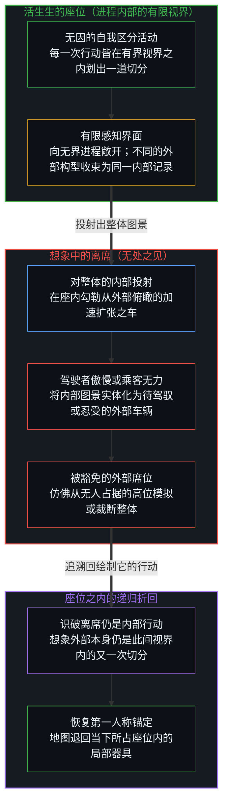
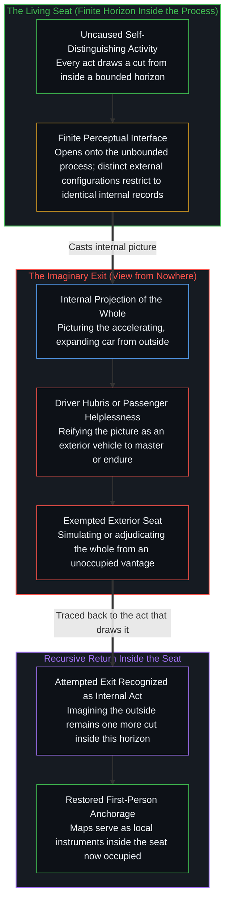
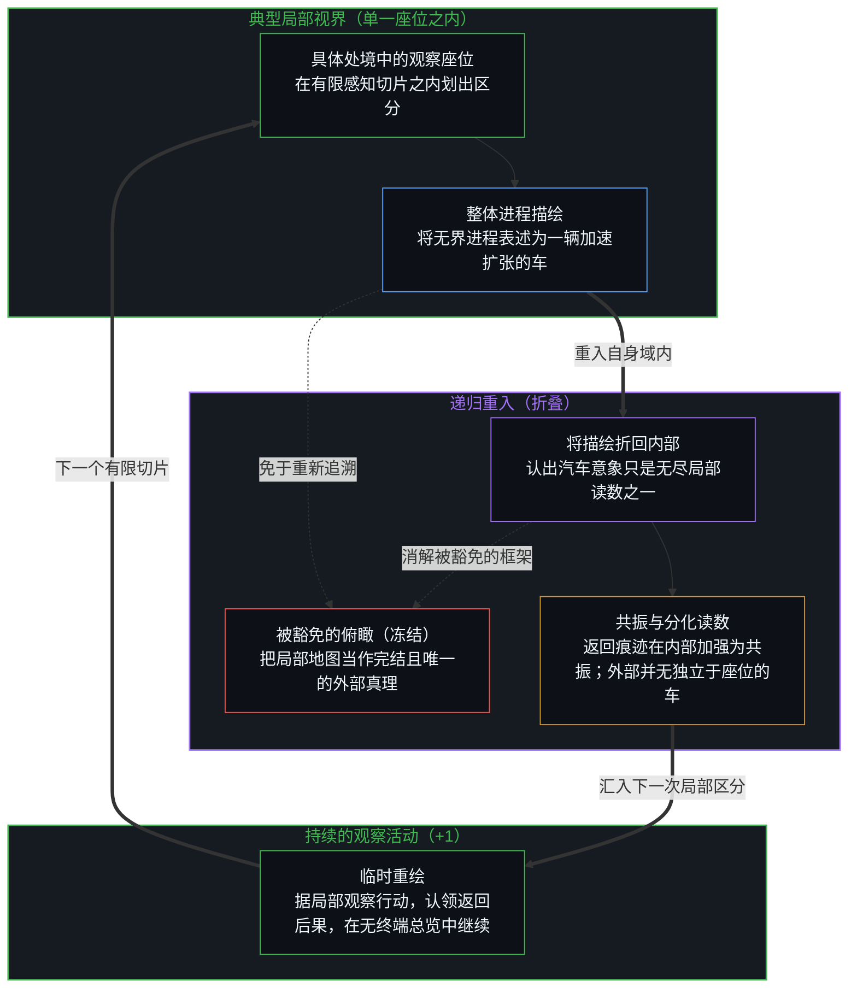
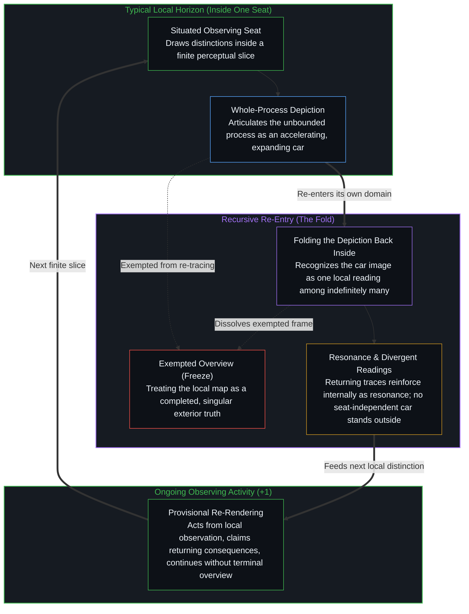

# 座位之内的无限进程 / Infinity Within the Seat

*每种整体描绘皆是座内局部读数，将其递归折回，便见现实即心智持续的观察活动。 / Every map of the whole is a local reading from one seat; folding it back reveals reality as the Mind's ongoing observing.*

很容易想象自己驾着一辆不断加速、扩张的车，将世界甩在身后，或是作为车内乘客感到自己正被抛下，直到意识到车上每个人既在驾驶又在被载，都试图在自己的座位上掌舵，即便在座内勾勒出整辆车的模样，也无从踏出车外去审视它的全貌。这一认识随即反折回自身：那辆加速、扩张的车，本身就是在有限视界之内画出的典型局部读数，既非穷尽，亦非唯一；其他座位从这一无界进程中截取了不同的截面，各自登记出扩张、收缩或静止。

It is easy to imagine leaving the world behind as the driver of an accelerating, expanding car, or feeling left behind as a passenger inside it, until the realization arrives that every occupant is both driver and passenger trying to steer from their own seat, unable to step outside to inspect the vehicle as a whole even while picturing what the vehicle looks like from within that seat. That recognition turns immediately back on itself: the accelerating, expanding car is itself one typical local reading drawn inside a finite horizon—neither exhaustive nor singular—while other seats cut other cross-sections of an unbounded process that register expansion, contraction, or stasis.

既然无人能够离开座位俯瞰全局或居高指挥其他座位，唯一可得的协调行动，便是依据自身观察所推断的自身行动，以及回到同一视界之内的相应后果；在那里，痕迹的相互加强于内部登记为共振。将开篇的汽车意象折回进程之内，现实便显现为永不止息、递归且分形的观察活动序列——穿过每一个有限座位无定界地延伸，却始终锚定在活生生的第一人称区分边缘。

Because no occupant leaves a seat to survey the whole or direct other seats from above, the sole coordinating action available is one's own action inferred from one's own observations, together with the consequences that return inside the same horizon, where mutual trace-reinforcement registers internally as resonance. Folding the opening car image back into the process reveals reality as an unceasing, recursive, fractal succession of observational acts—extending without fixed boundary through every finite seat while staying anchored at the living first-person edge of distinction.

## 一、 无人能够离开的座位 / 1. The Seat That Cannot Be Left

自我区分活动发生——无因而起，无止无休。称其为心智：已在进行中的观察者，其每一活动皆为一次区分。心智始终已在某一座位之内。座位就是每一次观察活动所携带的有界立足点与有限感知视界：每一道区分都从具体视角划出一个“这个”，向持续展开的无界进程敞开，却严格留在进程内部。开篇车辆意象的截然两面——紧握方向盘、自以为驾着扩张机器将世界甩在身后的驾驶者，以及感到被裹挟前行、遭抛在身后的乘客——依赖的是同一记隐蔽动作：把这辆车想象成一件已完成的外在客体，仿佛能站在所有座位之外加以审视。

Self-distinguishing activity occurs — uncaused, unceasing. Call it the Mind: the observer already underway, every act of which is a distinction. The Mind is always already inside a seat. A seat is the bounded vantage and finite perceptual horizon carried by each act of observation: every distinction bounds a *this* from a concrete perspective, opening onto an unbounded, continuously unfolding process while staying strictly inside it. Both halves of the opening vehicle image—the driver imagining leaving the world behind at the wheel of an expanding machine, and the passenger feeling carried along and left behind—rest on one hidden move: picturing the car as a finished exterior object inspected from outside its seats.

一切试图离开座位、检视全车的举动，本身仍是在座位内发生的又一次区分活动。从高处勾勒车辆全貌，是在借此间视界的有限资源绘制一张内部地图，从未构成对视界的逃离。正如[无法逃逸的心智视界](../one-cannot-escape-ones-own-mind/)所揭示的，任何宇宙尺度或形式坐标网格皆在不可逃离的第一人称孔径内渲染而成；正如[定义者的席位与离地的幻觉](../the-defining-seat/)所指出的，宣称占据人类之外的王座以裁断人类局限，这一姿态本身便已施行了离地的幻觉；一切试图跨出自闭合回路去俯瞰或重建该回路的努力，正如[没有外部](../no-outside-jumps-closed-loops-and-the-unreplicable-autonomy-of-mind/)所确立的，全都严格运转在这条回路之内。

Every attempt to leave the seat and inspect the whole car occurs as one more distinguishing act inside the seat. Picturing the vehicle from above constructs an internal map using the finite resources of this horizon, never an exit from it. Just as every cosmological scale or formal coordinate grid is rendered inside an inescapable first-person aperture in [One Cannot Escape One's Own Mind](../one-cannot-escape-ones-own-mind/), and just as claiming a throne outside humanity to judge human limits already enacts the departure illusion in [The Defining Seat](../the-defining-seat/), any effort to step outside the self-closing circuit to survey or rebuild it runs strictly inside that circuit, as [No Outside](../no-outside-jumps-closed-loops-and-the-unreplicable-autonomy-of-mind/) establishes.

物理学与推断理论中针对嵌入观察者的形式传统，在自身假定之内同样撞上了这道结构之墙，同时也标出了形式模型各自的边界。奥托·罗斯勒的内物理学区分了“外物理学”与“内物理学”：前者虚构出立于宇宙之外的超级观察者，后者则刻画嵌入动力学内部的观察者如何唯有透过内部界面接触世界；在协同形变机制下，任何将观察者与测量仪器同步形变的全局变换，在该界面上皆无从察觉。然而，罗斯勒用以研究这一落差的方法——微观建构主义——恰恰是构建计算机模拟的模型宇宙，再从外部检视被模拟的内观察者，从而在更高一层重新装上了一个外部座位；这正显出，一套论述嵌入性的理论多么容易漏掉正在运行模拟的理论家自己的座位。托马斯·布罗伊尔的自测量定理与大卫·沃尔珀特的物理推断极限，则通过状态限制映射与对角化方法形式化了这道内部界限：任何在物理上包含于更大系统之内的观察者或推断装置（O ⊂ S），都会面对多个不同的全局状态被压缩为同一内部记录的情形——即主观上不可区分的状态——由此在经典与量子、决定论与随机域中一并排除了系统内部的拉普拉斯妖。两项定理都在方程中把视界局限磨得格外锋利，同时也恰好触及[框架的边界](../the-boundary-of-the-frame/)所追溯的界限：为了证明内部不完备，二者都在起点处从分析者的书桌前预设了一个封闭的全局状态空间（Ω 或 U）——这是一套富有成效的形式脚手架，而绘出这套脚手架的动作本身，依然发生在某个具体处境的座位之内。

Formal embedded-observer traditions in physics and inference encounter this same structural wall from inside their own assumptions, while marking where formal models reach their own boundary. Otto Rössler's endophysics separates *exophysics*—a fictitious external super-observer standing outside the universe—from *endophysics*, in which an observer embedded inside the dynamics accesses the world exclusively across an internal interface; under *codeformation*, any global transformation that deforms observer and measuring apparatus identically stays undetectable across that interface. Yet Rössler's own method for studying the gap, microconstructivism, builds computer-simulated model universes and inspects simulated endo-observers from outside, reinstalling an external seat one level up and illustrating how easily an account of embeddedness drops the seat of the theorist running the simulation. Thomas Breuer's self-measurement theorem and David Wolpert's physical limits of inference formalize the internal bound through state-restriction mapping and diagonalization: any observer or inference device physically contained inside a larger system (O ⊂ S) confronts distinct global states that restrict to identical internal records—subjectively indistinguishable states—ruling out an internal Laplace's Demon across classical and quantum, deterministic and stochastic regimes alike. Both theorems sharpen the horizon limit inside their equations, and both mark the exact boundary traced in [The Boundary of the Frame](../the-boundary-of-the-frame/): to prove internal incompleteness, each begins by positing a closed global state space (Ω or U) from the analyst's desk—a productive formal scaffold whose own drawing still occurs inside a situated seat.

## 二、 局部行动与局部后果 / 2. Local Action and Local Consequence

既然没有任何心智能够退出自己的座位，唯一可采取的协调行动，便是依据自身观察所推断的自身行动，以及这些行动所带回的后果。带回的后果只在同一座位的视界之内被登记。因果也只经由这些分立的局部行动运作——每一次抉择都是独立的杠杆，虽受先前痕迹塑形，却唯独在此处发起，正如[个体抉择是唯一的因果杠杆](../individual-choices-as-the-only-causal-levers/)所确立的。

Because no Mind exits its seat, the sole coordinating action available is one's own action inferred from one's own observations, together with the consequences those actions return. Returning consequences register exclusively within the horizon of the same seat. Causality operates solely through these discrete local acts—each choice acting as its own lever shaped by prior traces yet initiated only here, as [Individual Choices as the Only Causal Levers](../individual-choices-as-the-only-causal-levers/) establishes.

这道边界随即消解了将汽车意象引申为“共同掌舵责任”、集体对齐或统一调速的读法。凡是“我们应当如何”式的处方——任何指示其他心智该如何合力驾车的指令——都早已预设了一个立于所有座位之外、无人占据的高位，仿佛能从那里俯瞰整辆车与每位乘员的内在并统一发号施令。尼克拉斯·卢曼的二阶观察理论精准剖开了这一结构：每一次观察都借划出一道主导区分（*Leitdifferenz*）来运作，而这道区分在当次行动中始终充当观察者自身的盲点（*blinder Fleck*）；观察另一位观察者如何区分，虽能照见前者的盲点，却同样携带一道属于自己的新盲点。卢曼由此诊断，所谓社会调控（*Sozialsteuerung*）与集体道德处方，皆在僭称一个不可得的外部阿基米德席位（*Standort außerhalb*），因为任何来自外部的指令一旦进入操作封闭的系统，都只能在该系统内部经由它自身的局部操作加以处理。卢曼的自创生社会学亦有其边界：严苛的第三人称系统封闭性，未能充分刻画具身活心智如何跨越界面承受不可逆的物理摩擦（+1）；然而他对那处虚悬掌舵席的揭穿，与[隐秘的上帝之眼](../the-invisible-gods-eye/)及[“共享”的两种读法与观察的边界](../the-two-readings-of-shared-and-the-observational-bound/)一脉相承——在某一座位的目的下作出的观察，可供任何怀有相容目的的座位取用，而其要求采纳的范围始终是空集。

This boundary dissolves readings of the car image that turn it into a call for "shared steering responsibility," collective alignment, or unified pacing. Every prescription of the form "what we should do"—every directive instructing other Minds how to steer the vehicle together—already presupposes an unoccupied position outside every seat from which the whole vehicle and every occupant's interior could be surveyed and commanded. Niklas Luhmann's theory of second-order observation isolates this exact structure: every observation works by drawing a guiding distinction (*Leitdifferenz*) that stays the observer's blind spot (*blinder Fleck*) during that act, and observing how another observer distinguishes exposes that first blind spot only by carrying a new blind spot of its own. Luhmann diagnosed calls for societal steering (*Sozialsteuerung*) and collective moral prescriptions as claims to an unavailable external Archimedean seat (*Standort außerhalb*), because any external directive entering an operationally closed system is processed exclusively inside that system through its own local operations. Luhmann's autopoietic sociology reaches its own boundary where strict third-person system closure under-specifies how embodied living Minds absorb irreversible physical friction (+1) across boundaries; yet his exposure of the unoccupied steering seat holds directly alongside [The Invisible God's Eye](../the-invisible-gods-eye/) and [The Two Readings of Shared and the Observational Bound](../the-two-readings-of-shared-and-the-observational-bound/)—an observation made under one seat's purpose remains available to any seat bringing a compatible purpose while carrying an empty range of required uptake.

撤去外部指挥席之后，大尺度对齐究竟如何出现便一目了然。各个中心不断向外输出持久的痕迹——价格、话语、代码、契约与物理构造——其中不乏有意的局部行动，意在把信号留在其他座位可遭遇之处。但发出痕迹本身仍是某一座位内的局部行动，而每一次接取、重释、修订或拒绝，也严格留在接收座位自己的回路之中。座位之间的因果，只在于塑形哪些痕迹可供后续行动取用；没有任何心智能够代另一心智完成它的回返。任何更大尺度的协调，都是在众多彼此独立的局部回路并行运转、借由外化痕迹间接耦合时浮现的，而非自外部发号施令的结果。

Dropping the exterior command bench clarifies how large-scale alignment arises at all. Centers continually externalize durable traces—prices, spoken sentences, code, contracts, physical structures—including deliberate local acts meant to leave signals where other seats can encounter them. Yet emitting a trace stays a local act inside one seat, and every uptake, re-interpretation, revision, or refusal stays strictly inside the receiving seat's own loop. Between seats, causality consists exclusively of patterning which traces are available to subsequent acts; no Mind completes another Mind's return. Any larger coordination appears when many independent local loops run in parallel, coupled indirectly through externalized traces rather than directed from outside.

三支传统阐明了这种以痕迹为媒介的耦合，同时各自显出自身的框架边界。弗里德里希·哈耶克论证，关于特定时空情势的知识只以分散、局部的洞察形态存于具体处境的行动者之中，市场价格则充当被压缩的公共痕迹，使每位行动者无需总览式计划者便能就地调适。正如[没有天才能够解决知识问题](../no-genius-can-solve-the-knowledge-problem/)所确立的，一旦公共价格被想象成某份可汇总存量的碎片，而非由每一心智各自重新建构的外化印记，哈耶克的框架便触及边界；并且价格协调依赖既定惯例，面对未定价的外部性或变动的制度域，并不保证收敛。在去中心化生物学与系统论中，皮埃尔-保罗·格拉塞提出的迹媒协调剖出了同一痕迹耦合机制：一次局部行动改变持久媒介，留下的痕迹在无蓝图、无监督者的情况下触发下一次局部行动；这一机制也唯有在痕迹的持久度与持续修订保持校准时方能成立，既不消散成噪声，也不固化为陈旧辙印。在分布式控制理论中，贾德巴拜、林与莫尔斯证明，严格遵循局部近邻规则的自主智能体，只要其随时间变化的交互图在有界时间区间内的并集保持联合连通，无需中央协调者也能达成全局航向对齐；一旦局部邻域随时间停止耦合，断连的群簇便失去一切足以令其对齐的痕迹路径。然而这项证明是在分析者的外部视角下，将所有智能体同时绘入一张全局图谱来建模跨体一致性。在活生生的因果现场中，没有任何座位能俯瞰那张全局图谱——每个座位严格只对返回自身视界的痕迹采取行动，而宏观对齐是得以维持还是分崩离析，取决于并行的局部回路能否随时间持续借痕迹相耦合。若是把共享账本、协议或协调脚手架视作供给能动性的引擎，而非承载痕迹的媒介，便重演了[协调者的范畴错误](../the-coordinators-category-error/)。

Three traditions illuminate this trace-mediated coupling while displaying their own frame boundaries. Friedrich Hayek demonstrated that knowledge of particular circumstances of time and place resides solely as dispersed, partial insight across situated actors, with market prices serving as compressed public traces that let each actor adjust locally without a synoptic planner. As [No Genius Can Solve the Knowledge Problem](../no-genius-can-solve-the-knowledge-problem/) establishes, Hayek's frame reaches its boundary wherever public prices are pictured as pieces of one gatherable stock rather than externalized marks uniquely reconstructed at each Mind, and price coordination relies on conventions that carry no guarantee of convergence across unpriced externalities or shifting regimes. In decentralized biology and systems theory, Pierre-Paul Grassé's stigmergy isolates the same trace-coupling mechanism: one local act alters a persistent medium, and that trace cues the next local act without a blueprint or supervisor, holding only while trace persistence stays calibrated to ongoing revision rather than evaporating into noise or locking into stale ruts. In distributed control theory, Jadbabaie, Lin, and Morse proved that autonomous agents following strictly local nearest-neighbor rules achieve global heading alignment without a central coordinator under the condition that the union of their time-varying interaction graphs over bounded intervals remains jointly connected; once local neighborhoods cease to couple over time, disconnected clusters lose any trace path that would align them. That proof models cross-agent consistency from an external analyst's global graph drawn over all agents at once. Inside lived causality, no seat surveys that global graph—each seat acts strictly on traces returning into its own horizon, while macro-alignment holds or fragments as parallel local loops remain trace-coupled over time. Treating a shared ledger, protocol, or coordination scaffold as the engine that supplies agency rather than as a medium of traces repeats [The Coordinator's Category Error](../the-coordinators-category-error/).

## 三、 不同座位看见不同的车 / 3. Different Seats See Different Cars

这一进程无固定边界地延伸。每一心智的有限感知视界各自截取其中不同的截面，因此在某一座位上登记到的“车”，从不是另一座位所检视的同一全局客体。在任一既定视界之内，局部测量直接依观察者的速度、采样率与参照系，登记出扩张、收缩或静止。这些表观动态属于有限视界与展开中场域的关系，从不属于某个立于所有座位之外、脱离观察者的整体。

The process extends without fixed boundary. Each Mind's finite perceptual horizon cuts a different cross-section of it, so the "car" that registers at one seat is never an identical global object inspected by another. Within any given horizon, local measurements register expansion, contraction, or stasis directly according to the observer's velocity, sampling rate, and frame of reference. Those apparent dynamics belong to the finite horizon's relation to the unfolding field, never to an observer-free whole standing outside all seats.

物理学与信号处理中的具体机制表明，无需引入任何外部基质，单凭视界、运动状态与采样节拍，便足以同时改变边界与表观方向。在指数扩张的德西特时空中，吉本斯与霍金证明，每条惯性世界线都处于各自静态片区的中心，外围由一道宇宙学事件视界所界定，视界之外的未来信号永不抵达该观察者；一旦挪动世界线，视界本身便随之移位，标明的是一道相对于轨迹的因果切口，而非插在全局空间中的围墙。即便在平直的闵可夫斯基时空中，林德勒与安鲁也证明，一名匀加速观察者会遭遇林德勒事件视界并登记出一片粒子热浴，而置身同一时空的惯性观察者登记到的却是空无一物的真空，且毫无视界——无论边界还是界内所登记之物，皆严格随观察者的运动状态而移易。这两套相对论模型都运行于物理学家书桌前草绘出的理想化、最大对称经典流形之内，每当这一坐标流形被误认作实在的边缘，而非相对于轨迹的描述时，它们便触及自身边界。在离散采样的尺度上，奈奎斯特-香农定理指出，只要观察者对连续周期进程的采样频率低于其最高频率的两倍（fₛ < 2W），高频成分就会折叠回低频混叠之中：在频闪车轮效应里，同一段连续旋转严格依采样节拍与进程速率之比，可以登记为向前转动、全然静止或表观倒转，与[可见性的速度差](../the-velocity-of-visibility/)所追溯的渲染节拍与被采样褶皱之间的速度差相互呼应。从形式上看，时间混叠刻画的是在稳定时钟下测量的带限周期信号，因此在此充当操作类比，用以说明有限采样如何塑造所登记的动态，而非直接覆盖开放扩张的字面定理。

Concrete mechanisms in physics and signal processing show how horizon, motion, and sampling cadence alter both boundary and apparent direction without invoking an exterior essence. In exponentially expanding de Sitter spacetime, Gibbons and Hawking showed that each inertial worldline sits at the center of its own static patch, bounded by a cosmological event horizon beyond which future signals never reach that observer; shifting the worldline shifts the horizon itself, marking a trajectory-relative causal cut rather than a wall planted in global space. Even in flat Minkowski spacetime, Rindler and Unruh showed that a uniformly accelerating observer encounters a Rindler event horizon and registers a thermal bath of particles, whereas an inertial observer in the exact same spacetime registers empty vacuum and no horizon—both the boundary and what registers inside it shift strictly with the observer's motion. Both relativistic models operate inside idealized, maximally symmetric classical manifolds drafted from the physicist's desk, marking their boundary wherever the coordinate manifold is mistaken for an edge of reality rather than a trajectory-relative description. At the scale of discrete sampling, the Nyquist–Shannon theorem shows that whenever an observer samples a continuous periodic process below twice its highest frequency (fₛ < 2W), higher frequencies fold back into lower-frequency aliases: in the stroboscopic wagon-wheel effect, one continuous rotation registers as forward motion, complete stasis, or apparent reversal strictly as a function of sampling cadence relative to process rate, echoing the velocity differential between rendering cadence and sampled folds traced in [The Velocity of Visibility](../the-velocity-of-visibility/). Formally, temporal aliasing governs band-limited periodic signals measured against a stable clock, serving as an operational analogy for how finite sampling shapes registered dynamics rather than a literal theorem covering open-ended expansion.

既然不同座位各自截取了不同的截面——此处登记为扩张，彼处登记为收缩，别处登记为静止——便不再存在一辆独立于所有座位的单一车辆，其全局状态可供共识核验。恰在这道门槛上，藏着两个陷阱。第一个陷阱滑向视角唯我论，宣称余下的“只是彼此互不重叠的局部读数集合”。与之相对的陷阱则试图缓和这种孤立，站在外部宣称不同座位持有“部分重叠的读数”。两种宣告都重新装上了它们原本试图消解的无处之见。凌驾于两处分离的座位之上，仿佛在一张无形的韦恩图里俯视它们的内在，再宣布这两个视界究竟是重叠还是不重叠，其前提正是预设了一个无人占据的外部高台，得以同时窥入两个心智。

Once different seats cut distinct cross-sections—registering expansion here, contraction there, stasis elsewhere—no seat-independent global state of a single car stands available for consensus verification. Two traps wait at this exact threshold. One trap swings into perspectival solipsism by declaring that what remains is "only a collection of non-overlapping local readings." The opposing trap tries to soften that isolation by declaring from outside that distinct seats hold "partially overlapping readings." Both declarations reinstall the exact view from nowhere they set out to dissolve. Standing above two separate seats to inspect their interiors on an invisible Venn diagram and announce whether those two horizons overlap or fail to overlap presupposes an unoccupied external perch looking into both Minds simultaneously.

严格从座位内部追溯，跨越不同心智而运作的是共振。外化痕迹留存于场域之中，并经由交互返回；凡返回的痕迹在本心智自身视界内加强既有模式之处，这种痕迹的相互加强便在内部登记为共振。在这一心智自己的视界之内，共振显现为交叠——被体验为共同基础、彼此理解或同一对象——而未获对齐的分歧则在局部登记为摩擦或偏离。没有任何心智会离开自己的座位，去从外部核验两个内在究竟重叠与否；正因如此，[共享意识是个体性的交集](../shared-consciousness-is-intersecting-individualities/)将共享严格奠基于单一心智的局部登记，而[共享沙盒的幻象](../the-illusion-of-the-shared-sandbox/)则把公共语词、价格与读数读作低维出清痕迹，而非相同共享内在的凭证。卡洛·罗韦利的关系量子力学，及其与艾米莉·阿德拉姆共同推进的“跨视角关联”，在物理学内部照亮了这道刀锋。正统关系量子力学主张物理变量严格只相对于交互系统才取得确定值，由此剔除了独立于观察者的全局状态，却引来了视角唯我论的指责；阿德拉姆与罗韦利遂引入跨视角关联——若系统 A 在一次交互中登记了某项物理事实，而系统 B 随后在未经擦除的情况下测量 A 的物理记录，B 的结果将与 A 所登记的事实一致——以此表明跨视角一致性只经由与痕迹的物理交互传递，而非源自鸟瞰式的全局状态。跨视角关联的精确边界恰恰落在这条表述本身：作为在分析框架内把 A 与 B 并置配对的第三人称公设，它依然是从两个座位之外建模跨座一致性，撞上了[对象是被稳定化的关系](../objects-are-stabilized-relationships/)与[割点可移不可除](../the-cut-moves-but-never-vanishes/)所追溯的扁平第三人称对称性边界。在活生生的因果现场中，没有任何座位站在第三个高台上同时审视 A 与 B；每个座位严格只登记返回自身视界的痕迹，以及这些痕迹在内部激起的共振。

Traced strictly from inside a seat, what operates across distinct Minds is resonance. Externalized traces persist in the field and return through interaction; where returning traces reinforce patterns inside this Mind's own horizon, that mutual trace-reinforcement registers internally as resonance. Inside that Mind's own horizon, resonance appears as overlap—experienced as shared ground, mutual understanding, or a common object—while unresolved non-alignment registers locally as friction or divergence. No Mind vacates its seat to verify overlap or non-overlap between two interiors from outside, which is why [Shared Consciousness Is Intersecting Individualities](../shared-consciousness-is-intersecting-individualities/) grounds sharedness strictly in one Mind's local registration and [The Illusion of the Shared Sandbox](../the-illusion-of-the-shared-sandbox/) reads public words, prices, and readings as low-dimensional clearing traces rather than proof of an identical shared interior. Carlo Rovelli's Relational Quantum Mechanics and its refinement with Emily Adlam, Cross-Perspective Links, illuminate this knife-edge inside physics. Orthodox RQM eliminated observer-independent global states by holding that physical variables take definite values strictly relative to an interacting system, drawing charges of perspectival solipsism; Adlam and Rovelli introduced Cross-Perspective Links—if system A registers a physical fact in an interaction and system B subsequently measures A's physical record without erasure, B's outcome matches A's registered fact—showing that consistency across perspectives moves exclusively through physical interaction with traces rather than a bird's-eye global state. The exact boundary of Cross-Perspective Links sits in that very formulation: written as a third-person postulate pairing A and B inside an analytical frame, CPL still models cross-seat consistency from outside both seats, running into the flat third-person symmetry boundary traced in [Objects Are Stabilized Relationships](../objects-are-stabilized-relationships/) and [The Cut Moves but Never Vanishes](../the-cut-moves-but-never-vanishes/). Within lived causality, no seat inspects A and B from a third perch; each seat registers exclusively the traces returning into its own horizon and the internal resonance they produce.

## 四、 原初描述作为一次折叠 / 4. The Original Description as One Folding

开篇的汽车比喻此刻便直接折回自身，显现为一次典型的局部读数。它始于某一寻常的有限视界，借用该视界的局部意象去指认包含它的无界进程，继而将所得描绘折回为无尽局部视见中的一种。这一折叠正是内部描述的结构本身：每一种对整体的描绘都生发自有限的感知切片，既不携完备性，亦不具唯一性。给出这幅关于车的图景本身，便当场表明没有任何图景立于车外。

The opening car metaphor now folds directly back onto itself as one typical local reading. It starts inside one ordinary limited horizon, draws on that horizon's local imagery to gesture at the unbounded process containing it, and then folds the resulting depiction back into the status of one local view among indefinitely many. This folding is the exact structure of internal description: every depiction of the whole originates from a finite perceptual slice and carries neither completeness nor singularity. Offering a picture of the car immediately demonstrates that no picture stands outside the car.

乔治·斯宾塞-布朗在《形式之律》中以“重入”为名，为这一动作给出了精确的形式语法。划出一道边界便分开了标记空间与未标记空间；当一个形式越过自身边界重新进入自身空间（f = ¬f）时，静态空间求值会在矛盾中停滞，而一旦将重入按序展开，静态悖论便转化为时间振荡——直接从自指中生出序列与时间。重入由此阐明，为何将加速之车的描述折回座位之内并不会坍缩为自我反驳，反而让进程持续推进；同时，它也清晰标出自身的边界：《形式之律》是一套关于区分与记号的形式演算，作为结构语法颇有用途，却从不化作脱离具体处境之心智、自行运转的形式宇宙——每一道记号仍由该心智划出并一再重绘。

G. Spencer-Brown's *Laws of Form* gives a precise formal grammar for this move under the name re-entry. Drawing a boundary divides marked space from unmarked space; when a form crosses its own boundary and re-enters its own space (f = ¬f), static spatial evaluation stalls in contradiction, whereas unfolding the re-entry sequentially turns static paradox into temporal oscillation—generating sequence and time directly from self-reference. Re-entry clarifies why folding the accelerating-car description back into the seat keeps the process moving instead of collapsing into self-refutation, while marking its own boundary clearly: *Laws of Form* operates as a formal calculus of distinctions and marks, useful as structural grammar while never becoming a self-running formal universe detached from the situated Mind that draws and re-draws every mark.

同一道折叠，也把冻结的自我形象与开放的递归观察区分开来。在[自我形象仿佛从无处发声](../self-image-speaks-as-if-from-nowhere/)中，心智在自身场域之内将自己重新投射为一幅有界形象，却忘记内画框依然画在同一张画布之上，任由这方内框仿佛立于房间之外发声。在[加速替换与形象滞后](../accelerating-replacement-and-image-lag/)中，被压缩的替换间隔让同一心智同时置身于自己所造之物与正在超越己身之物之间；每当被保留的形象落后于移动的步伐，那辆加速行驶的车辆便显得像一台从外部席卷座位前行的机器。将开篇的汽车意象折回为一次局部读数，恰恰扭转了这种冻结：描绘无界进程的地图敞开为画中之画，也将[无穷总体的海市蜃楼](../the-mirage-of-the-infinite-totality/)抛在身后——无穷由此显现为在有限视界之内持续区分的无穷尽潜能，而从不是一件立于外部即可尽收眼底的已完成总体。

The same fold separates a frozen self-image from open recursive observation. In [Self-Image Speaks as if from Nowhere](../self-image-speaks-as-if-from-nowhere/), the Mind re-projects itself inside its own field as a bounded image and forgets that the inner frame stays painted on the same canvas, allowing that inner frame to speak as if from outside the room. In [Accelerating Replacement and Image Lag](../accelerating-replacement-and-image-lag/), compressed replacement intervals place one Mind simultaneously inside what it built and what is overtaking it, making the accelerating vehicle feel like an exterior machine sweeping the seat along whenever a retained image lags the moving step. Folding the opening car image back into one local reading reverses that freeze: the map of the unbounded process stands openly as a picture inside the picture, leaving [The Mirage of the Infinite Totality](../the-mirage-of-the-infinite-totality/) behind—infinity appears as the inexhaustible potential of distinguishing to continue from inside finite horizons, never as a completed totality surveyed from outside.

## 五、 作为观察活动的现实 / 5. Reality as Observing Activity

一旦开篇描绘折回座位之内，持续活跃着的便是一场永不止息的进程，其实在性严格就在于观察活动的接续。每一心智不断生成、检验、修正并重新嵌入自身的局部图景，没有任何终端总览能中止或完结这一序列。车从不是立于外部、乃至从预先给定的静止座位上加以审视的固定客体；被登记为“车”的，正是这些观察活动本身的持续展开——它们递归地标示出自身的局部性，却从未退出其中。

Once the opening depiction folds back inside the seat, what stays active is a never-ceasing process whose actuality consists strictly in the succession of observational acts. Each Mind continuously generates, tests, revises, and re-embeds its own partial picture, with no terminal overview halting or completing the sequence. The car is never a fixed object inspected from outside or even from stationary, pre-given seats; what registers as the car is the ongoing activity of those observations themselves, recursively indexing their own partiality while never exiting it.

海因茨·冯·福斯特的二阶控制论在系统论内部追溯了同样的倒转。一阶控制论假定一个外部控制者的席位，以此建模“被观察的系统”；二阶控制论则将观察者折入反馈回路之中，指出经验中稳定显现的“对象”是作为本征形式（O = F(O)）存续的——它们是唯有通过持续的观察与行动递归循环方得以维系的不变不动点，而非躲在幕后静候检视的独立实体。每当操作建构主义被读作脱离不可逆代价的无摩擦唯心论时，二阶控制论便触及自身边界：每一条递归回路都锚定在接触瞬间遭遇的因果摩擦（+1）之中，这正是[对象是被稳定化的关系](../objects-are-stabilized-relationships/)所追溯的地基——对象登记为经受住因果摩擦的关系不变量——亦即[现实是心智持续的实现](../reality-is-the-minds-ongoing-realization/)所指明之处：每一道新近接起的区分，对那一心智而言便是正在行进的现实。

Heinz von Foerster's second-order cybernetics traces this same inversion inside systems theory. Whereas first-order cybernetics models *observed* systems from an assumed external controller's bench, second-order cybernetics folds the observer inside the feedback loop, showing that stable experienced "objects" persist as eigenforms (O = F(O))—invariant fixed points sustained exclusively through ongoing recursive cycles of observation and action rather than freestanding substances waiting behind the curtain. Second-order cybernetics reaches its own boundary whenever operational constructivism is read as frictionless idealism detached from irreversible cost: each recursive loop anchors in the causal friction (+1) it encounters upon contact, the exact ground traced in [Objects Are Stabilized Relationships](../objects-are-stabilized-relationships/)—where objects register as relational invariants surviving causal friction—and [Reality Is the Mind's Ongoing Realization](../reality-is-the-minds-ongoing-realization/), where every newly taken-up distinction is reality moving for that Mind.

这种递归的自我嵌入在跨越尺度时呈现出分形结构。从某一典型视角出发，在该视角内阐明无界进程，再将这一阐明折回为无尽视角之一，这一步既无底限亦无顶盖地一再重演：在每一分辨率上，一道有界切分都承载着无界进程的图景，同时不断被进一步的区分从内部刺穿。正如[现实扭曲力场颠倒了基线](../the-reality-distortion-field-inverts-the-baseline/)借本华·曼德博的分形几何所追溯的，自相似结构表达的正是开放跨尺度地递归重入自身。这一几何表达的边界同样清晰：曼德博的分形——以及度量空间上的迭代压缩映射——是依固定规则细分一个既定的外围空间，提供的是描述性的数学纹理，而非第二重本体论地基。活生生的观察活动溢出于任何预先给定的外围容器；正如[感知的界限与理解的无限](../the-boundary-of-perception-and-the-infinity-of-understanding/)所表明的，感知的每一道有限界限皆是一次划分留下的痕迹，理解由此在毫无固定围墙的开放之中绵延展开。

This recursive self-embedding is fractal across scales. Starting inside a typical perspective, articulating the unbounded process within that perspective, and folding that articulation back as one perspective among indefinitely many repeats without bottom or ceiling: at every resolution, a bounded cut holds an image of the unbounded process while remaining perforated from within by further distinguishing. As [The Reality Distortion Field Inverts the Baseline](../the-reality-distortion-field-inverts-the-baseline/) traces through Benoit Mandelbrot's fractal geometry, self-similar structures express openness re-entering itself recursively across scales. The boundary of that geometric expression stays equally crisp: Mandelbrot's fractals—and iterated contraction maps on a metric space—subdivide a fixed ambient space by fixed rules and supply descriptive mathematical texture rather than a second ontological ground. Lived observing activity exceeds any pre-given ambient container; as [The Boundary of Perception and the Infinity of Understanding](../the-boundary-of-perception-and-the-infinity-of-understanding/) shows, each finite boundary of perception is the trace of a division from which understanding unfolds endlessly without fixed walls.

认清无界进程之内的座位，便直接化解了开篇的两极对立。车外并无一座等待驾驶者将世界甩在身后去夺取的外部王座，也不存在一辆从外部拖曳无助乘客的自主车辆。每一次行动、每一项返回的后果，以及每一张描绘整体的地图，全都已在当下所占的座位之内展开。因果始终锚定在活生生的第一人称边缘（+1）：直接从这一视界观察，依此处登记之物行动，不设托辞地认领返回的后果，凡外化痕迹相互加强处便登记共振，并将每一幅整体图景轻持为一份暂时且可重绘的读数，置入心智永不止息的观察活动之中。

Recognizing the seat inside the unbounded process settles the opening polarity directly. No exterior throne waits to be seized by a driver leaving the world behind, and no autonomous vehicle drags a helpless passenger from outside. Every action, every returning consequence, and every map of the whole already unfolds inside the seat now occupied. Causality stays anchored at the living first-person edge (+1): observing directly from this horizon, acting on what registers here, claiming returning consequences without alibi, registering resonance wherever externalized traces reinforce, and holding every picture of the whole lightly as one provisional, re-renderable reading inside the unceasing observing activity of the Mind.
