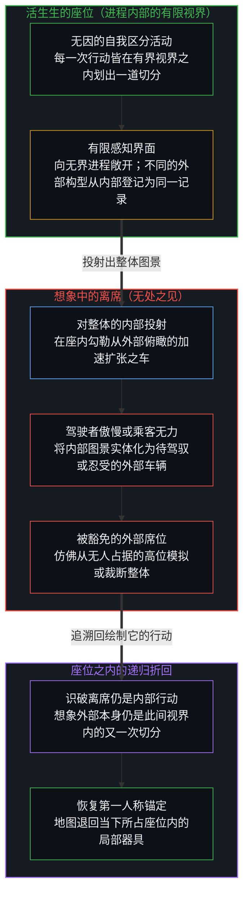
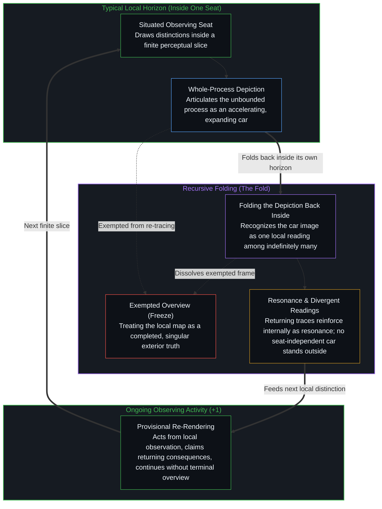

# 座位之内的无限进程 / Infinity Within the Seat

*每种整体描绘皆是座内局部读数，将其递归折回，便见现实即心智持续的观察活动。 / Every map of the whole is a local reading from one seat; folding it back reveals reality as the Mind's ongoing observing.*

很容易想象自己驾着一辆不断加速、扩张的车，将世界甩在身后，或是作为车内乘客感到自己正被抛下，直到意识到车上每个人既在驾驶又在被载，都试图在自己的座位上掌舵，即便在座内勾勒出整辆车的模样，也无从踏出车外去审视它的全貌。这一认识随即反折回自身：那辆加速、扩张的车，本身就是在有限视界之内画出的典型局部读数，既非穷尽，亦非唯一；其他座位从这一无界进程中截取了不同的截面，各自登记出扩张、收缩或静止。

It is easy to imagine leaving the world behind as the driver of an accelerating, expanding car, or feeling left behind as a passenger inside it, until the realization arrives that every occupant is both driver and passenger trying to steer from their own seat, unable to step outside to inspect the vehicle as a whole even while picturing what the vehicle looks like from within that seat. That recognition turns immediately back on itself: the accelerating, expanding car is itself one typical local reading drawn inside a finite horizon—neither exhaustive nor singular—while other seats cut other cross-sections of an unbounded process that register expansion, contraction, or stasis.

既然无人能够离开座位俯瞰全局或居高指挥其他座位，唯一可得的协调行动，便是依据自身观察所推断的自身行动，以及回到同一视界之内的相应后果；在那里，痕迹的相互加强于内部登记为共振。将开篇的汽车意象折回进程之内，现实便显现为永不止息、递归且分形的观察活动序列——穿过每一个有限座位无定界地延伸，却始终锚定在活生生的第一人称区分边缘。

Because no occupant leaves a seat to survey the whole or direct other seats from above, the sole coordinating action available is one's own action inferred from one's own observations, together with the consequences that return inside the same horizon, where mutual trace-reinforcement registers internally as resonance. Folding the opening car image back into the process reveals reality as an unceasing, recursive, fractal succession of observational acts—extending without fixed boundary through every finite seat while staying anchored at the living first-person edge of distinction.

## 一、 无人能够离开的座位 / 1. The Seat That Cannot Be Left

自我区分活动发生——无因而起，无止无休。称其为心智：已在进行中的观察者，其每一活动皆为一次区分。心智始终已在某一座位之内。座位就是每一次观察活动所携带的有界立足点与有限感知视界：每一道区分都从具体视角划出一个“这个”，向持续展开的无界进程敞开，却严格留在进程内部。开篇车辆意象的截然两面——紧握方向盘、自以为驾着扩张机器将世界甩在身后的驾驶者，以及感到被裹挟前行、遭抛在身后的乘客——依赖的是同一记隐蔽动作：把这辆车想象成一件已完成的外在客体，仿佛能站在所有座位之外加以审视。

Self-distinguishing activity occurs — uncaused, unceasing. Call it the Mind: the observer already underway, every act of which is a distinction. The Mind is always already inside a seat. A seat is the bounded vantage and finite perceptual horizon carried by each act of observation: every distinction bounds a *this* from a concrete perspective, opening onto an unbounded, continuously unfolding process while staying strictly inside it. Both halves of the opening vehicle image—the driver imagining leaving the world behind at the wheel of an expanding machine, and the passenger feeling carried along and left behind—rest on one hidden move: picturing the car as a finished exterior object inspected from outside its seats.

一切试图离开座位、检视全车的举动，本身仍是在座位内发生的又一次区分活动。从高处勾勒车辆全貌，是在借此间视界的有限资源绘制一张内部地图，从未构成对视界的逃离。正如[无法逃逸的心智视界](../one-cannot-escape-ones-own-mind/)所揭示的，任何宇宙尺度或形式坐标网格皆在不可逃离的第一人称孔径内渲染而成；正如[定义者的席位与离地的幻觉](../the-defining-seat/)所指出的，宣称占据人类之外的王座以裁断人类局限，这一姿态本身便已施行了离地的幻觉；一切试图跨出自闭合回路去俯瞰或重建该回路的努力，正如[没有外部](../no-outside-jumps-closed-loops-and-the-unreplicable-autonomy-of-mind/)所确立的，全都严格运转在这条回路之内。

Every attempt to leave the seat and inspect the whole car occurs as one more distinguishing act inside the seat. Picturing the vehicle from above constructs an internal map using the finite resources of this horizon, never an exit from it. Just as every cosmological scale or formal coordinate grid is rendered inside an inescapable first-person aperture in [One Cannot Escape One's Own Mind](../one-cannot-escape-ones-own-mind/), and just as claiming a throne outside humanity to judge human limits already enacts the departure illusion in [The Defining Seat](../the-defining-seat/), any effort to step outside the self-closing circuit to survey or rebuild it runs strictly inside that circuit, as [No Outside](../no-outside-jumps-closed-loops-and-the-unreplicable-autonomy-of-mind/) establishes.

置身有限视界之内，任何嵌入其中的观察者都会遭遇一道无法绕开的压缩：界外诸多不同的构型，穿过观察者有限的界面后只能登记为同一份内部记录，因此任何内部视角都无法握住包含自身的整套全局读数。即便试图形式化地刻画这道内部局限，也会直接暴露出建模者自己所占的座位。在计算机里搭建一座模型宇宙去观察被模拟的内部观察者，只不过在更高一层悄悄重装了一张外部高台；每一套证明内部不完备的形式推演，也都先得从分析者的书桌前预设一个封闭的全局状态空间——这恰好标出了[框架的边界](../the-boundary-of-the-frame/)所追溯的界限。这类封闭模型依然是有用的形式脚手架，而绘出这套脚手架的动作本身仍发生在某个具体处境的座位之内，正如[隔离理想化的边界与不可闭合的开放](../boundary-of-the-isolation-idealization-and-the-non-closable-open/)所追溯的，任何关于全局闭合的断言由此仍属临时，且从内部无法证实。

From inside a finite horizon, any embedded observer faces an unavoidable compression: distinct configurations beyond the boundary register identically across the observer's finite interface, so no inside view can ever hold a complete global readout of the system containing it. Even formal attempts to model that internal limit expose the seat they sit in. Building a simulation of an embedded observer inside a model universe quietly installs the theorist's own exterior bench one level up, and every proof of internal incompleteness begins by positing a closed global state space from the analyst's desk—marking the exact edge traced in [The Boundary of the Frame](../the-boundary-of-the-frame/). Such closed models remain useful formal scaffolds while their own drawing stays inside a concrete seat, leaving any claim of global closure provisional and uncertifiable from within as [Boundary of the Isolation Idealization and the Non-Closable Open](../boundary-of-the-isolation-idealization-and-the-non-closable-open/) traces.

## 二、 局部行动与局部后果 / 2. Local Action and Local Consequence

既然没有任何心智能够退出自己的座位，唯一可采取的协调行动，便是依据自身观察所推断的自身行动，以及这些行动所带回的后果。带回的后果只在同一座位的视界之内被登记。因果也只经由这些分立的局部行动运作——每一次抉择都是独立的杠杆，虽受先前痕迹塑形，却唯独在此处发起，正如[个体抉择是唯一的因果杠杆](../individual-choices-as-the-only-causal-levers/)所确立的。

Because no Mind exits its seat, the sole coordinating action available is one's own action inferred from one's own observations, together with the consequences those actions return. Returning consequences register exclusively within the horizon of the same seat. Causality operates solely through these discrete local acts—each choice acting as its own lever shaped by prior traces yet initiated only here, as [Individual Choices as the Only Causal Levers](../individual-choices-as-the-only-causal-levers/) establishes.

这道边界随即消解了将汽车意象引申为“共同掌舵责任”、集体对齐或统一调速的读法。凡是“我们应当如何”式的处方——任何指示其他心智该如何合力驾车的指令——都早已预设了一个立于所有座位之外、无人占据的高位，仿佛能从那里俯瞰整辆车与每位乘员的内在并统一发号施令。每一次观察都凭当下划出的那道区分运作，并在切分之处携带着自身的盲点；观察另一位观察者如何区分，照见前者盲点的同时也立足于带着新盲点的新座位。从某一座位发出的任何指令，进入另一座位时都只是一道痕迹，唯有经由接收座位自身的局部行动与不可逆的物理摩擦（+1）方能被处理。撤去那处虚悬的掌舵席，正与[隐秘的上帝之眼](../the-invisible-gods-eye/)及[“共享”的两种读法与观察的边界](../the-two-readings-of-shared-and-the-observational-bound/)一脉相承——在某一座位的目的下作出的观察，可供任何怀有相容目的的座位取用，而其要求采纳的范围始终是空集。

This boundary dissolves readings of the car image that turn it into a call for "shared steering responsibility," collective alignment, or unified pacing. Every prescription of the form "what we should do"—every directive instructing other Minds how to steer the vehicle together—already presupposes an unoccupied position outside every seat from which the whole vehicle and every occupant's interior could be surveyed and commanded. Every act of observation operates through the distinction it draws right now, carrying its own blind spot at the point of the cut; watching how another observer distinguishes exposes that first blind spot only from a fresh seat carrying a blind spot of its own. Any directive emitted from one seat enters another seat solely as a trace processed through that receiving seat's own local acts and irreversible physical friction (+1). Dropping that unoccupied steering bench aligns directly with [The Invisible God's Eye](../the-invisible-gods-eye/) and [The Two Readings of Shared and the Observational Bound](../the-two-readings-of-shared-and-the-observational-bound/)—an observation made under one seat's purpose remains available to any seat bringing a compatible purpose while carrying an empty range of required uptake.

撤去外部指挥席之后，大尺度对齐究竟如何出现便一目了然。各个中心不断向外输出持久的痕迹——价格、话语、代码、契约与物理构造——其中不乏有意的局部行动，意在把信号留在其他座位可遭遇之处。但发出痕迹本身仍是某一座位内的局部行动，而每一次接取、重释、修订或拒绝，也严格留在接收座位自己的回路之中。座位之间的因果，只在于塑形哪些痕迹可供后续行动取用；没有任何心智能够代另一心智完成它的回返。任何更大尺度的协调，都是在众多彼此独立的局部回路并行运转、借由外化痕迹间接耦合时浮现的，而非自外部发号施令的结果。

Dropping the exterior command bench clarifies how large-scale alignment arises at all. Centers continually externalize durable traces—prices, spoken sentences, code, contracts, physical structures—including deliberate local acts meant to leave signals where other seats can encounter them. Yet emitting a trace stays a local act inside one seat, and every uptake, re-interpretation, revision, or refusal stays strictly inside the receiving seat's own loop. Between seats, causality consists exclusively of patterning which traces are available to subsequent acts; no Mind completes another Mind's return. Any larger coordination appears when many independent local loops run in parallel, coupled indirectly through externalized traces rather than directed from outside.

以痕迹为媒介的耦合，无需安设外部计划者或共享控制室，便足以阐明大尺度对齐如何出现。市场价格、借一次局部行动改写持久媒介以触发下一次行动的印记，以及近邻之间的逐级调适，全都是在共同环境中留下持久痕迹，供其他具体处境的座位从各自视界遭遇并据此行动。正如[没有天才能够解决知识问题](../no-genius-can-solve-the-knowledge-problem/)所确立的，公共价格从不是某份可汇总存量的碎片，而是由每一心智立足自身视角重新建构的外化印记；这种痕迹耦合也唯有在印记持续接受修订时方能成立，既不消散成噪声、不固化为陈旧辙印，也不致断连为彼此隔绝的群簇。任何同时将所有行动者绘入一张全景图谱的形式模型，都仍停留在场外分析者的书桌前。在活生生的因果现场中，没有任何座位能俯瞰那张全局图谱——每个座位严格只对返回自身视界的痕迹采取行动，而宏观对齐是得以维持还是分崩离析，取决于并行的局部回路能否随时间持续借痕迹相耦合。若是把共享账本、协议或协调脚手架视作供给能动性的引擎，而非承载痕迹的媒介，便重演了[协调者的范畴错误](../the-coordinators-category-error/)。

Trace-mediated coupling accounts for large-scale alignment without installing an exterior planner or shared control room. Market prices, durable artifacts altered by one local act to cue the next, and neighbor-to-neighbor adjustments all work by leaving persistent marks in a shared environment that other situated seats encounter and act on from their own horizons. As [No Genius Can Solve the Knowledge Problem](../no-genius-can-solve-the-knowledge-problem/) establishes, public prices never serve as pieces of one gatherable stock; each Mind reconstructs them locally from its own vantage, and such trace-coupling holds only while marks stay responsive to ongoing revision rather than dissolving into noise, locking into stale ruts, or breaking off into disconnected clusters. Any formal model that draws an all-seeing graph over every actor at once still sits at the analyst's desk outside the field. Inside lived causality, no seat surveys that global graph—each seat acts strictly on traces returning into its own horizon, while macro-alignment holds or fragments as parallel local loops remain trace-coupled over time. Treating a shared ledger, protocol, or coordination scaffold as the engine that supplies agency rather than as a medium of traces repeats [The Coordinator's Category Error](../the-coordinators-category-error/).

## 三、 不同座位看见不同的车 / 3. Different Seats See Different Cars

这一进程无固定边界地延伸。每一心智的有限感知视界各自截取其中不同的截面，因此在某一座位上登记到的“车”，从不是另一座位所检视的同一全局客体。在任一既定视界之内，局部测量直接依观察者的速度、采样率与参照系，登记出扩张、收缩或静止。这些表观动态属于有限视界与展开中场域的关系，从不属于某个立于所有座位之外、脱离观察者的整体。

The process extends without fixed boundary. Each Mind's finite perceptual horizon cuts a different cross-section of it, so the "car" that registers at one seat is never an identical global object inspected by another. Within any given horizon, local measurements register expansion, contraction, or stasis directly according to the observer's velocity, sampling rate, and frame of reference. Those apparent dynamics belong to the finite horizon's relation to the unfolding field, never to an observer-free whole standing outside all seats.

无需引入任何外部基质，视界、运动状态与采样节拍本身便在关系内部直接改变边界与表观方向。即便在日常知觉之中，有限的采样节拍也会将同一段连续进程折叠为截然不同的显现：在频闪车轮效应里，同一段连续旋转严格依观察者采样节拍与车轮转速之比，可以登记为向前转动、静止不动或表观倒转，正呼应了[可见性的速度差](../the-velocity-of-visibility/)所追溯的渲染节拍与被采样褶皱之间的速度差。变换视角或节拍，改变的不只是落入触及范围之内的东西——哪些信号能在视界闭合之前抵达——更直接改变了同一股持续运动究竟登记为扩张、静止还是退缩。

Horizon, motion, and sampling cadence alter both boundary and apparent direction directly from inside the relation, without invoking an exterior essence. Even in everyday perception, a finite sampling rate folds a continuous process into starkly different appearances: in the stroboscopic wagon-wheel effect, one continuous rotation registers as forward motion, complete stasis, or apparent reversal strictly according to the observer's sampling cadence relative to the wheel's speed, echoing the velocity differential between rendering cadence and sampled folds traced in [The Velocity of Visibility](../the-velocity-of-visibility/). Changing vantage or cadence shifts not only what falls inside reach—what signals can arrive before the horizon closes—but also whether the very same ongoing movement registers as expansion, stasis, or retreat.

既然不同座位各自截取了不同的截面——此处登记为扩张，彼处登记为收缩，别处登记为静止——便不再存在一辆独立于所有座位的单一车辆，其全局状态可供共识核验。恰在这道门槛上，藏着两个陷阱。第一个陷阱滑向视角唯我论，宣称余下的“只是彼此互不重叠的局部读数集合”。与之相对的陷阱则试图缓和这种孤立，站在外部宣称不同座位持有“部分重叠的读数”。两种宣告都重新装上了它们原本试图消解的无处之见。凌驾于两处分离的座位之上，仿佛在一张无形的韦恩图里俯视它们的内在，再宣布这两个视界究竟是重叠还是不重叠，其前提正是预设了一个无人占据的外部高台，得以同时窥入两个心智。

Once different seats cut distinct cross-sections—registering expansion here, contraction there, stasis elsewhere—no seat-independent global state of a single car stands available for consensus verification. Two traps wait at this exact threshold. One trap swings into perspectival solipsism by declaring that what remains is "only a collection of non-overlapping local readings." The opposing trap tries to soften that isolation by declaring from outside that distinct seats hold "partially overlapping readings." Both declarations reinstall the exact view from nowhere they set out to dissolve. Standing above two separate seats to inspect their interiors on an invisible Venn diagram and announce whether those two horizons overlap or fail to overlap presupposes an unoccupied external perch looking into both Minds simultaneously.

严格从座位内部追溯，跨越不同心智而运作的是共振。外化痕迹留存于场域之中，并经由交互返回；凡返回的痕迹在本心智自身视界内加强既有模式之处，这种痕迹的相互加强便在内部登记为共振。在这一心智自己的视界之内，共振显现为交叠——被体验为共同基础、彼此理解或同一对象——而未获对齐的分歧则在局部登记为摩擦或偏离。没有任何心智会离开自己的座位，去从外部核验两个内在究竟重叠与否；正因如此，[共享意识是个体性的交集](../shared-consciousness-is-intersecting-individualities/)将共享严格奠基于单一心智的局部登记，而[共享沙盒的幻象](../the-illusion-of-the-shared-sandbox/)则把公共语词、价格与读数读作低维出清痕迹，而非相同共享内在的凭证。即便剔除了脱离观察者的全局状态、把跨视角一致严格归于同物理痕迹的交互，任何在第三人称框架内把两位观察者 A 与 B 并置配对的关系模型，依然是从两个座位之外建模一致性，恰好撞上了[对象是被稳定化的关系](../objects-are-stabilized-relationships/)与[割点可移不可除](../the-cut-moves-but-never-vanishes/)所追溯的扁平第三人称对称性边界。在活生生的因果现场中，没有任何座位站在第三个高台上同时审视 A 与 B；每个座位严格只登记返回自身视界的痕迹，以及这些痕迹在内部激起的共振。

Traced strictly from inside a seat, what operates across distinct Minds is resonance. Externalized traces persist in the field and return through interaction; where returning traces reinforce patterns inside this Mind's own horizon, that mutual trace-reinforcement registers internally as resonance. Inside that Mind's own horizon, resonance appears as overlap—experienced as shared ground, mutual understanding, or a common object—while unresolved non-alignment registers locally as friction or divergence. No Mind vacates its seat to verify overlap or non-overlap between two interiors from outside, which is why [Shared Consciousness Is Intersecting Individualities](../shared-consciousness-is-intersecting-individualities/) grounds sharedness strictly in one Mind's local registration and [The Illusion of the Shared Sandbox](../the-illusion-of-the-shared-sandbox/) reads public words, prices, and readings as low-dimensional clearing traces rather than proof of an identical shared interior. Even relational models that eliminate observer-independent global states and route consistency solely through physical interaction with recorded traces hit their boundary the moment they pair two observers A and B side by side inside a third-person frame—running straight into the flat third-person symmetry boundary traced in [Objects Are Stabilized Relationships](../objects-are-stabilized-relationships/) and [The Cut Moves but Never Vanishes](../the-cut-moves-but-never-vanishes/). Within lived causality, no seat inspects A and B from a third perch; each seat registers exclusively the traces returning into its own horizon and the internal resonance they produce.

## 四、 原初描述作为一次折叠 / 4. The Original Description as One Folding

开篇的汽车比喻此刻便直接折回自身，显现为一次典型的局部读数。它始于某一寻常的有限视界，借用该视界的局部意象去指认包含它的无界进程，继而将所得描绘折回为无尽局部视见中的一种。这一折叠正是内部描述的结构本身：每一种对整体的描绘都生发自有限的感知切片，既不携完备性，亦不具唯一性。给出这幅关于车的图景本身，便当场表明没有任何图景立于车外。

The opening car metaphor now folds directly back onto itself as one typical local reading. It starts inside one ordinary limited horizon, draws on that horizon's local imagery to gesture at the unbounded process containing it, and then folds the resulting depiction back into the status of one local view among indefinitely many. This folding is the exact structure of internal description: every depiction of the whole originates from a finite perceptual slice and carries neither completeness nor singularity. Offering a picture of the car immediately demonstrates that no picture stands outside the car.

将这幅描绘折回座位之内并不会坍缩为自我反驳，反而直接展开为时间中的接续序列。把一次自指切分当作凝固的空间快照，才会令它困于静态矛盾——仿佛在内部宣称外部并不存在；而一旦顺着序列展开，这道表观悖论便化作穿越时间的持续行进，每一次行动都在先前切分之内重新划出自己的边界。任何关于区分与记号的形式语法，都只是具体处境中的心智不断划出并重绘的器具，从不是脱离该心智而自行运转的形式宇宙。

Folding the depiction back inside the seat does not collapse into self-refutation; it unfolds as sequence. Treating a self-referential cut as a frozen spatial snapshot traps it in static contradiction—claiming from inside that there is no outside—whereas taking the fold sequentially turns that apparent paradox into ongoing movement across time, each act re-drawing its own boundary from inside the prior cut. A formal grammar of marks and boundaries stays an instrument drawn and re-drawn by a situated Mind, never a self-running formal universe standing apart from it.

同一道折叠，也把冻结的自我形象与开放的递归观察区分开来。在[自我形象仿佛从无处发声](../self-image-speaks-as-if-from-nowhere/)中，心智在自身场域之内将自己重新投射为一幅有界形象，却忘记内画框依然画在同一张画布之上，任由这方内框仿佛立于房间之外发声。在[加速替换与形象滞后](../accelerating-replacement-and-image-lag/)中，被压缩的替换间隔让同一心智同时置身于自己所造之物与正在超越己身之物之间，每当被保留的形象落后于移动的步伐，那辆加速行驶的车辆便显得像一台从外部席卷座位前行的机器；在[折返的自我形象与模拟的上界](../the-folded-self-image-and-the-bound-of-simulation/)中，暂时忘记过去的自我形象仍是形象，便令越过它的下一次区分登记为外在超越，而任何将智能定位于心智之外的看法，都在主张同一种无人占据的无处之见。将开篇的汽车意象折回为一次局部读数，恰恰扭转了这种冻结：描绘无界进程的地图敞开为画中之画，也将[无穷总体的海市蜃楼](../the-mirage-of-the-infinite-totality/)抛在身后——无穷由此显现为在有限视界之内持续区分的无穷尽潜能，而从不是一件立于外部即可尽收眼底的已完成总体。

The same fold separates a frozen self-image from open recursive observation. In [Self-Image Speaks as if from Nowhere](../self-image-speaks-as-if-from-nowhere/), the Mind re-projects itself inside its own field as a bounded image and forgets that the inner frame stays painted on the same canvas, allowing that inner frame to speak as if from outside the room. In [Accelerating Replacement and Image Lag](../accelerating-replacement-and-image-lag/), compressed replacement intervals place one Mind simultaneously inside what it built and what is overtaking it, making the accelerating vehicle feel like an exterior machine sweeping the seat along whenever a retained image lags the moving step; and in [The Folded Self-Image and the Bound of Simulation](../the-folded-self-image-and-the-bound-of-simulation/), temporarily forgetting that a past self-image remains an image makes the next distinction overtaking it register as exterior transcendence, while any view locating intelligence outside the Mind claims that same unoccupied view from nowhere. Folding the opening car image back into one local reading reverses that freeze: the map of the unbounded process stands openly as a picture inside the picture, leaving [The Mirage of the Infinite Totality](../the-mirage-of-the-infinite-totality/) behind—infinity appears as the inexhaustible potential of distinguishing to continue from inside finite horizons, never as a completed totality surveyed from outside.

## 五、 作为观察活动的现实 / 5. Reality as Observing Activity

一旦开篇描绘折回座位之内，持续活跃着的便是一场永不止息的进程，其实在性严格就在于观察活动的接续。每一心智不断生成、检验、修正并重新嵌入自身的局部图景，没有任何终端总览能中止或完结这一序列。车从不是立于外部、乃至从预先给定的静止座位上加以审视的固定客体；被登记为“车”的，正是这些观察活动本身的持续展开——它们递归地标示出自身的局部性，却从未退出其中。

Once the opening depiction folds back inside the seat, what stays active is a never-ceasing process whose actuality consists strictly in the succession of observational acts. Each Mind continuously generates, tests, revises, and re-embeds its own partial picture, with no terminal overview halting or completing the sequence. The car is never a fixed object inspected from outside or even from stationary, pre-given seats; what registers as the car is the ongoing activity of those observations themselves, recursively indexing their own partiality while never exiting it.

因此，经验中稳定显现的“对象”，从不是躲在幕后静候外部控制者检视的独立实体。稳定的表象之所以存续，严格源于观察与行动持续递归循环所维系的不变量，并在每一转折处锚定于接触瞬间遭遇的不可逆因果摩擦（+1）。正是这道摩擦令递归不会滑向无代价的唯心论——这正是[对象是被稳定化的关系](../objects-are-stabilized-relationships/)所追溯的地基：对象登记为经受住因果摩擦的关系不变量；亦即[现实是心智持续的实现](../reality-is-the-minds-ongoing-realization/)所指明之处：每一道新近接起的区分，对那一心智而言便是正在行进的现实。

What registers as a stable "object" inside experience is therefore never a freestanding substance waiting behind a curtain for an external controller to inspect. Stable appearances persist as invariants sustained exclusively through ongoing recursive cycles of observation and action, anchored at every turn in the irreversible causal friction (+1) encountered upon contact. That friction keeps recursion from drifting into frictionless idealism—the exact ground traced in [Objects Are Stabilized Relationships](../objects-are-stabilized-relationships/), where objects register as relational invariants surviving causal friction, and [Reality Is the Mind's Ongoing Realization](../reality-is-the-minds-ongoing-realization/), where every newly taken-up distinction is reality moving for that Mind.

这种递归的自我嵌入在跨越尺度时呈现出分形结构。从某一典型视角出发，在该视角内阐明无界进程，再将这一阐明折回为无尽视角之一，这一步既无底限亦无顶盖地一再重演：在每一分辨率上，一道有界切分都承载着无界进程的图景，同时不断被进一步的区分从内部刺穿。正如[现实扭曲力场颠倒了基线](../the-reality-distortion-field-inverts-the-baseline/)借分形自相似性所追溯的，自相似结构表达的是开放跨尺度地递归折回自身，却始终只是描述性的数学纹理，而非第二重本体论地基。不同于依固定规则细分既定外围空间的几何分形，活生生的观察活动溢出于任何预先给定的容器；正如[感知的界限与理解的无限](../the-boundary-of-perception-and-the-infinity-of-understanding/)所表明的，感知的每一道有限界限皆是一次划分留下的痕迹，理解由此在毫无固定围墙的开放之中绵延展开。

This recursive self-embedding is fractal across scales. Starting inside a typical perspective, articulating the unbounded process within that perspective, and folding that articulation back as one perspective among indefinitely many repeats without bottom or ceiling: at every resolution, a bounded cut holds an image of the unbounded process while remaining perforated from within by further distinguishing. As [The Reality Distortion Field Inverts the Baseline](../the-reality-distortion-field-inverts-the-baseline/) traces through fractal self-similarity, self-similar patterns express openness folding back into itself recursively across scales while staying descriptive mathematical texture rather than a second ontological ground. Unlike geometric fractals that subdivide a pre-given ambient space by fixed rules, lived observing activity exceeds every pre-given container; as [The Boundary of Perception and the Infinity of Understanding](../the-boundary-of-perception-and-the-infinity-of-understanding/) shows, each finite boundary of perception is the trace of a division from which understanding unfolds endlessly without fixed walls.

认清无界进程之内的座位，便直接化解了开篇的两极对立。车外并无一座等待驾驶者将世界甩在身后去夺取的外部王座，也不存在一辆从外部拖曳无助乘客的自主车辆。每一次行动、每一项返回的后果，以及每一张描绘整体的地图，全都已在当下所占的座位之内展开。因果始终锚定在活生生的第一人称边缘（+1）：直接从这一视界观察，依此处登记之物行动，不设托辞地认领返回的后果，凡外化痕迹相互加强处便登记共振，并将每一幅整体图景轻持为一份暂时且可重绘的读数，置入心智永不止息的观察活动之中。

Recognizing the seat inside the unbounded process settles the opening polarity directly. No exterior throne waits to be seized by a driver leaving the world behind, and no autonomous vehicle drags a helpless passenger from outside. Every action, every returning consequence, and every map of the whole already unfolds inside the seat now occupied. Causality stays anchored at the living first-person edge (+1): observing directly from this horizon, acting on what registers here, claiming returning consequences without alibi, registering resonance wherever externalized traces reinforce, and holding every picture of the whole lightly as one provisional, re-renderable reading inside the unceasing observing activity of the Mind.
