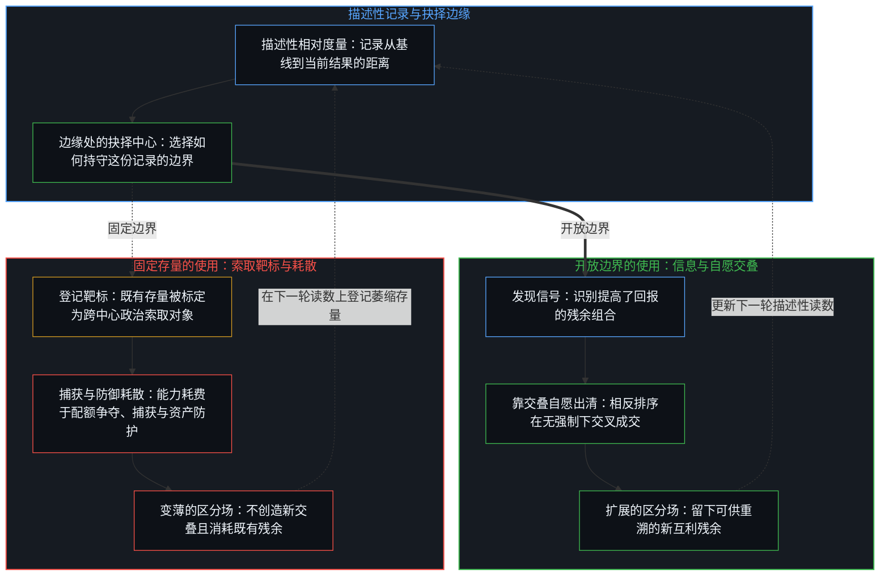
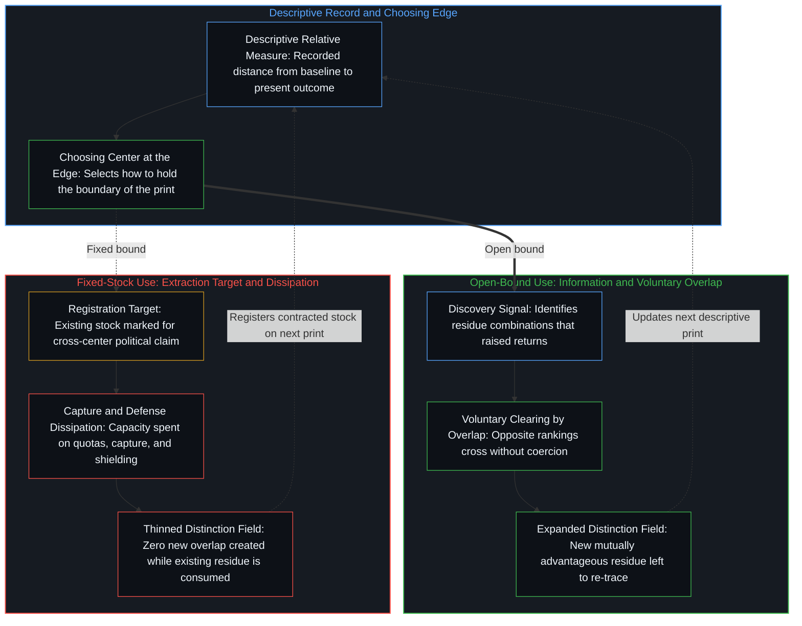
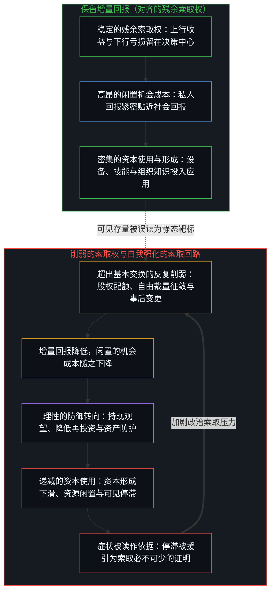
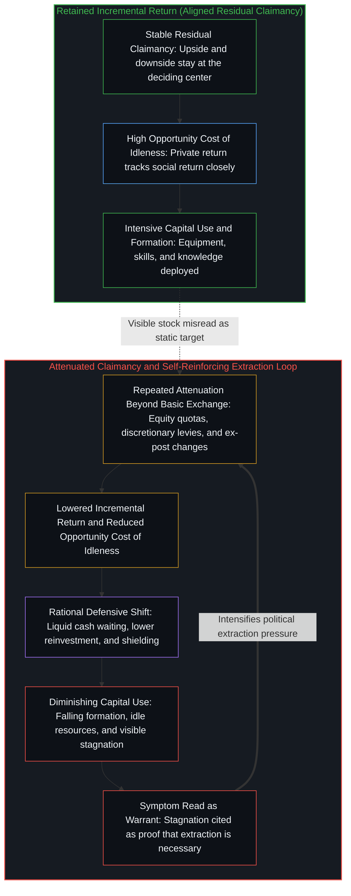

# 继承的残余与索取的必要 / Inheritance as Residue and the Need for Extraction

*相对度量保持描述性，索取的持续压力本身标明资本与资源的使用正在递减。 / Relative measures remain descriptive; sustained pressure for extraction itself marks that capital and resources are being used in a diminishing way.*

每一个中心都从先前活动留下的残余中开始。所谓继承并非某个中心独有的优势，而是当下可重溯的全部痕迹。相对度量记录从某一基线出发的距离，它既可作为自我改进的信息，也可作为政治索取的靶标。只有前者通过自愿交换扩大可供后续区分的场；后者不创造新残余，只消耗已有残余，并降低进一步使用资本的回报。索取显得必要之处，正是资本与资源使用已经递减之处。

Every center begins from residue left by prior activity. Inheritance is not an advantage unique to one center; it is the entire set of traces available for re-tracing in the present. Relative measures record distance traveled from a given baseline. They can serve as information for self-improvement or as a target for political extraction. Only the former enlarges the field available for later distinctions through voluntary exchange. The latter creates no new residue; it consumes existing residue and lowers the return to further use of capital. Where extraction appears necessary is where capital and resources are already being used in a diminishing way.

## 一、 继承是共同残余而非特殊起点 / 1. Inheritance Is Shared Residue, Not a Special Starting Point

自我区分的活动发生着——无因、不息。称之为心智：早已在途的观察者，其每一个行动都是一次区分。当下可及的全部知识、制度、工具与物质存量，都是先前区分留下的残余。较早的离散行动塑造了较晚行动可用的场，然而持久的痕迹并不会自行重启或自行运转；正如[你的代码库即是记忆](../your-codebase-is-memory/)所确立的，语言、数学形式体系、技术手册与公共惯例只保存着早先切口的形态，唯有活生生的心智对照当下的摩擦重溯并重新切分它们，进一步的推进才会发生。编码化的观念与设计是非竞争性的痕迹：一个中心重溯微积分、物理学或处理器指令集，从留给其他每一个中心的供给中减去的份额为零。每一个中心都从这一共同残余出发；起点的相对差异并不预先决定任何中心从自身基线出发能走多远。正如[拥有更多从不是原因](../having-more-is-never-the-cause/)所追溯的，触手可及的初始存量只塑造初始可得性的分布，却从不充当撰写下一次区分的独立力量。

Self-distinguishing activity occurs — uncaused, unceasing. Call it the Mind: the observer already underway, every act of which is a distinction. All knowledge, institutions, tools, and material stocks available in the present are residue left by prior distinctions. Earlier discrete acts shape the field available to later ones, yet durable traces do not resume or execute themselves; as [Your Codebase Is Memory](../your-codebase-is-memory/) establishes, languages, mathematical formalisms, technical manuals, and civic routines hold the shape of prior cuts and advance further only when a living Mind re-traces and re-cuts them against present friction. Codified ideas and designs are non-rivalrous traces: one center re-tracing calculus, physics, or processor instruction sets subtracts zero from the supply remaining for every other center. Every center begins from this shared residue; relative differences in starting position do not predetermine how far any center travels from its own baseline. As [Having More Is Never the Cause](../having-more-is-never-the-cause/) traces, whatever starting stock sits within reach patterns initial availability without acting as an independent force that authors the next distinction.

一种反复出现的政治信念，将这片共享背景转化为一笔可追缴的起源债务：既然每个人都降生于累积的语言、工具与公民秩序之中——剥离这些痕迹，孤立的劳动者仅能维持温饱——由此产生的成果便被视作欠社会的共同资产，由同时代的国家充当先辈的产权人与收债人。这一表述在一项有界的描述性观察之内成立：没有任何心智从零开始。它的前提经由双重置换而到达边界。其一，指出基线未经本人选择，仅仅是一项否定性的观察；在未缔约的文化与公共痕迹环绕下成长，并不赋予第三方对一个人后续努力享有无上限的股权留置权。其二，跨代累积的人类残余既非领土政府所创制，亦非其私产；既然非竞争性知识在同一辖区内数百万参与者面前于边际上对称敞开，却不会自行组装成企业或发明，共同的背景遗产便无法解释特定抉择中心借此构建出不同成果的边际分化。

A recurring political belief converts this shared background into a collectible origin debt: because everyone is born into accumulated language, tools, and civic order—without which a solitary worker would produce only subsistence—the resulting output is treated as a common asset owed back to society, with the contemporaneous state acting as proprietor and collector for prior generations. That framing holds inside a bounded descriptive observation: no Mind begins from nothing. Its premise reaches its boundary through a double substitution. First, noting that a baseline was unchosen is a negative observation only; growing up surrounded by uncontracted cultural and civic traces does not vest a third party with an open-ended equity lien over a person's subsequent effort. Second, multi-generational human residue is neither authored nor owned by a territorial government, and because non-rivalrous knowledge sits symmetric at the margin before millions of participants inside the same jurisdiction without assembling itself into a firm or invention, shared background heritage cannot account for the marginal divergence in what particular choosing centers build from it.

这种压缩在2026年11月16日门洛帕克举行的 Semafor“硅谷与世界”峰会上具象地浮现出来：南非总统西里尔·拉马福萨在为电信牌照强制规定辩护时——该规定要求 SpaceX 必须交出当地子公司30%的股权方可运营星链——呼吁埃隆·马斯克*“忠于你的故国”*并*“回馈”*，理由是*“你今天所成就的一切，皆源于你自身的出身，源于你最初受教育的地方——当年你就是在那里开始摆弄那些游戏机的……正是因为当时向他提供了那些知识与教育。”*这一主张将三个截然不同的层次压缩到了同一张国家资产负债表上。那名十二岁少年在比勒陀利亚对照说明书自学编程所用的*“游戏机”*，是一台进口的 Commodore VIC-20，围绕美国设计的 MOS 6502 微处理器与 BASIC 语言构建而成——这是在南非国家之外创制的跨国非竞争性计算残余，使用时的损耗为零。二十世纪八十年代比勒陀利亚的公立中学教育，包括种族隔离时期有案可查的生均国家教育支出十二比一的种族悬殊，则是一项已由同时代家庭税收偿付的竞争性财政投入；即便将其建模为一笔面向未成年人的未缔约公共贷款，其规模也以生均学费成本为上限，从不构成一项永久股权索取，去追索当事人十七岁时为拒服种族隔离军队兵役而移居海外、数十年后在北美创立的企业。把有界的早期学校教育记作此后数十年间在异国制度生态中承担风险的作者，是在主权账本上重演了[主体性的折现](../the-discount-on-agency/)在慈善领域所剖析的倒置：凭一张初始支票，便将受助者此后数十年的跋涉记作出资者的收益。在被要求*“回馈”*之前，SpaceX 已正式提交一项5亿兰特的“股权等价投资计划”，拟提供由其出资的卫星终端、太阳能供电以及永久免费的高速宽带，覆盖服务约240万名学生的5000所南非乡村学校——这笔投入超出单名学生受教育成本数个数量级——然而监管机构仍因未交出30%的股权份额而搁置部署。将某一中心的成就读成对特殊继承的债务，是把共同残余冻结成该中心的私人欠账。残余可被重溯并扩展，也可被登记为索取对象。差异在于使用方向，不在于起点的固定高度。

That compression surfaced in concrete form on November 16, 2026, at Semafor's *Silicon Valley & The World* summit in Menlo Park, when South African President Cyril Ramaphosa—defending telecommunications licensing mandates requiring SpaceX to surrender 30 percent local subsidiary equity before operating Starlink—called on Elon Musk to remain *"loyal to your old country"* and *"give back"* on the ground that *"what you've become today is by dint of your own origins, where you were initially educated when you started dabbling with these game machines... It is because of the knowledge and the education that were made available to him."* The claim compresses three distinct layers onto one state balance sheet. The *"game machine"* a twelve-year-old taught himself to program from a manual in Pretoria was an imported Commodore VIC-20 built around an American MOS 6502 microprocessor and BASIC—transnational, non-rivalrous computing residue authored outside the South African state and depleted by zero upon use. Public secondary schooling in 1980s Pretoria, including apartheid's documented twelve-to-one racial disparity in per-pupil state outlays, was a rivalrous fiscal input already financed through contemporaneous household taxes; even if modeled as an uncontracted public loan to a minor, its magnitude is bounded by per-pupil tuition cost, never a perpetual equity claim on enterprises built decades later in North America after emigrating at age seventeen to avoid conscription into the apartheid military. Crediting bounded early schooling as the author of decades of subsequent risk-bearing across foreign institutional ecosystems repeats on a sovereign ledger the inversion [The Discount on Agency](../the-discount-on-agency/) dissects in philanthropy, where an initial check books a recipient's later decades of struggle as donor yield. Prior to the demand to *"give back,"* SpaceX had formally proposed a 500-million-rand Equity Equivalent Investment Programme to supply funded satellite terminals, solar power, and free perpetual high-speed broadband to 5,000 rural South African schools serving roughly 2.4 million students—an outlay exceeding single-pupil schooling cost by orders of magnitude—yet regulators stalled deployment because no 30 percent equity slice was handed over. Reading one center’s achievement as a debt owed for special inheritance freezes shared residue into a private liability of that center. Residue can be re-traced and extended, or it can be registered as an object of claim. The difference lies in the direction of use, not in the fixed height of the starting point.

## 二、 相对度量的两种使用 / 2. Two Uses of Relative Measures

相对度量是描述性记录：它标明从某一基线到当前结果的距离。沿着某个共享维度——无论是净资产、产出、每公斤入轨成本，还是宽带覆盖面——为各异的轨迹计分，只是将多维序列投射到同一把标尺上，并未给这些序列本身增添任何力量，正如[来自个体差异的层级](../hierarchy-from-individual-difference/)所确立的那样。作为一笔既成的读数，测得的差距并不发起任何行动。同一记录可为后续区分提供参照——哪些残余组合提高了回报，哪些路径可被重溯——也可为跨中心索取提供坐标。前一种使用将度量当作开放边界下的信息；后一种使用将度量当作固定存量上的登记靶标。在开放前提下，正如[潜能作为威胁或启发](../ones-potential-as-threat-or-inspiration/)所追溯的，另一中心的离群成果充当了已付代价的实验，证明可行前沿比此前测绘的更宽：先行者承担试错失败的不可逆成本，使后来者能够以不断下降的单位成本重溯可行的技术与组织组合。

Relative measures are descriptive records: they mark the distance from a given baseline to a present outcome. Scoring distinct trajectories along a shared dimension—whether net worth, output, cost per kilogram to orbit, or broadband reach—projects multidimensional sequences onto a common scale without adding any force to the sequences themselves, as [Hierarchy from Individual Difference](../hierarchy-from-individual-difference/) establishes. As a settled print, the measured gap initiates nothing. The same record can supply reference for later distinctions—which combinations of residue raised returns, which paths can be re-traced—or it can supply coordinates for claims across centers. The first use treats the measure as information under an open bound; the second treats it as a registration target on a fixed stock. Under an open premise, as [One’s Potential as Threat or Inspiration](../ones-potential-as-threat-or-inspiration/) traces, another center's outlier result serves as paid experimentation proving that the feasible frontier is wider than previously mapped: pioneers bear the irreversible cost of failed trials so followers can re-trace viable technical and organizational combinations at falling unit cost.

自愿交换在重叠区域留下相互有利的残余，扩大可供后续行动的场。正如[价格是言说，理解是交易](../price-as-utterance-understanding-as-trade/)所表明的，只要两个中心对某项物品及其对价的排序方向相反，不受强制的交易便会出清；这既不需要共享的内在体验，也不需要相同的估值模型，却能让双方都站上更受偏好的位置，并沉淀出更稠密的供应链、更低廉的价格与运转中的基础设施，供后续行动重溯。索取在不创造新重叠的情况下转移既有残余，并在转移过程中消耗资源。除强制转移必然伴随的行政开支、规避摩擦与受抑制的投入之外，一旦财富或市场准入成为政治上可争夺的对象，更深层的耗散随即发生：各个中心将工程、法律与管理能力转向游说股权配额、追逐牌照或防范资产征用，直接消耗被争夺的存量本身，而非平移一块无摩擦的会计矩形。封闭的规则不会熄灭人的主动性，而是塑形各中心如何在创造新能力与捕获既有存量之间分配心力。位于二者之下的，正是[生产、消费与心智的区分](../production-consumption-and-the-minds-distinction/)所析出的那唯一一道边界抉择：将寄存器持守为开放，新的区分便能拓宽可表征的容量；将寄存器封死为固定存量，后续行动便转为零和耗竭。度量本身不携带方向；方向由中心选择如何对待它。

Voluntary exchange leaves mutually advantageous residue in the region of overlap and enlarges the field available for subsequent acts. As [Price as Utterance, Understanding as Trade](../price-as-utterance-understanding-as-trade/) shows, an uncoerced trade clears wherever two centers rank a good and its consideration in opposite directions, requiring no shared interior or identical valuation model while leaving both parties on preferred ground and depositing denser supply chains, lower prices, and working infrastructure for subsequent acts to re-trace. Extraction transfers existing residue without creating new overlap and consumes resources in the act of transfer. Beyond the administrative overhead, avoidance friction, and dampened effort incurred whenever claims are transferred coercively, making wealth or market entry politically contestable triggers a deeper dissipation: centers divert engineering, legal, and managerial capacity into lobbying for equity quotas, chasing licenses, or shielding assets against seizure, consuming the contested stock itself rather than shifting a frictionless accounting rectangle. Closed rules do not extinguish human initiative; they pattern how centers allocate effort between building new capacity and capturing existing stock. Beneath both lies the single boundary choice [Production, Consumption, and the Mind's Distinction](../production-consumption-and-the-minds-distinction/) isolates: holding the register open lets new distinctions widen representable capacity, whereas sealing the register into a fixed stock turns subsequent action into zero-sum depletion. The measure itself carries no direction; the direction is chosen by how a center treats it.

## 三、 索取的必要标明使用递减 / 3. The Necessity of Extraction Marks Diminishing Use

持续的索取压力本身是信号。当残余索取权被反复削弱时，中心理性地降低再投资强度、持有流动性，或将努力转向保护已有存量。在不确定性下投放资本，系于将运营控制权、下行亏损与净上行收益留在做出决断的中心；通过强制股权稀释、牌照关卡或自由裁量的征敛来削弱这些权利，则会把资产价值推入未经定价的争夺场，任由各方索取者竞相捕获。私有产权并非废除认识界限的封闭制度灵药；但作为暂时的脚手架，正如[知识问题与委托的幻觉](../the-knowledge-problem-and-the-illusion-of-delegation/)所确立的，它让局部误差与回报继续依附于依据局部印迹采取行动的中心。由于电网、电信网络、工厂与铁路走廊等实体基础设施一旦沉没便不可移动、不可逆转，反复削弱残余索取权便抬高了持现观望而非投入固定资本的收益。资本的使用强度与形成速度因此下降；已有资源的回报低于在更稳定残余索取权下本可达到的水平。索取显得必要，正是因为增量回报已经被降低。并且，正如[私人残差与社会剩余的因果次序](../the-causal-order-of-private-residuals-and-social-surplus/)所追溯的——在威廉·诺德豪斯的战后非农经济核算中，创新者仅留存约 2.2% 的创新价值，约 97.8% 则扩散至下游使用者——在第 0 步压缩预期私人残差，会在规模大得多的社会剩余尚未诞生之前就掐灭不确定的投入承诺。

Sustained pressure for extraction is itself a signal. When residual claimancy is repeatedly attenuated, centers rationally reduce reinvestment intensity, hold liquid assets, or divert effort into protecting existing stock. Deploying capital under uncertainty turns on keeping operational control, downside loss, and net upside gain attached to the deciding center; attenuating those claims through forced equity dilution, licensing gates, or discretionary levies pushes asset value into an unpriced arena where claimants race to capture it. Private property rights are not a closed institutional panacea that abolishes epistemic limits, yet as provisional scaffolding, as [The Knowledge Problem and the Illusion of Delegation](../the-knowledge-problem-and-the-illusion-of-delegation/) establishes, they keep local error and return attached to the center acting on partial marks. Because physical infrastructure—power grids, telecommunications networks, factories, rail corridors—becomes immobile and irreversible once sunk, repeated attenuation raises the payoff to waiting in liquid cash rather than committing fixed capital. The intensity of capital use and the rate of capital formation therefore fall; the return on existing resources sits below the level reachable under more stable residual claimancy. Extraction appears necessary precisely because incremental returns have already been lowered. And as [The Causal Order of Private Residuals and Social Surplus](../the-causal-order-of-private-residuals-and-social-surplus/) traces—where innovators in William Nordhaus's postwar nonfarm accounting retained roughly 2.2 percent of innovation value while roughly 97.8 percent diffused to downstream users—compressing expected private residuals at Step 0 extinguishes uncertain commitments before the far larger social surplus ever comes into existence.

相反，当中心预期保留增量回报的较大份额时，资本使用与形成同步上升：设备、技能与组织知识被更密集地应用，因为私人回报更贴近社会回报。索取超过维持基本交换所需公共品的部分，并不扩大可供区分的场；它降低进一步区分的回报，并使闲置或低强度使用资源的机会成本下降。契约执行、争议解决与非索取性的核心基础设施能够降低自愿交换中的交易摩擦；然而正如[公共支出不创造资本](../public-spending-does-not-create-capital/)所确立的，每一笔公共支出都先取走私人资源，随后才做政治上的重新配置，从不充当创造资本的第二台引擎。一旦财政与规制索取越出维持基本交换的范围——或将税收与举债能力导入庇护分肥，任由核心电网与铁路衰败——预期增量回报便会下跌，闲置资本的机会成本也随之下降：与残余索取权未受削弱的情形相比，停留在流动存款中或迁往离岸所放弃的潜在回报要小得多，资本因此撤出正规生产、转入低收益避风港，进而拖慢就业与产出。当生活水准对照着被保留的消费基线陷入停滞时，政治认领者便标记出选民之间扩散开来的归因，正如[政客是责任扩散的显性症状](../politicians-appear-as-visible-symptoms-of-responsibility-diffusion/)与[生产的不透明与消费的权重](../the-opacity-of-production-and-the-weight-of-consumption/)所追溯的那样，指着国内停滞与可见的资产负债表，将其当作更深度的股权强制要求与财富转移不可或缺的证据——把回报受削弱的下游症状，反过来变成了进一步削弱回报的凭据。

Conversely, when centers expect to retain a large share of incremental returns, capital utilization and formation rise together: equipment, skills, and organizational knowledge are applied more intensively because private return tracks social return more closely. Extraction beyond the public goods that sustain basic exchange does not enlarge the field available for distinctions; it lowers the return to further distinguishing and reduces the opportunity cost of leaving resources idle or under-deployed. Contract enforcement, dispute resolution, and core non-extractive infrastructure lower transaction friction across voluntary exchange, yet as [Public Spending Does Not Create Capital](../public-spending-does-not-create-capital/) establishes, every public outlay first removes private resources before reallocating them politically, never acting as a second engine of capital creation. Once fiscal and regulatory extraction expands past sustaining basic exchange—or diverts tax and borrowing capacity into patronage while core grids and rails decay—expected incremental returns drop and the opportunity cost of leaving capital idle falls alongside them: sitting in liquid deposits or moving offshore sacrifices far less foregone return than it would under unattenuated residual claimancy, steering capital out of formal production into low-yield shelters and slowing employment and output. When living standards stagnate against a preserved consumption baseline, political claimants mark diffused attribution across voters, as [Politicians Are Visible Symptoms of Responsibility Diffusion](../politicians-appear-as-visible-symptoms-of-responsibility-diffusion/) and [The Opacity of Production and the Weight of Consumption](../the-opacity-of-production-and-the-weight-of-consumption/) trace, pointing to domestic stagnation and visible balance sheets as evidence that deeper equity mandates and wealth transfers are indispensable—turning the downstream symptom of attenuated returns into the warrant for further attenuation.

其领导层援引起源债务的同一辖区，在宏观经济记录中登记下了这一回路的足迹。南非的固定资本形成总额占国内生产总值的比重，从2008年的约23%一路滑落至2024年与2025年的约14%——不足其《国家发展规划》30%目标的一半，勉强够抵消既有存量的物质折旧。同一时期内，面对电力与货运铁路瓶颈以及强制股权稀释规则，国内非金融企业累积了逾1.8万亿兰特的银行流动存款，而不愿投入不可逆的国内资本；与此同时，逾5200亿兰特流向国有垄断企业的财政纾困，伴随的却是严重的电网轮流限电、物流瘫痪、吞噬逾五分之一税收的偿债成本、按不变价格计算的人均产出停滞在十余年前的水平甚或更低，以及超过32%的官方失业率。这些总量指标并不从外部强制任何行动者；它们只是汇总了有界中心面对受压缩的增量回报与被压低的持现观望机会成本所作出的抉择——在宏观遥测层面印证了：持续的索取压力所标明的，正是资本与资源的使用已经处于递减之中的环境。

Macroeconomic records from the same jurisdiction whose leadership invoked origin debt register the footprints of this loop. South Africa's Gross Fixed Capital Formation slid from roughly 23 percent of gross domestic product in 2008 to roughly 14 percent across 2024 and 2025—below half its 30 percent National Development Plan target and barely enough to offset physical depreciation of existing stock. Over the same period, domestic non-financial corporations accumulated more than 1.8 trillion rand in liquid bank deposits rather than sinking irreversible domestic capital amid electricity and freight-rail bottlenecks and mandatory equity-dilution rules, while more than 520 billion rand in fiscal bailouts routed to state-owned monopolies accompanied severe grid load-shedding, logistics breakdown, debt-service costs absorbing over a fifth of tax revenue, and output per person in constant terms stalling at or below its level more than a decade earlier alongside official unemployment exceeding 32 percent. Those aggregates do not compel any actor from outside; they tally the choices of bounded centers responding to compressed incremental returns and a lowered opportunity cost of waiting in cash—confirming in macroscopic telemetry that persistent pressure for extraction marks an environment where capital and resources are already being used in a diminishing way.

## 四、 从自身基线出发的扩展 / 4. Extension from One’s Own Baseline

成就的度量是从自身基线出发的距离，而非起点相对于同时代中心的排名。多数高影响活动从相对普通或受约束的条件出发；起点差异并不决定后续区分的幅度。正如[能动性、复利与 AI 封建之争](../agency-compounding-and-the-argument-over-ai-feudalism/)所推导的，家庭财富、当地学校教育、出生地域等初始条件只构成有限的静态截距 `S₀`，而自主引导的学习、纠错与风险承担则跨越相继的离散切分呈乘法复利累积（`Sₜ = S₀ ∏ (1 + εₖ)`），因此步长速率 `εₖ` 上的持续差异终将超越 `S₀` 上的有限差异。企业领域的经验记录映照出这一因果次序，而非充当其地基：顶尖私营企业的活跃所有者若英年早逝或退休，约四分之三的企业利润便会永久消失，登记下与特定创始人绑定的主动执行，而非初始存量生出的被动收益——这正是系于活跃建造者本人的活态生产性判断，正如[建造者的缺席与解释的自洽循环](../the-builders-absence-and-the-self-consistent-cycle-of-explanation/)所追溯的那样。

The measure of achievement is distance traveled from one’s own baseline, not the ranking of the starting point against contemporaneous centers. Most high-impact activity begins from relatively ordinary or constrained conditions; differences in starting points do not determine the amplitude of subsequent distinctions. As [Agency, Compounding, and the Argument Over AI Feudalism](../agency-compounding-and-the-argument-over-ai-feudalism/) derives, initial conditions—household wealth, local schooling, geographic birth—form a finite static intercept `S₀`, whereas self-directed learning, error correction, and risk-bearing compound multiplicatively across successive discrete cuts (`Sₜ = S₀ ∏ (1 + εₖ)`), so sustained differences in the step rate `εₖ` overtake finite differences in `S₀`. Enterprise records reflect this causal order without serving as its ground: when an active owner of a top private firm dies prematurely or retires, roughly three-quarters of firm profits disappear permanently, registering active founder-specific execution rather than passive yield on starting stock—the same living productive judgment bound to an active builder that [The Builder's Absence and the Self-Consistent Cycle of Explanation](../the-builders-absence-and-the-self-consistent-cycle-of-explanation/) traces.

在受约束的起始条件确实构成发明瓶颈的地方，构成紧约束的是能否接触到编码化工具与可供效仿的鲜活范例，而非缺乏由国家监管机构撮合的股权配额。正如[前沿抬升底线](../the-frontier-lifts-the-floor/)所追溯的，前沿扩张与开放互联通过将更稠密的非竞争性残余送到受约束基线触手可及之处，抬升整个分布的后随边缘；而为了强制交出 30% 子公司股权去阻断乡村学校宽带，恰恰关上了身处受约束基线的学生借以复利自身轨迹的那条接触通道。对继承残余的建设性回应是扩展它——留下可供他人重溯的新痕迹——而非将其登记为必须归还的存量。后一种登记并不改善集体可及的场；它消耗残余并强化使消耗显得必要的条件。

Where constrained starting conditions do bottleneck invention, the binding constraint is access to codified tools and live examples to emulate, not an absence of equity quotas brokered by state regulators. As [The Frontier Lifts the Floor](../the-frontier-lifts-the-floor/) traces, frontier expansion and open connectivity raise the trailing edge across a distribution by placing denser non-rivalrous residue within reach of constrained baselines, whereas blocking rural school broadband to enforce a 30 percent subsidiary equity handover closes the very exposure channel through which students at constrained baselines could compound their own trajectories. The constructive response to inherited residue is to extend it—leaving new traces that others can re-trace—rather than to register it as a stock that must be returned. The latter registration does not improve the field available collectively; it consumes residue and reinforces the conditions that make consumption appear necessary.

正如[自我价值感与所有权](../ownership-and-self-worthiness/)所确立的，心智唯有在后果作为自身下一次离散切分的材料重新进入时才产生复利，而非让后果作为欠领土监护人的一笔祖传负债、或向他人资产负债表请愿讨要的一份配享权利到来。没有任何法定账册、历史积怨或同时代排名能够替另一个中心完成这次重溯，也没有任何这类登记能够阻止一个行动中的中心去重新切分已然触手可及的痕迹。相对度量保持描述性；在每一步上，从自身基线出发行动的心智选择它们的使用方向，并在这一行动中决定自己所遇见的残余是被扩展还是被递减。

As [Ownership and Self-Worthiness](../ownership-and-self-worthiness/) establishes, a Mind compounds only when consequences re-enter as its own material for the next discrete cut rather than arriving as an ancestral liability owed to a territorial custodian or an entitlement petitioned from another's balance sheet. No statutory register, historical grievance, or contemporaneous ranking can complete that re-tracing on another center's behalf, and none prevents an acting center from re-cutting the traces already within reach. Relative measures remain descriptive; at each step, a Mind acting from its own baseline chooses the direction of their use, deciding in that act whether the residue it met is extended or diminished.
