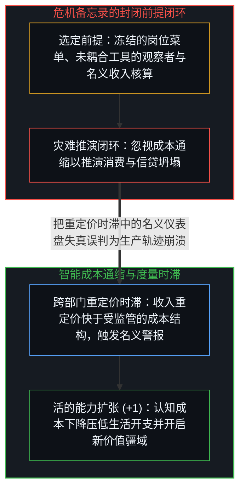
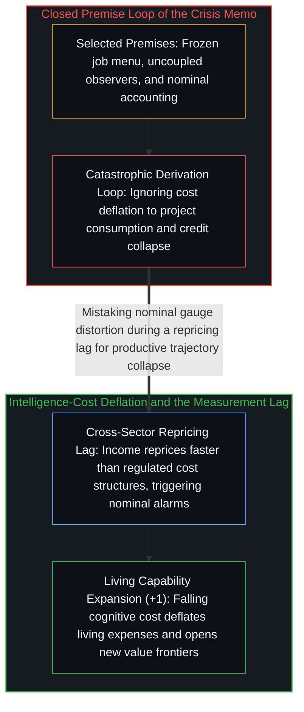

# 度量时滞与智能成本通缩 / The Measurement Lag

*将智能成本通缩误判为系统性危机，源于名义核算、静态岗位与抗拒工具的隐性前提。 / Mistaking intelligence-cost deflation for systemic crisis rests on nominal accounting, a frozen job menu, and uncoupled agency.*

Citrini Research 的备忘录追踪了若干可观测的制度机制——运营支出替代循环、私募信贷链条的层层传导，以及利润率压力下技术采纳的反射性加速。单就金融管道的局部机制描述而言，链条中的若干环节相当犀利。然而整份报告的灾难性结论在推理启动之前就已被锁定：作者先行挑选了一组起点假定——劳动者静止不动、人工智能被塑造成外在威胁、新经济活动归零、生活成本通缩被忽略——使崩溃成为必然结果，随后再用绵密的技术细节推演结果，让读者只顾审视中间的逻辑链条，却忘了检视起点处的前提。

The Citrini Research memo traces observable institutional mechanisms—the operating-expense substitution loop, the private-credit daisy chain, and the reflexive acceleration of adoption under margin pressure. As a description of financial plumbing, several links in the chain are sharp. Yet its catastrophic conclusion was fixed before the reasoning began: the memo selects starting assumptions—static workers, artificial intelligence framed as an external threat, zero new economic activity, and ignored living-cost deflation—that make collapse inevitable, then derives the outcome with enough technical detail that readers scrutinize the intermediate logic rather than the premises.

## 一、 推导精密性对前提筛选的伪装 / 1. Sophistication of Derivation as Camouflage for Premise Selection

备忘录并非从机制正向推演至结果，而是从系统性金融危机的终点倒推，拼装出闭合这一环路所需的前置条件——正如[赢家与输家的转化框架](../huberman-winners-losers/)所剖析的，它在起点框架中就预设了结论，并将当下的方向选择冻结为固定的人群类别。其显性假定——年薪十八万美元的产品经理跌落至四万五千美元的网约车零工、冻结的职业菜单，以及单一的名义收入核算——建立在更沉重却从未宣之于口的隐性假定之上：被替代的劳动者无法使用同样的人工智能工具，在[当丰裕看起来像稀缺](../when-abundance-looks-like-scarcity/)所追溯的固定蛋糕容器内智能成本下探不会催生任何新的可行工作类别，且在名义收入压缩的同时生活成本依然冻结在原位。私募股权估值流入保险资产负债表与离岸再保险特殊目的实体的详尽描写，制造出了一种严谨性的光环，将这些人为选定的前提伪装成了自然事实。

Rather than reasoning forward from mechanism to outcome, the memo starts with a systemic financial crisis and works backward to assemble the preconditions required to close the loop—presupposing its conclusion in the starting frame and freezing a moment-to-moment directional choice into a permanent category of person, as dissected in [Winners and Losers in the Transmutation Frame](../huberman-winners-losers/). Its explicit assumptions—a 180,000 USD product manager dropping to a 45,000 USD ride-share gig, a frozen menu of occupations, and purely nominal accounting—rest upon heavier implicit assumptions that are never stated aloud: that displaced workers cannot access the very same artificial intelligence tools, that falling intelligence costs spawn no new categories of viable work inside the fixed-pie container traced in [When Abundance Looks Like Scarcity](../when-abundance-looks-like-scarcity/), and that living costs remain frozen while nominal incomes compress. Detailed descriptions of private-equity marks flowing into insurance balance sheets and offshore reinsurance vehicles create a halo of rigor that camouflages these selected premises as natural facts.

备忘录中的每一条灾难闭环，都运行在名义核算以及将工具实体化、拟人化为自主外部威胁的叙事之上，重演了[米塞斯论国家与强制力的向量和](../mises-state-analysis/)所追溯的终结探究的四步闭合。要想让十八万美元跌至四万五千美元的剧本成立，人工智能必须强大到足以消解复杂的协同角色，同时又让周围的经济荒芜到只剩下开网约车这一条出路——这是由同一机制衍生却指向相反方向的两个条件。自我区分的活动只发生于活生生的心智；正如[AI 不会终结软件工程，而是将其扩展](../ai-wont-kill-software-engineering/)与[你的代码库即是记忆](../your-codebase-is-memory/)所追溯的，模型与外化的代码库都是既往区分层叠而成的残余，它们放大个体的认知吞吐量，而非作用于被动旁观者的异己主体。备忘录所谓的“替代”，是未经强化的工作流被活生生的心智耦合更高杠杆器物（+1）所形成的向量和所超越；随着能力底线持续抬升，除主动拒绝重绘自身工作流的人之外，后来者的追赶只会变得越来越容易。

Every catastrophic loop in the memo runs on nominal accounting paired with a narrative that reifies and anthropomorphizes a tool into an autonomous external threat, repeating the four-step closure of inquiry traced in [Mises on the State and the Vector Sum of Coercion](../mises-state-analysis/). For the 180,000 USD to 45,000 USD downshift to hold, artificial intelligence must be potent enough to dissolve complex coordination roles while leaving the surrounding economy so barren that only ride-share driving remains—two conditions generated by the same mechanism pointing in opposite directions. Self-distinguishing activity occurs only at the living Mind; as traced in [AI Won't Kill Software Engineering, It Will Expand It](../ai-wont-kill-software-engineering/) and [Your Codebase Is Memory](../your-codebase-is-memory/), models and externalized codebases are stacked residues of prior distinctions that amplify individual cognitive throughput rather than alien agents acting on passive bystanders. What the memo labels "displacement" is an unaugmented workflow being superseded by the vector sum of living minds coupling with higher-leverage instruments (+1), where a rising capability floor makes catching up progressively easier for everyone except those who actively refuse to re-render their own workflow.

## 二、 跨部门重定价时滞与度量基础设施的校准 / 2. Cross-Sector Repricing Lag and Recalibrating Measurement Infrastructure

备忘录略去的成本端机制在于，同一股能力跃迁正在同步压低围绕着每位参与者的成本结构。法律咨询、税务申报、财务规划、保险核保、医疗分诊、教育获取与软件工具——凡是过去以人类认知劳动作为约束性成本投入的领域，都在沿着同一条曲线通缩，物流与实体制造也紧随其后。正如[价值、货币与财富的生成机制](../the-generative-mechanics-of-value-money-and-wealth/)所阐明的，名义数字只是滞后的借据，而财富存在于活的生产能力之中；只要生活与生产成本的通缩速率与名义收入的压缩速率相当乃至更陡，那些将名义数字下调直接等同于物质福利崩溃的反馈环路就无法闭合。

The cost-side mechanism omitted by the memo is that the very same capability shift is simultaneously deflating the cost structure surrounding every participant. Legal consultation, tax preparation, financial planning, insurance underwriting, medical triage, educational access, and software tooling—every domain where human cognitive labor was previously the binding cost input—are deflating along the same curve, with logistics and physical fabrication following close behind. Because nominal figures are lagging IOUs while wealth resides in living productive capability, as [The Generative Mechanics of Value, Money, and Wealth](../the-generative-mechanics-of-value-money-and-wealth/) establishes, whenever living and production costs deflate at a rate comparable to or steeper than nominal income compression, the feedback loops that equate lower nominal figures with collapsing material welfare fail to close.

在转型期中，认知成本通缩以不同速率在各部门间传导：软件与知识工作最先重定价，金融与法律中介随后，而医疗、建筑与实体制造等受密集监管或合同约束的部门重定价较慢。正如[阻力体感与速率差](../felt-resistance-and-the-speed-differential/)所追溯的，这种速率差产生了暂时的剪切力——走得快的部门先一步褪去名义收入溢价，而走得慢的部门尚未完成那些收入原本所覆盖的成本通缩。按照昨日固定名义数字校准的制度基础设施与同辈比较——按揭贷款、信贷核保与税收征管——即便在购买力与可行的人类活动持续扩张时，也会将这种背离登记为困境，如[宏观现象及参数和个人微观选择的因果倒置与利率的命令幻相](../the-summary-first-reversal-and-the-command-of-yields/)所剖析的那样，错把滞后的汇总读数当成了支配性的指令。危机存在于名义仪表盘的过剩心像时滞之中，而非生产轨迹之上；放下备忘录的静态前提，展现出的便是仅受制于行动意愿的扩张地平线。

During the transition, cognitive cost deflation propagates at differential rates across sectors: software and knowledge work reprice first, financial and legal intermediation follow, and heavily regulated or contract-bound sectors like healthcare, construction, and physical fabrication reprice more slowly. As [Felt Resistance and the Speed Differential](../felt-resistance-and-the-speed-differential/) traces, that speed differential creates a temporary shear in which fast-moving sectors shed nominal income premiums before slower-moving sectors have finished deflating the costs those incomes serviced. Institutional infrastructure and peer comparisons calibrated to yesterday's fixed nominal figures—mortgages, credit underwriting, and tax collection—register this divergence as distress even as purchasing power and viable human activity expand, mistaking a lagging summary readout for a governing command in the manner dissected in [Macro Parameters, Micro Choices, and the Command of Yields](../the-summary-first-reversal-and-the-command-of-yields/). The crisis resides in the excess Image lag of the nominal gauge rather than the productive trajectory, and releasing the memo's static premises reveals an expansionary horizon bounded only by the willingness to engage.
