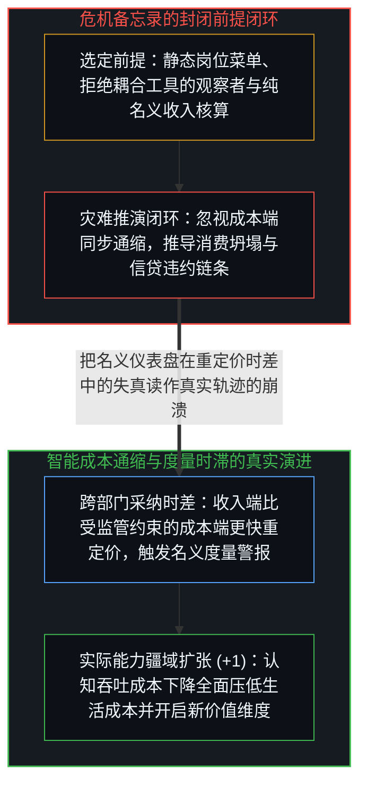
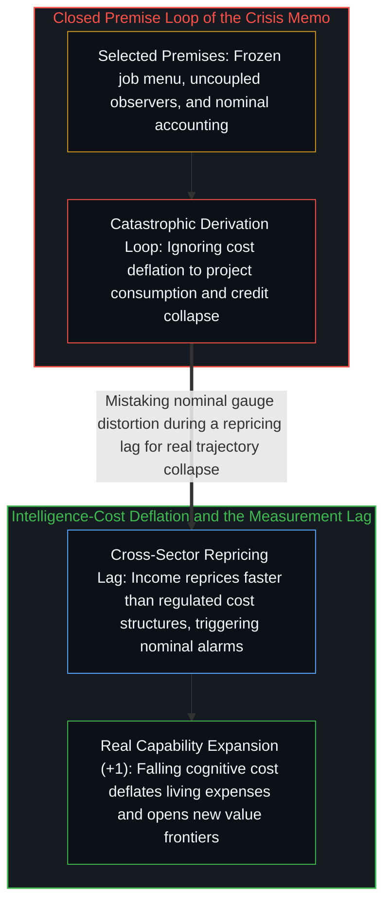

# 度量时滞与智能成本通缩 / The Measurement Lag

*将智能成本通缩误判为系统性危机，源于名义核算、静态岗位与抗拒工具的隐性前提。 / Mistaking intelligence-cost deflation for crisis rests on nominal accounting and static premises.*

Citrini Research 的备忘录描绘了若干真实的微观机制——运营支出替代循环、私募信贷链条的层层传导，以及利润率压力下技术采纳的反射性加速。单就金融管道的局部机制描述而言，其中不少拆解相当犀利。然而整份报告的灾难性结论在推理启动之前就已被锁定：作者先行挑选了一组特定前提——劳动者静止不动、人工智能被塑造成外在威胁、新经济活动缺席、实际生活成本通缩被抹除——使崩溃成为必然结果，随后再用极其绵密的推演吸收读者的全部注意力，让人只顾核对中间的逻辑链条，却忘了审视起点处的预设。

The Citrini Research memo traces real institutional mechanisms—the operating-expense substitution loop, the private-credit daisy chain, and the reflexive acceleration of adoption under margin pressure. As a description of financial plumbing, several links in the chain are sharp. Yet its catastrophic conclusion was fixed before the reasoning began: the memo selects starting assumptions—static workers, artificial intelligence framed as an external threat, zero new economic activity, and ignored real-cost deflation—that make collapse inevitable, then derives the outcome with enough technical detail that readers scrutinize the intermediate logic rather than the premises.

## 一、 推导精密性对前提筛选的伪装 / 1. Sophistication of Derivation as Camouflage for Premise Selection

备忘录并非从机制推向结论，而是从“人工智能引发系统性金融危机”的预设终点倒推，拼装出能使这一终点闭合的前置条件。其显性假定包括年薪十八万美元的产品经理跌落至四万五千美元的网约车司机、固定不变的职业菜单以及全程采用的名义收入核算；而真正承担重任的则是那些从未宣之于口的隐性假定——即被替代的从业者无法使用同样的人工智能工具放大自身能力、智能成本骤降不会催生任何新的高价值经济活动、且在名义收入压缩的同时实际生活成本依然维持原状。私募股权估值传导至保险资产负债表再传导至离岸再保险特殊目的实体的精密管道描写，制造出了一种分析严谨性的光环，诱使读者将对金融管道的认可不知不觉地平移到了“消费坍塌”与“劳动者只能去开网约车”等事先选定的前提筛选之上。

Rather than reasoning forward from mechanism to outcome, the memo starts with a systemic financial crisis and works backward to assemble the preconditions required to close the loop. Its explicit assumptions—a 180,000 USD product manager dropping to a 45,000 USD ride-share gig, a frozen menu of occupations, and purely nominal accounting—rest upon heavier implicit assumptions that are never stated aloud: that displaced workers cannot access the very same artificial intelligence tools, that falling intelligence costs spawn no new categories of viable work, and that real living costs remain frozen while nominal incomes compress. Detailed descriptions of private-equity marks flowing into insurance balance sheets and offshore reinsurance vehicles create a halo of rigor that camouflages these selected premises as natural facts.

支撑整套危机闭环的核心支点是“名义核算”与“将工具外化为威胁的免责叙事”。要想让十八万美元跌至四万五千美元的剧本成立，必须同时满足两个自相矛盾的条件：人工智能强大到足以消解产品经理的职能，而整个经济却又贫瘠到只剩下开网约车这一条出路。正如[AI 不会终结软件工程，而是将其扩展](../ai-wont-kill-software-engineering/)与[你的代码库即是记忆](../your-codebase-is-memory/)所揭示的，人工智能与外部代码库是放大个体认知吞吐量的器物，而非独立施害的外部主体。所谓“替代”，并不是工具把人赶走，而是耦合了新一代工具与外化记忆的行动者超越了拒绝升级的旧配置；并且由于工具能力底线随每一轮迭代持续抬升，后来者面对的是门槛更低、放大倍率更高的基线，唯一真正的制动器是个体对改变的主动抗拒。

Every catastrophic loop in the memo runs on nominal accounting paired with a narrative that externalizes a tool into an autonomous threat. For the 180,000 USD to 45,000 USD downshift to hold, artificial intelligence must be potent enough to dissolve complex coordination roles while leaving the surrounding economy so barren that only ride-share driving remains—two conditions generated by the same mechanism pointing in opposite directions. As traced in [AI Won't Kill Software Engineering, It Will Expand It](../ai-wont-kill-software-engineering/) and [Your Codebase Is Memory](../your-codebase-is-memory/), models and externalized codebases are instruments that amplify individual cognitive throughput rather than alien agents acting on passive bystanders. What the memo labels "displacement" is an unaugmented workflow being superseded by the same human mind coupled with higher-leverage tools, where a rising capability floor makes catching up progressively easier for everyone except those who actively refuse to engage.

## 二、 跨部门重定价时差与度量基础设施的校准 / 2. Cross-Sector Repricing Lag and Recalibrating Measurement Infrastructure

备忘录故意略去的另一半因果机制在于：同一股压低名义认知溢价的智能浪潮，正在同步压低围绕在每个人身边的真实成本结构。法律咨询、税务筹划、财务规划、保险比价、医疗分诊、教育获取与软件开发——凡是以人类认知劳动作为约束性成本输入的领域，其边际成本都在沿着同一条曲线陡峭下行，紧随其后的则是物流与实体制造层面的全面压缩。只要实际生活与生产成本的通缩斜率与名义收入的重构斜率相当乃至更陡，备忘录所依赖的“名义收入下降直接等于实际福利毁灭”的反馈环路就无法闭合（参见[当丰裕看似稀缺](../when-abundance-looks-like-scarcity/)、[米塞斯论国家与强制力的向量和](../mises-state-analysis/)与[赢家与输家的转化框架](../huberman-winners-losers/)）。

The cost-side mechanism omitted by the memo is that the very same capability shift is simultaneously deflating the cost structure surrounding every participant. Legal consultation, tax preparation, financial planning, insurance underwriting, medical triage, educational access, and software tooling—every domain where human cognitive labor was previously the binding cost input—are deflating along the same curve, with logistics and physical fabrication following close behind. Whenever real living and production costs deflate at a rate comparable to or steeper than nominal income compression, the feedback loops that equate lower nominal figures with collapsing real welfare fail to close (see [When Abundance Looks Like Scarcity](../when-abundance-looks-like-scarcity/), [Mises on the State and the Vector Sum of Coercion](../mises-state-analysis/), and [Winners and Losers in the Transmutation Frame](../huberman-winners-losers/)).

现实中真正运行的机制，是认知吞吐成本下降在不同部门间的传导速率差异：软件与知识工作最先重定价，金融中介与法律服务随后，而受合同周期、监管表面与组织惯性约束的实体制造、医疗与建筑则传导较慢。这种跨部门的采纳时差产生了暂时的干涉伪影——走得快的部门先一步甩掉名义收入溢价，而走得慢的部门尚未完成对应成本的通缩重定价。习惯于用名义数字和同辈相对位置来衡量处境的人们，以及按固定名义收入核发按揭与征税的制度基础设施，都会在这段重定价时差中把名义指标的背离登记为“危机”。然而痛感出在旧的度量仪表盘上，而非底层的真实轨迹上；随着成本通缩传遍全链路、度量基准完成重校准，低成本认知所敞开的是远比旧有职业菜单辽阔得多的可行人类活动空间。

What actually operates in the transition is a differential propagation rate across sectors: software and knowledge work reprice first, financial and legal intermediation follow, and heavily regulated or contract-bound sectors like healthcare, construction, and physical fabrication reprice more slowly. That timing differential creates a temporary interference pattern in which fast-moving sectors shed nominal income premiums before slower-moving sectors have finished deflating the costs those incomes serviced. Institutional infrastructure calibrated to fixed nominal figures—mortgages, credit underwriting, and tax collection—registers this divergence as distress even as real purchasing power and viable human activity expand. The crisis resides in the measurement lag rather than the underlying trajectory, and releasing the memo's static premises reveals an expansionary horizon bounded only by the willingness to engage.
