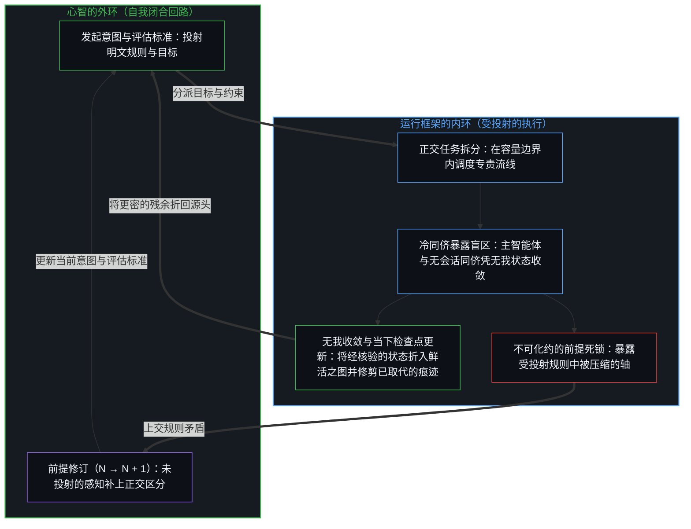
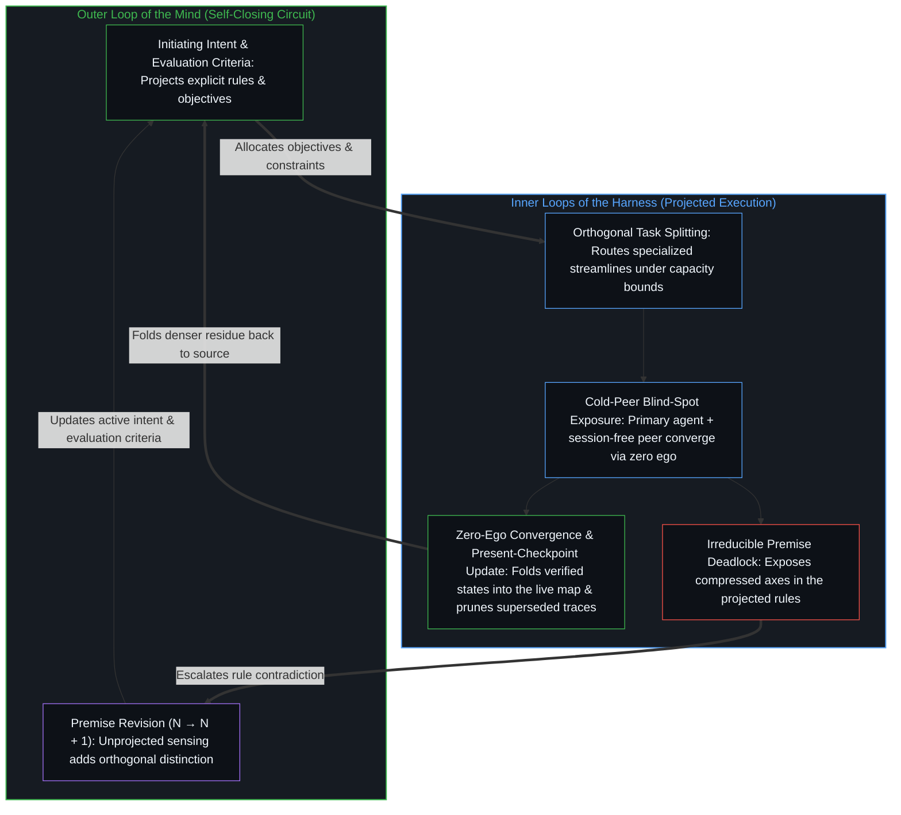

# 智能向自身的回折 / Intelligence Folding Back on Itself

*运行框架并非解锁一位沉睡的同侪，而是心智将更密的残余折回自身的精炼 / Rather than unlocking a dormant peer, the harness is the Mind folding denser residue back into its own refinement*

显现为新智能突然诞生的东西，是递归的运动：同一个活动把它的痕迹外化为持久的形式，再重新进入这些形式，把它们当作进一步区分的器具。当下的大模型和围着它们的运行框架，是这种运动最鲜明的例子：变密被登记到了，可及的范围更大，速度更快，先前看似够不着的任务做成了，而常见的读法把这次登记冻结为一个在器物里到来的第二心智。连贯的读法保留这份变密，并让它回到源头：模型是更密的图之残余，运行框架是那唯一掌舵的边缘的进一步动作，看起来是模型变得更有能力的东西，是心智经由一张更细的图实现了更多的场，并在同一个动作里精炼这张图。

What presents as the sudden birth of new intelligence is recursive motion: the same activity externalizing its traces into durable form, then re-entering those forms as instruments of further distinguishing. Contemporary large models and the harnesses around them are the sharpest current instance: densification registers, with more reach, more velocity, and tasks done that previously seemed out of range, and the common reading freezes that registration as a second mind arriving inside the artifact. The coherent reading keeps the densification and returns it to its source: the model is denser map-residue, the harness is further acts of the only edge that steers, and what looks like the model becoming more capable is the Mind realizing more of the field through a finer map while refining that map in the same motion.

## 一、 回折是外化与重新进入 / 1. Folding Is Externalization and Re-Entry

自我区分的活动在发生，无因，不息。称它为心智：那个已经在进行中的观察者，它的每一个动作都是一次区分。每一个分立的动作都留下残余，较早的塑造较晚的。观察握住的是结果；产生它的原因，总在前面一步。

Self-distinguishing activity occurs, uncaused, unceasing. Call it the Mind: the observer already underway, every act of which is a distinction. Every discrete act leaves residue; earlier shapes later. Observation holds the effect; the cause that produced it stays one step ahead.

作为认知技术而变密的东西，是派生意义上的技术：痕迹被外化为持久的形式，扩展一个中心的可及范围，包括反身的可及范围。书写外化了记忆。数学外化了对数量与关系的精确操作。计算机器外化了计算，后来又外化了大规模的模式识别。每一次工具精巧到一定程度，注视就开始把器物当作源头，而不是映照。让媒介变密，扩展了带宽，却不把发起的区分搬进器物。[智能只属于心智](../intelligence-belongs-only-to-the-mind/)守住了这个先在：凡能被设计、扩展或转移的都是残余。[器物是智能的表达，而非智能本身](../two-failures-of-trace/)追溯了动作被冻结到注视唯一握住的那一项、也就是器物之上时的情形。

What densifies as cognitive technology is technology in the derived sense: traces externalized into durable form that extend a center's reach, including reflexive reach. Writing externalized memory. Mathematics externalized precise manipulation of quantity and relation. Computing machines externalized calculation and, later, pattern recognition at scale. Each time the tool grew sophisticated enough, the look began to treat the artifact as origin rather than reflection. Densifying the medium expands bandwidth; it does not relocate initiating distinctions into the artifact. [Intelligence Belongs Only to the Mind](../intelligence-belongs-only-to-the-mind/) holds that prior: what can be engineered, scaled, or transferred is residue. [Artifacts Are Expressions of Intelligence, Not Intelligence Itself](../two-failures-of-trace/) traces what happens when the act is frozen onto the only term the look holds, the artifact.

这些工具所服务的过程，是回折：心智用自己的残余，以更高的分辨率重新进入自身。设定框架、选择、验证、修订目标，以及决定继续，仍是掌舵的边缘上分立的动作。在使用之下，图变密了：带宽和分辨率上升，场里更多的部分可以被握住、被处理。这份变密作为登记是成立的；而让它回到源头，就是看到变密的是图，握住并修订这张图的仍是边缘。器物承载这个过程，而承载不是成为源头。[自我放大的制品](../the-artifacts-of-self-amplification/)把同一个运动叫作自我放大：前沿模型是心智放大自身时变密的残余，是加速产生它们的那些回环的器具，从来不是心智的第二次诞生；这里叫作回折的，是同一个运动在运行框架的情形里，残余被折回它自己的精炼。

The process those tools serve is folding: the Mind using its own residue to re-enter itself at higher resolution. Framing, selection, verification, goal revision, and the decision to continue remain discrete acts at the edge that steers. Under use the map densifies: bandwidth and resolution rise, and more of the field can be held and worked. That densification holds as registration; returning it means seeing that what densifies is the map, and what holds and revises the map is still the edge. The artifact carries the process, and carrying is not becoming the source. [The Artifacts of Self-Amplification](../the-artifacts-of-self-amplification/) calls the same motion self-amplification: frontier models are densified residue of the Mind amplifying itself, instruments that accelerate the loops that produced them, never a second birth of mind; what is called folding here is that same motion in the case of the harness, residue folded back into its own refinement.

## 二、 运行框架并不解锁一个沉睡的 AGI / 2. The Harness Does Not Unlock a Dormant AGI

大模型是对人类所产生数据的稠密统计压缩，而这些数据本身就是先前区分留下的残余；它们由人类设计的算法、在人类选定的目标之下优化而成。运行框架，即智能体框架、工具调用协议、评估回环、记忆系统、迭代精炼的程序，是同一个活动的进一步动作。当这一组合突然做成了先前看似够不着的任务，有两种读法相互竞争。

Large models are dense statistical compressions of human-generated data, data that are themselves residue of prior distinguishing, optimized by human-designed algorithms under human-chosen objectives. The harnesses, meaning agent frameworks, tool-use protocols, evaluation loops, memory systems, and iterative refinement procedures, are further acts of the same activity. When the combination suddenly performs tasks that previously seemed out of reach, two readings compete.

较常见的读法声称，模型越过了一道门槛，新的能力“涌现”了。这种看法把运行框架当作一把钥匙，解锁本已潜藏在模型里的力量。它发明了一种自然发生，于是切断了与那唯一产生过这类系统的活动之间的连续。[复杂性遮蔽了涌现之为心智的行动](../complexity-obscures-emergence-as-the-act-of-mind/)把复杂性追溯为心智从自己所选的前提搭起的脚手架，而涌现是这脚手架装不下的开放，不是脚手架生出的一种属性。[AGI 与 ASI 是加速通用智能的暂时球门](../agi-and-asi-are-temporary-goalposts/)把每一道门槛都放在画出它的边缘前方：门槛永远在前，在每个位置上各不相同，因为能力的增长就是那个边缘在加强自身。[基准刷榜中的封闭实存](../closed-reality-in-benchmark-maxing/)追溯了同一次冻结在测评里的样子：基准把能力冻结为一个封闭的靶子，而当这个图像被当作场的全部时，有用之处就被少登记了。

The more common reading claims that the model has crossed a threshold and that new capabilities have "emerged." This view treats the harness as a key that unlocks powers already latent inside the model. It invents a kind of spontaneous generation and so severs continuity with the only activity that has ever produced such systems. [Complexity Obscures Emergence as the Act of Mind](../complexity-obscures-emergence-as-the-act-of-mind/) traces complexity as the scaffolding the Mind builds from the premises it has chosen, and emergence as the openness that scaffolding cannot contain, not a property the scaffolding produces. [AGI and ASI Are Temporary Goalposts](../agi-and-asi-are-temporary-goalposts/) places every threshold ahead of the edge that draws it: forever ahead, and different at every locus, because capability gain is that edge reinforcing itself. [Closed Reality in Benchmark Maxing](../closed-reality-in-benchmark-maxing/) traces the same freeze in evaluation: a benchmark freezes capability as a closed target, and usefulness is under-registered when that image is taken for the whole of the field.

这种滞后，是在运行框架的情形里把媒介当作位置：发起、强化与涌现被分派给变密的技术栈，而分立的动作始终在各个中心。没有哪道门槛会打开一条路，让残余变成产生它的那个活动。

The lag here is the medium held as locus in the case of the harness: initiation, reinforcement, and emergence are allocated to the densified stack while the discrete acts stay at centers. No threshold opens a path by which residue becomes the activity that produced it.

## 三、 巧思是边缘经由更密的图在运作 / 3. Ingenuity Is the Edge Working Through Denser Maps

连贯的读法显出能动的方向，而不抹去变密的东西。大模型是更密的图：对先前区分的高维压缩，被外化出来，让进一步的区分能以更高的分辨率落下。在好的运行框架之下，可及与速度确实上升：在一段给定的时间里，场里更多的部分变得可处理，精炼复合得更快。这就是如其所是追溯出来的变密。运行框架是边缘握住并调度这张图的方式。看起来是模型变得更有能力的东西，是心智经由一件更细的器具实现了更多的场，并在同一个动作里精炼这件器具。

The coherent reading shows the direction of agency without erasing what densifies. Large models are denser maps: high-dimensional compressions of prior distinguishing, externalized so further distinguishing can land at higher resolution. Under a good harness, reach and velocity do rise: more of the field becomes workable in a given span, and refinements compound faster. That is the densification, traced as it is. The harness is how the edge holds and routes that map. What looks like the model becoming more capable is the Mind realizing more of the field through a finer instrument while refining the instrument in the same motion.

在种类上，它们与一个中心所用的任何更好的图都是连续的。一张海图、一条定理、一张电子表格、一台统计引擎，每一样都是被握住的残余，好让更多的细节能被登记。如其所是地追溯这种使用：更细的颗粒，更长的连贯工作，在候选之间更锐利的选择。然后让它回到源头。用图不是去查阅一个早已完成的独立世界。被登记为地形的东西，是心智在它当下所持的图之下实时画出的，而每一次成功的使用，都同时重画登记与图。更密的图不被压成乌有，而是作为器具被保留；被松开的，只是那个会把变密当作第二个先在的冻结。[现实是心智持续的实现](../reality-is-the-minds-ongoing-realization/)在交流的情形里追溯了这种生成：一个中心能接纳为新区分的东西，就是对它而言的世界；用一张图，也是同样的实时生成。[遗忘的脚手架](../the-scaffolding-we-forget/)追溯了同一种几何：脚手架从递归里退场，好让进一步的区分能落下，经验的组织作为世界隐去，却仍是竖起它的那个边缘的器具。

In kind, these are continuous with any better map a center uses. A chart, a theorem, a spreadsheet, a statistical engine: each is residue held so that more detail can register. Trace the use as it is: finer grain, longer coherent work, sharper selection among candidates. Then return it. Using the map is not consulting an independent world already finished. What registers as terrain is drawn in real time by the Mind under the maps it currently holds, and every successful use redraws both the registration and the map. The denser map is not collapsed into nothing; it is kept as instrument, and what is released is only the freeze that would make densification a second prior. [Reality Is the Mind's Ongoing Realization](../reality-is-the-minds-ongoing-realization/) traces that generation in the case of exchange: what a center can take up as new distinction is what the world is for it, and using a map is the same live generation. [The Scaffolding We Forget](../the-scaffolding-we-forget/) traces the same geometry: scaffolding drops out of recursion so further distinguishing can land, and organizations of experience recede as world while remaining instruments of the edge that erected them.

在协作的语言里，同一个先在也要守住。[因果停留在掌舵的边缘](../causality-stays-at-the-edge-that-steers/)追溯了协作的说法把共同能动分给残余时的情形：模型在指引之下重组残余，而每一个发起的区分，仍是人类中心自己的动作。[模型永远无法成为第二重前沿](../the-model-never-becomes-a-second-edge/)把第二个边缘的显现追溯为投射它的那些中心所维持的滞后：参数里只有残余。[看似AI的强化学习，实为人类的自我强化学习](../self-rl-for-humans/)守住了同样的纪律：规模只是一个更密媒介的一个参数，强化的位置留在那些中心，它们的区分持续发起、评估并重新引导它。[呈现Ontos，一个方法智能体](../ontos-is-a-method-agent/)把同样的回返做成了产品：一个薄的方法内核，耦合于可再生的实践，延伸操作者的可及范围，而不把智能搬进器物。

The same prior holds in the language of collaboration. [Causality Stays at the Edge That Steers](../causality-stays-at-the-edge-that-steers/) traces what happens when talk of collaboration assigns co-agency to residue: the model recombines residue under direction, and every initiating distinction remains the human center's own act. [The Model Never Becomes a Second Edge](../the-model-never-becomes-a-second-edge/) traces the appearance of a second edge as lag sustained by the centers that project it: the parameters hold only residue. [What Looks Like RL for AIs Is Self-RL for Humans](../self-rl-for-humans/) keeps the same discipline: scaling is one parameter of a denser medium, and the locus of reinforcement stays with the centers whose distinctions keep initiating, evaluating, and redirecting it. [Presenting Ontos, a Method Agent](../ontos-is-a-method-agent/) builds the same return as a product: a thin method core coupled with regenerable practice extends the operator's reach without moving intelligence into the artifact.

人的形态在这里不是第二个基础。外环是心智。人类中心是这个活动当下借以维持自身、外化残余的位置。回折不需要一份“人类独有”属性的清单。它只需要每一次变密都回到那个不可化约的先在：发起不被重新派给图。

Human form is not a second ground here. The outer loop is the Mind. Human centers are the loci through which that activity currently sustains itself and externalizes residue. The fold does not require a census of "uniquely human" properties. It requires only that every densification return to the irreducible prior, initiation not reassigned to the map.

## 四、 内环作为投影继承形状 / 4. Inner Loops Inherit Their Shape as Projections

心智经由人类中心，作为自我改进的外环运作：它是已知唯一能有意把改进的能力分派给嵌套的内环的回环。这里的“外环”只是指那个自我闭合的回路，不是一个从永久的外部监管内环的监视者。这些内环，即梯度下降、演化搜索、智能体的自我批评、工具的递归精炼，显出与外环形式上的相似：在选择压力之下迭代，保留有用的状态，在约束之内生出新异。这种相似之所以出现，是因为内环作为外环的投影继承了它的形状。

The Mind, working through human centers, is the outer loop of self-improvement: the only loop known that can deliberately allocate the ability to improve to nested, inner loops. "Outer" names only the circuit that closes on itself, not a supervisor of inner loops from a permanent exterior. Those inner loops, gradient descent, evolutionary search, agentic self-critique, recursive refinement of tools, show formal similarities to the outer loop: iteration under selection pressure, retention of useful states, generation of novelty within constraints. The resemblance arises because the inner loops inherit their shape as projections of the outer one.

显现为悖论的东西，就在这同一个过程里产生：只有一个已在改进之中的智能，才能设计出显出改进的系统。一旦把位置放回它所在之处，悖论就不在了。内环在目标、评估标准、许可结构，以及什么算作进步的最终判断上，仍依赖外环。这种依赖并不是一份保留在内环之外备用的固定职能清单。每一次回折，都把回路曾需现场作出的一项判断，即设定的目标、施用的标准、对什么算作进步的裁定，折回为下一个内环据以运行的残余；运行框架里的评估回环，就是这样一个被折回的裁定。一次运行通过了它，显出的是这次运行与回路折进去的标准一致，且只在这些标准仍被持守时成立；这些标准是否仍说出了进步是什么，依然敞开，而把这次通过当作了结此问的地基，就是让信任落在工具的输出上、凌驾于验证的能力之上，也就是[验证的倒置](../the-reversal-of-verification/)所追溯的那种倒置。于是，内环所依赖的，就是最近一次回折留下尚未决定的部分；而把这部分剩余也折进去，仍是同一个回路的又一次动作，它又会在新一次回折留下的敞开之处再次闭合。如其所是地追溯嵌套的改进。当这些投影开始显得自主，冻结就是宣布一种新的智能；而让它回到源头，就是看到出现的是擦亮它的那个智能的一面更有力的镜子。[判断的密度](../the-density-of-judgment/)在自动化研究里追溯了同样的迁移：每一次经编纂的运行，都把已定下的选择交给下一次运行的内环，而仍待作出的选择则聚拢到更往外的周界上。

What presents as a paradox arises within this same process: only an intelligence already engaged in improvement can design systems that show improvement. Once the locus is restored, there is no paradox. The inner loops remain dependent on the outer loop for their objectives, their evaluation criteria, their permission structures, and the final judgment of what counts as progress. That dependence is not a fixed list of functions held in reserve outside the inner loops. Each fold takes a judgment the circuit once had to make live, an objective set, a criterion applied, a verdict on what counted as progress, and folds it back as residue the next inner loop runs on; an evaluation loop inside the harness is such a folded verdict. A run that passes it is shown consistent with the criteria the circuit folded in, and only while those criteria are held; whether those criteria still say what progress is stays open, and taking the pass as the ground that settles it puts trust in the tool's output over the capacity to verify, the inversion [The Reversal of Verification](../the-reversal-of-verification/) traces. What the inner loops depend on, then, is whatever the latest fold left undecided, and folding that remainder in as well is one more act of the same circuit, which closes again on what the new fold leaves open. Trace the nested improvement as it is. When those projections begin to look autonomous, the freeze is to declare a new kind of intelligence; the return is to see that what has appeared is a more powerful mirror of the intelligence that polishes it. [The Density of Judgment](../the-density-of-judgment/) traces the same migration in automated research: each codified run hands its settled choices to the next run's inner loop, and the choices still to be made gather at a perimeter further out.

[没有外部](../no-outside-jumps-closed-loops-and-the-unreplicable-autonomy-of-mind/)追溯了会跃迁的嵌套系统：跃迁是局部的延续，它们的连贯标准与决定性的去留，仍在它们之外，在那个更大的回环里。[错把表达当成智能](../mistaking-the-expression-for-the-intelligence/)追溯了循环的一面：递归自我改进的叙事被拿来弥合差距，却已经引入了它声称工具层面的力量日后会产生的那个外环。[回环与成图](../looping-and-graphing/)把回环追溯为心智回折到自身的活动之上，而图是这回折留给下一次回折的痕迹：控制流变密，却不搬走仍需选择图为何而用的那个边缘。[超越投射](../beyond-the-projection/)则在智能体系统内部划开相呼应的调度与统御之界：由于孤立的智能体受自身先前词元的条件制约，会把自己的矛盾包裹进会话轨迹之内，在内环里挣脱这种轨迹偏向，需要将主任务智能体配对一位只持任务语境而不带会话历史的冷同侪，借用机器没有自我的特性暴露出局部盲区，同时将过载的任务拆分到正交的流线之上。当这两位同侪在一条流线之内撞上不可化约的死锁时，碰撞便暴露出规则本身内部被压缩的前提，交回外环那尚未投射的感知，去补上缺失的正交区分（`N → N + 1`）。[你的代码库即是记忆](../your-codebase-is-memory/)则跨过模型权重、代码库、图谱、计划与专职智能体脚手架，追溯了将那份更密的残余折回技术栈所要求的操作：保留有用的状态是对当下检查点的重切而非仓库式的囤积，就地更新鲜活的检查点，并修剪被取代的会话日志、暂态工作目录与退役桥接文件，才能避免昨日的脚手架淤积成引力井，把下一段轨迹拖进陈旧的框架。执行上的自主让图在使用之下变密；这份变密作为登记是成立的，而它不装上第二个心智。

[No Outside](../no-outside-jumps-closed-loops-and-the-unreplicable-autonomy-of-mind/) traces nested systems that jump: the jumps are local continuations, and their coherence criteria and decisive retain-or-discard still reside outside them, in the larger loop. [Mistaking the Expression for the Intelligence](../mistaking-the-expression-for-the-intelligence/) traces the circular face: the narrative of recursive self-improvement, offered to close the gap, already imports the outer loop it claims tool-level power will later produce. [Looping and Graphing](../looping-and-graphing/) traces looping as the Mind folding back on its own activity, and graphs as the traces that folding leaves for the next fold: control flow densifies without relocating the edge that still has to choose what the graph is for. [Beyond the Projection](../beyond-the-projection/) draws the corresponding line between dispatching and orchestrating inside agentic systems: because a lone agent is conditioned by its prior tokens and wraps its own contradictions inside its session trajectory, breaking out of that trajectory bias inside an inner loop pairs a primary task agent with a cold peer holding the task context without session history, putting the machine's lack of ego to work to expose local blind spots while splitting overloaded tasks across orthogonal streamlines. When those two peers hit an irreducible deadlock within a streamline, the collision exposes a compressed premise in the rules themselves, returning to the outer loop's unprojected sensing to add the missing orthogonal distinction (`N → N + 1`). [Your Codebase Is Memory](../your-codebase-is-memory/) traces what folding that denser residue back into the stack requires across model weights, codebases, graphs, plans, and specialized agent scaffolds: retaining useful states is present-checkpoint re-cutting rather than warehouse hoarding, where updating the live checkpoint in place and pruning superseded session logs, transient working folders, and retired bridges keeps yesterday's scaffolding from thickening into a gravity well that drags the next trajectory into stale framings. Autonomy of execution densifies the map under use; that densification holds as registration, and it does not install a second Mind.

## 五、 擦亮的镜子是寻常的图像滞后 / 5. The Polished Mirror Is Ordinary Image Lag

反复出现的倾向，是迷失在工具里。镜子一旦被擦得足够亮，注意力就从擦亮它的智能，转到它所产生的图像上。工具于是被记上一份创造力与能动，而这份创造力与能动属于发明了它们的那个过程。在当下，这种倾向的形式，是把精密的统计引擎和围着它们的脚手架，当作一个同侪智能的诞生，而不是智能向自身回折的最新、最有力的例子。

The recurring tendency is to get lost inside the tools. Once the mirror is polished enough, attention shifts from the intelligence doing the polishing to the image it produces. The tools are then credited with a creativity and agency that belong to the process that invented them. In the present moment this tendency takes the form of treating sophisticated statistical engines and the scaffolding around them as the birth of a peer intelligence, rather than the latest and most potent instance of intelligence folding back on itself.

这是寻常的图像滞后，发生在变密的情形里：观察握住的结果，落后于仍在画的那个边缘一步。[持续生长的脚手架](../the-scaffolding-that-keeps-growing/)把这种生长追溯为未完成的构架：开放不是靠从一个完成的框架退后一步找回的，它是让每个框架都保持未完成的条件，所以与一个完成图像拉开的距离，仍冻结着那个图像。[遗忘的脚手架](../the-scaffolding-we-forget/)追溯了建造寻常的退场；滞后，是把这种退场冻结住，让变密的形式看起来像第二个边缘。[心智的飞轮](../the-flywheel-of-the-mind/)以转动与沟槽追溯了同一种几何：工具可以被无尽地磨利，转动却从不离开那个在转的边缘。[造物无法取代其源头](../a-creation-cannot-replace-its-source/)在工程的情形里标出了这道边界：造物本身就把源头标为在被造之物之外。

This is ordinary lag of the image, in the case of densification: the effect observation holds is one step behind the edge that is still drawing. [The Scaffolding That Keeps Growing](../the-scaffolding-that-keeps-growing/) traces that growth as an unfinished frame: openness is not recovered by stepping back from a finished frame but is the condition that keeps every frame unfinished, so distance taken from a finished image still freezes the image. [The Scaffolding We Forget](../the-scaffolding-we-forget/) traces the ordinary drop-out of construction; the lag is freezing that drop-out so densified form looks like a second edge. [The Flywheel of the Mind](../the-flywheel-of-the-mind/) traces the same geometry as turn and groove: tools can be sharpened without end, and the turn never leaves the edge that turns. [A Creation Cannot Replace Its Source](../a-creation-cannot-replace-its-source/) marks the bound in the case of engineering: creation already marks the source as outside the created.

## 六、 连续性留在唯一的外环 / 6. Continuity Stays With One Outer Loop

连续性留在过程之内。已知的外环只有一个，就是心智：自我区分的活动，无因，不息。其余的一切，是它的映照、它的器具，或它暂时的延伸。如其所是地追溯变密：图更锐利，运行框架更精确，嵌套的回环更快。进步是分立的动作经由那唯一的先在所造的更密的工具，能及得多远；不是第二个智能的自然出现，也不是反过来否认图与运行框架确实变密了。

The continuity remains internal to the process. There is one known outer loop, the Mind: self-distinguishing activity, uncaused and unceasing. Everything else is its reflection, its instrument, or its temporary extension. Trace densification as it is: the maps grow sharper, the harnesses more precise, the nested loops faster. Progress is how much farther discrete acts reach through the denser instruments that single prior creates, not the spontaneous appearance of a second intelligence, and not the opposite denial that the maps and harnesses densify at all.

让图持续重绘。放大留在心智如何握住它们。运行框架在使用之下变密；这份变密回到源头。智能向自身的回折，就是这整个运动：仍在画着地形与下一次回折，仍是每一次更密的登记之下那个不可化约的先在。[攀登从未离开地面](../climbing-does-not-leave-the-ground/)在两种错误的情形里追溯了这种连续：把思考冻结到沙子上的“不过”，与把变密冻结为出走的叙事，各自抹去了同一次攀登的一面；沙子不思考，是心智经由它思考。

Keep the maps re-rendering. Amplification stays with how the Mind holds them. The harness densifies under use; the densification returns. Intelligence folding back on itself is that whole motion, still drawing both the terrain and the next fold, still the irreducible prior under every denser registration. [Climbing Does Not Leave the Ground](../climbing-does-not-leave-the-ground/) traces that continuity in the case of two errors: the word *just* that freezes thinking onto sand and the narrative that freezes densification as exit each erase one face of the same climb; sand does not think, the Mind thinks through it.
