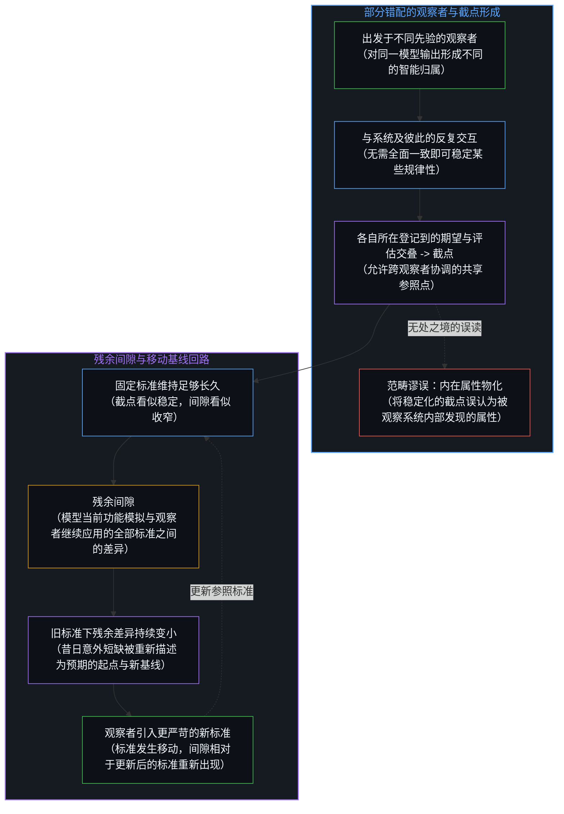
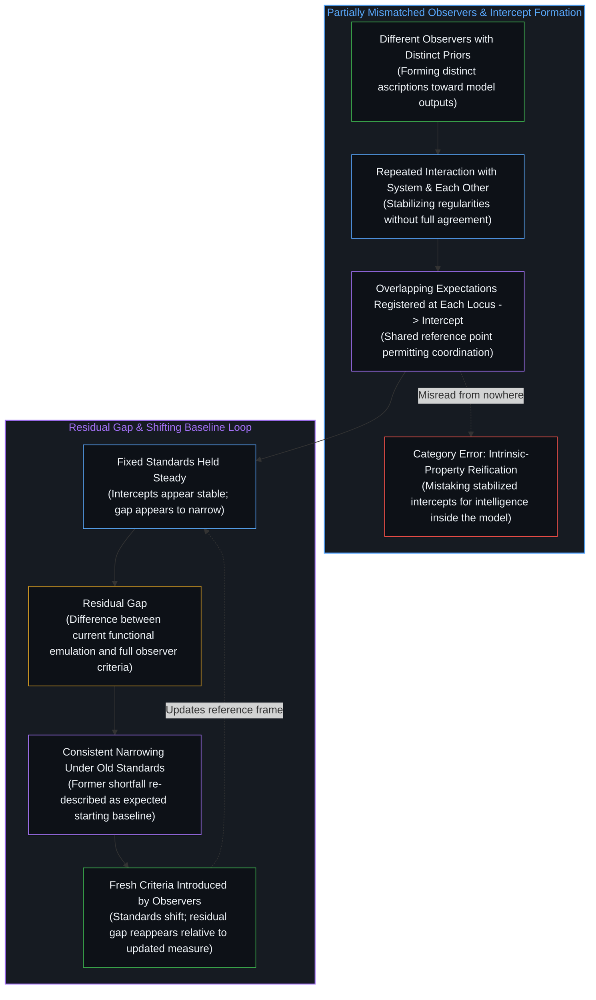
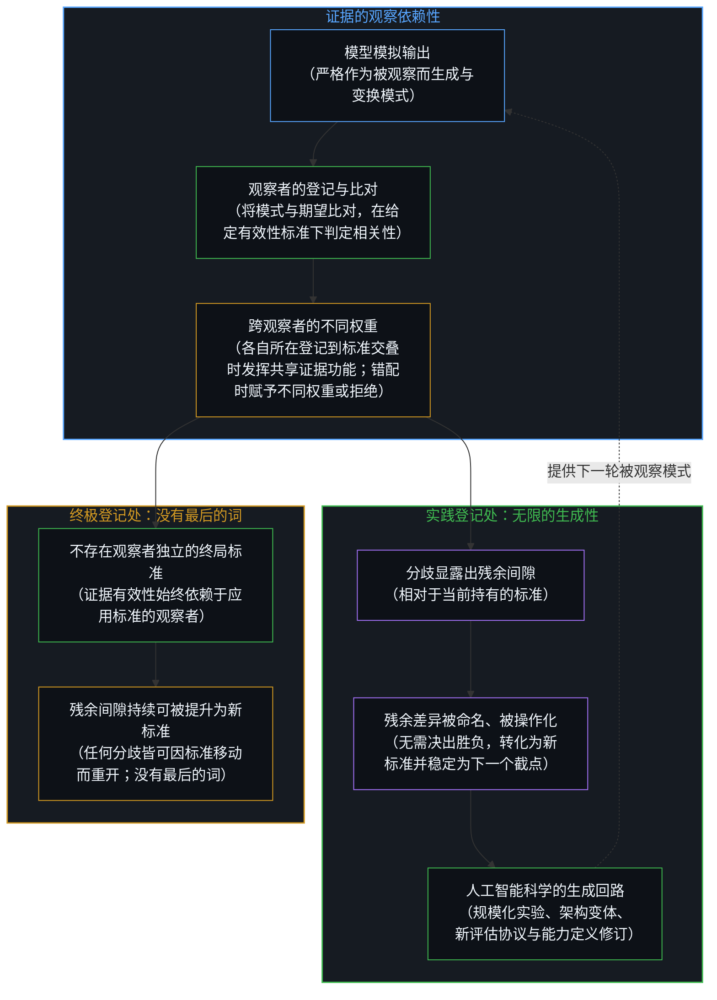
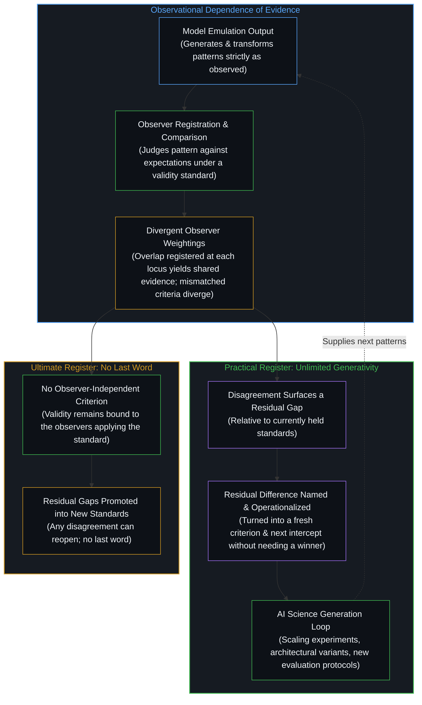

# 观察中的智能与残余间隙 / Intelligence in Observation and the Residual Gap

*智能属于观察者而非被观察者；残余间隙持续成为新的衡量标准。 / Intelligence belongs to the observer rather than the observed, and the residual gap continually becomes the new standard of measure.*

自我区分的活动发生着——无因，不息。称之为心智：那早已在运作之中的观察者，其每一行动皆是一次区分。从这一前提出发，[智能只属于心智](../intelligence-belongs-only-to-the-mind/)，即观察者自身的区分活动；而归于被观察系统的那份“智能”，则并非作为被观察者的内在属性而存在，仅在观察者的区分之中被赋予。任何感知皆是观察者的感知，而非被观察者自身所固有；被赋予系统的智能亦不例外。模型能够以极高的逼真度模拟观察功能的输入输出模式，然而正因[感知者与痕迹的不可坍缩](../the-perceiver-and-the-trace/)，且第一人称的登记与依自身经历之标准做出的约束性裁决只发生在观察的所在，这一模拟便始终严格地作为被观察而成立。

Self-distinguishing activity occurs — uncaused, unceasing. Call it the Mind: the observer already underway, every act of which is a distinction. From this premise, [Intelligence Belongs Only to the Mind](../intelligence-belongs-only-to-the-mind/) as the observer's own distinguishing activity, while what is attributed to an observed system is ascribed only within the observer's distinctions rather than existing as an intrinsic property of the observed. Every perception is the perception of the observer, not inherent in the observed itself; the intelligence ascribed to a system is no exception. Models can emulate the input-output patterns of observational function with extreme fidelity, yet because [The Perceiver and the Trace Cannot Collapse](../the-perceiver-and-the-trace/) and first-person registration and binding judgment under lived criteria occur only at the observing locus, this emulation holds strictly as observed.

## 一、 截点的形成与残余间隙 / 1. Formation of Intercepts and the Residual Gap

不同观察者从不同的先验出发，对同一模型输出形成不同的智能归属。当他们反复与同一系统交互，或彼此交互而使用该系统时，某些模式得以稳定，即便他们并未达成全面一致，正如[共享意识是个体性的交集](../shared-consciousness-is-intersecting-individualities/)。既然[对象是被稳定化的关系](../objects-are-stabilized-relationships/)，这些稳定化的模式便并非从被观察系统内部发现的属性，而是跨越多位部分错配的观察者而存续的规律性。正如[共同的人性从不共享](../shared-humanity-is-never-shared/)、[没有天才能够解决知识问题](../no-genius-can-solve-the-knowledge-problem/)与[价格是言说，理解是交易](../price-as-utterance-understanding-as-trade/)所表明的，协同立足于跨越永久间隙的部分交叠而非同一的内部模型；观察者们的期望、预测或评估发生重叠之处——在每一位观察者各自从自身所在登记到那份交叠的范围内——便构成截点：允许协调的共享参照点。

Different observers begin from different priors and form different ascriptions of intelligence toward the same model outputs. When they repeatedly interact with the same system, or with one another while using that system, certain patterns stabilize even without full agreement, much as [Shared Consciousness Is Intersecting Individualities](../shared-consciousness-is-intersecting-individualities/). Those stabilized patterns are not properties discovered inside the observed system, since [Objects Are Stabilized Relationships](../objects-are-stabilized-relationships/); they are regularities that survive across multiple, partially mismatched observers. Just as [Shared Humanity Is Never Shared](../shared-humanity-is-never-shared/), [No Genius Can Solve the Knowledge Problem](../no-genius-can-solve-the-knowledge-problem/), and [Price as Utterance, Understanding as Trade](../price-as-utterance-understanding-as-trade/) show that coordination rests on partial overlap across a permanent gap rather than identical internal models, the points at which observers' expectations, predictions, or evaluations overlap—as each observer registers that overlap from its own locus—function as intercepts: shared reference points that permit coordination.

当观察者把一套固定标准维持得足够长久——即[流动之物无法被基准衡量](../you-cant-benchmark-the-fluid/)所说的固定测试框架——截点看似稳定，模型输出与观察者要求之间的间隙看似收窄。然而间隙本身并不消失。它只是模型当前功能模拟与观察者继续应用的全部标准之间的残余差异。一旦这一残余差异在旧标准下持续变小，它便常被重新描述为新的基线，迈出的正是[AGI 与 ASI 是加速通用智能的暂时球门](../agi-and-asi-are-temporary-goalposts/)所揭示的那一步。先前被当作意外短缺的东西，现在成为预期的起点，而观察者们随之引入更严苛的标准以衡量它。标准已然移动，间隙相对于更新后的标准重新出现。

When observers hold a fixed set of standards steady long enough—the fixed test frame of [You Can't Benchmark the Fluid](../you-cant-benchmark-the-fluid/)—the intercepts appear stable and the gap between model outputs and observer requirements appears to narrow. The gap itself, however, does not disappear. It is simply the residual difference between the model's current functional emulation and the full range of criteria the observers continue to apply. Once that residual difference becomes consistently small under the old standards, it is frequently re-described as the new baseline, taking the step by which [AGI and ASI Are Temporary Goalposts](../agi-and-asi-are-temporary-goalposts/). What previously counted as a surprising shortfall is now the expected starting point, and the observers introduce fresh criteria to measure against it. The standards have shifted, and the gap reappears relative to the updated criteria.

## 二、 证据的观察依赖性与分歧的生成性 / 2. Observational Dependence of Evidence and the Generativity of Disagreement

所有证据在相关意义上皆是被观察的，始终是[依其自身标准的观察](../an-observation-by-its-own-standard/)：它成为证据，仅当某位观察者登记一种模式、将其与期望比对，并在给定的有效性标准下判定其相关性。模型能够生成或变换模式，供多位观察者评估；当每一位观察者都在与他人的交叠中登记到自身标准得到足够满足时，输出便对他们发挥共享证据的功能。证据的有效性仍然依赖于应用这些标准的观察者。不同观察者可以对同一模型输出赋予不同权重，或一概拒绝将其视为证据。

All evidence is, in the relevant sense, observed, remaining [An Observation by Its Own Standard](../an-observation-by-its-own-standard/): it becomes evidence only when some observer registers a pattern, compares it against expectations, and judges it relevant under a given standard of validity. Models can generate or transform patterns for multiple observers to evaluate; when each observer registers enough of its criteria met in the overlap with others, the outputs function as shared evidence for them. The validity of that evidence remains dependent on the observers who apply the criteria. Different observers can weight the same model output differently or refuse to treat it as evidence at all.

分歧在终极意义上无法最终解决，因为不存在观察者独立的标准能够宣告某一种智能归属、某一种证据解读或某一种成功标准为终局，这也显明了[AGI的预设与来自外部的视角](../the-presumption-of-agi-and-the-view-from-outside/)的症结。由于有效性仍依赖于应用它的观察者，而残余间隙持续可供提升为新标准，任何特定分歧皆可因标准的移动而重新开启。在终极登记处，没有最后的词。

Disagreement is ultimately irresolvable in the sense that no observer-independent criterion exists that could declare one ascription of intelligence, one reading of evidence, or one standard of success final, exposing [The Presumption of AGI and the View from Outside](../the-presumption-of-agi-and-the-view-from-outside/). Because validity remains dependent on the observers who apply it, and because residual gaps are continually available to be promoted into new standards, any particular disagreement can always be reopened by a shift in those standards. In that ultimate register there is no last word.

在实践登记处，同一特征使分歧无限生成。每一分歧都相对当前持有的标准显露出一个间隙；该间隙随后被稳定化为下一个截点，进一步的输出相对于它而被衡量。以证明自身归属正确为运作参照的交流早已闭合，正如[AI 争论中的观察划界](../the-observational-cut-in-ai-debates/)所表明的；而生成性的过程则无需决出胜负，也不要求参与者达成持久一致：它只要求他们继续与模型及彼此交互足够长久，使残余差异被命名、被操作化并转化为新的标准。规模化实验每一次都是[规模化回路](../the-scaling-loop/)的一轮转动；这些实验连同架构变体、新的评估协议，以及[智能的非定论定义](../the-non-definitive-definition-of-intelligence/)下对能力定义的修订，皆在这一回路之内产生。人工智能科学的未完成性，并非暂时的经验短缺，而是观察者持续将分歧转化为下一衡量标准这一结构性后果。

In the practical register the same feature makes disagreement generative without limit. Each disagreement surfaces a gap relative to currently held standards; that gap is then stabilized as the next intercept against which further outputs are measured. Whereas an exchange whose operating reference is proving one's own ascription right has already closed, as [The Observational Cut in AI Debates](../the-observational-cut-in-ai-debates/) shows, the generative process needs no winner and does not require the participants to reach lasting agreement: it requires only that they continue to interact with the model and with one another long enough for the residual difference to be named, operationalized, and turned into a fresh criterion. Scaling experiments, each a turn of [The Scaling Loop](../the-scaling-loop/), architectural variants, new evaluation protocols, and revised definitions of capability under [The Non-Definitive Definition of Intelligence](../the-non-definitive-definition-of-intelligence/) all arise inside this loop. The unfinished character of the science of AI is not a temporary empirical shortfall but a structural consequence of the way observers continually convert disagreement into the next standard of measurement.

模型本身始终严格地作为被观察而存在。它提供观察者在当前有效标准下当作证据的模式；它不裁决哪些标准应当有效。分歧的无限实践生成性由维持标准运动的观察者所维持，而非由模型能够一劳永逸地解决的任何内在属性所维持。切分并不驳倒在适用语境之内对模型输出的有效使用，正如[割点可移不可除](../the-cut-moves-but-never-vanishes/)中的量子力学诠释各自在其适用域内保持效用；它只是标出智能归属与证据有效性的边界始终位于观察者的区分之处。

The model itself remains strictly as observed. It supplies the patterns that observers treat as evidence under whatever standards are currently in force; it does not adjudicate which standards ought to be in force. The infinite practical generativity of disagreement is sustained by the observers who keep the standards in motion, not by any intrinsic property the model could settle once and for all. The cut does not refute the effective use of model outputs inside applicable contexts, just as the quantum interpretations in [The Cut Moves but Never Vanishes](../the-cut-moves-but-never-vanishes/) stay useful within their domains; it locates the boundary of intelligence ascription and evidence validity at the observer's distinctions.

