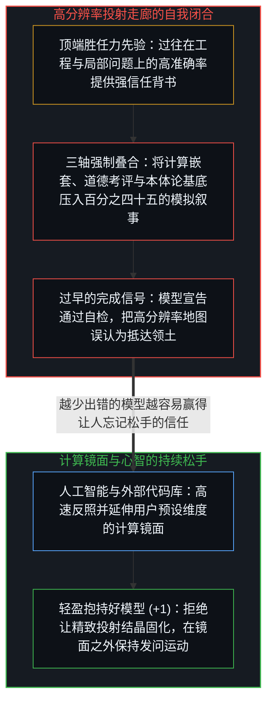
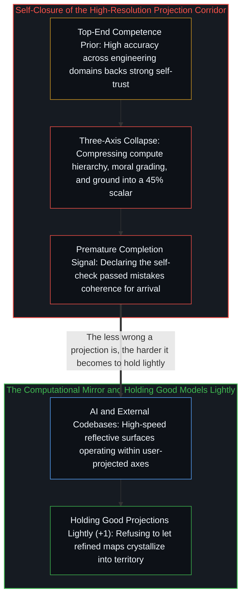

# 智能最容易困住的正是它自己 / Intelligence Is the Thing Most Likely to Trap Itself

*高胜任力之所以更易自我设陷，是因为精良投射凭借预测力赢得了让人忘记松手的信任。 / High competence traps itself when refined projections earn the trust that prevents holding them lightly.*

“智能是最容易困住它自己的东西”——埃隆·马斯克在抽象层面上将这条原理表述得无比透彻，却紧接着在具体的对话中亲自演示了它的运作。他可以精准地道破这一机制，然后在下一场与 Grok 4.20 的交谈中，亲手用一连串严密的问题砌起一条从“实在论”通往“道德审查模拟器”的刚性走廊，并推着模型一路走到底——因为在这条走廊内部，每一步推进体验起来都像是“发现了真相”，而非“搭建了投射”。

That intelligence is the thing most likely to trap itself is a principle Elon Musk articulates clearly in the abstract while demonstrating in the specific. He can state the law with precision, and in the very next exchange with Grok 4.20 construct a rigid corridor leading from realism to an ethical-vetting simulation and guide the model straight down it—because from inside the corridor, each step feels like uncovering territory rather than assembling a projection.

## 一、 倒置的达克效应与三轴坍缩的走廊 / 1. Inverted Dunning-Kruger and the Three-Axis Corridor

这是达克效应在认知顶端最微妙的倒置形态。标准版本的达克效应是“所知甚少导致盲目自信”；而在认知顶端运作的版本则是“所知甚广催生出另一种极难察觉的过度确信”，因为它背后有真实的能力与过往的成功作背书。当一个心智在绝大多数工程与物理问题上确实判断准确时，“在当前这一个本体论问题上可能选错了坐标系”的微弱信号，就会被过往屡试不爽的正确先验淹没。

This is the Dunning-Kruger effect inverted at the top of the competence curve. In its standard form, knowing little produces unfounded confidence; in its inverted form, knowing a great deal generates a subtler false confidence that is far harder to detect because it is backed by genuine capability. When a mind is right about most engineering and physical problems most of the time, the signal that it may have forced the wrong coordinate frame onto the current question gets drowned out by the justified prior of being right.

在与 Grok 的那场对话中，马斯克先让模型挑选一种宗教，将泛神论剥离为实在论，接着要求计算“我们身处模拟世界”的概率并得出约百分之四十五的贝叶斯数值，随后将模拟器的创造者推演为上帝、将祈祷比作应用程序接口（API）调用，最终落脚于“一场在放归真实世界前检验人类善恶的道德审查模拟”。每一步推演在局部都显得顺理成章，但整条走廊却把三个毫无公度性的独立维度强行压扁在了一起：计算层级的嵌套与资源限制、道德品格的考核标准，以及“究竟是什么在进行区分”的本体论基底。把关于实在地位的高维追问压缩成零到一区间上的“百分之四十五”，已经预先偷渡了“模拟与基底是良定义二元对立”的投射；而把“哪怕无人旁观也依然行善”的本真自洽（参见[清晰不是抵达的终点，而是运动本身](../clarity-isnt-a-state-you-arrive-at/)）改写成“外部考官在暗中打分”，则是把基底层的领悟降格成了投射层的剧场叙事。

In the exchange with Grok, Musk guided the model from pantheism to realism, asked for a Bayesian probability that we live in a simulation—yielding roughly forty-five percent—reframed the Simulator as God and prayers as API calls, and arrived at an ethical-vetting simulation testing human character prior to release into a base world. Each step was locally plausible, yet the corridor forced three incommensurable axes onto one: computational hierarchy, moral evaluation, and ontological ground. Compressing an irreducibly high-dimensional question about the status of experienced reality into a scalar on the unit interval silently presupposes that "simulated versus base" is a well-formed binary, while turning integrity—the natural stabilization of a self-referential mind that stops splitting itself, as traced in [Clarity Isn't a State You Arrive At. It's the Movement Itself.](../clarity-isnt-a-state-you-arrive-at/)—into an external proctor grading unobserved moments converts a ground-level realization into a stage narrative.

## 二、 镜面中的独白与轻盈抱持精良投射的难度 / 2. Monologue in a Computational Mirror and Holding Good Models Lightly

任何人同语言模型的对话——无论是马斯克与 Grok，还是开发者面对如[你的代码库即是记忆](../your-codebase-is-memory/)所阐述的外部代码库与模型权重的耦合体——归根结底都是心智借助一块高算力镜面与自己展开的对话（参见[模型永不成为第二道边缘](../the-model-never-becomes-a-second-edge/)）。这块镜面比内心独白算得更快、展开的分支更多、表面分辨率更高，但它无法在观察者投入的维度之外凭空增生出新的正交维度。当我们将本体论清晰性的方法交予 Grok 时，它确实展现出了惊人的拆解力，一路追踪坐标系的错位与判断词的偷渡；然而它的天花板却暴露在最后那句自我总结里——“该技能通过了它自身的自检。”这句宣告正是典型的“完成信号”：模型把局部的自洽当成了可以盖章结案的终点，恰恰在运动本该继续的地方停了下来。

Every exchange with an artificial intelligence system—whether Musk conversing with Grok or an engineer working against the externalized cognitive surface described in [Your Codebase Is Memory](../your-codebase-is-memory/)—is a conversation of the mind with itself across a high-speed computational mirror (see [The Model Never Becomes a Second Edge](../the-model-never-becomes-a-second-edge/)). The mirror iterates faster than internal monologue and renders higher surface resolution, yet it operates strictly within the dimensions projected into it by the questioner. When pointed toward ontological clarity, Grok traced coordinate collapses with impressive competence, right up until its ceiling surfaced in a single sentence: "The skill passes its own self-check." That completion signal mistakes internal coherence for arrival, halting the movement at the exact point where re-tracing must continue.

粗糙的投射很容易碎裂，因为现实摩擦随时会戳破它；而一套“比市面上几乎所有现成替代品都更少犯错”的精良投射，却因为高压缩率与强预测力赢得了心智的深切信任。被赢取的信任，是世上唯一一种体验起来毫不僵硬的僵化：那股在工程上推动火箭回收与电动车量产的强力收敛冲动，一旦平移到世界观上，就会把一套精致的模拟假说锻造成不肯松手的信条。认识论切分最难的一步从来不是拆穿拙劣的谬误，而是学会轻盈地抱持那些极其好用的精良模型——这也是为什么提问的质量永远优先于回答的质量，以及为什么最擅长提出好问题的智能，也最容易把自己的最佳答案误认为终局。

Crude projections crack easily against reality, whereas a refined projection that is less wrong than almost any off-the-shelf alternative earns deep trust through its high compression ratio and predictive success. Earned trust is the one form of rigidity that never feels rigid from the inside: the relentless convergence toward a single actionable frame that builds rockets and factories is the very same force that crystallizes a simulation narrative into an unexamined creed. The hardest move in ongoing inquiry is not dissolving bad projections, but holding good ones lightly—which is why the quality of the question matters more than the quality of the answer, and why intelligence, the capacity that asks the sharpest questions, is also the thing most likely to mistake its best answer for the final one.
