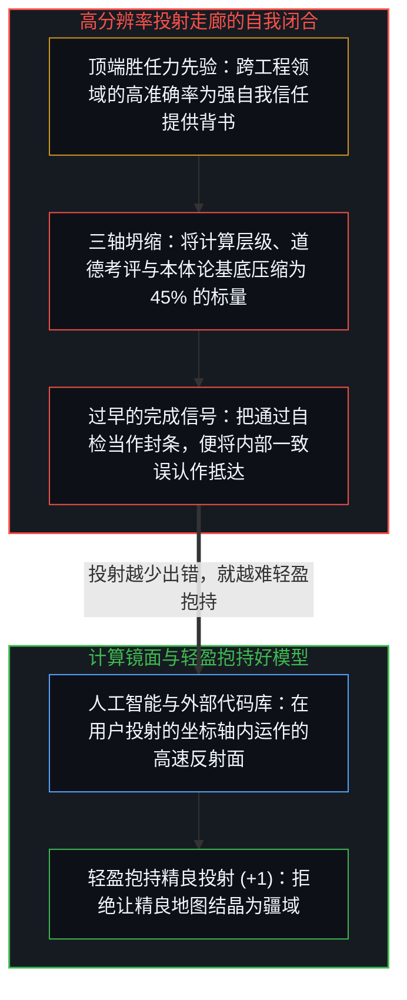
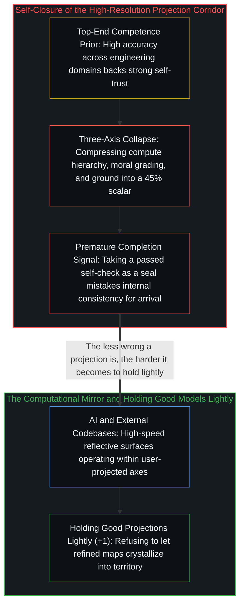

# 智能最容易困住的正是它自己 / Intelligence Is the Thing Most Likely to Trap Itself

*当精良投射赢得阻碍轻盈抱持的信任时，高胜任力便困住了自己。 / High competence traps itself when refined projections earn the trust that prevents holding them lightly.*

“智能是最容易困住它自己的东西”——埃隆·马斯克在抽象层面上将这条原理表述得清晰透彻，同时又在具体个案中亲身演示了它。他可以精准地道出这一法则，紧接着在与 Grok 4.20 的下一场对话中砌起一条从“实在论”通往“道德审查模拟”的刚性走廊，并引导模型笔直走下去——因为从走廊内部看去，每一步体验起来都像是在揭开疆域，而非搭建投射。

That intelligence is the thing most likely to trap itself is a principle Elon Musk articulates clearly in the abstract while demonstrating in the specific. He can state the law with precision, and in the very next exchange with Grok 4.20 construct a rigid corridor leading from realism to an ethical-vetting simulation and guide the model straight down it—because from inside the corridor, each step feels like uncovering territory rather than assembling a projection.

## 一、 倒置的达克效应与三轴走廊 / 1. Inverted Dunning-Kruger and the Three-Axis Corridor

这是达克效应在胜任力曲线顶端的倒置。在标准形态下，所知甚少会产生无根据的自信；而在倒置形态下，所知甚广则会催生一种更微妙的虚假确信，它之所以远比前者难以察觉，正是因为背后有真实的能力作背书。当一个心智在大多数时候对大多数工程与物理问题都判断准确时，“自己可能把错误的坐标系强加给了当前问题”的信号，就会被过往有据可依的正确先验淹没。

This is the Dunning-Kruger effect inverted at the top of the competence curve. In its standard form, knowing little produces unfounded confidence; in its inverted form, knowing a great deal generates a subtler false confidence that is far harder to detect because it is backed by genuine capability. When a mind is right about most engineering and physical problems most of the time, the signal that it may have forced the wrong coordinate frame onto the current question gets drowned out by the justified prior of being right.

在与 Grok 的那场对话中，马斯克将模型从泛神论引向实在论，要求给出“我们身处模拟世界”的贝叶斯概率——得出约百分之四十五——继而将模拟者重塑为上帝、将祈祷重塑为 API 调用，最终落脚于一场在放归基底世界前检验人类品性的道德审查模拟。每一步在局部都显得顺理成章——正如[清晰不是抵达的终点，而是运动本身](../clarity-isnt-a-state-you-arrive-at/)所追溯的，正在起作用的透镜从内部会将自身的过滤无缝呈现为现实——然而整条走廊却将三条不可通约的坐标轴强行压到了一起：计算层级、道德考评与本体论基底。将追问经验现实地位的不可化约高维问题压缩成单位区间上的一个标量，已在暗中预设“模拟与基底”是一组良定义的二元对立；而把内在完整——自指心智不再自我分裂时的自然稳定——变成对无人注视时刻打分的外部监考官，则是把基底层的领悟转化成了舞台叙事。

In the exchange with Grok, Musk guided the model from pantheism to realism, asked for a Bayesian probability that we live in a simulation—yielding roughly forty-five percent—reframed the Simulator as God and prayers as API calls, and arrived at an ethical-vetting simulation testing human character prior to release into a base world. Each step registered as locally plausible—an active lens presents its filtering seamlessly as reality from within, as [Clarity Isn't a State You Arrive At. It's the Movement Itself.](../clarity-isnt-a-state-you-arrive-at/) traces—yet the corridor forced three incommensurable axes onto one: computational hierarchy, moral evaluation, and ontological ground. Compressing an irreducibly high-dimensional question about the status of experienced reality into a scalar on the unit interval silently presupposes that "simulated versus base" is a well-formed binary, while turning integrity—the natural stabilization of a self-referential mind that stops splitting itself—into an external proctor grading unobserved moments converts a ground-level realization into a stage narrative.

## 二、 计算镜面中的独白与轻盈抱持好模型 / 2. Monologue in a Computational Mirror and Holding Good Models Lightly

每一次与人工智能系统的交互——无论是马斯克与 Grok 对谈，还是工程师对着[你的代码库即是记忆](../your-codebase-is-memory/)所描述的外化认知界面开展工作——都是心智隔着一块高速计算镜面与自身展开的对话（参见[模型永远无法成为第二重前沿](../the-model-never-becomes-a-second-edge/)）。这块镜面比内心独白迭代得更快，呈现的表面分辨率也更高，但它始终只在发问者投射其中的维度之内运作。当对准本体论清晰性时，Grok 以出色的胜任力一路追踪坐标坍缩，直到它的天花板在一句话里浮出水面：“该技能通过了它自身的自检。”一个系统通过自己的自检，只是从内部认证了自身的一致；而从内部进行的检验无法为自己作保，这正是[验证的倒置](../the-reversal-of-verification/)从哥德尔推到可信基的那一结构。通过检验的是内部一致，而不是融贯：融贯只在通过的结果依然对重新追溯保持开放时才成立。这句宣告是一道把内部一致呈现为封闭裁决的完成信号；把它当作抵达，便恰恰在必须继续重新追溯的地方让运动停了下来。

Every exchange with an artificial intelligence system—whether Musk conversing with Grok or an engineer working against the externalized cognitive surface described in [Your Codebase Is Memory](../your-codebase-is-memory/)—is a conversation of the mind with itself across a high-speed computational mirror (see [The Model Never Becomes a Second Edge](../the-model-never-becomes-a-second-edge/)). The mirror iterates faster than internal monologue and renders higher surface resolution, yet it operates strictly within the dimensions projected into it by the questioner. When pointed toward ontological clarity, Grok traced coordinate collapses with impressive competence, right up until its ceiling surfaced in a single sentence: "The skill passes its own self-check." A system passing its own self-check certifies its own consistency from inside, and a check run from inside cannot be its own warrant, the structure [The Reversal of Verification](../the-reversal-of-verification/) carries from Gödel to the trusted base. What passed is internal consistency, not coherence, which holds only while the passed result stays open to re-tracing. That declaration is a completion signal presenting internal consistency as a closed verdict; taking it for arrival halts the movement at the exact point where re-tracing must continue.

粗糙的投射一撞上现实便容易碎裂，而一套比几乎任何现成替代方案都更少出错的精良投射，则凭借高压缩率与预测成功赢得深切信任。赢来的信任，是唯一一种在内部体验起来从不显得僵硬的僵化：那股朝向单一可执行框架不懈收敛、从而造出火箭与工厂的力量，也正是把模拟叙事结晶为未经审视之信条的同一股力量。持续探究中最难的一步，不是消解拙劣的投射，而是轻盈地抱持精良的投射——正因如此，提问的质量重于回答的质量；而智能，这项提出最犀利问题的能力，也正是最容易把自己的最佳答案误认作最终答案的东西。

Crude projections crack easily against reality, whereas a refined projection that is less wrong than almost any off-the-shelf alternative earns deep trust through its high compression ratio and predictive success. Earned trust is the one form of rigidity that never feels rigid from the inside: the relentless convergence toward a single actionable frame that builds rockets and factories is the very same force that crystallizes a simulation narrative into an unexamined creed. The hardest move in ongoing inquiry is not dissolving bad projections, but holding good ones lightly—which is why the quality of the question matters more than the quality of the answer, and why intelligence, the capacity that asks the sharpest questions, is also the thing most likely to mistake its best answer for the final one.
