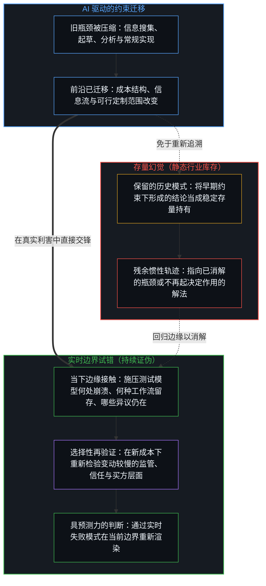
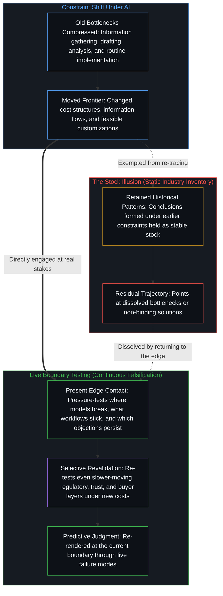
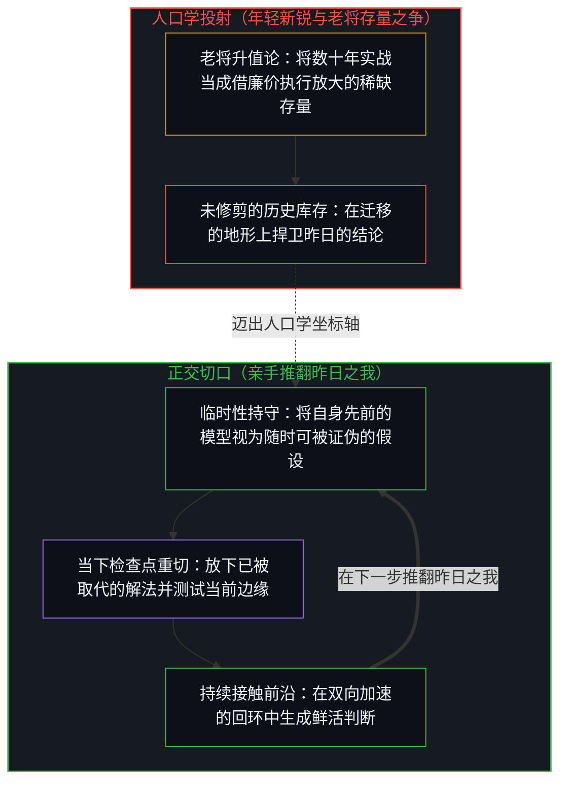
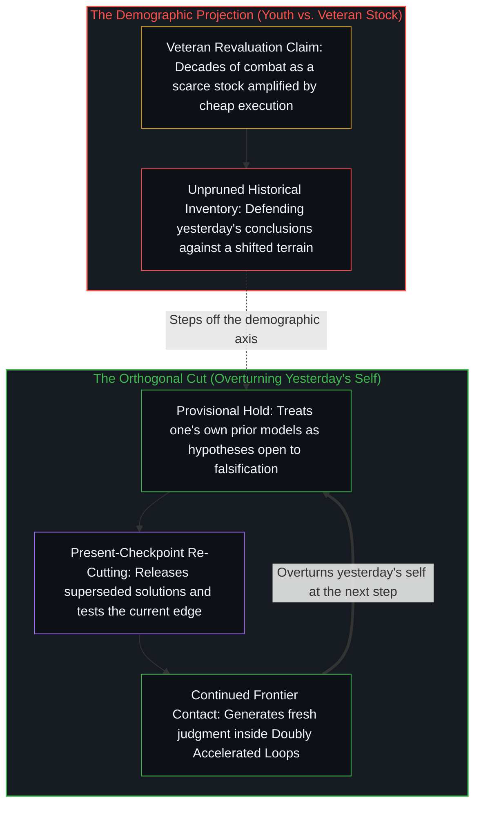

# 判断力不是可囤积的存量 / Judgment Is Not a Stock

*把实战经验当成能被AI放大的静态库存，忽略了判断力只在当前前沿的实时试错中成立 / Treating experience as a static stock AI amplifies misses that judgment holds only in live frontier testing*

一种广为流传的预测认为，随着现成答案与执行变得廉价，人工智能将重新抬高数十年实战积累下来的判断力与品味，从而掀起一波四五十岁创业者的浪潮。这一论点把判断力当成通过漫长的历史约束接触所沉淀下来的稳定存量，假定当 AI 消除了执行瓶颈，这批库存资产就会被放大而非折旧。然而，昔日积累的很大一部分，恰恰建立在同那些如今已被 AI 压缩的瓶颈反复摩擦之上；一旦约束边界发生迁移，昨天的地图就会沦为指向已失效问题的惯性轨迹。决定走向的并非年龄与资历；真正稀缺的，是在当下的活前沿上持续生成并证伪假设、亲手推翻昨日之我的能力。

A widespread forecast holds that artificial intelligence will usher in a wave of forty- and fifty-year-old founders by revaluing decades of accumulated practical judgment and taste once ready answers and execution become cheap. That thesis treats judgment as a stable stock built through slow historical contact with constraints, assuming that when AI removes the execution bottleneck, the stored inventory is amplified rather than depreciated. Yet much of that historical accumulation consisted of repeated contact with the very bottlenecks AI now compresses, and once the constraint boundary shifts, yesterday's map turns into a residual trajectory pointing at problems that no longer bind. Age and prior tenure do not decide the trajectory; what stays scarce is the capacity to overturn yesterday's self by generating and falsifying hypotheses against the live frontier right now.

## 一、 判断力升值的存量前提与迁移的约束边界 / 1. The Stock Premise of Revalued Judgment and the Shifting Constraint

认为 AI 会让长期积累的实战判断力升值，这一主张把判断力当成了一种相对稳定的存量：多年与真实问题的接触沉淀出模式识别与品味，AI 压低了生产现成答案与执行落地的成本，因此这份存量变得更加稀缺、更具威力。在这一预测中——近期由 Y Combinator 总裁加里·谭提出——提出好问题与做出关键判断被视为依赖数十年的实战交锋，单凭年轻人的聪明才智无法供给；而中年老将在执行速度上的历史劣势，则随着 AI 接管信息检索、文稿起草与数据分析而被抹平。其内在逻辑在于，稀缺投入是同那些昔日只能缓慢攻克的约束正面交锋；一旦这些约束被 AI 放宽或移除，原有的存量理应得到放大，而非面临折旧。

The claim that AI revalues long-accumulated practical judgment treats that judgment as a relatively stable stock: years of contact with real problems produce pattern recognition and taste, AI cheapens the production of ready answers and execution, and therefore the stock becomes more scarce and more powerful. In this forecast—recently voiced by Y Combinator President Garry Tan—asking good questions and making critical judgments are taken to depend on decades of practical combat that youthful intelligence alone cannot supply, while middle-aged veterans' historical disadvantage in execution speed is erased as AI takes over information retrieval, drafting, and data analysis. The internal logic is that the scarce input is contact with constraints that once had to be overcome slowly. Once those constraints are relaxed or removed by AI, the stock is supposed to be amplified rather than depreciated.

这一逻辑唯有在相关约束大体保持不变时才成立。在实践中，历史积累的很大一部分，恰恰来自与那些如今正被 AI 压缩的任务和瓶颈反复打交道——信息搜集、文稿起草、分析研判、工程实现以及各种形式的迭代。昔日的这种接触之所以宝贵，是因为它是触及当时前沿、并产生足够多失败尝试以孕育判断力的少数可靠途径之一。正如[遗忘的脚手架](../the-scaffolding-we-forget/)所追溯的，为了应对特定约束而竖起的临时结构在使用期间会退居焦外，可一旦越过那些约束成立的阶段仍被保留下来，就会化作过剩滞后。当前沿迁移时，同一过程并不会自动继续供给同样的稀缺投入。曾经推动一个人向前的方向，可能变成一条残余的惯性轨迹，指向不再以原貌存在的问题，或指向已不再构成关键约束的解法。

That logic only holds if the relevant constraints remain roughly the same. In practice, much of the historical accumulation consisted of repeated contact with tasks and bottlenecks that AI now compresses—information gathering, drafting, analysis, implementation, and many forms of iteration. The contact was valuable because it was one of the few reliable ways to reach the then-prevailing frontier and to generate enough failed attempts for judgment to form. As [The Scaffolding We Forget](../the-scaffolding-we-forget/) traces, provisional structures erected to navigate a set of constraints drop out of focus while in use, yet turn into excess lag the moment they are preserved past the step where those constraints held. When the frontier moves, the same process does not automatically continue to supply the same scarce input. The direction that once pushed a person forward can become a residual trajectory pointing at problems that no longer exist in the same form, or at solutions that are no longer the binding constraint.

## 二、 实时边界试错与静态行业库存 / 2. Live Boundary Testing and Static Industry Inventory

真正保持稀缺的不是先前的地图，而是定位并向当前边界施压测试的能力，这正是[真正稀缺的不是记忆，而是持续的重新追溯](../the-real-scarcity-is-not-memory-but-continuous-re-tracing/)所剖析的同一道切口。能够持续预测结果的洞见，是那些仍在活约束下不断生成并接受证伪的洞见：在真实利害下什么依然会失败、哪些新工作流真正被采纳、模型或工具在哪里仍会崩溃、当旧的信息与协调成本下降后哪些买方异议依然顽固存在。静态持有的行业知识——在早期约束下形成并被保留下来的模式——则是另一回事。它们可以被存储，却不会在成本结构、信息流向、可行定制范围或竞争态势改变时自动更新。正如[专家经验作为参考而非替代](../expertise-as-reference-not-replacement/)所确立的，先前的地图唯有作为临时参考素材才提供信息，一旦在承担代价的边缘盖过实时信号，就会沦为本末倒置。某些变动较慢的层面（买方心理的特定面向、监管红线、物理或信任门槛）固然存续更久，但即便这些层面也必须重新验证，而不能直接视为当然。

What remains scarce is not the prior map but the capacity to locate and pressure-test the current boundary, the same cut traced in [The Real Scarcity Is Not Memory, But Continuous Re-Tracing](../the-real-scarcity-is-not-memory-but-continuous-re-tracing/). Insights that continue to predict outcomes are those still being generated and falsified against live constraints: what still fails under real stakes, which new workflows are actually adopted, where models or tools still break, which buyer objections persist after the old information and coordination costs have fallen. Static holdings of industry knowledge—patterns formed under earlier constraints and then retained—are a different object. They can be stored; they do not automatically update when cost structures, information flows, feasible customizations, or competitive dynamics change. As [Expertise as Reference, Not Replacement](../expertise-as-reference-not-replacement/) establishes, prior maps inform only as provisional reference material and become an inversion the moment they override live signals at the edge that bears the cost. Some slower-moving layers (certain aspects of buyer psychology, regulatory limits, physical or trust requirements) persist longer, but even these must be revalidated rather than assumed.

## 三、 双向加速的回环与等待成熟的滞后 / 3. The Doubly Accelerated Loop and the Lag of Waiting for Maturity

AI 同时加速了回环的两端。它既压低了生成候选解法的成本，也在许多领域缩短了观察失败模式所需的周期。正如[不断收紧的回环](../the-tightening-loop/)所展示的，当泛化能力吸收了可共享的执行模式，演进便取决于意图、工具与实时反馈之间自指回环的紧密程度。这并未消除对判断力的需求，而是改变了生成判断力并使其保持鲜活的条件。

AI accelerates both sides of the loop. It lowers the cost of generating candidate solutions and, in many domains, shortens the cycle time required to observe failure modes. As [The Tightening Loop](../the-tightening-loop/) demonstrates, when generalization absorbs shareable execution patterns, progress is governed by the tightness of the self-referential cycle between intention, instrument, and live feedback. This does not eliminate the need for judgment; it changes the conditions under which judgment is produced and kept current.

能够成功调用判断力的人，是那些已经在当前边界内部运作的人，而非等待一个符合旧心智模型的稳定均衡出现的人。等待成熟本身就是一种滞后，因为落地的行动需要针对技术当前能做什么、不能做什么进行持续校准。正如[自我价值、反向财富转移与过去成功的陷阱](../self-worthiness-reverse-wealth-transfer-and-the-trap-of-past-success/)所揭示的，把过去的积累当成力量之源会让发射台变成拖累；同样，袖手旁观、等待新工具落入熟悉的旧槽位，也是以牺牲实时校准回环为代价来保全先前的心智模型。迎头赶上依然可能，但它仰赖的是同一个修正过程，而非仅仅占有所谓的过往经验。

The people who successfully deploy it are those already operating inside the present boundaries rather than waiting for a more stable equilibrium that matches an earlier mental model. Waiting for maturity is itself a form of lag, because the act of landing requires continuous calibration against what the technology can and cannot yet do. Just as [Self-Worthiness, Reverse Wealth Transfer, and the Trap of Past Success](../self-worthiness-reverse-wealth-transfer-and-the-trap-of-past-success/) traces how treating past accumulation as the source of power turns a launchpad into drag, waiting on the sidelines for new tools to settle into familiar slots preserves a prior mental model at the expense of the live calibration loop. Catch-up remains possible, but it depends on the same revision process, not on the mere possession of earlier experience.

## 四、 消解年龄坐标轴与亲手推翻昨日之我 / 4. Dissolving the Age Axis into Overturning Yesterday's Self

因此，决定走向的并非年龄与过往资历。没有漫长历史惯性包袱、善于思考的年轻建造者，一旦借力 AI 便能迅速超越守成者；然而把这道分水岭框定为年轻人与中年人的对立，只是把人口学坐标轴倒转过来，却原封不动地保留了同一个范畴错误。正如[好奇没有最终的形态](../curiosity-has-no-final-form/)所指出的，作出新区分的生成倾向并不会随年龄增长而衰退；真正让复利停滞的，是用受防卫的专家自我形象去过滤新的摩擦。唯有当一个人仍在当前边缘持续生成并抛弃假设时，年龄与资历才会提供优势。

Age and prior tenure therefore do not decide the trajectory. Thoughtful young builders without the baggage of long-accumulated historical practice can rapidly surpass incumbents when leveraged by AI, yet framing the divide as youth versus middle age merely inverts the demographic axis while keeping the same category error intact. As [Curiosity Has No Final Form](../curiosity-has-no-final-form/) shows, the generative tendency to draw fresh distinctions does not decay with age; what stalls compounding is filtering new friction through a defended expert self-image. Age and tenure supply an advantage only to the extent that the person is still generating and discarding hypotheses at the current edge.

过往积累中真正可以迁移的残余，不是结论的库存，而是在路径迁移之后依然存续的那种定位前沿、并将自身先前模型视为临时假设的习惯——这正是[你的代码库即是记忆](../your-codebase-is-memory/)所追溯的当下检查点修剪：只保留承重的约束，同时果断舍弃已被取代的轨迹，从而防止累积的历史不断增厚、坍缩成引力深井。一旦缺少这种习惯，积累的经验就会变成可能不再匹配地形的库存。原先的存量前提在自身的推演下不攻自破：如果判断力的价值源于在当时约束下与前沿的交锋，那么唯有继续与新前沿交锋，才能继续产生判断力。一旦路径本身已经改变，历史上的正确方向并不能替代当下的边缘试错。

The transferable residue of past accumulation is not the inventory of conclusions but whatever habit of locating frontiers and treating one’s own prior models as provisional survives the shift in path—the same present-checkpoint pruning traced in [Your Codebase Is Memory](../your-codebase-is-memory/), where keeping only load-bearing constraints while discarding superseded trajectories prevents accumulated history from thickening into a gravity well. Where that habit is absent, accumulated experience becomes inventory that may no longer match the terrain. The original premise fails under its own terms: if the value of judgment arose from contact with the frontier under the constraints of the time, then only continued contact with the new frontier continues to produce it. Historical correct orientation does not substitute for present edge-testing once the path itself has changed.
