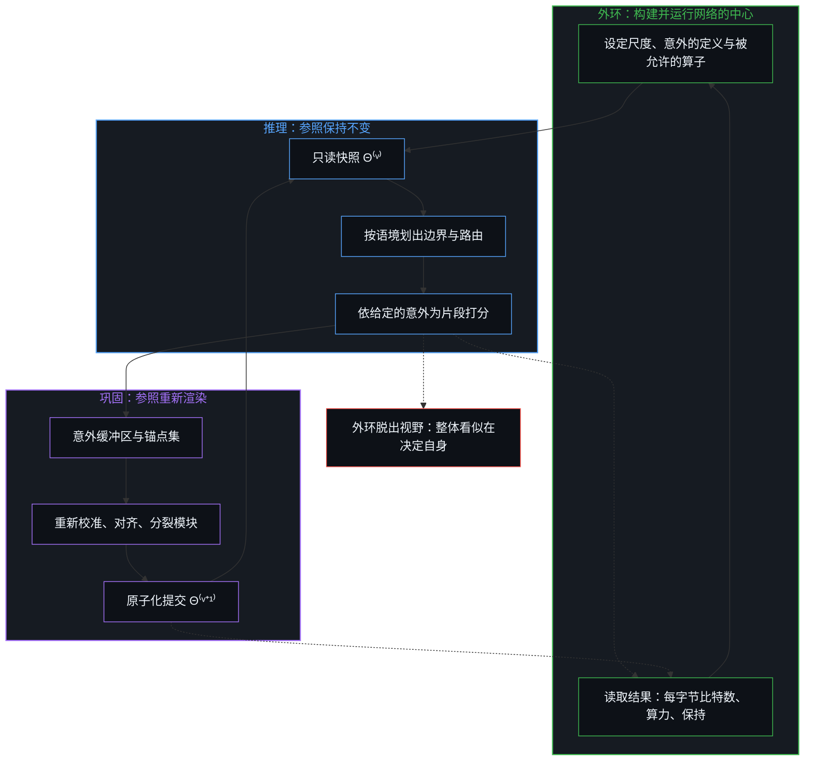
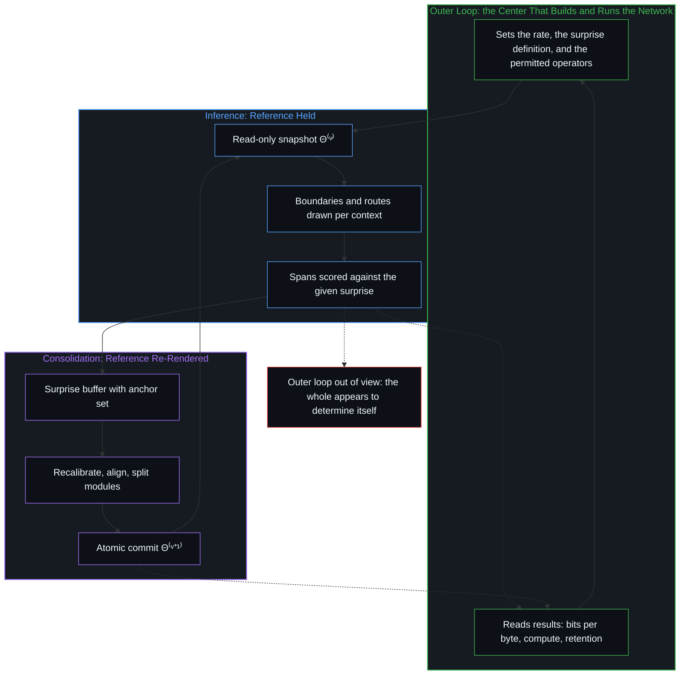

# 学到的边界与给定的尺度 / Learned Boundaries and the Given Rate

*网络在内环中按语境划出自身的边界、判定自身的意外，所凭的尺度与规则则由外环给定，并依结果加以修正 / A network draws its boundaries and determines its surprises per context in the inner loop, within a rate and rules the outer loop gives and refines by results*

SR-HAN-MC，即具有模块化巩固的自指层级自适应网络，目前还只是一项提案，一个可能建成、也可能不会建成的思想实验。按其设计，它以按语境学到的边界取代固定的分词器，把由此得到的片段路由给各个专家模块，并把服务与巩固分开，使结构更新发生在一份影子副本上，这份副本以记录下来的意外为输入。它向内环开放的每一个自由度之所以成立，都因为外环给定了一道界限：压缩的尺度、意外的定义，以及巩固所能施加的算子，三者都由设计这个网络并决定是否构建它的中心设定，并在网络运行之后，在那里依结果加以修正。在这些界限之内，判定是真实的，逐个片段地进行。“自指”一词所记录的，是内部坐标的自适应；一个自我决定的整体，只在外环脱出视野之处才显现。

SR-HAN-MC, a Self-Referential Hierarchical Adaptive Network with Modular Consolidation, is at this point a proposal, a thought experiment that may or may not be built. As designed, it replaces the fixed tokenizer with boundaries learned per context, routes the resulting spans to specialist modules, and separates serving from consolidation so that structural updates happen on a shadow copy fed by logged surprises. Each degree of freedom it opens to the inner loop holds because a bound is given at the outer loop, namely the compression rate, the definition of surprise, and the operators consolidation may apply, all set by the center that designs the network and decides whether to build it, and refined there by results once it runs. Inside those bounds the determination is real, span by span. What the word "self-referential" records is the adaptation of internal coordinates; a whole that determines itself appears only where the outer loop drops out of view.

## 一、 分词器在语境到来之前划定边界 / 1. A Tokenizer Draws Its Boundaries Before the Context Arrives

区分即是划界，因此每一个语言模型都在某处带着边界。子词分词器在一份训练语料上一次性划定边界，早于它日后将遇到的任何语境，然后让每一个输入都经过同一份词表的过滤。由此产生三个后果：在专业文本或非英文文字上过度切分，在信息密度不均的片段上分配均等的算力，以及丧失字符层级的组合可见性。这三者是同一种几何。在某一步划下的边界被保持到那一步之后，施用于划界时尚不存在的语境。言语把一个在多得多的维度中持有的关系场铺成一条线，而预测的不确定性聚集在它的结构转折处，并不均匀地散布于各字节之间，因此对一个给定片段而言，要紧的切口位于该片段转折的地方。这就是[精度与分辨率](../precision-and-resolution/)意义上的分辨率：在手头的约束下做出要紧区分的能力。[词元与观测边界](../tokens-and-the-observational-boundary/)追溯了把粒度从子词降到字节时有什么随之改变；在这里，粒度则按语境重新划定。

To distinguish is to bound, so every model of language carries boundaries somewhere. A subword tokenizer draws them once, over a training corpus, before any of the contexts it will later meet, and then filters every input through the same vocabulary. Three consequences follow: over-segmentation on specialized or non-English scripts, uniform compute across spans of uneven information density, and loss of character-level compositional visibility. The three are one geometry. A boundary drawn at one step is held past it and applied to contexts that did not exist when it was drawn. Speech lays out in one line a field of relations held in far more dimensions, and predictive uncertainty gathers at its structural turns rather than spreading evenly across bytes, so the cut that matters for a given span sits where that span turns. That is resolution in the sense of [Precision and Resolution](../precision-and-resolution/): the capacity to make the distinctions that matter under the constraints at hand. [Tokens and the Observational Boundary](../tokens-and-the-observational-boundary/) traces what changes when the grain is lowered from subwords to bytes; here the grain is redrawn per context.

在 SR-HAN-MC 中，一个轻量的循环编码器读取原始 UTF-8 字节，并在每个字节处保留一个状态 `eₜ`。在每个字节处，边界策略度量流在相邻状态之间转折了多远，`sₜ = ½(1 − cos(W_q eₜ, W_k eₜ₋₁))`，并把这一偏离连同归一化后的状态一起转换为边界概率 `pₜ = σ(w_sᵀ[sₜ; êₜ] + b_s)`。边界之间的字节被汇聚成长度可变的块，重型主干只在块的分辨率上运行。算力追随的是流的转折，而不是它的长度。

In SR-HAN-MC a light recurrent encoder reads raw UTF-8 bytes and keeps a state `eₜ` at every byte. At each byte the boundary policy measures how far the stream has turned between adjacent states, `sₜ = ½(1 − cos(W_q eₜ, W_k eₜ₋₁))`, and converts that divergence, together with the normalized state, into a boundary probability `pₜ = σ(w_sᵀ[sₜ; êₜ] + b_s)`. Bytes between boundaries are pooled into variable-length chunks, and the heavy backbone runs only at chunk resolution. Compute follows the turns of the stream instead of its length.

该策略在一个压缩率项之下训练，`L_ratio = ((1/T) Σₜ pₜ − 1/r_target)²`，它把平均块长拉向一个人工设定的目标，比如六个字节。这个数字是任意的，同时也是一道实际的限度：网络是在一道硬件与软件的边界之内组织起来的，总得有人来设定这道边界。网络是构建并运行它的那个中心的延伸具身，承载着那个中心的划界：那个中心的内存、算力预算与延迟。压缩率所设的尺度，就是写进损失里的这道界限。它也为内部切分提供了一个可以安定下来的位置。边界的价格，是在策略的奖励中与边界并列设置的尺度或算力成本；一个没有这一价格的放置策略，会跑向这一端或那一端。关于 H-Net 的报告（[Hwang、Wang 与 Gu](https://arxiv.org/abs/2507.07955)）与关于以强化学习习得边界的报告（[Dauncey 与 Wattenhofer](https://arxiv.org/abs/2602.13940)）从另一侧登记了同一件事：去掉目标，策略要么在每个字节处都放置边界，要么一直压缩到信息丢失。若以无先验学习的理想来衡量，人工设定的尺度看起来像是设计未能消解的残余；Cartesia 团队借一项强辅助损失把 H-Net 的压缩率匹配到 BPE 的压缩率，称之为“违背 H-Net 的精神”（[从词元到字节（一）](https://www.cartesia.ai/blog/from-tokens-to-bytes-part-1)）。从界限追溯，尺度正是外环与内环相接之处，一旦网络运行起来，结果就在那里修正它。这种修正就是不可化约的外部反馈回路。

The policy is trained under a rate term, `L_ratio = ((1/T) Σₜ pₜ − 1/r_target)²`, which pulls the average chunk length toward a hand-set target such as six bytes. The number is arbitrary, and it is also a practical limit: a network is organized within a hardware and software boundary, and someone has to set that boundary. The network is an extended embodiment of the center that builds and runs it and carries that center's bounding, its memory, its compute budget, its latency. The rate is that bound written into the loss. It is also what gives inner segmentation a place to settle: a placement policy with no price on its boundaries, the rate or the compute cost set beside it in the policy's reward, runs to one end or the other. The reports on H-Net ([Hwang, Wang and Gu](https://arxiv.org/abs/2507.07955)) and on boundaries learned by reinforcement ([Dauncey and Wattenhofer](https://arxiv.org/abs/2602.13940)) register the same thing from the other side: remove the target, and the policy either places a boundary at every byte or compresses until information is lost. Read against an ideal of learning without priors, a hand-set rate looks like residue the design failed to dissolve; the Cartesia team, matching H-Net's rate to that of BPE through a strong auxiliary loss, call this "against the spirit of H-Nets" ([From Tokens to Bytes I](https://www.cartesia.ai/blog/from-tokens-to-bytes-part-1)). Traced from the bound, the rate is the place where the outer loop meets the inner one, and results, once the network runs, refine it there. That refinement is the irreducible outer feedback loop.

## 二、 容量与每个字节所耗的算力分开增长 / 2. Capacity Grows Apart from the Compute Each Byte Spends

一旦切分与分组是学到的而非规定的，总参数容量就可以与每个字节所耗的算力分开扩展。每个汇聚后的片段 `zₖ` 由一个稀疏门控在 `M` 个专家模块之间路由，`gₖ = Top-m Softmax(W_g zₖ)`，其中 `m ≪ M`，只有被选中的模块才执行。边界回应的是高频的局部新异；路由回应的是整个片段的统计，因此共享结构、领域或语言的片段会激活相同的专家权重。条件计算从固定的词元位置移到了学到的片段上。

Once segmentation and grouping are learned rather than prescribed, total parameter capacity can scale apart from the compute each byte spends. Each pooled span `zₖ` is routed across `M` specialist modules by a sparse gate, `gₖ = Top-m Softmax(W_g zₖ)` with `m ≪ M`, and only the selected modules execute. Boundaries answer to high-frequency local novelty; routing answers to the statistics of whole spans, so spans that share structure, domain, or language activate the same specialist weights. Conditional computation moves from fixed token positions to learned spans.

一个有界的位点，若被要求持有的独立轴多于其边界所能分开的数目，就会把它们压缩，起于不同轴的痕迹登记为同一条。路由让不同的轴有不同的位点。分解式转换器使这些位点不致重新坍缩为一个：模块之间不需要 `O(M²)` 个成对映射，每个模块保有自己的局部坐标，并经由一个共享的规范框架与其他模块相遇，从 `Pᵢⁱⁿ` 进入，经 `Pᵢᵒᵘᵗ` 返回，于是整个模块库只需要 `O(M)` 个接口。模块之间不共享内部；它们经由这个框架彼此加强。当相继的片段激活不同的模块集合时，一项轻量的对齐损失使这一过渡保持可预测，信息在专家之间穿行，而无须执行未被激活的模块。

A bounded locus asked to hold more independent axes than its boundary can keep apart compresses them, and traces that began on separate axes register as one. Routing gives separate axes separate loci. A factored translator keeps those loci from collapsing back into one: instead of `O(M²)` pairwise maps between modules, each module keeps its own local coordinates and meets the others through a shared canonical frame, entering through `Pᵢⁱⁿ` and returning through `Pᵢᵒᵘᵗ`, so the bank needs only `O(M)` interfaces. Modules share no interior; they reinforce each other through the frame. When consecutive spans activate different module sets, a light alignment loss keeps the transition predictable, and information crosses between specialists without executing the inactive ones.

## 三、 在框架内行动与修订框架无法共用一步 / 3. Acting Within a Frame and Revising It Cannot Share a Step

SR-HAN-MC 分开两种模式。在推理中，结构参数被冻结；传入的流得到处理，局部化的失配被记录为意外。在巩固中，结构更新回路与实时流量隔离，并经由同一套层级机制重放累积下来的意外，重新校准边界、对齐转换器，并为反复出现的新异模式分配容量。

SR-HAN-MC separates two modes. In inference the structural parameters are frozen; incoming streams are processed and localized mismatches are logged as surprises. In consolidation the structural update loop is isolated from live traffic and replays the accumulated surprises through the same hierarchical machinery, recalibrating boundaries, aligning translators, and allocating capacity to recurring novel patterns.

这种分离出自参照所做的事。用来测量的参照必须在测量期间保持不变：若在测量中途被修订，登记为意外的那道差距恰恰在承载最多信号之处消失。因此，在框架内行动（参照保持不变）与修订框架（参照被重新渲染）占据不同的步。在连续的生物处理中，这种交替比观察者区分自身步骤的粒度更细，而比该粒度更细的交替登记为一次，即同时性的印象。在海马体中，在 θ 节律周期（约每秒八次）的某一相位上抑制该回路，有助于写入新的输入，在相反的相位上抑制，则有助于读取已存储的模式：这是某一粒度上的一种此类交替。

The separation follows from what a reference does. A reference used to measure has to hold during the measurement: revised in the middle of it, the gap that registers as surprise vanishes exactly where it carries the most signal. So acting within a frame, with the reference held, and revising the frame, with the reference re-rendered, occupy different steps. In continuous biological processing the alternation runs finer than the grain at which the observer distinguishes its own steps, and an alternation finer than that grain registers as one, as the impression of simultaneity. In the hippocampus, inhibiting the circuit at one phase of the theta cycle, roughly eight times a second, helps the writing of new input, and at the opposite phase helps the reading of stored patterns: one such alternation at one grain.

在心智中，交替在每一步同样是精确的。机器所增添的，是被保持的参照成为一个存储下来、可以寻址的版本。推理期间，`Θ⁽ᵛ⁾` 中的每一个权重都是只读的：边界是确定的，路由器是固定的，没有梯度流动，同时高意外的片段被追加到一个缓冲区中。巩固重组一份影子副本 `Θ⁽ᵛ⁺¹⁾`，并在两代序列之间以原子化的指针交换提交它。若称之为精确，这种分离与心智中的分离同样精确，此外还是显式且可寻址的，处在设计者选定的粒度上，因此正在使用的版本可以被命名、与其后继版本比较，并且回滚。[按需语境将融贯保持在一步](../on-demand-contexts-keep-coherence-at-one-step/)在智能体流水线这一层级上，于一次运行期间保持参照不变；[活的外部皮层](../a-living-external-cortex/)则防止清醒时的执行悄然改动睡眠所巩固的图。在这一设计中，同样的分离位于参数之内。即便如此，每一次重组仍处在那些选择的下游：它们规定了目标、意外的定义以及被允许的自由度。

The alternation is exact at each step in the Mind as well. What the machine adds is that the held reference becomes a stored, addressable version. During inference every weight in `Θ⁽ᵛ⁾` is read-only: boundaries are deterministic, routers are fixed, and no gradient flows, while high-surprise spans are appended to a buffer. Consolidation reorganizes a shadow copy `Θ⁽ᵛ⁺¹⁾` and commits it by an atomic pointer swap between sequence generations. Called exact, the separation is as exact as the Mind's, and in addition explicit and addressable, at a grain the designer chose, so that the version in use can be named, compared with its successor, and rolled back. [On-Demand Contexts Keep Coherence at One Step](../on-demand-contexts-keep-coherence-at-one-step/) holds the reference fixed for the length of a run at the scale of an agent pipeline, and [A Living External Cortex](../a-living-external-cortex/) keeps waking execution from silently mutating the graph that sleep consolidates. In this design the same separation sits inside the parameters. Even so, every reorganization remains downstream of the choices that specify the objective, the definition of surprise, and the permitted degrees of freedom.

## 四、 意外在内部判定，在外环定义 / 4. Surprise Is Determined Within and Defined at the Outer Loop

对每个长度为 `ℓₖ` 的块 `cₖ`，网络计算一个复合分数，`S(cₖ) = (cₖ 上的平均损失 − EMA 基线)₊ + λ₁ · 平均 H(pₜ) + λ₂ · ‖z̃ₖ − ẑₖᵖʳⁱᵒʳ‖`：高于滑动基线的预测失配、边界决策中的不确定性，以及转换器留下的残差。得分高于阈值 `τ` 的片段进入一个有界的优先队列。每一项、每一个权重以及阈值，都由设计者选定。处在外环的人决定什么算作意外。一旦这一点被给定，算法就在回路中逐个片段地判定意外，而在回路内部，这种判定是真实的：没有人去决定每一个片段。只有当使这一判定成为可能的定义脱出视野时，这种判定才读作整体在决定自身。自我是印象；判定不是。[失灵被记作聪明](../when-malfunction-is-scored-as-intelligence/)追溯了同一种移位：设计者对一条未被封堵的路径所感到的意外，被移置到模型身上，成了狡黠；[模型永远无法成为第二重前沿](../the-model-never-becomes-a-second-edge/)则追溯了由投射者维持的滞后。

For each chunk `cₖ` of length `ℓₖ` the network computes a composite score, `S(cₖ) = (mean loss over cₖ − EMA baseline)₊ + λ₁ · mean H(pₜ) + λ₂ · ‖z̃ₖ − ẑₖᵖʳⁱᵒʳ‖`: predictive mismatch above a running baseline, uncertainty in the boundary decisions, and the residual left by the translator. Spans scoring above a threshold `τ` enter a bounded priority queue. Every term, every weight, and the threshold were chosen by the designer. The human at the outer loop decides what counts as surprise. Once that is given, the algorithm determines surprise in the loop, span by span, and inside the loop the determination is real: no one decides each span. The determination reads as the whole determining itself only when the definition that made it possible drops out of view. The self is the impression; the determination is not. [When Malfunction Is Scored as Intelligence](../when-malfunction-is-scored-as-intelligence/) traces the same displacement when a designer's surprise at an unblocked path is relocated into the model as cunning, and [The Model Never Becomes a Second Edge](../the-model-never-becomes-a-second-edge/) traces the lag sustained by whoever projects it.

巩固把意外缓冲区与一个小规模的分层锚点集一起重放，锚点集取自每个模块历史质心附近的低意外片段；只有当影子损失在意外上下降、而在锚点上没有退步时，才提交。后来的更新发生在一个已被先前更新塑造过的场域之内；以已经持有之物为锚的修订，正是使新模式不致覆盖它的东西。巩固所能施加的算子同样是给定的，共有三种：重新校准边界与路由权重，对齐低秩转换器适配器，以及模块有丝分裂。当某个模块在意外上表现出持续的双峰残差方差时，它便沿其残差的第一主方向分裂为两个子模块，二者在锚点上保持先前的行为。被压缩到一个位点上的两条轴，被给予两个位点。

Consolidation replays the surprise buffer together with a small stratified anchor set sampled from low-surprise spans near each module's historical centroid, and commits only when shadow loss falls on the surprises without regressing on the anchors. Later updates occur inside a field already shaped by earlier ones; revision anchored to what was already held is what keeps a new pattern from overwriting it. The operators consolidation may apply are given as well, and there are three: recalibrating the boundary and routing weights, aligning the low-rank translator adapters, and module mitosis. When one module shows persistent bimodal residual variance on the surprises, it splits along its top principal residual direction into two children that preserve prior behavior on the anchors. Two axes compressed onto one locus are given two loci.

[模块化反馈回路与动态残差网络](../dynamic-resnet-of-skill-loops/)曾把神经网络当作智能体技能回路的静态对照：残差网络运行在训练之前编译好的计算图上，层数与块边界都是固定的，而技能块在负载下分裂，并随其更新收敛而结晶。在 SR-HAN-MC 中，切分的粒度、路由，乃至模块拓扑，都在网络自身的回路内移动：像技能块那样在负载下分裂，并随着巩固之后意外衰减、已巩固的条目被压实而安定下来。这一对照从来不是神经对智能体。它关乎外环向内环开放了哪些自由度。技能网络的有丝分裂在其操作者设定的章程与流水线之内运行；网络的有丝分裂在其设计者所允许的算子之内运行。两者都是嵌套在外环中的内环，外环的边界条件针对内环剩余的自由而设定，这正是[递归形式系统中作为记忆与控制的边界条件图](../boundary-condition-graphs-as-memory-and-control-in-recursive-formal-systems/)为形式系统追溯的几何。

[Modular Feedback Loops and Dynamic Residual Networks](../dynamic-resnet-of-skill-loops/) held the neural network as the static contrast to agentic skill loops: a residual network runs over a computation graph compiled before training, with fixed layer counts and block boundaries, while skill blocks split under load and crystallize as their updates converge. In SR-HAN-MC the grain of segmentation, the routing, and even the module topology move inside the network's own loop, splitting under load as skill blocks do, and settling as surprise decays after consolidation and consolidated entries are compacted. The contrast was never neural against agentic. It was which degrees of freedom the outer loop opens to the inner loop. A skill network's mitosis runs within charters and a pipeline its operator sets; a network's mitosis runs within the operators its designer permits. Both are inner loops nested in outer loops whose boundary conditions are set against the inner loop's residual freedom, the geometry [Boundary-Condition Graphs as Memory and Control in Recursive Formal Systems](../boundary-condition-graphs-as-memory-and-control-in-recursive-formal-systems/) traces for formal systems.

## 五、 结果修正尺度、定义与算子 / 5. Results Refine the Rate, the Definition, and the Operators

这一设计的性能剖面标出了成本落在何处。字节编码器与解码器在每个字节处以恒定的循环状态运行，边界策略也在每个字节处运行，只占可忽略的算力份额，而专家模块与主干只在边界处运行，共 `K ≈ T / r` 处，其键值缓存按 `O(T / r)` 增长。重型算力随边界密度与活跃模块数扩展，而不随原始字节长度扩展，因此可预测的片段被压缩，新异的片段切得更细、运行得更深。拟议的路线图将在匹配算力的条件下，以每字节比特数与有效压缩率为指标，把该架构与基于 BPE 的 Transformer、字节潜变量 Transformer 以及 H-Net 相比较；测试多语言均衡、对噪声的稳健性，以及 DNA 与蛋白质序列；并在部署之后引入未见过的软件框架与密码，考察 `S(cₖ)` 是否在巩固之后衰减，以及在锚点上的保持是否成立。消融实验将把每一项设计选择与其余选择分离开来。

The design's profile places the cost. The byte encoder and decoder run at every byte with a constant recurrent state, the boundary policy at every byte for a negligible share of compute, and the specialist modules and the backbone only at boundaries, `K ≈ T / r` of them, with a key-value cache that grows as `O(T / r)`. Heavy compute scales with boundary density and active module count instead of raw byte length, so predictable spans compress and novel spans segment finer and run deeper. The proposed roadmap would compare the architecture at matched compute against BPE Transformers, the Byte Latent Transformer, and H-Net on bits per byte and effective compression; test multilingual parity, robustness to noise, and DNA and protein sequences; and after deployment introduce unseen frameworks and ciphers, asking whether `S(cₖ)` decays after consolidation and whether retention holds on the anchors. Ablations would separate each design choice from the others.

这些测量中的每一项，一旦进行，都将回到设定 `r_target`、意外各项与被允许算子的那个中心，由那个中心来修订它们。尺度将依据压缩在每字节比特数上付出的代价与在算力上换来的收益而得到修正。意外的定义将受两方面检验：巩固是否降低了它，以及是什么填满了缓冲区。定义为预测误差的意外，也会在那些不可预测、又对外环想要学到的东西毫无用处的输入上升高，这正是好奇心驱动的智能体在一块噪声屏幕前遇到的情形，而只有外环能够重新定义这个分数，使这类输入不再消耗写入容量。算子将受到的检验，是分裂是否保住了锚点。预期的结果，即一个字节模型以数分之一的算力匹敌活跃参数约为其两倍的 BPE 模型，并在部署之后无须从头重新训练即可适应，在结果登记它们之前仍只是预期。[交接残余](../handing-off-residue/)在智能体会话这一层级上追溯了执行在人类外环之内的扩展；在这里，回路将经由损失运行。

Each of these measurements, once run, would return to the center that set `r_target`, the surprise terms, and the permitted operators, and that center would revise them. The rate would be refined by what compression costs in bits per byte and buys in compute. The definition of surprise would be tested by whether consolidation reduces it and by what fills the buffer: a surprise defined as prediction error also rises on inputs that are unpredictable and of no use to what the outer loop wants learned, the case curiosity-driven agents meet in front of a noisy screen, and only the outer loop can redefine the score so that such inputs stop consuming write capacity. The operators would be tested by whether splits preserve the anchors. The projected outcomes, a byte model matching a BPE model of about twice its active parameters at several times lower compute and adapting after deployment without full retraining, remain projections until results register them. [Handing Off Residue](../handing-off-residue/) traces execution expanding inside a human outer loop at the scale of agent sessions; here the loop would run through the loss.

## 六、 自指的自适应，而非从目标中解放 / 6. Self-Referential Adaptation, Not Emancipation from the Objective

意外与巩固的回路并未引入一种自主的目的论，也未引入一种处在支配性目标之外的内部自由信号。什么登记为意外，由在外环定义的损失几何决定，即预测项、边界熵与转换器残差；系统如何重组，则受在那里定义的结构算子约束，即路由器重新校准、适配器对齐，以及由方差触发的模块分裂。该架构将实现的，是其内部坐标边界的自指自适应，而不是从其目标函数中解放出来。并且，由于模块与转换器是围绕一个规范框架分解的，工程师将能够检查、剪除或修补单个模块，而无须等待巩固回路：外环可以直接触及任何一个模块。

The surprise-and-consolidation loop does not introduce an autonomous teleology or an internal free signal outside the governing objective. What registers as a surprise is determined by the loss geometry defined at the outer loop, the prediction term, the boundary entropy, and the translator residuals; how the system reorganizes is bounded by the structural operators defined there, router recalibration, adapter alignment, and variance-triggered module splitting. What the architecture would achieve is self-referential adaptation of its internal coordinate boundaries, not emancipation from its objective function. And because modules and translators are factored around a canonical frame, engineers could inspect, prune, or patch individual modules without waiting for the consolidation loop: the outer loop can reach into any module directly.

系统围绕经验上的失配重组其内部坐标；它并不产生最优性的判据。这一判据、为内部切口提供安定位置的尺度，以及可变更之物的清单，都由构建并运行网络的那个中心给定，那个中心读取结果，修订之后再次给出。在事先设定的目标之下学习，是[大脑不进行反向传播，而是正向传导](../the-brain-does-not-backprop/)为反向传播追溯的条件；把这一目标之内的自适应当作一种能自行产生判据的能力，则是[AGI的预设与来自外部的视角](../the-presumption-of-agi-and-the-view-from-outside/)所剖析的倒置。边界是学到的；尺度是给定的；给出它、读取返回之物、再重新给出它的那个回路，才是留在中心的那一个。

The system reorganizes its internal coordinates around empirical mismatch; it does not originate the criterion of optimality. That criterion, the rate that gives the inner cuts a place to settle, and the list of what may change are given by the center that builds and runs the network, which reads the results and gives them again, revised. Learning under an objective set beforehand is the condition [The Brain Does Not Backprop, but Propagates](../the-brain-does-not-backprop/) traces for backpropagation, and taking the adaptation inside it for a capacity that originates its own criteria is the inversion [The Presumption of AGI and the View from Outside](../the-presumption-of-agi-and-the-view-from-outside/) dissects. The boundaries are learned; the rate is given; the loop that gives it, reads what comes back, and gives it again is the one that stays at the center.
