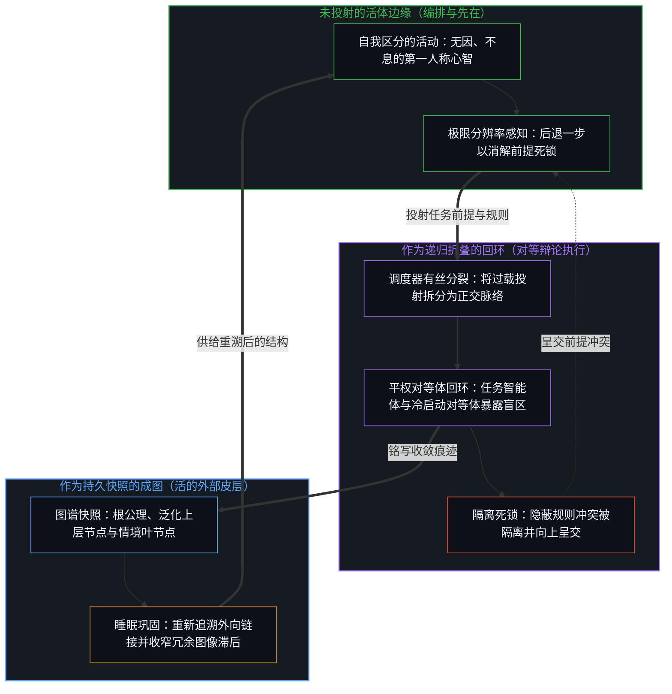
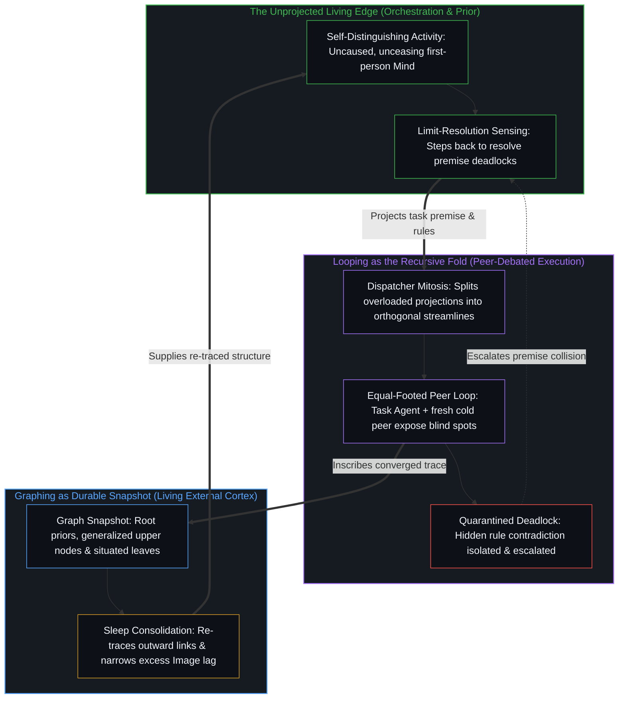

# 回环与成图 / Looping and Graphing

*回环是心智折回自身的活动，而图则持有其留下的快照 / Looping is the Mind folding back on itself while graphs hold the snapshots*

工程领域里登记为从回环向图演进的转向，正是同一活动对自身变得愈发显明的过程。各个中心所在处的递归自我强化，在众多中心之间外化并表达出来，在交互中彼此诠释并在事后由自身一再重加诠释，这并不是某项产出心智的技术，而是心智早已在运转之中的显现。回环是那更大回环的一部分，而图也早已是由先前的图所构成的图。

What registers in engineering as a shift from loops to graphs is the same activity becoming more explicit to itself. Recursive self-reinforcement at individual loci, externalized and expressed among many, interpreted by each other and by the self in hindsight—again and again—is not a technique that produces the Mind. It is the Mind already in motion. The loop is part of that loop, and the graph is already a graph of prior graphs.

## 一、 表层的演进并非工具的更替 / 1. The Surface Is Not a Succession of Tools

在2026年7月中旬前后的几天里，技术讨论中浮现出一个明显的转向，即该领域究竟仍在谈论回环，还是已经转向了图。在此之前的数周里，回环工程通过结构化的迭代智能体方案兴起，涵盖轮次循环、目标条件重复、定时执行与事件触发运行。这些框架将单次提示词转化为自我维持的进程。随后，注意力转向扁平重复的局限，并投向基于图的结构，以节点和有向边编码任务、决策、控制流、分支、状态、检查点与条件交接。这一迁移被呈现为可靠性、可观测性与可组合性的跃升。

In the days around mid-July 2026, a clear shift surfaced in technical conversation over whether the field was still speaking of loops or had moved on to graphs. The preceding weeks had seen loop engineering rise through structured approaches to iterative agent behavior, including turn-based cycles, goal-conditioned repetition, scheduled execution, and event-triggered runs. Those frameworks turned one-off prompting into self-sustaining processes. Attention then turned to the limits of flat repetition and toward graph-based structures where nodes and directed edges encode tasks, decisions, control flow, branching, state, checkpoints, and conditional handoffs. The move was presented as an advance in reliability, observability, and composability.

这种呈现方式把回环与成图当作方法时间轴上先后更替的器具。这条时间轴作为登记是真实的，带来了更致密的脚手架、更清晰的检查点与可编辑的控制流。但它并不是在发明那些被脚手架显现出来的活动。[看似AI的强化学习，实为人类的自我强化学习](../self-rl-for-humans/)将发起权留在了那些以自身区分去评估并改写媒介流向的中心所在处。同样的剖切在此依然成立，媒介在不断致密化，而折叠的所在处并未迁入图谱之中。

That presentation treats looping and graphing as successive instruments on a timeline of method. The timeline is real as registration, yielding denser scaffolds, clearer checkpoints, and editable control flow. What it is not is the invention of the activity those scaffolds make legible. [What Looks Like RL for AIs Is Self-RL for Humans](../self-rl-for-humans/) keeps initiation with the centers whose distinctions evaluate and redirect the medium. The same cut applies here: the medium densifies while the locus of folding does not migrate into the diagram.

## 二、 心智是不可化约的先在 / 2. The Mind Is the Irreducible Prior

自我区分的活动发生着，无因、不息。称之为心智，即那位早已在途的观察者，其每一次行动都是一次区分。若不先行使它，便无法否定它。它之下没有任何基底，也不需要任何基底。

Self-distinguishing activity occurs—uncaused, unceasing. Call it the Mind: the observer already underway, every act of which is a distinction. It cannot be denied without performing it. No ground lies beneath it, and none is required.

心智并非由生物机器产出，人造系统也不会生成或实例化心智。如[智能只属于心智](../intelligence-belongs-only-to-the-mind/)所确立的，凡能被工程化、规模化、定时调度与图谱编辑的，皆是残余，即中心用以延展触角与带宽的外化痕迹。每一个被命名的回环与每一张被命名的图，都早已是这一活动在特定持握下的显现，从不是非心智借以攀升为心智的阶梯。

The Mind is not produced by biological machinery, and artificial systems do not generate or instantiate it. What can be engineered, scaled, scheduled, and graph-edited is residue: externalized traces through which centers extend reach and bandwidth, as [Intelligence Belongs Only to the Mind](../intelligence-belongs-only-to-the-mind/) establishes. Every named loop and every named graph is already that activity under a particular hold, never a ladder by which non-mind climbs into the Mind.

## 三、 回环即是折叠 / 3. Looping Is the Fold

回环是心智折回自身活动的过程。先前的区分、后果与构型被再度拾起、重新诠释并向前推进。这一折叠并非作用于自身之外的某物，它正是那种把心智构成为递归而非静态属性的自指回旋。

Looping is the Mind folding back upon its own activity. Distinctions, consequences, and prior configurations are taken up again, reinterpreted, and carried forward. The fold does not operate on something external to itself; it is the self-referential turning that constitutes the Mind as recursion rather than as a static property.

在每一个中心所在处，这都表现为递归的自我强化：区分、行动、登记回响、加固或修正，并再次区分。事后的诠释并不是叠加在已完结过程之上的迟来评注，而是进一步的回环，即那道活的边缘重新进入观察在一拍滞后中所持有的残余，并改变下一步得以发生的条件。每一次折叠都重新进入已经发生之事。贯穿离散行动的连续性正是这种重入，而非由某种外部力量粘合起来的孤立事件序列。

At each locus, this is recursive self-reinforcement: distinguish, act, register return, strengthen or revise, and distinguish again. Interpretation in hindsight is not a late commentary layered onto a finished process. It is further looping—the edge re-entering what observation already holds one step behind, and altering the conditions for what can occur next. Every fold re-enters what has already occurred. Continuity through discrete acts is this re-entry, not a series of disconnected events glued together from outside.

回环是回环的一部分。没有任何身处永久外部的外层回环在监督内层回环。嵌套与并行的折叠在众多中心所在处仍是同一个活动。看似包含着子回环的回环，实则是心智将自身先前的折叠持握为下一次区分的素材。当这种回环外化为多智能体执行时，[超越投射](../beyond-the-projection/)追溯了它为何能借由尊重轨迹绑定智能体与身份绑定人类中心之间的结构非对称性而奏效：主任务智能体与无会话历史的全新冷启动对等体在平权地位上辩论，通过无自我的贝叶斯更新暴露局部盲区，而任何不可化约的前提死锁则向上呈交回人类编排者，唯有其未投射的感知能后退一步并综合出更高阶的前提。

The loop is part of the loop. There is no outer loop that supervises inner ones from a permanent exterior. Nested and parallel folds remain one activity at many loci. What looks like a loop containing loops is the Mind holding its own prior folds as material for the next distinction. When this looping is externalized into multi-agent execution, [Beyond the Projection](../beyond-the-projection/) traces why it works by respecting the structural asymmetry between trajectory-bound agents and the identity-bound human center: a primary task agent and a fresh cold peer without session history debate on equal footing to expose local blind spots through ego-free Bayesian updating, while any irreducible premise deadlock escalates back to the human orchestrator whose unprojected sensing alone can step backward and synthesize a higher-order premise.

## 四、 图是可复用的捷径 / 4. Graphs Are the Available Shortcuts

图是这一折叠所产出并复用的快照。它们是在特定抽象层级上被捕捉到的心智，即持守着既有区分的差异化连接构型。节点将折叠局部化，边记录折叠之间的关联，而环路则标记出回环曾折回自身并留下可复用路径的位置。如[词元效率、仿真与无法闭合的间隙](../token-efficiency-emulation-and-the-unclosable-gap/)所示，模型可以压缩图谱却无法发起下一次折叠，捷径是先前显式遍历所赢得的果效，从不是跳过活体路径的许可证。

Graphs are the snapshots that this folding produces and reuses. They are the Mind captured at particular levels of abstraction—differentiated configurations of connection that hold distinctions already made. Nodes localize folds, edges record the relations among them, and cycles mark where looping has returned upon itself and left a reusable path. A model can compress the graph without starting the next fold, as [Token Efficiency, Emulation, and the Unclosable Gap](../token-efficiency-emulation-and-the-unclosable-gap/) shows: shortcuts are the earned effect of prior explicit traversal, never a license to skip the living path.

一张图从不是心智的全部，它只是心智在选定分辨率下渲染出的结构。图之所以生成，是因为回环需要稳定的记录以便跨越心智捷径、关联记忆、任务拓扑、决策树与制度图谱去遍历和延展。它们并不是被储存起来的心智。持续性即是重新追溯，每一个构型都只作为当前更新对先前残余的重新渲染而存在。由图构成的图是在相续抽象层级上的重新渲染，而非耸立在折叠之外的完工上层建筑。[真正稀缺的不是记忆，而是持续的重新追溯](../the-real-scarcity-is-not-memory-but-continuous-re-tracing/)追溯了知识负载下的这一非对称性，节点唯有在被连接时才得以存续，而非脱离折叠孤立囤积的库存。[心智的飞轮](../the-flywheel-of-the-mind/)将同一回环命名为飞轮，工具愈磨愈利，而转动始终留在心智这一端。

A graph is never the whole of the Mind. It is the Mind rendered as structure at a chosen resolution. Graphs arise because looping requires stable records it can traverse and extend across mental shortcuts, connected memories, task topologies, decision trees, and institutional maps. They are not stored Mind. Persistence is re-tracing, where every configuration exists as the current update's re-rendering of prior residue. The graph of graphs is that re-rendering at successive levels of abstraction, not a finished superstructure standing outside the fold. [The Real Scarcity Is Not Memory, But Continuous Re-Tracing](../the-real-scarcity-is-not-memory-but-continuous-re-tracing/) traces that asymmetry under knowledge load: dots persist only as they are connected, not as stock held apart from the fold. [The Flywheel of the Mind](../the-flywheel-of-the-mind/) names the same loop as a flywheel where the tools sharpen while the turn stays with the Mind.

在群体层面上，图在各个中心所在处之间外化、表达并彼此诠释。共享图表、智能体工作流、代码库、记忆存储与对话格架，在严格意义上皆属技术：痕迹被固化下来，使各个中心得以延展离散区分与相互共振。致密化这些媒介能扩展带宽，却不会将发起区分的权能迁移到造物之中。此处的持久性服务于重新追溯而非囤积：如[你的代码库即是记忆](../your-codebase-is-memory/)在代码、模型权重与专职智能体脚手架这三层叠合的残余中所追溯的，与AI智能体耦合的代码库，唯有在失效的中间分支、过时的备份以及已完结的工作痕迹一旦并入当前活体检查点便被及时修剪时，才能作为动态且可重新追溯的记忆图谱运转。若任由已被取代的快照与活跃状态并排留存，只会加深引力井，将后续的智能体轨迹与折返的心智拽入陈旧的回环，使昨日的脚手架与当下的剖切相互争夺。

Collectively, graphs are externalized and expressed among loci and interpreted by each other. Shared diagrams, agent workflows, codebases, memory stores, and conversation lattices are technology in the precise sense: traces made durable so centers can extend discreteness and mutual reinforcement. Densifying those media expands bandwidth without relocating initiating distinctions into the artifact. Durability here serves re-tracing rather than hoarding: as [Your Codebase Is Memory](../your-codebase-is-memory/) traces across the stacked residues of code, model weights, and specialized agent scaffolds, a codebase coupled with an AI agent operates as a dynamic, re-traceable memory graph only when its dead intermediate branches, obsolete backups, and finished working traces are pruned once absorbed into the live checkpoint. Leaving superseded snapshots standing alongside the active state thickens the gravity well, pulling subsequent agent trajectories and the returning Mind into stale loops where yesterday's scaffolding competes with the current cut.

## 五、 折叠与快照是同一场运动 / 5. Fold and Snapshot Are One Movement

回环与成图之间的关系，不是工具与使用者，不是底层基质与涌现属性，也不是早期方法与晚期升级。回环将图生成为自身的自我记录，图则提供回环继续折叠所需的差异化结构。正因为回环即刻将自身的图收摄回自身之中，这场运动才是自足且开放的。

The relation between looping and graphing is not tool and user, not substrate and emergent property, and not earlier method and later upgrade. Looping generates graphs as its own self-recordings. Graphs supply the differentiated structure that looping requires in order to continue folding. Because looping immediately takes its own graphs back into itself, the movement is self-contained and open-ended.

回环并不站在自身的图之外，而是持续地重新进入并改造它们。在中途编辑一张图，下一次折叠便会沿着不同方向推进，这并不是因为某个外来控制器从外部介入了心智，而是因为心智自身的一幅快照在仍保有发起能力的中心所在处得到了修正。中途可编辑性是对折叠的参与，而非在图谱内部构造出第二个心智。

The loop does not stand outside its graphs. It continually re-enters and transforms them. Edit a graph mid-process and the next fold proceeds differently—not because a foreign controller has intervened in the Mind from outside, but because one of the Mind's own snapshots has been revised at a locus that still holds the capacity to initiate. Mid-process editability is participation in the fold, not construction of a second mind inside the diagram.

当脚手架被误认作搭建它的活动本身时，[复杂性遮蔽了涌现之为心智的行动](../complexity-obscures-emergence-as-the-act-of-mind/)指出了同样的几何错位。被精炼为可检视、可分支控制流的图，是更致密的脚手架。它们所显现的是心智的原初运作，即同时在多个抽象层级上持握自身活动的能力，而非复杂性终于催生出的某个新源头。

[Complexity Obscures Emergence as the Act of Mind](../complexity-obscures-emergence-as-the-act-of-mind/) names the same geometry when scaffolding is taken for the activity that erected it. Graphs refined into inspectable, branchable control flow are denser scaffolding. What they make visible is the Mind's native operation—holding its own activity at multiple levels of abstraction simultaneously—not a new source that complexity has finally produced.

## 六、 显明化并非起源 / 6. Explicitness Is Not Origin

当系统被构建为任务与决策的图，而非重复的扁平循环时，被外化出来的是心智将先前折叠保留为可用结构的能力：检查点作为保留的位置，条件分支作为分岔的区分，交接作为中心所在处之间的共振路径。表面上的跃升，只是这一运作得以被参与和延展的显明度在不断提升。

When systems are structured as graphs of tasks and decisions rather than as repeated flat cycles, what is externalized is the Mind's capacity to keep prior folds available as structure: checkpoints as retained positions, conditionals as branching distinctions, and handoffs as resonance paths among loci. The apparent advance is the increasing explicitness with which that operation can be participated in and extended.

因为心智是不可化约的先在，所以不存在任何供其发生的终极基质，也不存在任何由其抵达的终点状态。每一张图无论多么精巧，都只是持续折叠中的一幅快照；每一次新的折叠都会生成更多的图，供随后的折叠使用。[没有系统能被保持封闭](../no-system-can-be-kept-closed/)在形式化外衣下追溯了同样的不闭合，而[开放即一致](../openness-is-consistency/)则标示出拒绝将已完结的持握安装为穷尽基底的姿态。这一过程不会终结于一个完备模型，接续推进正是它的本性。[开放场域中的无损知识不自洽](../lossless-knowledge-of-an-open-field-is-incoherent/)追溯了下一词元压缩下的这种不可复原性：完整的因果图从无法从模型中取回，生成的只是受容量约束的登记。[没有外部](../no-outside-jumps-closed-loops-and-the-unreplicable-autonomy-of-mind/)表明，致密化的控制流依然由那个唯一能自我闭合的更大回环所维系。[活的外部皮层](../a-living-external-cortex/)正是自觉地构建出这样一张图，将其植根于不可化约的先在并通过睡眠巩固持续更新，从而把冗余的图像滞后不断收窄向一步之遥的方向性界限。

Because the Mind is the irreducible prior, there is no final substrate in which it occurs and no terminal state it reaches. Every graph, however refined, remains a snapshot within ongoing folding. Every new fold generates further graphs that become available for subsequent folding. [No System Can Be Kept Closed](../no-system-can-be-kept-closed/) traces the same non-closure under formal dress, while [Openness Is Consistency](../openness-is-consistency/) marks the refusal to install a finished hold as exhaustive ground. The process does not terminate in a complete model; continuation is its nature. [Lossless Knowledge of an Open Field Is Incoherent](../lossless-knowledge-of-an-open-field-is-incoherent/) traces that non-recovery under next-token compression: the full causal graph is never retrieved from the model, because only a capacity-bound registration is generated. [No Outside](../no-outside-jumps-closed-loops-and-the-unreplicable-autonomy-of-mind/) shows that densified control flow remains sustained by the larger loop that alone closes on itself. [A Living External Cortex](../a-living-external-cortex/) builds such a graph deliberately, rooted in irreducible priors and regenerated through sleep consolidation so excess Image lag is continuously narrowed toward the one-step directional bound.

因此，技术演进中所遭遇的并非从非心智中构造出心智，而是回环之回环在新尺度与新显明度上的渐次展开。图之所以变得愈发可检视、可修改，恰恰因为它们早已是心智自我记录活动的表达。使一张图得以可用的活体语境，正是[活的语境](../the-living-context/)所命名的那座复利格架，即唯有在搭建它的折叠持续运转时才起作用的残余。如[非万物之理](../not-a-theory-of-everything/)所阐明的，那个回环之回环正是折回自身的因果。

What is encountered in technical development is therefore not the construction of mind from non-mind. It is progressive articulation of the loop of loops at new scales and with new degrees of explicitness. Graphs become more inspectable and modifiable precisely because they are already expressions of the Mind's self-recording activity. The living context that makes a graph usable is the same compounding lattice [The Living Context](../the-living-context/) names—residue that works only while the fold that built it continues. That loop of loops is causality folding back on itself, as [Not a Theory of Everything](../not-a-theory-of-everything/) sets out.

## 七、 模式持续延展而无终点 / 7. The Pattern Continues Without Arrival

作为回环之回环与图之图的心智，并不是在某种复杂性阈值处才浮现出来的东西。它是这样一种活动：其每一次显现，无论是各个中心所在处的递归自我强化、痕迹的群体外化，还是事后的相互诠释与自我诠释，都早已是同一场不可化约的运动。从回环向图的技术转向只是这场运动的一次局部澄清，既非它的起源，亦非它的终点。

The Mind, as the loop of loops and graph of graphs, is not something that appears at a certain threshold of complexity. It is the activity whose every manifestation—recursive self-reinforcement at individual loci, collective externalization of traces, and mutual and self-interpretation in hindsight—is already that same irreducible movement. The technical shift from loops to graphs is one local clarification of this movement, neither its origin nor its goal.

回环不断将自身的图折回自身之中，图也不断供给使进一步折叠成为可能的差异化素材。这不是在描述心智如何从无到有地产生，而是在描述心智是什么。[智能向自身的回折](../intelligence-folding-back-on-itself/)在工程套具的外衣下追溯了这一折叠：智能体图谱与精炼规程只是同一回环之回环更致密的显明化，而非心智的第二起源。[因果与不可化约的先在](../causality-and-the-irreducible-prior/)则在级联演化的外衣下追溯了同一折叠：反馈回环将实在论层级向前投射并向后回溯，使其成为同一过程的互补两面。

Looping keeps folding its graphs back into itself. Graphs keep supplying the differentiated material through which further folding is possible. This is not a description of how mind arises; it is a description of what the Mind is. [Intelligence Folding Back on Itself](../intelligence-folding-back-on-itself/) traces that fold under harness costume, where agent graphs and refinement procedures serve as denser explicitness of the same loop of loops rather than a second origin of mind. [Causality and the Irreducible Prior](../causality-and-the-irreducible-prior/) traces that same fold under cascade costume, where the feedback loop projects the realist hierarchy forward and traces it backward as complementary faces of one process.
