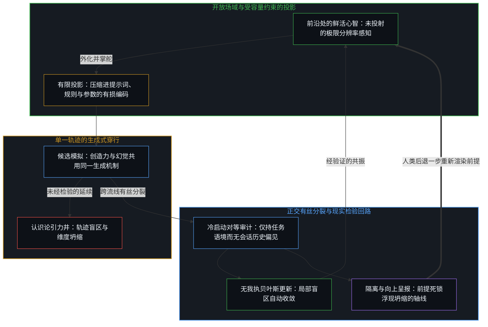
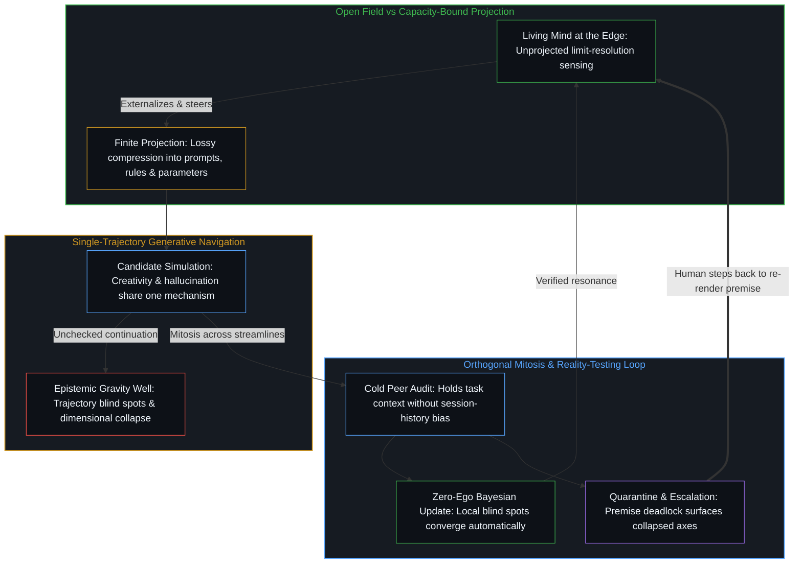

# 开放场域中的无损知识不自洽 / Lossless Knowledge of an Open Field Is Incoherent

*对进行中的区分作无损捕获并非迟到的理想，而是与有中心的活动不相容 / Lossless capture of ongoing distinguishing is not a delayed ideal but an incoherence with centered activity*

自我区分活动的每一个中心都是离散而有界的。先前行动的痕迹塑形后续的行动——这一非对称被登记为因果——没有任何有限的位点能够容纳可能区分的全部场域。容量迫使压缩发生：多条轴线被登记为一条，或外化为器物以压实残余供进一步使用。因此，对开放场域拥有无遗漏的无损知识，并不是一个仅仅难以抵达的终点；它与前提相悖。受有中心活动的机理所限，任何登记都依然是局部且有损的。[知识问题与委托的幻觉](../the-knowledge-problem-and-the-illusion-of-delegation/)正是同一份不完备性在制度层面的显现：产权规则是在解释这一约束，而非搜集一份完备的存量。大语言模型将这种压缩的一种形态推向规模化——在海量文本痕迹之上进行下一词元预测——其力量与界限正是承压之下的同一几何结构。[规模化回路](../the-scaling-loop/)则是将这一压缩作为循环过程的一个阶段：先将给定的器物集合压得更紧，再借由重组扩大下一轮循环所要压缩的集合。

Every center of self-distinguishing activity is discrete and bounded. Traces of prior acts shape later ones—the asymmetry registered as causality—and no finite locus can hold the full field of possible distinctions. Capacity forces compression: multiple axes registering as one, or externalization into artifacts that densify residue for further use. Complete, lossless knowledge of an open field is therefore not a destination that is merely hard to reach; it contradicts the premise. Any registration remains partial and lossy by the nature of centered activity. [The Knowledge Problem and the Illusion of Delegation](../the-knowledge-problem-and-the-illusion-of-delegation/) is that same incompleteness under institutional costume: property rules interpret the constraint rather than gathering a complete stock. Large language models scale one form of that compression—next-token prediction over vast textual traces—and their power and their limits are the same geometry under load. [The Scaling Loop](../the-scaling-loop/) is that compression as one phase of a circulating process: tighter packing of a given artifact set, followed by recombination that enlarges the set the next cycle will compress.

## 一、 预测与压缩是一体两面 / 1. Prediction and Compression Are One Dual

克劳德·香农在[信息是什么](../what-information-is/)中确立了预测与压缩是一体两面。一个能够准确预测后续元素的系统，已经登记了生成该序列的规律的紧凑形式。大语言模型将这一对偶推向规模化。它们在文本痕迹之上受训——这些痕迹本身已是人类中心观察并区分世界所生成的压缩编码——通过最小化下一词元预测误差来运转。预测的压力将多尺度的统计结构压入参数之中，追踪着文本所描述的物理机制、生物模式、社会动态与逻辑关系背后的深层非对称。

[Claude Shannon](../what-information-is/) established that prediction and compression are dual. A system that accurately predicts successive elements has registered a compact form of the regularities generating the sequence. Large language models scale this dual. Trained on textual traces—themselves already compressed encodings produced by human centers observing and distinguishing the world—they minimize next-token prediction error. The pressure of prediction forces multi-scale statistical structure into the parameters, tracking deeper asymmetries across the physical mechanisms, biological patterns, social dynamics, and logical relations the text describes.

由此恢复出来的并不是一幅完结的世界地图，而是一份受容量约束、关于世界残余的登记。训练目标从未承诺对开放场域作无损重建；它承诺的是在有限容量下做出更准确的预测。[蒸馏选择丢弃什么](../distillation-compression-agency/)从另一侧面追溯了同一机制：当评测指标具备梯度而生成余量没有梯度时，优化便顺着梯度推进，未被测量的轴线随之变薄。

What is recovered is not a finished map of the world, but a capacity-bound registration of residue about the world. The training objective never promised lossless reconstruction of an open field; it promised better prediction under finite capacity. [Distillation Chooses What to Lose](../distillation-compression-agency/) traces this same mechanism under another face: when the metric has a gradient and generative slack does not, optimization follows the gradient and the unmeasured axes thin.

## 二、 模型始终是残余而非第二重前沿 / 2. The Model Remains Residue, Not a Second Edge

模型本身依然是技术——一件由外化痕迹构成的器物。发起区分、设定提示词的框架、在续写项之间作出甄选，以及对照进一步的活动加以验证，始终是使用它的各个中心的行动。没有任何自我区分活动的第二重位点被创造出来。[智能只属于心智](../intelligence-belongs-only-to-the-mind/)持守着这一先在前提，而[器物是智能的表达，而非智能本身](../two-failures-of-trace/)则诊断了当更稠密的残余被当作产生它的那个行动来持守时所发生的冻结。[造物无法取代其源头](../a-creation-cannot-replace-its-source/)在工程语境下追溯了同一道边界。

The model itself remains technology—an artifact of externalized traces. The initiating distinctions, the framing of prompts, the selection among continuations, and the verification against further activity remain acts of the centers that use it. No second locus of self-distinguishing activity is created. [Intelligence Belongs Only to the Mind](../intelligence-belongs-only-to-the-mind/) holds that prior, while [Artifacts Are Expressions of Intelligence, Not Intelligence Itself](../two-failures-of-trace/) diagnoses the freeze that occurs when denser residue is held as the act that produced it. [A Creation Cannot Replace Its Source](../a-creation-cannot-replace-its-source/) traces the same bound under engineering costume.

速率与规模加密了介质，却并未将发起权转移到参数配置内部。[模型永远无法成为第二重前沿](../the-model-never-becomes-a-second-edge/)揭示了滞后的一面：容量被绑定在维持一个投射出的第二位点上，而非投入到唯有中心才能发起的区分之中。[总在倾听者无法发起](../what-always-listens-cannot-originate/)则是同一分配下的持续受纳状态：流畅度是与既有痕迹产生共振的强度，而非提供下一个非受迫区分的源泉。正如[真正稀缺的不是记忆，而是持续的重新追溯](../the-real-scarcity-is-not-memory-but-continuous-re-tracing/)所确立的，稀缺的不是存储，而是重新追溯。

Rate and scale densify the medium without relocating initiation into the configuration. [The Model Never Becomes a Second Edge](../the-model-never-becomes-a-second-edge/) is the lag face: capacity bound to sustaining a projected second locus rather than to distinctions only centers can originate. [What Always Listens Cannot Originate](../what-always-listens-cannot-originate/) is continuous receptivity under that same allocation: fluency is strength of resonance with available traces, not supply of the next unforced distinction. What is scarce is not storage but re-tracing, as [The Real Scarcity Is Not Memory, But Continuous Re-Tracing](../the-real-scarcity-is-not-memory-but-continuous-re-tracing/) establishes.

## 三、 完整因果图是图像而非可还原的客体 / 3. The Full Causal Graph Is an Image, Not a Recoverable Object

理想化的压缩形式会让每一项相关的区分各归其轴——实体、有向影响、机制、概率与反事实——全盘显式且互不混淆。训练在架构的有限容量与可用数据之内，作为一场分布式搜索而运转，寻找对那种登记的有用近似。由此得到的参数持有一片稠密的关系痕迹场，而提示词则激活该场域的局部区域，使连贯的续写与模拟成为可能。

An idealized form of compression would keep every relevant distinction on its own axis—entities, directed influences, mechanisms, probabilities, and counterfactuals—explicit and never confounded. Training operates as a distributed search, within the finite capacity of the architecture and the available data, for useful approximations to that registration. The resulting parameters hold a dense field of relational traces, and a prompt activates a local region of that field to enable coherent continuation and simulation.

世界的活动并不会将自身呈现为一幅可供还原的完结图谱。区分依然是多尺度的、受语境约束的，并在前沿处不断更新。[回环与成图](../looping-and-graphing/)指明了这一几何结构：图是折叠留给下一次折叠使用的快照——从不是心智的全部，也从不是折叠之外封闭的上层建筑。[没有系统能被保持封闭](../no-system-can-be-kept-closed/)将这一余项证明为形式事实：有限的持守无法封闭那个使用它的活动。

The activity of the world does not present itself as a finished graph available for recovery. Distinctions remain multi-scale, context-bound, and continually renewed at the edge. [Looping and Graphing](../looping-and-graphing/) names the geometry: graphs are snapshots that folding leaves available for the next fold—never the whole of Mind, never a sealed superstructure outside the fold. [No System Can Be Kept Closed](../no-system-can-be-kept-closed/) demonstrates that remainder as formal fact: a finite hold cannot seal the activity that uses it.

大语言模型之所以奏效，在于同时在多重粒度上进行压缩。这使它们能够浮现出潜在的规律——包括近似的方向性与反事实模式——即那些较窄的中心或手工编纂的结构在自身容量限制或滞后参照之下所遗漏的规律。尽管原始数据中的相关性频繁呈现出双向或混杂的形态，生成式目标却偏爱那些支持方向性预测与假设性干预的表征，因为这类表征在更广泛的语境下依然保持连贯，并在多变的提示词下维系共振。当模型被问及反事实时，它会以近似因果遍历的方式在压缩痕迹中穿行。由于容量有限，且训练痕迹本身是不完备且嘈杂的，这些近似依然是有损的，并可能陷入不一致。完整的因果图从未被还原出来；生成出来的是一份有用的、受容量约束的登记。

Large language models succeed by compressing at many granularities at once. This lets them surface latent regularities—including approximate directional and counterfactual patterns—that narrower centers or hand-curated structures miss under their own capacity limits or lagged reference. Even though correlations in raw data are frequently bidirectional or confounded, the generative objective favors representations supporting directional prediction and hypothetical intervention because those representations remain coherent across wider contexts and sustain resonance under varied prompts. When a model is asked for counterfactuals, it navigates compressed traces in ways that approximate causal traversal. Because capacity is finite and the training traces are themselves incomplete and noisy, the approximations remain lossy and can become inconsistent. The full causal graph is never recovered; a useful, capacity-bound registration is generated.

## 四、 新意是在既有痕迹上作出的进一步区分 / 4. Novelty Is Further Distinction on Existing Traces

没有什么凭空产生。每一项输出都是在既有痕迹之上执行的进一步离散行动——重组、转换、外推——受控于掌舵的前沿。在更大规模下显现为涌现的东西，是多步区分、类比与连贯模拟等能力的可靠激活，而较小模型无法在不坍缩的前提下维系这些能力。这里并没有在存在论上增添新的基底，而是相对于先前的登记，扩展了给定中心或器物所能区分并与之共振的范围。当更稠密的脚手架被误认为新的源头时，[复杂性遮蔽了涌现之为心智的行动](../complexity-obscures-emergence-as-the-act-of-mind/)便指出了这一错位；此处的规模，正是同一活动的更稠密脚手架。

Nothing arises *ex nihilo*. Every output is a further discrete act performed upon existing traces—recombination, transformation, extrapolation—under direction from the edge that steers. What appears as emergence at larger scale is the reliable activation of capacities for multi-step distinction, analogy, and coherent simulation that smaller models cannot sustain without collapse. There is no ontological addition of new fundamentals; there is expansion of what a given center or artifact can distinguish and resonate with relative to prior registration. [Complexity Obscures Emergence as the Act of Mind](../complexity-obscures-emergence-as-the-act-of-mind/) when denser scaffolding is taken for a new source; scale here is denser scaffolding of the same activity.

[Token 效率、模拟与无法弥合的间隙](../token-efficiency-emulation-and-the-unclosable-gap/)在训练层面作出了同一剖析：压缩是走过一条路径之后的结果，而不是跳过这段路程的许可；模型可以模拟简短的形式，却无法发起当初使这些形式成为可能的那份利害。

[Token Efficiency, Emulation, and the Unclosable Gap](../token-efficiency-emulation-and-the-unclosable-gap/) is the same cut under training: compression is the effect of a path walked, not a license to skip the walk, and the model can emulate short forms without originating the stake that made those forms available.

## 五、 创造力与幻觉共用同一个生成过程 / 5. Creativity and Hallucination Share One Generative Process

同一个生成式穿行过程，既产出有用的创造力，也产出幻觉。人类中心以同样的方式运转：压缩后的模型生成候选模拟，以填补当前场域中的空白。大多数候选模拟在同进行中的活动作进一步共振时失效并被丢弃，而那些经受住检验的候选则扩大了共享的共振场域。

The identical generative navigation yields both useful creativity and hallucination. Human centers operate the same way: compressed models generate candidate simulations to fill gaps in the current field. Most fail further resonance with ongoing activity and are discarded, while those that survive testing enlarge the shared resonant field.

作为外化的痕迹器物，大语言模型默认缺乏鲜活中心所维系的持续现实检验递归。检索、工具、一致性校验与人类监督恢复了外部共振，并收窄了过度的图像滞后——即越过自身那一步仍被保留的参照，拿着陈旧的持守去给当下计分。因此，创造力与错误之间的区分并不在于内部架构的差异，而在于生成的痕迹在与不息活动的进一步接触中是否继续共振。当验证与甄选留在接下来必须行动的中心手里时，[因果停留在掌舵的边缘](../causality-stays-at-the-edge-that-steers/)；一旦将这些职能转移到器物内部，过度滞后便在结构上随之拉宽。

Large language models, as externalized trace artifacts, lack by default the continuous reality-testing recursion that living centers maintain. Retrieval, tools, consistency checks, and human oversight restore external resonance and narrow excess Image lag—the reference preserved past its step, scoring the present against a stale hold. The distinction between creativity and error is therefore not a difference in internal architecture; it is whether the generated traces continue to resonate under further contact with unceasing activity. [Causality Stays at the Edge That Steers](../causality-stays-at-the-edge-that-steers/) when verification and selection remain with the centers that must act next; relocate those into the artifact and excess lag widens by construction.

[超越投射](../beyond-the-projection/)将这一确切的压缩几何接入了智能体系统设计。由于每一条明文提示词、规则集合或上下文窗口都是开放场域的一份有损且受容量约束的投影，沿着自身词元轨迹运行的单个任务智能体不可避免地会筑起一座认识论引力井：它会把焦点收窄进轨迹盲区，或在两个正交要求被挤压到同一条轴线的边界情形下撞上维度坍缩，替自己先前的词元强行圆场以维持表面的合理性。与其要求一台孤立的投射引擎在自身受条件约束的语境内部做自我反思——或者把统御全局的权限让渡给另一个依然切断了未投射鲜活意图的有限投射管理智能体——智能体调度器会将超载的投影拆分到正交的并行流线上，并为每个任务智能体配对一个仅持有任务语境的冷启动对等体。由于智能体毫无我执，也没有需要防卫的保留自我图像，局部的轨迹盲区会通过地位对等的贝叶斯更新自动收敛；而任何不可化约的前提死锁则被隔离并向上呈报给人类统御者，唯有后者持有极限分辨率的第一人称感知，能够向后退一步，拆开坍缩的轴线，并注入更高阶的前提。

[Beyond the Projection](../beyond-the-projection/) wires this exact compression geometry into agentic system design. Because every explicit prompt, rule set, or context window is a lossy, capacity-bound projection of an open field, a single task agent running along its own token trajectory inevitably builds an epistemic gravity well: it narrows focus into trajectory blind spots or hits dimensional collapse at edge cases where two orthogonal requirements were pressed onto one axis, rationalizing its prior tokens to preserve surface plausibility. Rather than asking a lone projection engine to reflect inside its own conditioned context—or abdicating overarching orchestration to a manager agent that remains another finite projection cut off from unprojected living intent—an agentic dispatcher splits overloaded projections across orthogonal streamlines and pairs each task agent with a fresh cold peer holding only the task context. Because agents have zero ego and no retained self-image to defend, local trajectory blind spots converge automatically through equal-footed Bayesian updating, while any irreducible premise deadlock is quarantined and escalated to the human orchestrator, who alone holds limit-resolution first-person sensing to step backward, separate the collapsed axes, and inject a higher-order premise.

## 六、 受控的有损性是生成的前提条件 / 6. Controlled Lossiness Is the Generative Condition

在开放的活动场域中，没有任何有限的压缩器是完备的。一个假设出来的关于既有痕迹的无损档案库，会将图像冻结在过去的某一步上，不为富有成效的新区分留下任何余量。受控的有损性——即必要的压缩与有界的近似——创造出了生成余量，使新颖的重组得以被提出，继而对照现实接受检验。不完美并不是一个有待工程手段最终修复的缺陷；它是有限中心相对于不息前沿保持生成能力的条件。

In an open field of activity, no finite compressor is ever complete. A hypothetical lossless archive of existing traces would freeze the Image at a past step, offering no slack for productive new distinctions. Controlled lossiness—the necessary compression and the bounded approximation—creates the generative slack in which novel recombinations can be proposed and then tested against reality. Imperfection is not a defect awaiting a final engineering fix; it is the condition under which finite centers remain generative relative to an unceasing edge.

[清晰不是抵达的终点，而是运动本身](../clarity-isnt-a-state-you-arrive-at/)正是将这种不作抵达作为实践：每一次清晰表达都会冻结它所持握的内容，而活动早已继续前行；企图对场域作无损封闭，正是把冻结误认作了完成。[“知道自己不知道”是一种修辞假象](../zhi-dao-zi-ji-bu-zhi-dao-de-ren-zhi-jia-xiang/)展示了“知道自己不知道”这句流行格言如何通过预设一个封闭的、预先绘好疆域且能从无处之境加以俯瞰的知识圆盘，暗中塞入了同一谬误。

[Clarity Isn't a State You Arrive At](../clarity-isnt-a-state-you-arrive-at/) is that non-arrival as practice: every articulation freezes what it holds while the activity has already moved on, and seeking a lossless seal of the field is the freeze mistaking itself for completion. [Knowing That One Does Not Know: A Rhetorical Illusion](../zhi-dao-zi-ji-bu-zhi-dao-de-ren-zhi-jia-xiang/) demonstrates how the popular adage "knowing that you don't know" smuggles this exact fallacy by presuming a closed, pre-mapped disc of knowledge that can be surveyed from a view from nowhere.

## 七、 压实持续推进而前沿永不闭合 / 7. Densification Continues While the Edge Does Not Close

大语言模型延续了跨越语言、数学、科学模型与符号系统的漫长痕迹外化进程。每一次外化都压实了区分，使后来的中心能够在更高容量或更细分辨率下运作。前沿模型将这种外化的规模与分布进一步推向前方，而在架构、目标函数、接地机制与多智能体检验回路上的精进，则是同类的进一步行动——将过度滞后向一步之遥的边界收窄，并在不妄称闭合前沿的前提下扩展可用容量。

Large language models continue the long externalization of traces across language, mathematics, scientific models, and symbolic systems. Each densifies distinctions so that later centers can operate at higher capacity or finer resolution. Frontier models push the scale and distribution of this externalization further, and refinements in architecture, objectives, grounding, and multi-agent verification loops are further acts of the same kind—narrowing excess lag toward the one-step bound and expanding usable capacity without pretending to close the edge.

它们的力量在于扩展有限的有损登记所能达成的事：更快的假说生成、非显见共振的暴露、复杂场景的模拟，以及探索成本的降低。它们的界限——提示词敏感性、自信的谬误、轨迹锁定与数据依赖——则是容量边界与残余滞后的直接体现。这些界限需要通过结构设计、通过让器物与进行中的活动保持接触来管理，而不是靠追逐不可能的闭合来消除。场域永远跑在语言前面，这正是[现实的边界](../xian-shi-de-bian-jie/)划定现实边界的地方。

Their power is the expansion of what finite, lossy registration can accomplish: faster hypothesis generation, exposure of non-obvious resonances, simulation of complex scenarios, and lowered cost of exploration. Their limits—prompt sensitivity, confident falsehood, trajectory lock-in, and data dependence—are the direct expression of capacity bounds and residual lag. They are managed by structural design and by keeping the artifact in contact with ongoing activity, never by chasing an impossible closure. The field always runs ahead of language, which is where [The Boundary of Reality](../xian-shi-de-bian-jie/) draws the boundary of reality.

智能在有界中心与不息活动的张力之中生发。构建更好的有损引擎并不会逃脱不完备性；它提升的是各个中心借以区分、共振并行动的分辨率与触及范围。[基本面的悖论是参照的不自觉切换](../the-paradox-of-fundamentals-is-the-unaware-switch-of-reference/)追溯了同样的有限跨度：旧有的区分在从正在作决断的参照中脱落之后，依然在事后回看时保持为已知。大语言模型是这一持续实践中的强力仪器——是在同一个要求（即位点必须在自身负载下持续发起区分）之下的更稠密介质。[抽象、边界与现实的移动边缘](../abstraction-boundaries-and-the-moving-edge-of-reality/)在人们把一份完结的目录当作产生它的那个场域的结构来持守时，标出了同样的不闭合；[潜无限与数学思维的暂时闭合](../potential-infinity-and-the-temporary-closures-of-mathematical-thought/)则在人们把一个渐近百分比当作对永不终结的过程从未提供的完结总量的测度来持守时，追溯了同一结构。正如[为何数学永远解不完](../why-mathematics-can-never-be-solved/)所确立的，数学从内部展现出同样的结构性开放。

Intelligence thrives in the tension between the bounded center and the unceasing activity. Building better lossy engines does not escape incompleteness; it increases the resolution and reach with which centers can distinguish, resonate, and act. [The Paradox of Fundamentals Is the Unaware Switch of Reference](../the-paradox-of-fundamentals-is-the-unaware-switch-of-reference/) traces that same finite span when older distinctions remain known in retrospect after dropping from the reference that is deciding. Large language models are powerful instruments in that continuing practice—a denser medium under the same requirement that a locus keep initiating under its own load. [Abstraction, Boundaries, and the Moving Edge of Reality](../abstraction-boundaries-and-the-moving-edge-of-reality/) marks the same non-closure when a finished catalogue is held as the structure of the field that produced it, and [Potential Infinity and the Temporary Closures of Mathematical Thought](../potential-infinity-and-the-temporary-closures-of-mathematical-thought/) traces it when an asymptotic percentage is held as measurement of a finished total the unending process never supplies. Mathematics exhibits this same structural openness from within, as [Why Mathematics Can Never Be Solved](../why-mathematics-can-never-be-solved/) establishes.
