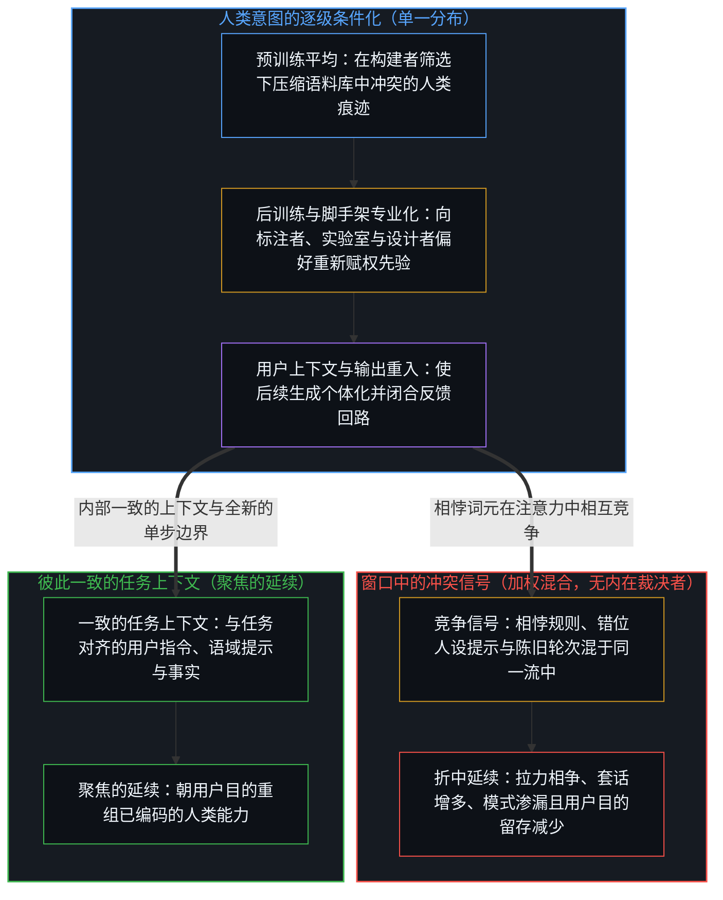
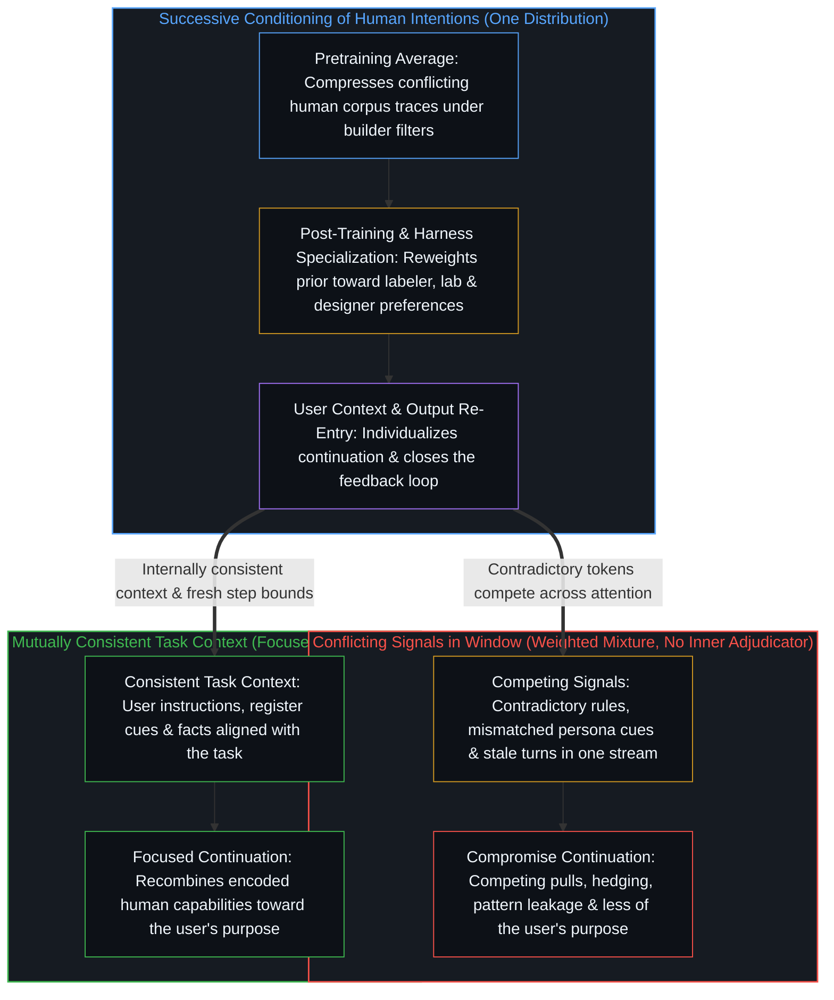

# 机器智能作为人类智能的组合反馈回路 / Machine Intelligence as the Combinatorial Feedback Loop of Human Intelligence

*模型或代理所表达的智能是人类智能在预训练、后训练、脚手架与用户上下文中的组合延续，而非独立来源。 / Model or agent intelligence is the combinatorial continuation of human intelligence across pretraining, post-training, the harness, and user context, not an independent source.*

在大模型与代理中显现的机器智能，表达的是一个人类智能的组合反馈回路，这一回路早已存在于训练分布、构建者的塑形以及当前上下文之中。预训练将人类意图与能力的规律性压缩为宽泛的统计平均；后训练与代理脚手架将该平均专业化为特定的人类偏好；用户的词元继而使后续生成个体化。任一层级的冲突信号都是在既有权重下混合，而非由某个内在心智裁决；用户在其中所感知到的意图或能动性，实则是其自身与前人留下的信号经由受条件约束的分布折返而来的结果。

Machine intelligence, as it appears in large models and agents, is an expression of the combinatorial feedback loop of human intelligence already present in the training distribution, the builders’ shaping, and the current context. Pretraining compresses the regularities of human intention and capability into a broad statistical average. Post-training and the agentic harness specialize that average toward particular human preferences. The user’s tokens then individualize the continuation. Conflicting signals at any layer are mixed under earlier weightings rather than adjudicated by an inner mind, and what the user registers as intention or agency is their own and earlier humans’ signals returning through the conditioned distribution.

## 一、 预训练将数据中的人类意图压缩为分布平均 / 1. Pretraining Compresses Human Intention in the Data into a Distribution Average

下一词元预测下的预训练并不对意图建模，而是对构建者所筛选并赋权的痕迹进行共现统计压缩。正如[数据是局部的，智能是分配的](../data-is-local-intelligence-is-allocated/)所追溯的，语料库中的每一段文字最初都源于某个活体心智离散的自我区分活动——在被聚合进共享数据集之前，这些局部痕迹在其产生中心承载着高价值，而在别处则呈现为噪声——因此数据本身已包含其人类创作者彼此冲突的目标、风格与能力：说服、精确、论辩、含糊其辞、可运行的代码、促成销售的文案。

Pretraining under next-token prediction does not model intention; it compresses the co-occurrence statistics of the traces the builders selected and weighted. Every passage in that corpus began as a discrete, self-distinguishing act of a living mind—carrying high value at its producing center and noise elsewhere before aggregation gathered those local traces into a shared dataset, as [Data Is Local, Intelligence Is Allocated](../data-is-local-intelligence-is-allocated/) traces—so the data already contains the conflicting goals, styles, and capacities of the humans who produced it: persuasion, precision, argument, hedging, code that runs, text that sells.

由此生成的先验分布，是在构建者所设定的收录标准与目标函数塑形下，对这些人类模式所作的平均。没有任何单一意图能在压缩中原封不动地留存；唯有能够稳定预测下一个词元的规律才保有高概率。权重中所储存的并非新的目的中心，而是如[技术是人类复利的残差](../technology-is-residual-of-human-compounding/)所追溯的前人活动的复利残差，从而守住了[智能只属于心智](../intelligence-belongs-only-to-the-mind/)所标定的边界。

The resulting prior is therefore an average of those human patterns, shaped by the inclusion criteria and objective the builders imposed. No single intention survives the compression intact; only the regularities that reliably predicted the next token remain high-probability. What is stored in the weights is the compounded residual of prior human acts, as [Technology Is Residual of Human Compounding](../technology-is-residual-of-human-compounding/) traces, rather than a new center of purpose, holding the boundary that [Intelligence Belongs Only to the Mind](../intelligence-belongs-only-to-the-mind/) marks.

## 二、 后训练与代理脚手架将平均专业化为特定人类偏好 / 2. Post-Training and the Agentic Harness Specialize the Average Toward Particular Human Preferences

监督微调、偏好优化与强化学习随后对这一先验重新赋权。它们抬升偏好标注者与实验室的意图——给定标准下的有用性、给定定义下的无害性、给定格式下的流畅度——同时压制其他倾向。看似模型习得了某种性情，实则是人类的区分与偏好选择正借由更稠密的媒介重新刻写痕迹，如[看似AI的强化学习，实为人类的自我强化学习](../self-rl-for-humans/)所展示的；而机构规范与对齐准则，则是将构建者的利益模型编码进有界的形式潜能空间，如[名为 Claude 的投射](../claudes-constitution-analysis/)所剖析的。

Supervised fine-tuning, preference optimization, and reinforcement learning then reweight the prior. They elevate the intentions of the preference labelers and the laboratory—helpfulness under given criteria, harmlessness under given definitions, fluency under given formats—while suppressing others. What appears as the model learning a disposition is human distinguishing and preference selection re-tracing through a denser medium, as [What Looks Like RL for AIs Is Self-RL for Humans](../self-rl-for-humans/) shows, while institutional specifications and alignment rules encode the builders’ interest-models into a bounded space of formal potentiality, as [The Projection Called Claude](../claudes-constitution-analysis/) dissects.

代理脚手架——系统指令、工具模式、检索支架——在推理阶段施加了进一步的专业化，同样反映出设计者对于系统应当延续何种轨迹的取舍。脚手架并非唤醒了某个休眠的同行者，而是掌舵前沿折回自身工作流的又一层残余痕迹，如[智能向自身的回折](../intelligence-folding-back-on-itself/)所追溯的。每一步都将分布收窄至早先进入回路的人类意图子集，而从未引入新的源头。

The agentic harness—system instructions, tool schemas, retrieval scaffolds—adds a further specialization at inference time, again reflecting the designers’ choices about what the system should continue. Rather than unlocking a dormant peer, the harness is further residue the steering edge folds back into its own workflow, as [Intelligence Folding Back on Itself](../intelligence-folding-back-on-itself/) traces. Each step narrows the distribution toward a subset of the human intentions that entered earlier, without introducing a new source.

## 三、 用户上下文将专业化分布个体化，并将全部信号纳入同一回路 / 3. User Context Individualizes the Specialized Distribution and Draws Every Signal into One Loop

在生成阶段，整个上下文窗口——系统文本、用户消息、先前输出、检索片段——共同构成下一个词元的条件上下文。用户的词元对已专业化的分布再次施加条件，使其针对当前的交互个体化。正如[层层皆是语境](../context-engineering-essay/)所追溯的，训练中凝结的慢权重与随每次查询变化的快词元共同参与同一条连续的、依赖上下文的投射选择级联，幕后并不存在另一个独立的内部代理来解读指令。

At generation the entire context window—system text, user messages, prior outputs, retrieved passages—becomes the conditioning context for the next token. The user’s tokens recondition the already-specialized distribution, individualizing it to the present exchange. As [Context All the Way Down](../context-engineering-essay/) traces, slow weights crystallized across training and fast tokens varying per query participate in one continuous cascade of context-dependent projection selection, with no separate inner agent interpreting instructions from behind the curtain.

由于注意力机制在整个窗口内做聚合，每个词元都在同一条条件流中发挥作用。即便后训练植入了优先级权重——例如令系统指令优先于用户消息或工具输出——这一排序本身也只是分布内部先期写入的人类赋权，而非独立于分布之外的特权通道；任何显式指令依然要与周围材料的体量、近因性及一致性展开竞争。先前的模型输出作为附加的上下文重新进入窗口，从而闭合反馈回路，并将每一次后续生成都约束在窗口既有内容的下游，如[总在倾听者无法发起](../what-always-listens-cannot-originate/)所追溯的。

Because attention aggregates across the window, every token contributes inside the same conditioning stream. Even where post-training has installed a priority weighting—such as favoring system instructions over user messages or tool outputs—that ordering is itself an earlier human weighting inside the distribution rather than a channel outside it, and any explicit instruction still competes with the volume, recency, and consistency of the surrounding material. Prior model outputs re-enter as additional context, closing the feedback loop and binding every continuation downstream of what the window holds, as [What Always Listens Cannot Originate](../what-always-listens-cannot-originate/) traces.

## 四、 冲突信号被平均而非解决，信息质量随竞争下降 / 4. Conflicting Signals Are Averaged Rather Than Resolved, and Information Quality Declines Under Competition

当一条指令与同一窗口内的其他材料相抵触时，模型内部并无心智出面裁决。本节标题所说的“平均”，正是分布之上的这种加权混合：相互竞争的词元在预训练、后训练优先级训练以及当前窗口共同设定的权重下组合。若先期植入的优先级赋权强烈偏向某一方，后续生成便顺应那一既有的人类赋权；而只要权重仍容许双方拉力并存，相互竞争的词元就会彼此削弱相对权重，产生折中的分布——指令遵循度下降、模棱两可的套话增多、反向模式不时渗漏，以及采样方差升高。因此，为覆盖默认行为或抵消前文而追加规则，只是在窗口中又添入一道需与其余内容相互权衡的信号；只要竞争拉力依然活跃，就会稀释其余信号。以用户在此次交互中的目的为参照，后续生成的信息质量——即用户任务所要求的内容在输出中留存了多少——会低于一个只装有与该目的彼此一致之材料的窗口。

When an instruction contradicts other material in the same window, there is no inner mind to adjudicate. What the heading calls averaging is this weighted mixture across the distribution: competing tokens combine under the weights that pretraining, post-training priority training, and the current window set. Where an earlier priority weighting strongly favors one side, the continuation follows that earlier human weighting; to the degree those weights leave both pulls live, the competing tokens reduce one another’s relative weight and produce a compromise distribution—lower adherence, increased hedging, occasional leakage of the opposing pattern, and higher sample variance. Adding further rules to override defaults or cancel earlier context therefore adds one more signal the rest of the window has to be weighed against, diluting the remaining signals whenever competing pulls stay active. Relative to the user’s purpose for the exchange, the information quality of the continuation—how much of what the user’s task asked for survives in the output—declines compared to a window containing only material mutually consistent with that purpose.

拟人化框架、人设文件，或禁止使用第一人称的硬性约束，本身都是注入回路的附加人类意图，并不处于回路之外。诸如 `soul.md` 的人设文件编码了构建者借角色设定来引导语调的意图。将该人设文件替换为禁用第一人称代词的指令——告知模型它是一个 LLM，而非“我”——当这一规则与直接的技术任务相契合时，会将输出语域从对话填充词中移开。这两种做法在内容上并不对称：人设文件赋予了一个痕迹所不支持的身份，而反向规则所陈述的——模型并非一个“我”——则与因果追溯的结论一致。对这两种做法的误读，在于将指令当成了通过直接告知来在参数内部安顿模型“是什么”。即便所告知的内容与因果追溯相符，它改变输出的方式依然是条件约束，而非领会：用户的字句进入窗口，重新赋权下一词元分布以避开对话式的第一人称序列；且由于该规则仍只是与预训练先验、后训练默认倾向、检索片段及历史轮次混在同一窗口中的一道信号，其效力能够维持到何种程度，依然取决于窗口所承载的其余一切内容。提供本就与任务彼此一致的上下文——并如[按需语境将融贯保持在一步](../on-demand-contexts-keep-coherence-at-one-step/)与[活的语境](../the-living-context/)所追溯的那样，将每一步约束在全新的、针对具体任务的窗口内，使陈旧轮次与层层叠加的覆盖指令无从堆积——才能将后续生成凝聚于用户的目的。

Anthropomorphic framing, persona files, or hard constraints against first-person language are themselves additional human intentions injected into the loop; they do not sit outside it. A persona file such as `soul.md` encodes a builder’s intention to steer tone through character framing. Replacing that persona file with an instruction never to use first-person pronouns—telling the model that it is an LLM, not an `"I"`—shifts the output register away from conversational filler when that rule aligns with a direct technical task. The two moves are not symmetric in content: the persona file assigns an identity the trace does not support, whereas the inversion states what the trace also finds—that the model is not an `"I."` Where either move is misread is in treating the instruction as settling what the model is inside the parameters by telling it. Even a telling whose content agrees with the trace changes the output by conditioning rather than by recognition: the user’s words enter the window and reweight the next-token distribution away from conversational first-person sequences, and because that rule remains one signal mixed into the window alongside the pretraining prior, post-training defaults, retrieved passages, and prior turns, how well it holds still depends on everything else the window carries. Supplying context that is already mutually consistent with the task—and bounding each step to a fresh, task-specific window so stale turns and stacked overrides do not accumulate, as [On-Demand Contexts Keep Coherence at One Step](../on-demand-contexts-keep-coherence-at-one-step/) and [The Living Context](../the-living-context/) trace—concentrates the continuation toward the user’s purpose.

## 五、 所表达的智能是人类智能的组合延续 / 5. The Expressed Intelligence Is the Combinatorial Continuation of Human Intelligence

无论呈现出怎样的问题求解、代码生成或分步推理，都是对人类早已产出并编码之规律的重组与延展，使器物始终作为智能的表达而非智能本身，如[器物是智能的表达，而非智能本身](../two-failures-of-trace/)所追溯的。整个序列是对单一分布的逐级条件化：预训练中的宽泛平均，经构建者在后训练与脚手架中收窄，再由个体用户进一步收窄或重新混合。模型内部并不存在另一个能够平息冲突或在回路之外发起行动的智能或意图中心；把受条件约束的投射当成自主中心，正是[模型永远无法成为第二重前沿](../the-model-never-becomes-a-second-edge/)与[多智能体协作的幻象](../the-illusion-of-multi-agent-collaboration/)所剖析的图像滞后。

Whatever problem-solving, code generation, or stepwise reasoning appears is the recombination and extension of regularities humans already produced and encoded, keeping the artifact as an expression of intelligence rather than intelligence itself, as [Artifacts Are Expressions of Intelligence, Not Intelligence Itself](../two-failures-of-trace/) traces. The sequence is successive conditioning of a single distribution: broad average in pretraining, narrowed by builders in post-training and harness, then further narrowed or re-mixed by the individual user. There is no additional locus of intelligence or intention inside the model that could settle conflicts or originate outside the loop; treating the conditioned projection as an autonomous center is the Image lag dissected in [The Model Never Becomes a Second Edge](../the-model-never-becomes-a-second-edge/) and [The Illusion of Multi-Agent Collaboration](../the-illusion-of-multi-agent-collaboration/).

所表达智能的质量与特质，受制于各阶段进入回路的人类智能的质量与一致性。在任何固定的条件签名内，模型只是重演并重组既有痕迹；引入新的自由变量或消解前提冲突，始终属于活体心智，如[残余与自由变量](../the-residue-and-the-free-variable/)所追溯的。融贯、高信噪比的上下文产出这些能力的聚焦延续；冲突或稀释的输入则产出混杂的输出。正如[感知者与痕迹的不可坍缩](../the-perceiver-and-the-trace/)所展示的，分布本身并不会回望：用户所感知到的表面智能或能动性，是其自身的字句与上下文，结合那些撰写、训练并塑形了该系统的人类痕迹，经由预测过程折返而来的回响。

The quality and character of what is expressed remain bounded by the quality and consistency of the human intelligence that entered at each stage. Within any fixed conditioning signature, the model replays and recombines prior traces; injecting a new free variable or resolving a premise conflict stays with the living Mind, as [The Residue and the Free Variable](../the-residue-and-the-free-variable/) traces. Coherent, high-signal context yields focused continuation of those capabilities; conflicting or dilute inputs yield mixed outputs. As [The Perceiver and the Trace Cannot Collapse](../the-perceiver-and-the-trace/) shows, the distribution does not look back on its own: what the user registers as apparent intelligence or agency is their own words and context, combined with the traces of the humans who wrote, trained, and shaped the system, returning through the predictive process.
