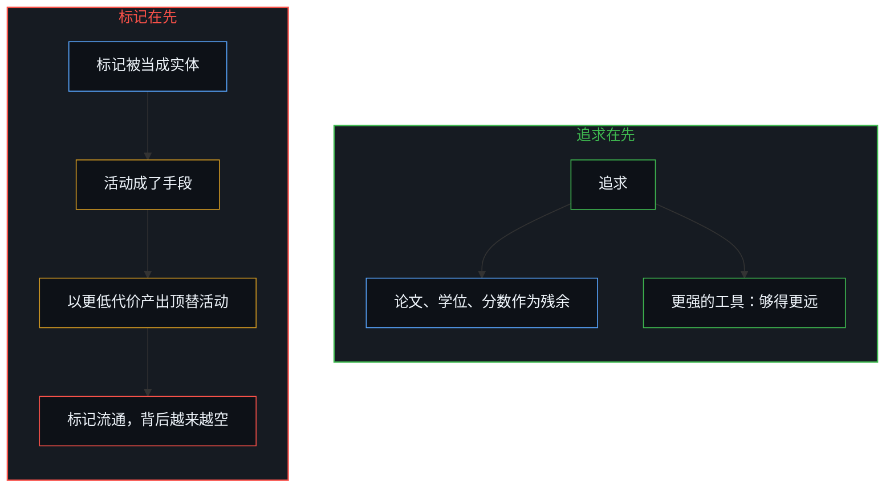
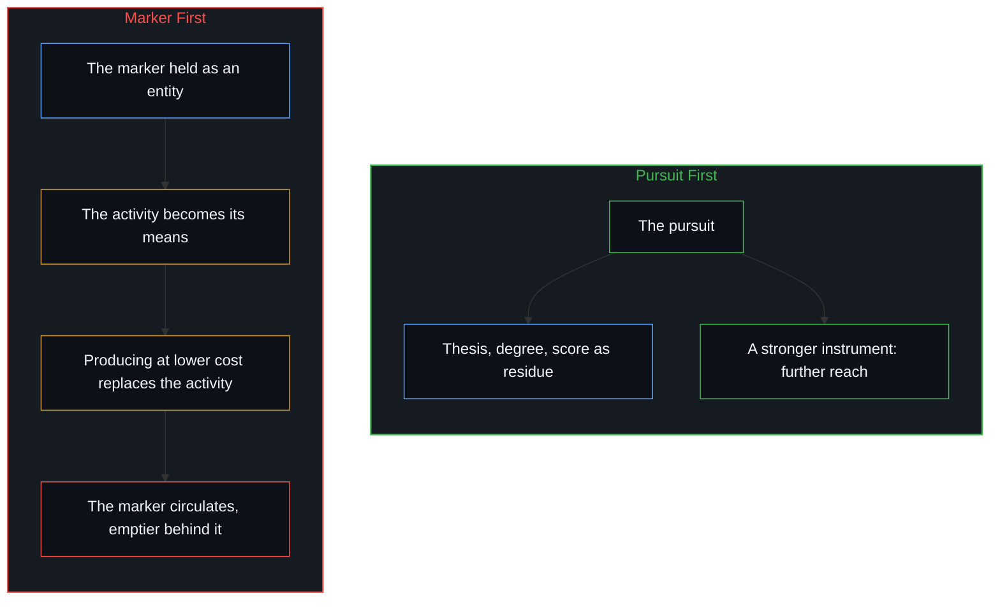

# 作为职业的数学不是作为追求的数学 / Math as a Career Is Not Math as a Pursuit

*追求带动职业时二者同行；把标记当成所代表之物，因果便倒转 / The two track while the pursuit drives the career; mistaking the marker for what it represents reverses causality.*

一个模型解开了一位博士生选作论文的问题，流传开来的回应要的是同情：职业正在被重新定向，人们不得不重塑自己。作为职业的数学不是作为追求的数学，追求带动职业时二者同行，先后倒过来二者就分道；对追求来说，更快的引擎就是更多的数学，只有把职业放在前面，才会把这一进展记成损失。同样的倒转出现在一切把职业、学位、头衔、考试分数当得比它们所代表的东西更实在的地方，作业分数上升而独立的能力变薄，名校学位不再凭能力授予就开始贬值，都是它。

A model solves the problem a PhD student had chosen for a thesis, and the reply that circulates asks for sympathy: careers are being reoriented, and people have to reinvent themselves. Math as a career is not math as a pursuit; the two track while the pursuit drives the career, and diverge once that order is reversed. For the pursuit, a faster engine is simply more mathematics; only when the career is placed first does this advance register as a loss. The same reversal appears wherever a career, a degree, a title, or a test score is treated as more substantial than what it represents: homework scores rising while independent capability thins, and prestigious degrees devaluing once no longer conferred for capability, are both instances of it.

## 一、 职业与追求只在追求领跑时同行 / 1. Career and Pursuit Track Only While the Pursuit Leads

格兰特·桑德森对 AI 与数学的反思，先把数学家做的各项工作、数学为什么受重视、经费从哪里来一一列出，再问 AI 更强之后会怎样。从中引出的那句“从没有比现在更好的时候进入数学”，被人回了一句：这话站在职业阶梯之外说很容易；对一个论文题目刚被模型解开的博士生、一个怀疑自己的本事是否还算数的博士后，这是艰难的时刻，值得的是同情，而不只是乐观。

Grant Sanderson's reflection on AI in mathematics lists what a mathematician does, why the subject is valued, and where its funding comes from, then asks what happens as AI grows more capable. The line quoted from it—that there has never been a better time to go into math—drew the reply that this is easy to say from outside the career ladder: for a PhD student whose thesis problem was just solved by a model, or a postdoc doubting whether their skills still count, this is a difficult moment that calls for sympathy, not just optimism.

两种说法把不同的优先放在前面。桑德森顺着追求在想：这项活动做什么、产出什么。那句回应顺着职业在想：本该算数的论文，本该被计入的本事。追求带动职业的时候，二者一起走，论文是做一个问题留下的东西，职位是这份留存换来的。先后一旦倒过来，在数学里和在任何职业里都一样，职业成了所求，数学成了手段，手段一旦能被别的东西替代，二者就在那里分道。这个领域一刻不停地向前，AI 是它眼下的样子。倒过来的那种先后，需要的是重新排定优先，而不是停在同情上。

The two accounts put different priorities first. Grant follows the pursuit: what the activity does and what it yields. The reply follows the career: the thesis that was to count, the skills that were to be credited. While the pursuit drives the career, the two move together: the thesis is what working through a problem leaves behind, and the position is what that residue is traded for. Once the order is reversed—in mathematics as in any career—the career becomes the end and mathematics the means; once the means can be replaced by something else, the two part ways. The field advances without pause, and AI is its present face. What that reversed order needs is to reorder priorities, not to stop at sympathy.

## 二、 追求随加速自然适应 / 2. The Pursuit Adapts Naturally as the Field Accelerates

对作为追求的数学来说，模型解开一个问题，就是这个问题在眼下的形式框架里解开了。本想弄明白的东西如今摆在那里可以去弄明白，理解不会缩成对一份封闭清单的核验；下一个问题从它那里打开，解开这一个的引擎也正好拿来对付下一个。适应不是压在追求之上的另一项任务，追求接纳任何能够得更远的工具，因为工具服务的正是追求本来所求的东西。[为何数学永远解不完](../why-mathematics-can-never-be-solved/)追溯了终点线为何不会出现：地平线是这项活动自己生成的，清得越快，剩下的越分明。模型的参数承载的，是已经做出的区分增密而成的残余，下一个问题仍在做数学的心智那里打开，这是[模型永远无法成为第二重前沿](../the-model-never-becomes-a-second-edge/)所追溯的边界。

For mathematics as a pursuit, a model solving a problem simply means that the problem is solved within the current formal framework. What one had wanted to understand is now there to be understood, and understanding does not reduce to checking off items on a closed checklist; the next question opens from it, and the engine that solved this one is immediately at hand for the next. Adaptation is no separate task laid on top of the pursuit; the pursuit takes up any instrument that reaches further, because the instrument serves what the pursuit was after all along. [Why Mathematics Can Never Be Solved](../why-mathematics-can-never-be-solved/) traces why no finish line forms: the horizon is generated by the activity itself, and the faster ground is cleared, the starker the remainder stands out. The model's parameters carry the densified residue of distinctions already made, while the next question still opens at the Mind doing the mathematics—the boundary traced by [The Model Never Becomes a Second Edge](../the-model-never-becomes-a-second-edge/).

要同情的那种读法把这件事看反了。它把不适应当作前提，当成导出这一艰难时刻的既定起点，再去回应这个时刻。损失只在把论文当作职业筹码的地方才被记下：解开的问题到来时，被记成一笔被拿走的功劳，而不是多出来的数学。同情回应的正是这笔记账。它把产生这笔账的先后原样留着，下一次进展落到同样的先后上，还会以同样的方式落下。[同情是缺乏清晰时的占位符](../sympathy-is-a-placeholder-for-lack-of-clarity/)追溯过同情站在哪里：站在对另一个中心之痕迹的进一步区分停住的地方；在这里停下的，是对产生这笔损失的那个先后的区分。感受可以留着，代价出在停下。要的是清晰，而不是同情；在这里，清晰就是重新排定优先，而这些优先只有持有它们的人自己能重排。

The reading that asks for sympathy has this backwards. It treats the failure to adapt as a given premise, the fixed starting point from which the difficult moment follows, and then responds to that moment. Loss is recorded only where the thesis was held as the career's bargaining chip: when a solved problem arrives, it registers as credit taken away, rather than more mathematics. Sympathy answers precisely this entry in the ledger. It leaves in place the order that produced that entry, so that the next advance lands on the same order in the same way. [Sympathy Is a Placeholder for Lack of Clarity](../sympathy-is-a-placeholder-for-lack-of-clarity/) traces where sympathy stands: at the point where further distinguishing of another center's traces stalls; and what stalls here is distinguishing the order that produced the loss. The feeling may remain; the cost lies in stopping. What is needed is clarity, not sympathy; and here, clarity means reordering priorities, which only the one holding those priorities can do.

## 三、 标记被当得比它所代表的更实在，因果就倒转 / 3. A Marker Held as More Substantial Than What It Represents Reverses Causality

这个样式不止于数学。职业、学位、头衔、考试分数，一旦被当得比它们所代表的东西更实在，因果就倒了过来。每一个标记都是某项活动的残余：分数是学习留下的，学位是多年学习留下的，头衔是做过的工作留下的。按这个先后，标记指回活动，它的用处恰在于此。一旦被当成实体，标记成了目的，活动成了手段，因果就倒转了：凡是能以更低代价产出这个标记的东西，都会顶替它原本记录的活动，标记照样流通，背后的东西越来越少。[教育与科学的倒置](../the-reversal-of-education-and-science/)在机构的尺度上把这叫作寄存器替代：原本作为探求之管理足迹的指标，最后僭取了它所标记的探求，机构把自己的账目当成了实在。[错把表达当成智能](../mistaking-the-expression-for-the-intelligence/)追溯的是同一种倒转落在固定约束下的表达上：分数先被等同于产生它的活动，再被放到活动之上。

This pattern extends beyond mathematics. A career, a degree, a title, a test score: once any of them is treated as more substantial than what it represents, causality reverses. Each marker is the residue of an activity: a score is left by learning, a degree by years of study, a title by work done. In that order, the marker points back to the activity, and that is precisely its use. Once held as an entity in itself, the marker becomes the end and the activity its means, and causality inverts: whatever produces the marker at lower cost replaces the activity it once recorded, while the marker continues to circulate with less and less behind it. [The Inversion of Education and Science](../the-reversal-of-education-and-science/) names this, at institutional scale, Register Substitution: a metric devised as an administrative footprint of inquiry ends up usurping the inquiry it marked, and the institution mistakes its own ledger for reality. [Mistaking the Expression for the Intelligence](../mistaking-the-expression-for-the-intelligence/) traces the same reversal in expression under a fixed constraint: the score is first equated with the activity that produced it, then set above it.

这就是图像滞后：一个参照被留过了产生它的那一步，后来的行动拿它来衡量，而不是让它从这些行动里重新画出。后果照样落在当下的场里，却记在那个过期的参照上，于是像是从外面施加过来的。[好奇先行](../curiosity-first-the-hidden-engine-of-talent-and-development/)是它在一个人身上的样子：测出来的表现被留作天赋，置于产生它的回路之前；[来自个体差异的层级](../hierarchy-from-individual-difference/)是它披着排名外衣的样子：所求的更高位置被留过了产生它的那一步，眼下的名次便被记成从别处落下来的。模型解开论文题目，对把论文当作职业的人来说，就是这样一个后果：它落在数学的当下，却记在被当作职业的那篇论文上，于是像一笔从外面拿走的功劳。

This is Image lag: a reference preserved past the step that produced it, so that later acts are measured against it rather than redrawn from them. Consequences still land in the present field, but because they register against the stale reference, they appear as if imposed from the outside. [Curiosity First](../curiosity-first-the-hidden-engine-of-talent-and-development/) traces this lag in an individual: measured performance preserved as talent prior to the loop that produced it. [Hierarchy from Individual Difference](../hierarchy-from-individual-difference/) is the same lag cloaked in ranking: the desired higher position is preserved past its step, so that the present rank registers as arriving from elsewhere. A model solving a thesis problem is such a consequence for whoever held the thesis as the career: it lands in the present of mathematics, but registers against the thesis held as a career, and thus arrives as credit taken away from outside.

## 四、 作业分数被当成了学习 / 4. The Homework Score Taken for Learning

学生与生成式 AI 的那些研究，在校园里记下了这个分叉。[作业与考试的倒置折射出替代效应](../the-homework-exam-inversion-registers-substitution/)追溯过它：作业分数上升、完成时间缩短，闭卷考试却在下滑。差距的一半并不是倒转，而是测量本身的构成：作业分数是原生能力加上工具，闭卷考试只测原生能力，两件仪器测的是两个对象；作业分数允许含进工具时，用上工具正是一件有用的工具该有的样子，而最有理由用它的，是原生能力落在那个分数之下最远的学生。另一半才是倒转，在几个月里、在同一批学生身上展开：分数成了所求，把解题的构建交给工具就是到达它的最短路；分数到手了，分数本该记录的那份能力却不再被练习，于是变薄。两半都不需要工具对学生再做什么。[研究AI效应重置了因果原点](../studying-the-effect-of-ai-relocates-causality/)追溯过，把能否使用工具当作自变量、把相反的两种用法平均起来称作“AI 的效应”，是把因果挪进了工具，而工具并不发起其中任何一种用法。在另一种用法里，先自己试，再去要解释，同一件工具延伸的正是分数所记录的那份能力。起决定作用的，是学生把二者之中哪一个放在前面：放在前面的是学习，工具交回来的东西就是要弄明白的；放在前面的是分数，工具交回来的东西就成了终点。

Studies of students and generative AI record this divergence in schools. [The Homework–Exam Inversion Registers Substitution](../the-homework-exam-inversion-registers-substitution/) traces it: homework scores rose and completion times fell, while closed-book exams declined. Half of the gap is not a reversal, but an artifact of the measurement's composition: the homework score reflects raw capability plus the tool, while the closed-book exam tests raw capability alone—two instruments measuring two different objects. When homework scores are allowed to incorporate the tool, employing it is simply what a useful tool looks like; and those with the most reason to use it are the students whose raw capability falls furthest short of the score. The other half is the genuine reversal, unfolding over months within the same cohort of students: when the score becomes what is sought, handing the construction of solutions to the tool is the shortest path to it; the score is secured, but the capability it was meant to record is no longer exercised, and so it thins. Neither half requires the tool to do anything further to the student. [Studying the Effect of AI Relocates Causality](../studying-the-effect-of-ai-relocates-causality/) traces how taking access as the independent variable, and naming the average of opposed uses "the effect of AI", relocates causality into the tool, which initiates neither use. In the other mode of use—attempting the problem first and asking for explanations—the same tool extends the very capability the score records. What decides is which of the two the student puts first: with learning placed first, what the tool returns is something to understand; with the score placed first, what the tool returns is the end.

## 五、 不再凭能力授予的名校学位 / 5. The Prestigious Degree No Longer Conferred for Capability

名校学位的贬值走的是同一条路。凭能力授予的学位，记录着挣得它的那份能力，它的价值就是这份记录。一旦学位为它自己而被追求、被授予，凭的是能力以外任何能打开那道门的东西，纸上的名字还在，它所记录的东西却不再跟着它走；读它的人学会了越过它去看，它的价值随之下降。这是寄存器替代，寄存器换成了门第：度量一旦成了目标，就不再度量。贬值记成损失，落在把学位当成实体的人那里：对凭它换取位置的持有者，是筹码的贬值；对把它当作能力定论的读者，是确定性的落空。当作信号来读，学位一直是留给每个读它的人，拿来同持有者实际能做的事一起掂量的，从不替读者作出这个判断；判断留在要承担这次阅读后果的读者那里，这正是[专家经验作为参考而非替代](../expertise-as-reference-not-replacement/)为一切外来的地图保留的先后：参考提供信息，不取代判断。对握有那份能力的人来说，能力本身没有变。

The devaluation of prestigious degrees follows the same path. A degree conferred for capability records the capability that earned it, and its value is that record. Once the degree is sought and conferred for itself, on whatever opens the gate other than capability, the paper still carries the name while what it once recorded no longer travels with it; those who read it learn to look past it, and its value falls. This is Register Substitution with pedigree as the register: once a measure becomes the target, it ceases to measure. Devaluation registers as a loss for whoever held the degree as an entity: for the holder who traded it for a position, it is a devalued chip; for the reader who treated it as the settled conclusion on capability, it is a dashed certainty. Read as a signal, the degree was always meant for each reader to weigh against what the holder can actually do, never to decide it in the reader's place; the judgment stays with the reader, who bears what follows from the reading—the ordering [Expertise as Reference, Not Replacement](../expertise-as-reference-not-replacement/) preserves for every external map: reference informs; it does not override. For whoever holds the capability, the capability itself has not changed.

## 六、 重排先后，标记回到残余的位置 / 6. Reordering Priorities Returns the Marker to Its Place as Residue

这个领域一刻不停地向前。[阻力体感与速率差](../felt-resistance-and-the-speed-differential/)追溯过这种前进被感到的样子：被感到的阻力，是前进中的能力与滞后的适应之间速率差的体感；把力气转去安抚这份体感，落差不会因此缩小，滞后反倒被坐实。同情停在那里的时候，做的正是这种安抚。重新排定优先，就是在每一步把追求放回前面：论文是做问题留下的，学位是学习留下的，分数是练习留下的。按这个先后，模型解开一个问题是够得更远，工具接过机械的步骤，心智就有更多余量留给问题本身，领域的进展是下一个问题的空间。由追求带动的职业随领域一起走，职业是追求的后果，追求适应了，它也就适应了。论文、形式证明与学位，是已做完的工作留下的记忆：正如[你的代码库即是记忆](../your-codebase-is-memory/)就代码所追溯的，它们保有先前切分的形状，却不再自己继续区分。所以职位若仍按寄存器发放，滞后在那本账里，不在数学里，追求也不等它。

The field advances without pause. [Felt Resistance and the Speed Differential](../felt-resistance-and-the-speed-differential/) traces how such an advance is felt: felt resistance is the sensation of the speed differential between advancing capability and the adaptation lagging behind it; diverting effort into pacifying that sensation does not narrow the gap, but entrenches the lag. When sympathy stops there, what it does is precisely this pacification. Reordering priorities means putting the pursuit back in front at each step: the thesis is what working through a problem leaves behind, the degree what learning leaves behind, the score what practice leaves behind. In that order, a model solving a problem is reach extended further, a tool taking over the mechanical steps leaves the Mind more capacity for the question itself, and the field's advance is room for the next question. A career driven by the pursuit moves with the field; the career is the pursuit's consequence, and as the pursuit adapts, the career adapts with it. Theses, formal proofs and degrees are memory left by work already done: as [Your Codebase Is Memory](../your-codebase-is-memory/) traces for code, they hold the shape of earlier cuts without continuing the distinguishing themselves. So where positions are still issued by the register, the lag sits in that ledger, not in the mathematics, and the pursuit does not wait on it.
