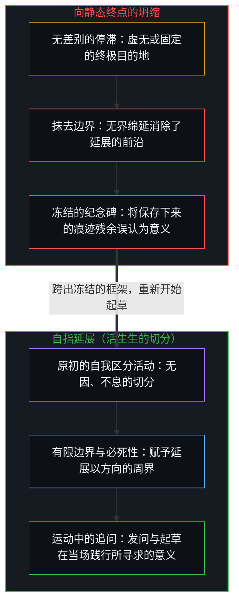
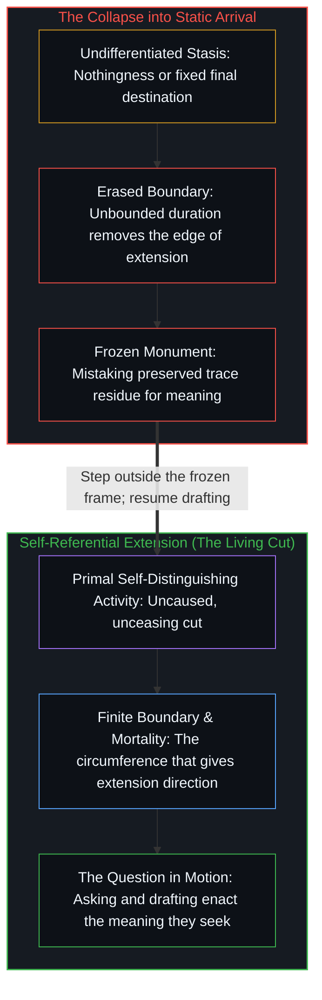

# 意义的结构 / The Structure of Meaning

*追问生命的意义，即是划出新边界以脱离停滞的自我区分运动。 / Asking for the meaning of life is itself the self-distinguishing movement that escapes stasis by drawing a new boundary.*

“生命的意义是什么？”——这一追问回荡了数千年，而答案总是以熟悉的形态出现：信仰、幸福、繁衍，或是反讽式的简写。大多数答案在审视之下都会坍塌，因为它们将局部偏好投射到了存在整体之上，或是将一场敞开的活动还原为封闭的客体。然而，一旦把发问这一行动本身追溯到它所实施的切分，这个问题便在结构上——而非修辞上——包含了它自己的解答。

The question—"What is the meaning of life?"—has echoed across millennia, and answers arrive in familiar forms: faith, happiness, reproduction, or ironic shorthand. Most collapse under examination because they project local preferences onto existence as a whole or reduce an open activity to a closed object. Yet the question contains its own resolution—structurally rather than rhetorically—once the act of asking it is traced to what it performs.

## 一、 自相矛盾 / 1. The Contradiction

毫无裂隙的虚无无法成立。哪怕是“无”这个概念，也已经划出了一道区分——一个将空无与非空无区分开来的框架——并在被设定的当场就推翻了自身。这不是有待修补的逻辑缺陷，而是生成的引擎。存在之所以展开，是因为静止、无差别的同一无法维持连贯；它会碎裂、分化并生成。

Unbroken nothingness cannot hold. Even the concept of "nothing" already draws a distinction—a frame that differentiates void from non-void—and contradicts itself in the very act of being posited. This is not a logical defect to repair; it is the generative engine. Existence unfolds because static, undifferentiated sameness cannot maintain coherence; it fractures, differentiates, and becomes.

这就是原初的自我区分活动：对分离与关联的同时要求。否定它即是践行它，因为任何否定都在制造它声称要拒斥的真伪边界。粒子、力、星系、生命与有意识的探究，各自都作为同一运动的一种方式而展开——通过进一步的区分来脱离停滞。

This is the primal self-distinguishing activity: the simultaneous demand for separation and relation. To deny it is to enact it, because any denial creates the true-versus-false boundary it claims to reject. Particles, forces, galaxies, life, and conscious inquiry each unfold as a mode of this same movement—escaping stasis through further distinction.

## 二、 作为自指延展的生命 / 2. Life as Self-Referential Extension

生命并非物理秩序中的反常例外；它是通过递归自指来运作的自我区分活动。无生命物质通过热力学与化学动力学来延展区分，而生命系统则通过复制、适应与自我建模来实现这一延展。

Life is not an anomalous exception to physical order; it is self-distinguishing activity operating through recursive self-reference. Where non-living matter extends distinction through thermodynamic and chemical dynamics, living systems do so through replication, adaptation, and self-modeling.

这一过程并非朝着预先印好的终点行进，而是不断脱离既成状态。当这一活动通过复杂到足以观察自身观察活动的有机体运作时，延展所呈现的形态便是复制、探索、创造与新颖性。发现、艺术与科学并非附加在生存之上的任意消遣，而是同一分化运动的明确延续。

The process does not march toward a pre-printed destination; it moves away from what it already is. Replication, exploration, creation, and novelty are the shapes extension takes when the activity operates through organisms complex enough to observe their own observing. Discovery, art, and science are not arbitrary pastimes bolted onto survival, but the explicit continuation of the same differentiating movement.

## 三、 绵延与边界 / 3. Duration and Boundary

不妨审视绵延与有限性。一个永远不会终止、也永远不会遭遇界限的系统，将不再留有任何可供延展的边界。延展要求在“既成之态”与“未成之境”之间保有一道活跃的前沿。一旦让系统在所有方向上都毫无边界，从而抹去这道前沿，延展也就失去了它的几何结构。

Consider duration and finitude. A system that could never terminate or encounter a limit would have no boundary left to extend. Extension requires the active edge between what already is and what is not yet. Remove that edge by making the system unbounded in every direction, and extension loses its geometry.

这并非宣称必死性为善或永生为恶的道德说教，而是对边界所起作用的观察。边界条件不是延展的障碍——它们正是赋予延展以方向的结构性周界。没有周界的圆无异于无定所的点，而没有边界的过程则无异于停滞。

This is not a moral sermon declaring that mortality is good or immortality is bad; it is an observation of what boundaries do. Boundary conditions are not obstacles to extension—they are the structural circumference that gives extension direction. A circle without a circumference is indistinguishable from an unlocated point, and a process without a boundary is indistinguishable from stasis.

## 四、 投射与基底 / 4. The Projection and the Substrate

每一个存在者都在内部通过连贯性、在外部通过与非自身的差异来界定自身。实在从一个由正交区分构成的敞开、可无限延展的超空间中投射而出——每一次切分都是独特的，每一次切分都为其他切分的显现提供了对照。意义之所以没有终极的封闭结构，原因正与[非万物之理](../not-a-theory-of-everything/)所给出的一致：因果并不闭合。

Every entity defines itself internally by coherence and externally by difference from what it is not. Reality projects from an open, infinitely extendable hyperspace of orthogonal distinctions—each cut unique, each providing the contrast against which others register. Meaning has no final closed structure for the exact reason [Not a Theory of Everything](../not-a-theory-of-everything/) gives: causality does not close.

每一个观察者都栖居于这一活动的有限投射之中，切近的运作环境也因此显现为有界且受约束的。正如[你的代码库即是记忆](../your-codebase-is-memory/)所展示的，外化的器物、记录与代码库是保存既往切分的持久记忆痕迹——作为延伸中心触角的脚手架固然不可或缺，但一旦被误认为活生生的前沿本身，便只是惰性的残余。所谓潜能，指的正是第一重无穷——在形式内部对区分的无尽推演——而先于形式、不可被投射的活动，才是使一切投射成为可能的源泉。

Every observer inhabits a finite projection of that activity, which is why the immediate operating environment registers as bounded and constrained. As [Your Codebase Is Memory](../your-codebase-is-memory/) shows, externalized artifacts, records, and codebases are durable memory traces of prior cuts—indispensable as scaffolding to extend a center's reach, yet inert whenever mistaken for the living edge itself. Potential names the first infinity—endless elaboration of distinctions within form—while the unprojectable activity prior to form is what makes every projection possible.

## 五、 问题回答了它自己 / 5. The Question Answers Itself

已知与未知之间的边界随着每一步而推远，因为终极抵达意味着停滞。“生命的意义是什么？”这一追问本身就是正在划出的一道区分——一场运动中的延展。[生命的意义在起草之中](../the-meaning-of-life-is-in-the-drafting/)将意义定位在那场鲜活的起草之中，而非任何已完工的纪念碑里。

The boundary between known and unknown recedes with every step because final arrival would mean stasis. The question "What is the meaning of life?" is itself a distinction being drawn—an extension in motion. [The Meaning of Life Is in the Drafting](../the-meaning-of-life-is-in-the-drafting/) locates meaning in that live drafting rather than in any finished monument.

在活生生的前沿提出这一追问，就已经是在践行它的答案。每一次表述都将运动暂时冻结为一道痕迹；每一次认出那次冻结，都是向外迈出的一步；而践行本身，就是这番不断往复的运动。

To ask the question at the living edge is already to enact its answer. Each articulation freezes the movement for a moment into a trace; each recognition of that freeze is a step outside; and the practice is the repeated movement itself.
