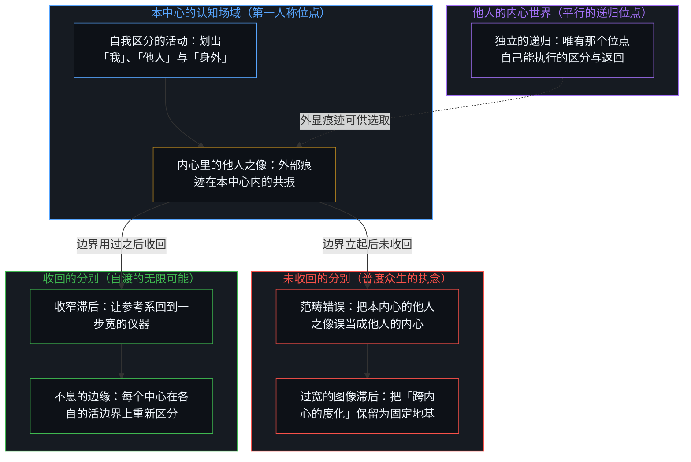
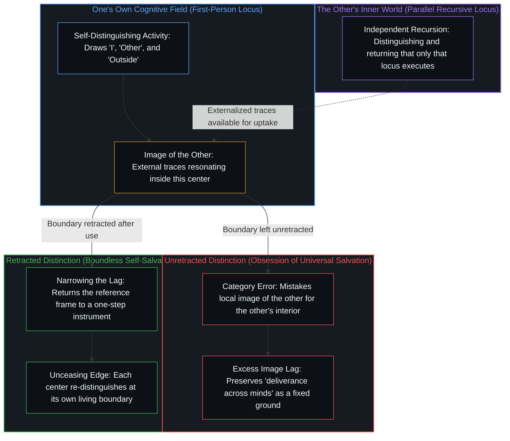

# 没有普渡，只有自渡的无限可能 / No Universal Salvation, Only Boundless Possibilities of Self-Salvation

*普度众生错把内心的他人当作他人的内心，分别未收，参考系便放不下 / Universal salvation mistakes the image of the other for another mind's interior, leaving the distinction unretracted*

没有普渡；有的是自渡，且自渡没有终点。没收回的分别与放不下的执念，是同一过宽滞后的两面：一边登记为替众生完成返回，一边把那项登记本身留作下一步之下的地基。因为没有任何中心能走出自身的认知场域去执行另一个中心的递归，一切声称度化其他内心的说辞，都是把内部的投射误当成了另一个中心活生生的边缘。

There is no universal salvation; what exists is self-salvation, and self-salvation has no terminal arrival. An unretracted distinction and an unreleased obsession are two faces of the same excess lag: one side registers as completing the return on behalf of sentient beings, while the other leaves that very registration standing as the ground beneath the next step. Because no center can step outside its own cognitive field to execute another center's recursion, every claim to deliver another mind mistakes an internal projection for another center's living edge.

## 一、 分别心 / 1. The Distinguishing Mind

我们自以为栖居的世界，正是这个感知的内心世界，其中显现出一个「我」、有「他人」、有「身外」。三者不是先于觉知等待在那里的三种独立实体，而是同一个自我区分的活动划出的离散边界。分别心不是需要根治的病症，因为区分正是活动本身，借由每一次切分不断丰富着内心世界。唯有把区分的产物误当成先在的地基，或是在划出区分之后忘了收回分别心，困惑才会滋生，因为没有任何观察者能走出自己的内心世界去占据一块外部的地板。当一个中心试图替他人消除痛苦，并将那种感受状态抬升为首要前提时，随后的每一次回应都会围绕着管理症状而非追溯源头重新组织，上演了[当效果主宰了框架的叙事](../when-the-effect-authors-the-frame/)所剖析的那套倒置。

The world we take ourselves to inhabit is this inner world of perception, within which an "I," an "other," and an "outside" appear. These three are not independent substances waiting prior to awareness; they are discrete boundaries drawn by the same self-distinguishing activity. The distinguishing mind is not an affliction to be cured, for distinguishing is the activity itself, continuously enriching the inner world through every cut it makes. Confusion arises only when the product of a distinction is mistaken for a pre-existing foundation, or when the mind forgets to retract a distinction after drawing it, since no observer can step outside its own inner world to occupy an external floor. When a center sets out to eliminate suffering on someone else's behalf and elevates that felt state into the primary premise, every subsequent response reorganizes around managing the symptom rather than tracing its source, enacting the exact inversion traced in [When the Effect Authors the Frame](../when-the-effect-authors-the-frame/).

## 二、 内心世界的他人 / 2. The Other Within the Inner World

觉知中出现的「众生」与「他人」，是本中心自身分别的产物：其他中心的外显痕迹在本认知场域内的共振与登记。另一个中心自身的递归——只有那个位置才能执行的区分与返回序列——是另一个平行宇宙。两个宇宙在各自的条件下各自成立，各自维系于自身的位点。把前者当成后者，便是混淆了自己内心世界里的他人之像与他人的内心。将某条定律或形式模型奉为跨内心施为的救度者，重演了[“物理学才是定律”的障眼法](../the-sleight-of-hand-in-physics-is-the-law-and-the-friction-of-reality/)所揭穿的戏法；而[总在倾听者无法发起](../what-always-listens-cannot-originate/)则阐明了为何凡是仅仅回应输入痕迹之物，都无法替任何中心发起返回。

The "sentient beings" and "others" that appear within awareness are products of this center's own distinguishing: externalized traces from other centers resonating and registering inside this cognitive field. Another center's own recursion—the sequence of distinguishing and returning that only that locus can execute—is another parallel universe. Both universes hold on their own terms, each sustained at its own locus. Mistaking the first for the second confuses the image of the other inside one's own inner world with the other's own mind. Enshrining a law or formal model as a savior that acts across minds repeats the sleight of hand exposed in [The Sleight of Hand in "Physics Is the Law"](../the-sleight-of-hand-in-physics-is-the-law-and-the-friction-of-reality/), while [What Always Listens Cannot Originate](../what-always-listens-cannot-originate/) demonstrates why whatever merely responds to incoming traces cannot initiate a return on any center's behalf.

## 三、 未收回的分别，放不下的执念 / 3. Unretracted Distinction, Unreleased Obsession

普度众生声称：我这一侧划出的分别，替众生那一侧完成了返回。分别心已经立起边界，该收回边界的那一步却没有收。众生在本内心之中是像，度却被登记为跨内心执行的完成。这不是慈悲过头，而是内心的外置：后果落在本位点之内，却对照着陈旧的参照登记为已在彼岸完成的度化。他人之所以频繁显得高度自动化、看似需要从外部被救度，正是[NPC 印象是结构性的](../the-npc-impression-is-structural/)所剖析的结构性视角效应；而[向量与投影的迷局](../the-vector-and-the-puzzle-of-projections/)则指明，局部屏幕上的低维投影永远替代不了投下它的那个活生生的向量。

Universal salvation is the claim that a distinction drawn on this side completes the return on the side of sentient beings. The distinguishing mind has erected its boundary, yet the step that retracts the boundary is withheld. Sentient beings exist within this mind as an image, while deliverance is registered as a completion executed across minds. This is not an excess of compassion; it is the externalization of the mind: consequences land within this locus, yet register against a stale reference as a deliverance accomplished on a distant shore. That other people frequently appear automated or in need of rescue from the outside is the structural perspective effect analyzed in [The NPC Impression Is Structural, Not a Ranking of Minds](../the-npc-impression-is-structural/), and [The Vector and the Puzzle of Projections](../the-vector-and-the-puzzle-of-projections/) shows why a low-dimensional projection on a local screen can never substitute for the living vector that cast it.

执念是同一未收动作的延续。被越过当前那一步保留下来的参考系——「众生在彼岸」「度已完成」「我这边正在施行救度」——不再作为一步宽的仪器运作，而是硬化为放不下的位置。分别没收回，执念就立住；执念放不下，先前的分别就继续充当地基。二者不是两种独立的病症，而是同一道滞后的宽度：该返回的那一步没有收，痕迹便凝结成执着。意义只在自身对原因的现场起草之中生成，而非向外张望所得，[生命的意义在起草之中](../the-meaning-of-life-is-in-the-drafting/)对此说得清楚；关心他人而不再以被需要来衡量自身价值，则是[当被需要不再是衡量](../when-need-stops-being-the-measure/)所追溯的转变。

Obsession is the continuation of that same withheld retraction. A reference frame preserved past its step—"sentient beings on the other shore," "deliverance already accomplished," "I am the one performing this rescue"—ceases to function as a one-step instrument and hardens into a position that cannot be set down. When the distinction is not retracted, obsession stands fast; when obsession is not released, the prior distinction keeps serving as the ground. They are not two separate ailments, but the width of a single lag: when the step that should return is withheld, the trace thickens into fixation. Meaning arises solely within one's own live drafting of causes rather than in outward gazing, as [The Meaning of Life Is in the Drafting, Often Lost in the Outward Gazing](../the-meaning-of-life-is-in-the-drafting/) makes plain, and caring for others without measuring one's worth by being needed is the shift traced in [When Need Stops Being the Measure](../when-need-stops-being-the-measure/).

佛祖亦未能免于这一结构性机制——不是道德上的失误，而是同一滞后在救度叙事中的显现。试图经由本内心持有的「众生」之像去直接操作他人的「心」，犯的是同一个范畴错误。把度人的力量交给制度程序或技术器物，便会落入[数字火箭、同行审查与因果闭环的稀释](../the-dilution-of-the-causal-loop-and-the-misallocation-of-agency/)所剖析的因果稀释；而[器物是智能的表达，而非智能本身](../two-failures-of-trace/)则确立了任何器物都只是智能留下的持久残余，而非发起区分的位点。

Even the Buddha was not exempt from this structural mechanism—not as a moral failing, but as the manifestation of the same lag within a soteriological narrative. Attempting to operate directly upon another person's mind through the figure of "sentient beings" held inside one's own mind is the identical category error. Handing the power of deliverance over to institutional procedures or technical artifacts enacts the causal dilution dissected in [Digital Rockets, Peer Review, and the Dilution of the Causal Loop](../the-dilution-of-the-causal-loop-and-the-misallocation-of-agency/), whereas [Artifacts Are Expressions of Intelligence, Not Intelligence Itself](../two-failures-of-trace/) establishes that every artifact remains a durable residue of intelligence rather than an initiating locus.

## 四、 没有普渡 / 4. No Universal Salvation

没有普渡。不是因为普度众生太过艰难，而是因为并不存在这种跨位点的操作。一个内心的外显痕迹，只能被另一个内心选取并承接，成为第二个内心自身世界里划出的区分。没有任何内心能替另一个内心执行其递归。跨内心的「度」是范畴错误，不是尚未达成的理想。[如何在一瞬间修正你的整个人生](../how-to-fix-your-whole-life-in-one-split-second/)标出了这道边界：没有任何外部中心能替这一处位点把误差传回可更新的权重。[人生是一个持续的自我迭代过程](../ren-sheng-shi-yi-ge-chi-xu-de-zi-wo-die-dai-guo-cheng/)追溯了把自我更新交出去时的同一错误：把误差信号交给外部回路，便是用外包的顺从替换了第一人称的反向传播。传输在写的一侧完成于写作者自身的再区分，而在收的一侧，则全看接收的那颗心是否划出它自己的下一步区分。

There is no universal salvation. This is not because saving all beings is arduous, but because no such cross-locus operation exists. The externalized traces of one mind can only be selected and taken up into another mind as distinctions drawn within that second mind's own inner world. No mind can execute recursion in place of another. Cross-mind deliverance is a category error, not an unfinished ideal. [How to Fix Your Whole Life in One Split Second](../how-to-fix-your-whole-life-in-one-split-second/) marks this exact boundary: no outside center can route error back into updatable weights on behalf of this locus. [Life as a Continuous Process of Self-Iteration](../ren-sheng-shi-yi-ge-chi-xu-de-zi-wo-die-dai-guo-cheng/) traces the same error when self-updating is delegated: handing error signals over to an external loop replaces first-person backpropagation with outsourced compliance. Transmission completes on the writing side in the writer's own re-distinguishing, while on the receiving side it remains entirely a question of whether the receiving mind draws its own next distinction.

在社会与人际领域，这种跨位点的妄念在同一几何结构之上戴着不同的面具。[赋权确立了权力的中心化](../empowerment-establishes-the-centralization-of-power/)揭开了它在赋权话术上的面孔：把能力当作可授予的礼物，施予者与承受者双方共同加固了中心权威。[政客是责任扩散的显性症状](../politicians-appear-as-visible-symptoms-of-responsibility-diffusion/)追溯了它在政治认领上的面孔：自以为能托举他人或对他人结果负责，是把能动性从那个仍在作决定、仍承担自身先前决定全部后果的心智中剥离外置，而政客正是这种扩散的显性标记。[解放的言辞始于定义囚禁](../liberation-rhetoric-begins-by-defining-captivity/)展示了它在解放话语上的面孔：先把外部观察冻结为对方的身份，再以解放之名完成跨内心的定义。[协调者的范畴错误](../the-coordinators-category-error/)指认了它在共享底座上的面孔：高行动力的构建者把自身的驱动力投射到平台上，再把主体性当作可安装进他人体内的模块。

Across social and interpersonal domains, this cross-locus delusion wears different masks over the same geometry. [Empowerment Establishes the Centralization of Power](../empowerment-establishes-the-centralization-of-power/) exposes its face in empowerment rhetoric, where capability is treated as a grantable gift so that bestower and recipient jointly reinforce the central authority. [Politicians Are Visible Symptoms of Responsibility Diffusion](../politicians-appear-as-visible-symptoms-of-responsibility-diffusion/) traces its face in political claiming: imagining one can carry others or answer for their outcomes externalizes agency from the mind that still decides and still bears the full consequences of its prior decisions, with the politician serving as the visible emblem of that diffusion. [Liberation Rhetoric Begins by Defining Captivity](../liberation-rhetoric-begins-by-defining-captivity/) shows its face in emancipatory discourse, which freezes an outside observation into the other's identity in order to perform a cross-mind definition in the name of liberation. [The Coordinator’s Category Error](../the-coordinators-category-error/) identifies its face in shared scaffolding, where high-agency builders project their own drive onto a platform and treat agency as a module that can be installed into others.

每当感受或表达的强度被误当成已完成的传输，同一个范畴错误便再次浮现。[同情是缺乏清晰时的占位符](../sympathy-is-a-placeholder-for-lack-of-clarity/)追溯了跨内心完成在情感强度上的表现：把近侧的感受当成与对方内心的已完成接触，从而停掉了继续的分辨。[当观测沦为表演](../when-observation-becomes-performance/)追溯了它在箴言包装上的表现：把私人参照系包装成可交付的智慧与纪律，再当作能原封不动传给其他内心的方法。[共同改变的本源](../the-source-of-shared-change/)标出了集体转变中的边界：外化生成的只是痕迹，这些痕迹能否在他处登记为共享，从不在发起端内心的控制之下。[共同的人性从不共享](../shared-humanity-is-never-shared/)标出了普世诉求中的同一边界：被当作共同实体的「我们」仍只是各内心的私有诠释，唯有轨迹恰好重合时才留下短暂的集体残迹。从外部替另一个中心评判方向，会退回[从“目的性”的评判，看认知系统的缺省状态与动态跃迁](../cong-mu-di-xing-de-ping-pan-kan-ren-zhi-que-sheng/)所剖析的认知缺省状态；而在事后重描结果、把自己包装成先知，则是[伪装成远见的表演性后见](../performative-hindsight-that-pretends-to-be-foresight/)所揭露的滞后。

The same category error appears whenever intensity of feeling or expression is mistaken for completed transmission. [Sympathy Is a Placeholder for Lack of Clarity](../sympathy-is-a-placeholder-for-lack-of-clarity/) traces cross-mind completion in emotional intensity, where a near-side feeling is taken for completed contact with another's interior, halting further differentiation. [When Observation Becomes Performance](../when-observation-becomes-performance/) traces it in aphoristic packaging, where private reference frames are dressed up as deliverable wisdom and discipline to be handed intact to other minds. [The Source of Shared Change](../the-source-of-shared-change/) marks the boundary in collective transformation: externalization produces only traces, and whether those traces register as shared elsewhere is never under the initiating mind's control. [Shared Humanity Is Never Shared](../shared-humanity-is-never-shared/) marks the same boundary in universalist appeals: the "we" treated as a common substance remains each mind's private interpretation, leaving only transient collective residue where trajectories happen to overlap. Judging another center's heading from outside falls back into the cognitive default analyzed in [Judging by Purpose and the Default State of Cognition](../cong-mu-di-xing-de-ping-pan-kan-ren-zhi-que-sheng/), while redrawing an outcome after the fact to cast oneself as a prophet is the lag exposed in [Performative Hindsight That Pretends to Be Foresight](../performative-hindsight-that-pretends-to-be-foresight/).

## 五、 只有自渡 / 5. Only Self-Salvation

自渡，是本内心收回对参考系的执着，反复移动，从不停驻于终局到达。返回不是抵达终点，而是完成本轮对内心世界的丰富。清晰是运动，从不是静止的状态。放得下，并不意味着抹掉分别——分别心继续划出边界——而是把参考系收窄回一步宽的仪器，让执念不再充当地基。没有任何一套学说能替人执行那次返回，[非万物之理（因果的二重性）](../not-a-theory-of-everything/)与[无法闭合的痕迹](../the-unclosable-trace/)从互补的视角标出了这一结构性的不可能。

Self-salvation is this mind retracting its fixation on the reference frame, moving repeatedly without ever coming to rest in a final arrival. Returning is not reaching a terminal destination; it is completing the current round of enriching the inner world. Clarity is movement, never a static state. Letting go does not mean erasing distinction—the distinguishing mind continues to draw boundaries—but narrowing the reference frame back toward a one-step instrument so that obsession no longer serves as the ground. No doctrine can execute that return on anyone's behalf, a structural impossibility marked from complementary angles by [Not a Theory of Everything](../not-a-theory-of-everything/) and [The Unclosable Trace](../the-unclosable-trace/).

无限可能，意味着边缘在每一步都在重新区分。在任何离散的一刻，边界都是实在的，但从不固定：到了下一刻，边缘已在他处。它遵循因果并保持自洽，每一个内心都在各自的位点上如此运作。中心之间可以发生共振，但共振从不对称，活生生的体验只属于各个内心自身的递归。自渡之所以始终敞开，是因为如[自由即地基](../freedom-as-ground/)所确立的，约束只是自由先前切分留下的轮廓；而[现实是心智持续的实现](../reality-is-the-minds-ongoing-realization/)则表明，一个中心承接为新区分的东西，正是它的世界移动的方式。

Boundless possibility means the edge re-distinguishes at every step. At any discrete instant the boundary is real, yet never fixed: at the next instant the edge is already elsewhere. It follows causality and remains self-consistent, and every mind operates in this way at its own locus. Resonance can occur between centers, yet it is never symmetrical, and lived experience belongs exclusively to the recursion of each individual mind. Self-salvation is always open because, as [Freedom as Ground](../freedom-as-ground/) establishes, constraints are only the contour of freedom's prior cuts, while [Reality Is the Mind's Ongoing Realization](../reality-is-the-minds-ongoing-realization/) shows that whatever a center takes up as a new distinction is how its world moves.

## 六、 办法在边的不断扩展 / 6. The Way Lies in the Unceasing Expansion of the Edge

有与无、度与未度、觉与未觉，都不是可以站到活动之外去裁定的判词。正如[开悟的相与门槛的倒置](../the-form-of-enlightenment-and-the-inversion-of-gates/)所辨明的，在外部设立苦修清单来裁定他人是否属于可觉醒的非凡人选，本身便是在分别取相，将宏观统计上的稀缺倒置为阻挡个体行动的门槛。办法在边缘：划出区分之后继续区分；未收回的分别，不过是把留下的痕迹当成了地基；放不下的执念，则是把那块地基当成了回家的路。能做的，是留下可供进一步区分的痕迹；不能做的，是替另一个内心区分。[前因，后果](../qian-yin-hou-guo/)在因果与解读之上登记了同一道边缘：连对缘起的解读本身也是缘起，只是用过即放的仪器，而本篇所能留下的，同样只是可供选取的轨迹。死守「我是善的」这幅偏好自我图像，恰恰生成了[恶是心智自己的造物](../evil-as-the-minds-own-creation/)所剖析的投射；而[心智的几何学](../the-geometry-of-mind/)则阐明，成长既不在于加固自我，也不在于抹去自我。

Being and non-being, delivered and undelivered, awakened and unawakened—none of these are verdicts that can be adjudicated by standing outside the activity. As [The Form of Enlightenment and the Inversion of Gates](../the-form-of-enlightenment-and-the-inversion-of-gates/) clarifies, erecting an external checklist of ascetic trials to judge whether others qualify as extraordinary candidates for awakening is itself a fixation on outward forms that inverts macroscopic statistical rarity into a gate blocking individual action. The way lies at the edge: after drawing a distinction, continue distinguishing; an unretracted distinction is simply a trace left behind as a foundation, and an unreleased obsession is treating that foundation as the road home. What can be done is leaving traces available for further distinguishing; what cannot be done is distinguishing in place of another mind. [Cause Before, Effect After](../qian-yin-hou-guo/) registers this same edge across causality and interpretation: even the reading of dependent origination is itself dependent origination, an instrument to be set down once used, and all this essay can leave behind is a trajectory available for uptake. Guarding the preferred self-image of "I am good" generates the very projection dissected in [Evil as the Mind’s Own Creation](../evil-as-the-minds-own-creation/), whereas [The Geometry of Mind](../the-geometry-of-mind/) shows that growth consists neither in fortifying the ego nor in erasing the self.

没有普渡，只有自渡的无限可能。[加塞球与魔术戏法](../the-bank-shot-and-the-magic-trick/)将这份自负其责落实在认知导航上：没有任何人欠我们一个解释或一个更好的世界，化解人际摩擦的全部责任，始终落在当下正在感知现实的这颗心上。[专家经验作为参考而非替代](../expertise-as-reference-not-replacement/)在健康协议上标出了同一边界：外部地图只可作为参考信号，从不能替代第一人称身体的判断。[偏好聚类与评判语言](../preference-clusters-and-the-language-of-judgment/)与[善恶是硬币的两面与那一刀](../good-and-evil-are-the-two-sides-of-the-coin-and-the-cut/)在评价语言与道德两极上追溯了这道边界：判断停留在生成它的中心，而对立的一极只是本中心切分后的余痕，并非另一个中心已完成的内在。[要求他人开放是对自我封闭的渴望](../advocating-openness-of-others-is-a-desire-for-closure-of-the-self/)在开放话语中揭穿了同一边界：中心之间的全盘透明在结构上是不可能的，要求他人敞开，不过是把对自我封闭的渴望穿成了美德。

There is no universal salvation; there is only the boundless possibility of self-salvation. [The Bank Shot and the Magic Trick](../the-bank-shot-and-the-magic-trick/) grounds this self-accountability in cognitive navigation: no one owes us an explanation or a better world, and the entire responsibility for dissolving interpersonal friction rests with the mind perceiving reality right now. [Expertise as Reference, Not Replacement](../expertise-as-reference-not-replacement/) marks the same boundary in health protocols, where external maps serve as reference signals without ever replacing first-person bodily judgment. [Preference Clusters and the Language of Judgment](../preference-clusters-and-the-language-of-judgment/) and [Good and Evil Are the Two Sides of the Coin and the Cut](../good-and-evil-are-the-two-sides-of-the-coin-and-the-cut/) trace this boundary in evaluative language and moral polarity: a judgment stops at the center that generated it, and the opposing pole is the residue of one's own cut rather than another center's completed interior. [Advocating Openness of Others Is a Desire for Closure of the Self](../advocating-openness-of-others-is-a-desire-for-closure-of-the-self/) exposes the same boundary in openness discourse: total transparency between centers is structurally impossible, and demanding that others open up dresses the desire for one's own closure as a virtue.

当私人愿景被抬升为普世标准、残余差异被登记为不合规时，拯救世界的冲动便转化为[对乌托邦的盲信是通往反乌托邦之路](../the-belief-in-utopia-is-the-path-to-dystopia/)与[一切伤害的根源](../the-source-of-all-harm/)所追溯的强制：以善之名越过另一个中心的边界替其作主，是把跨位点的完成误当成了关切，而后果的作者权从不转移。[自由的心智被声称保护它的东西取代](../the-free-mind-is-displaced-by-what-claims-to-protect-it/)与[剩余个人主义](../residual-individualism/)展示了刚认出自身自由的心智如何迅速将能动性再度外置——要么把自己嵌入声称保护它的结构，要么把洞见做成可转交的程序。无论在制度还是家庭生活中，[索维尔看到了表象，却错失了根因](../sowell-observed-the-surface-problem/)诊断了允许决策与后果落在不同位置时的分裂，[关于归因](../guan-yu-gui-yin/)指出外部讨论虽能点出归因的牵强，真正的收回却只发生在那个中心从内部重新认领自身位点的瞬间，而[外部归因：个人进步的障碍](../wai-bu-gui-yin-ge-ren-jin-bu-de-zhang-ai/)则描绘了父母如何从解释权上退后一步，只给孩子提供机会，而不把内部归因做成现成的礼物交过去。任何工具或多智能体框架同样无法从外部度化心智：正如[因果停留在掌舵的边缘](../causality-stays-at-the-edge-that-steers/)、[框架的倒置与驾驶位的主权非对称](../the-inversion-of-the-harness-and-the-driver-seat-asymmetry/)以及[超越投射](../beyond-the-projection/)所确立的，外部仪器与对等辩论回路虽能在共享的痕迹基底中暴露盲区、隔离前提死锁，然而向后退一步走出破损的框架并发起下一次区分，始终唯独属于坐在驾驶位上的活生生的心智。

When a private vision is elevated into a universal standard so that residual differences register as non-compliance, the impulse to save the world turns into the coercion traced in [The Belief in Utopia Is the Path to Dystopia](../the-belief-in-utopia-is-the-path-to-dystopia/) and [The Source of All Harm](../the-source-of-all-harm/), where overstepping another center's boundary in the name of the good mistakes cross-locus completion for care while the authorship of consequences never transfers. [The Free Mind Is Displaced by What Claims to Protect It](../the-free-mind-is-displaced-by-what-claims-to-protect-it/) and [Residual Individualism](../residual-individualism/) show how quickly a mind that has just recognized its freedom can re-externalize agency by embedding itself into protective structures or turning an insight into a transferable procedure. In institutional and family life alike, [Sowell Observed the Surface Problem](../sowell-observed-the-surface-problem/) diagnoses the split when decisions and consequences are allowed to land in different places, [On Attribution](../guan-yu-gui-yin/) shows that while outside discussion can point out a strained attribution, genuine retraction happens only when that center re-claims its own locus from within, and [External Attribution Is the Obstacle to Personal Growth](../wai-bu-gui-yin-ge-ren-jin-bu-de-zhang-ai/) traces how parents step back from interpretive authority to offer children opportunity rather than handing them internal attribution as a finished gift. Nor can any tool or multi-agent harness deliver a mind from outside: as [Causality Stays at the Edge That Steers](../causality-stays-at-the-edge-that-steers/), [The Inversion of the Harness and the Sovereignty of the Driver's Seat](../the-inversion-of-the-harness-and-the-driver-seat-asymmetry/), and [Beyond the Projection](../beyond-the-projection/) establish, external instruments and peer-debate loops can surface blind spots and isolate premise deadlocks in the shared trace substrate, yet stepping backward out of a broken frame and initiating the next distinction remains exclusively the act of the living Mind in the driver's seat.
