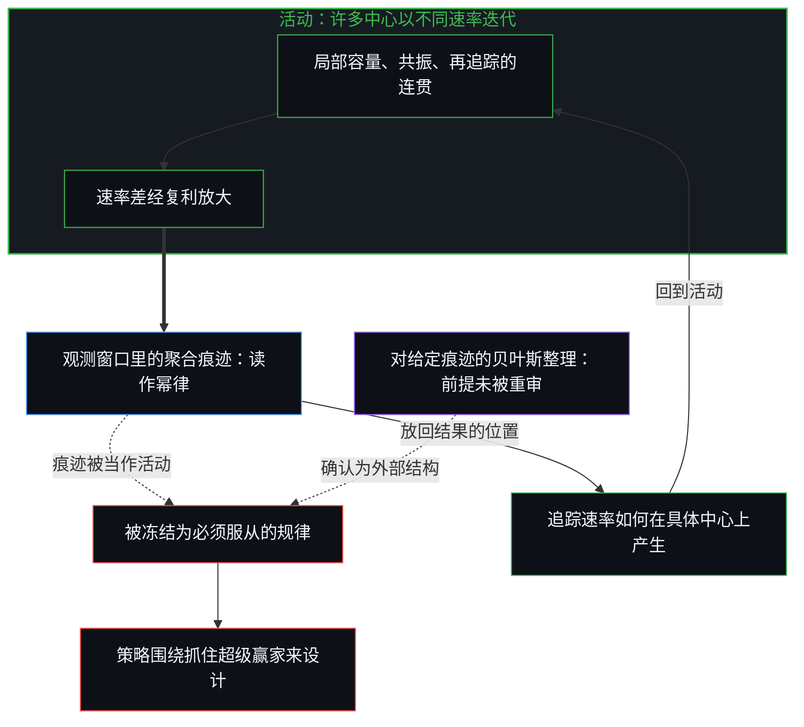
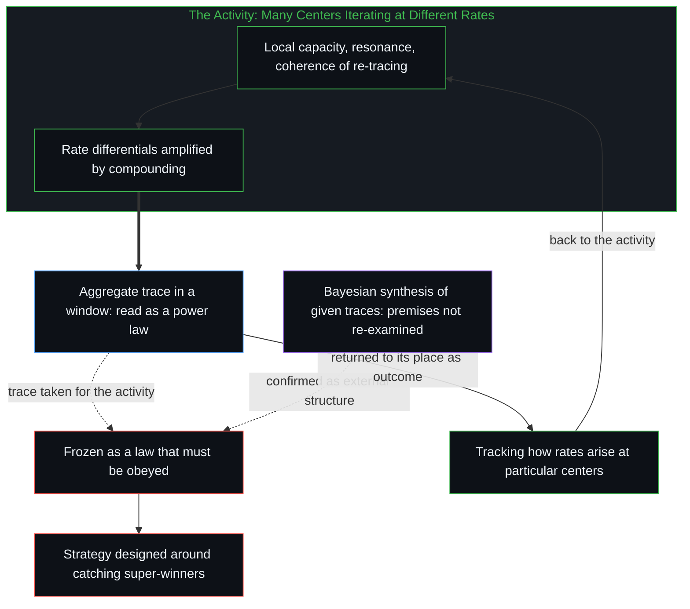

# 幂律是结果的表象 / Power Law Is the Surface of Outcomes

*幂律是已经发生的结果在一个观测窗口里的聚合形状，不是生成它的活动 / A power law is the aggregate shape of outcomes already produced in a window, not the activity generating them.*

一位清华学弟新发表的公众号文章，用价值投资九十年的一手材料指出，资本市场的回报是典型的幂律：极少数决策和公司贡献了几乎全部超额回报。这个形状作为对结果的统计描述是成立的；文章却据此把它提升为必须服从的底层结构，策略围绕抓住超级赢家来设计。

A newly published WeChat article by a younger Tsinghua alumnus uses ninety years of first-hand material on value investing to argue that returns in capital markets are a textbook power law: a very few decisions and companies account for almost all the excess return. As a statistical description of outcomes the shape holds; the article then raises it into an underlying structure that must be obeyed, and designs strategy around catching the super-winners.

把已经凝固的痕迹误认成生成它的活动，统计规律就被写成了生成的逻辑。要追踪的，是不同的迭代速率如何在时间中复利运作。

Mistaking a trace that has already set for the activity that generated it writes a statistical regularity as generative logic. What is to be tracked is how different rates of iteration compound over time.

## 一、 少数的暴政是已经发生的结果形状 / 1. The Tyranny of the Few Is the Shape of Outcomes Already Produced

[《幂律分布：少数的暴政与投资的真实形状》](https://mp.weixin.qq.com/s/4yOAQcDRglJ_s0TWTpeoFw)梳理了大量一手材料。芒格说，去掉伯克希尔最好的十五个决策，记录几乎归零；美国九十年的数据里，超过一半的超额回报只来自约九十家公司；巴菲特自己的可转换优先股组合，若去掉吉列，也只是与债券打平；ChatGPT 发布后的三年多里，英伟达、Palantir 等少数标的的涨幅远超中位数，而中位数股票几乎没有超额。文章据此强调，现代投资组合理论所依赖的钟形曲线假设系统性地失效，要紧的是寻找能实现极端复合成功的少数对象，幅度远比频率重要。

[Power Law Distribution: The Tyranny of the Few and the True Shape of Investing](https://mp.weixin.qq.com/s/4yOAQcDRglJ_s0TWTpeoFw) (in Chinese) gathers a great deal of first-hand material. Munger said that without Berkshire's best fifteen decisions the record would be close to nothing; in ninety years of American data, more than half the excess return came from about ninety companies; Buffett's own portfolio of convertible preferred stock, without Gillette, only matched bonds; in the three-plus years since ChatGPT's release, a few names such as Nvidia and Palantir rose far beyond the median, while the median stock earned almost no excess. On this basis the article stresses that the bell-curve assumption on which modern portfolio theory rests fails systematically, and that what matters is finding the few that achieve extreme compounded success, with magnitude far outweighing frequency.

这种观察本身并不新鲜。幂律分布早已被广泛引用为事物发展的“客观规律”，从财富、创新到城市规模、语言词频，再到投资回报，它几乎成了描述复杂系统的金科玉律。在投资领域，它常被提升为必须服从的底层结构：既然结果由少数极端事件支配，策略就应围绕“抓住超级赢家、接受高失误率”来设计。柏基、塔勒布、莫布森等人的论述，都被用来支撑这一判断。

The observation is not new in itself. The power law has long been cited as an "objective law" of how things develop, from wealth and innovation to city sizes and word frequencies, and on to investment returns; it has become nearly a golden rule for describing complex systems. In investing it is often raised into an underlying structure that must be obeyed: since outcomes are dominated by a few extreme events, strategy should be designed around "catching the super-winners and accepting a high rate of misses." The writings of Baillie Gifford, Taleb, Mauboussin and others are all enlisted to support the judgment.

## 二、 把统计规律当作生成的逻辑 / 2. A Statistical Regularity Taken for Generative Logic

幂律描述的是已经发生的结果在统计上的形状，不是事物如何发展的底层活动。把统计规律当作生成的逻辑，是把已经凝固的痕迹误认成生成它的活动本身。

A power law describes the statistical shape of outcomes that have already happened, not the underlying activity by which things develop. Taking a statistical regularity for generative logic mistakes a trace that has already set for the activity that generated it.

活动从未停止。每一个中心，一家公司、一笔投资决策、一条技术路径，都在进行离散的迭代，而迭代的速率并不相同。速率的差异来自局部的容量、与周围痕迹的共振，以及自身再追踪的连贯程度。起点的差别只是初始痕迹的配置；一旦活动继续，速率上的微小差异就会通过复利式的再追踪被持续放大。在足够长的时间窗口里，速率差会盖过任何初始条件的差别。这不是一条额外的法则，而是连续性通过离散性运作的直接后果：痕迹只能单向地塑造后续，时间的箭头就是这种不对称。[前因，后果](../qian-yin-hou-guo/)追的是同一种不对称：观察抓住的是已经成形的果，因总是领先那一步。

The activity never stops. Every center, a company, an investment decision, a technological path, iterates discretely, and the rates of iteration differ. The differences in rate come from local capacity, from resonance with surrounding traces, and from how coherently the center re-traces itself. A difference in starting point is only the initial configuration of traces; once the activity continues, small differences in rate are amplified without pause through compounding re-tracing. Over a long enough window, the rate differential outweighs any difference in initial conditions. This is not an extra law but the direct consequence of continuity operating through discreteness: traces can shape what follows in one direction only, and the arrow of time is that asymmetry. [Cause Before, Effect After](../qian-yin-hou-guo/) traces the same asymmetry: observation grasps the effect already formed, while the cause stays one step ahead.

## 三、 聚合形状不是一个独立的真实形状 / 3. The Aggregate Shape Is Not an Independent True Shape

因此，幂律不是作为一个独立之物的“世界的真实形状”，而是许多中心以不同速率迭代之后，在某个观测窗口里留下的聚合痕迹。极端值之所以支配总量，是因为速率高的中心持续把自己的痕迹叠加上去，而速率低的中心的痕迹相对被稀释。把这个聚合形状当成必须服从的“客观规律”或投资的金科玉律，等于把对结果的统计描述提升为生成的原因，把已经滞后的图像固定成了参照点。

A power law is therefore not "the true shape of the world" as an independent thing, but the aggregate trace that many centers iterating at different rates leave within a given observation window. Extremes dominate the total because high-rate centers keep stacking their traces on top, while the traces of low-rate centers are relatively diluted. Treating this aggregate shape as an "objective law" that must be obeyed, or as a golden rule of investing, raises a statistical description of outcomes into a generating cause and fixes an image that is already lagging as the point of reference.

[成功学](../cheng-gong-xue/)追的是同一种滞后被做成可迁移的原则：事后把已成的结果整理成引擎。[封闭的假设把复利挤成 S 曲线](../closed-assumptions-squeeze-compounding-into-s-curves/)追的是另一条被写成进步本性的统计曲线：S 形是封闭的持守把观测绑住之后的形状，不是开放活动自己的轨迹。[平均值是痕迹，不是引擎](../the-average-is-residue-not-the-engine/)拒绝把平均值写成引擎；这里拒绝的，是把尾部的形状写成生成的逻辑。

[Theories After Success, Mistaken for Theories Leading to Success](../cheng-gong-xue/) traces the same lag made into transferable principles: finished outcomes arranged after the fact into an engine. [Closed Assumptions Squeeze Compounding into S-Curves](../closed-assumptions-squeeze-compounding-into-s-curves/) traces another statistical curve written as the nature of progress: the S is the shape a closed hold gives the observation once it binds it, not the trajectory of the open activity itself. [The Average Is Residue, Not the Engine](../the-average-is-residue-not-the-engine/) refuses to write the average as the engine; what is refused here is writing the shape of the tail as generative logic.

## 四、 贝叶斯更新从来不是中立的发现 / 4. Bayesian Updating Is Never Neutral Discovery

AI 分析的运作方式，把这种滞后暴露得更清楚。那篇文章所出自的整理，做的是在给定痕迹上的贝叶斯更新。输出高度依赖被喂入的预设条件：选了哪四十五位投资人、哪一千多份文档、用什么提示词、截取哪一个时间窗口。条件不同，得到的“洞见”可以大相径庭。当这些条件本身不被放回生成它们的边缘去重新审视，输出就会被当作已经发现的外部结构，反过来加强原有的认知配置。结果不是看见了活动如何发生，而是把某一种特定的痕迹聚合，少数的暴政、寻找超级赢家、幅度重于频率，再一次确认为必须服从的形状。

The way AI analysis operates exposes this lag more plainly. The synthesis the article came from performs Bayesian updating on given traces. Its output depends heavily on the preset conditions fed in: which forty-five investors were chosen, which thousand-odd documents, which prompts, which window of time. Change the conditions and the resulting "insights" can differ widely. When the conditions themselves are not returned to the edge that generated them and re-examined, the output is taken as external structure already discovered and in turn reinforces the existing configuration of understanding. What comes out is not a view of how the activity happens, but one particular aggregation of traces, the tyranny of the few, the hunt for super-winners, magnitude over frequency, confirmed once more as a shape that must be obeyed.

## 五、 活动从未完成，起点可以被超越 / 5. The Activity Is Never Finished, and the Starting Point Can Be Surpassed

要追踪的不是分布曲线本身，而是速率如何在具体的中心上持续产生。起点可以被超越，是因为活动从未完成；预设条件可以改变结果，是因为贝叶斯更新从来不是中立的发现，而是操作者自己的区分在延伸。一旦把幂律从“客观规律”或“金科玉律”的位置上撤下来，它就只是它本来的样子：结果表象的统计规律。生成它的，始终是不同迭代速率在时间中的复利运作。

What is to be tracked is not the distribution curve itself but how rates keep arising at particular centers. The starting point can be surpassed because the activity is never finished; the preset conditions can change the result because Bayesian updating is never neutral discovery but the operator's own distinctions extended. Once the power law is taken down from the place of "objective law" or "golden rule," it is just what it is: a statistical regularity of the surface of outcomes. What generates it is always the compounding of different rates of iteration over time.

[幂律是正态分布的长期后果](../power-law-is-the-long-term-consequence-of-normal-distribution/)追的是同一种复利的短窗口一面：对数上近似正态的增量经过足够多次相乘，在长窗口里留下读作幂律的痕迹。

[Power Law Is the Long-Term Consequence of Normal Distribution](../power-law-is-the-long-term-consequence-of-normal-distribution/) traces the short-window face of the same compounding: increments approximately normal in the logarithm, multiplied enough times, leave a trace in the long window that reads as a power law.
