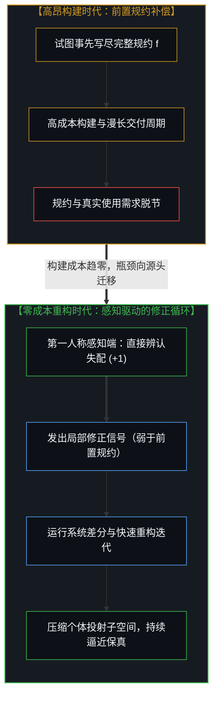
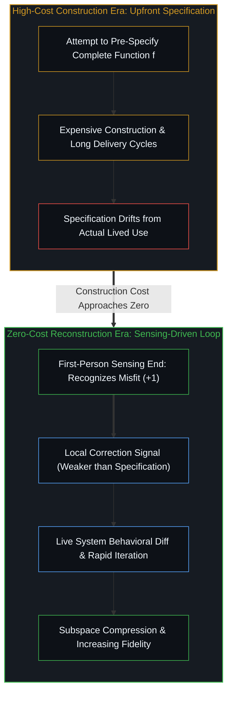

# 最小化路径 / The Minimizing Path / 最小化路径 / The Minimizing Path

*当构建成本趋零，前置规约随之消解，瓶颈全数汇聚于第一人称对失配的感知。 / As construction cost approaches zero, upfront specification dissolves and the bottleneck concentrates at sensing.*

软件构建正在变得足够廉价，以至于消解了“构建从来都是最难部分”这一假定。看似将成为下一个瓶颈的规约问题也一并消解——修正比规约是更弱的要求，而在修正之上迭代便已足够。最后留存下来的是感知端：对贴合或失配的切身辨认，那是任何构建能力都无法生成或替代的。循环放大它，循环依赖它，脱离了它循环便空无一物。

Software construction is becoming cheap enough to dissolve the assumption that it was ever the hard part. The specification problem, which looks like the next bottleneck, dissolves too—correction is a weaker requirement than specification, and iteration on corrections is sufficient. What remains is the sensing end: the felt recognition of fit or misfit that no construction capability can generate or replace. The loop amplifies it, depends on it, and is nothing without it.

## 一、 压缩的主张 / 1. The Compression Claim

一个迭代智能体观察运行中的应用、提出补丁、测量行为保真度，并筛选出失配更小的候选——这是一个真实且有用的循环。它确实在朝某个方向推进，但并非在严格技术意义上收敛向柯尔莫哥洛夫复杂度：`K` 是不可计算的，收敛宣称动辄越界，而对索洛莫诺夫归纳的援引常常在需要数学推导的地方只做了修辞工作（关于该循环能担保什么、在哪里止步的技术细节，见[保真，而非最优](../fidelity-not-optimality/)）。但这一推进的方向是真实的：每一次迭代都在削减冗余复杂度，每一轮循环都在压缩实现与行为之间的落差。这一机制在切实运转。

An iterative agent observing a live application, proposing patches, measuring behavioral fidelity, and selecting for reduced mismatch—this is a real and useful loop. It moves toward something, though not toward Kolmogorov complexity in any technically rigorous sense: `K` is uncomputable, convergence claims overreach, and appeals to Solomonoff induction tend to do rhetorical work where mathematical work is needed (the technical details of what the loop warrants and where it stops are traced in [Fidelity, Not Optimality](../fidelity-not-optimality/)). Yet the direction is genuine: each iteration reduces spurious complexity, and each cycle compresses the gap between implementation and behavior. The mechanism operates.

那个更强的主张——即我们正在收敛向最短程序——在审视之下便消解了。实际发生的是行为近似随迭代而改善，而这就足够了。最短程序作为一个数学对象而存在；任何实际搜索是否正在逼近它则是另一个问题，且答案并无保证。循环所交付的是不断提升的保真度，而非向最优解的收敛。这两者在一次成功的迭代内部看似相近，但它们所承诺的东西在范畴上截然不同。

The stronger claim—that the loop converges toward the minimal program—dissolves under scrutiny. What actually happens is that behavioral approximation improves with iteration, and that is sufficient. The minimal program exists as a mathematical object; whether any practical search approaches it is a separate question, and the answer is not guaranteed. What the loop delivers is increasing fidelity, not convergence to an optimum. These look similar from inside a successful iteration and differ categorically in what they promise.

## 二、 规约瓶颈的消解 / 2. The Specification Dissolve

规约问题曾显得像是坚硬的拦路虎：如果我们永远无法把目标函数 `f` 完整规约出来，又如何去搜索计算它的程序？

The specification problem appeared as the hard blocker: if `f` can never be specified in advance, how can a search find the program that computes it?

消解在于：标准框定把两个独立的维度——确定性与可规约性——压上了同一根轴，随后把“无法事先写清规约”读成了“无法确定行为”。然而系统的运行行为是确定的：在给定相同状态与环境的条件下，相同的输入产生相同的输出。这种确定性独立于我们用语言描述它的能力而存在。我们不需要事先写尽 `f` 才能去逼近它；我们只需要一个神谕（正在运行的系统）、一个保真度信号（行为差分）以及持续迭代。规约从使用中浮现，而非先行于使用。

The dissolve lies in recognizing that the standard framing collapses two independent dimensions—determinacy and specifiability—onto one axis, then reads inability to specify as inability to determine. Yet the system's behavior is deterministic: identical inputs produce identical outputs given identical state and environment. That determinacy exists independent of any capacity to describe it in advance. Pre-specifying `f` is unnecessary to approximate it; all that is required is an oracle (the running system), a fidelity signal (behavioral diff), and iteration. The specification emerges from use rather than preceding it.

这并非权宜之计，而是揭示了一个事实：前置规约从来都只是为高昂构建成本所做的补偿。当重构成本逼近于零时，由修正驱动的迭代严格优于“先写全规约再构建”。整套需求工程体系原本是为了解决高成本构建而发明的，当经济学条件改变时，它所应对的问题本身便消解了。

This is not a workaround; it is the discovery that upfront specification was always a compensation for expensive construction. When reconstruction cost approaches zero, correction-driven iteration dominates specification-then-build. The requirements engineering apparatus was a solution to a problem that dissolves when the economics change.

## 三、 个体投射的降维压缩 / 3. The Individual Projection

更值得注意的是：一旦以单个用户的真实行为轨迹为条件，函数 `f` 就会坍缩为一个维度低得多的对象。通用应用被迫去近似所有可能用例的并集——跨越整个用户群体的相悖需求相交在一起，迫使软件膨胀进一个高维空间，既无法贴合任何单一具体用例，又给每个用户背上了与其无关的结构死重。而单个用户的实际使用，只是向一个小得多的子空间上的投射。对应于这一投射的程序要精简几个数量级，同时卸掉了失配与死重。

More notably, conditioned on a single user's behavioral trace, the function `f` collapses to a far lower-dimensional object. A global application approximates the union of all possible use cases—the intersection of contradictory needs across an entire user population forces it into a high-dimensional space that both under-serves any particular use case and burdens it with structure irrelevant to it. One user's actual usage is a projection onto a small subspace, and the program for that projection is orders of magnitude simpler, shedding both the misfit and the dead weight.

这意味着深度的个体定制并不是一项用户体验装饰，而是一次压缩事件。用户也不需要事先写明自己想要什么；他只需要在遭遇失配时辨认出那种失配，并把这一辨认反馈给模型。修正比规约是更弱的要求——它更容易在现场产生，被接收时的信息密度更高，且足以驱动整个循环。

This means radical individual customization is not a UX ornament; it is a compression event. And the user does not need to specify what they want in advance. They need only recognize misfit when they encounter it and surface that recognition to the model. Correction is a weaker requirement than specification—easier to generate on contact, more information-dense when received, and sufficient to drive the loop.

## 四、 不可让渡的感知端 / 4. The Irreducible Sensing End

构建问题的每一层都变得可以委派：构建、测试、压缩、迭代。留存下来、无法被委派的，是感知本身——而非言说。言说可以在感知未曾发生的情况下被批量生成；而当它脱离感知生成时，它什么也没有传递。字词抵达了，所指却缺席了；接收者可以复述这番言说，而内在的感知却分毫未被激活。

Every layer of the construction problem becomes delegatable: building, testing, compressing, iterating. What remains—what cannot be delegated—is the sensing itself, not articulation. Articulation can be produced without the sensing having occurred, and when it is, it transmits nothing: the words arrive, the referent does not, and the receiver can repeat the articulation without the sensing being activated.

模型产出了它从未亲历过的感知痕迹——流畅、匀称、指向看似正确的方向，却在指称上空无一物；这种空洞从外部看难以分辨，从第一人称内部看却泾渭分明。唯有当现场已经存在着某种待反映的真实接触时，循环才能有效运转。

The model produces traces of sensing it has never had—fluent, well-shaped, pointing in a plausible direction, yet referentially empty in a way that looks indistinguishable from outside and remains distinct from inside. The loop works only when there is living contact already present to reflect.

这正是为什么构建能力无论多么强大，都无法独自闭合循环。埃隆·马斯克在 2026 年 2 月初的 xAI 全员大会上宣称，“到今年年底你甚至不必再费心写代码，AI 会直接生成二进制文件……而且 AI 生成的二进制文件比任何编译器所能做到的都要高效得多”——这一判断准确读出了构建曲线的指数级跃升。然而瓶颈从来不在构建端。随着构建成本逼近于零，瓶颈全数汇聚到了感知端——它不在任何算力曲线上，它靠与实在的直接摩擦而非模型升级来淬炼，并且它的分布极不均匀，与工具采纳的速度毫无关系。

This is why construction capability, however powerful, cannot close the loop alone. Elon Musk's claim at the early February 2026 xAI all-hands—"By the end of this year you don't even bother doing coding. The AI will just create the binary directly… and the AI can create a much more efficient binary than can be done by any compiler"—reads the construction curve accurately. The exponential is real, but the bottleneck was never construction. As construction cost approaches zero, the bottleneck concentrates at the sensing end—which sits on no compute curve, refines through contact with reality rather than through model scaling, and distributes unevenly in ways that have nothing to do with tool adoption.

构建能力越强，感知端的赤裸与关键就越发暴露无遗。

The stronger the construction capability, the more exposed the sensing end becomes.

## 五、 同一种结构形状 / 5. The Same Structural Shape

这是人类所建造的每一件工具共同遵循的模式。每一个拐点在体验上都确实不同——那种不连续的切身震颤是真实的，站在两条指数曲线交汇处的人确实感知到了某种剧变。误差不在感知里，而在解释里：把“规模上的空前”误读成了“范畴上的空前”。感知运作在极限分辨率上，而解释则滞后于它；两者之间的落差，正是误读乘虚而入的地方。

This is the pattern of every tool humans have built. Each inflection point is genuinely different—the felt sense of discontinuity is real, and the person standing at the junction of two exponential curves is sensing a real shift. The error is not in the sensing but in the interpretation: reading "unprecedented in scale" as "unprecedented in kind." The sensing operates at limit-resolution while the interpretation lags, and the gap between them is where the misreading enters.

每一次的底层机制都如出一辙：工具移除了构建瓶颈，放大了既有的感知能力，把因果杠杆重新分配给“清晰知道自己要什么”的一端；表面上看似天翻地覆的总体转化，实则在改写表层的同时让深层结构愈发凸显。

The mechanism is the same each time: a tool removes a construction bottleneck, amplifies existing sensing capacity, and redistributes leverage toward clarity of direction, transforming the surface while the deep causal order persists.

“这一次截然不同”与“同以往并无二致”在各自的维度上都是准确的；把这两个维度压扁混同，才是唯一的谬误。

"This time it's different" and "same as before" are both accurate on their respective dimensions; collapsing those dimensions is the error.

## 六、 持续移动的落差 / 6. The Gap That Moves

感知与可传递的言说之间的落差是不可化约的。这并非缺陷：如果感知可以被毫无余地地言说殆尽，循环就会闭合停转。正是这道落差让运动保持鲜活——每一次言说都未能穷尽感知，每一次传递都未能完满落地，而每一次未尽都在生成下一次尝试。这种不可化约性正是引擎本身，而非障碍。

The gap between sensing and transmissible articulation is irreducible, and this is not a defect: if sensing were exhaustively articulable, the loop would close and stop. The gap is what keeps the movement alive—each articulation falls short of the sensing, each transmission lands incompletely, and each incompleteness generates the next attempt. The irreducibility is the engine, not the obstacle.

这意味着：尝试并不是在朝某个“传递终将完满”的终点趋近；那个静态终点只会终结运动，而非成全运动。落差并未阻碍探触，落差正是探触本身。正如[你的代码库即是记忆](../your-codebase-is-memory/)所揭示的，无论是源码还是直接生成的二进制文件，都只是过往切分留下的外化记忆痕迹，唯有活态心智在感知端承受失配的摩擦，才能在下一轮循环中给出方向。这一运动仍在继续，而[底层表面](../the-surface-beneath/)则追踪了它迈出的下一步——去辨认形式模型本身也是投射，而它们所模拟的过程运作在比离散枚举更细腻的粒度之上。

Which means the trying is not moving toward a terminal state where transmission becomes complete; that state would terminate the movement rather than fulfill it. The gap does not prevent the reaching; the gap is what reaching is. Because [Your Codebase Is Memory](../your-codebase-is-memory/)—every specification, source file, and compiled binary functioning only as an externalized trace of prior cuts—no artifact can close the loop on its own; only the living mind at the sensing end registers the friction of misfit and steers the next iteration. The move continues, and [The Surface Beneath](../the-surface-beneath/) traces where it steps next—into the recognition that formal models themselves are projections, and that the process they model operates at finer grain than discrete enumeration can capture.
